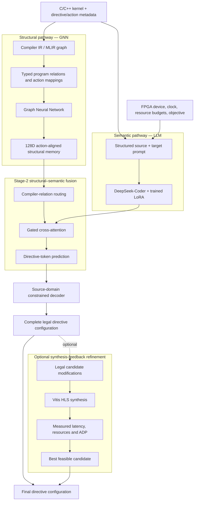

# MailoHLS / SALT-HLS

### Structure-Aware Language Models for FPGA High-Level Synthesis Optimization

MailoHLS is a machine-learning framework for automatically selecting hardware optimization directives for C/C++ programs targeting FPGAs.

Its extended research architecture is called **SALT-HLS**.

The framework combines two complementary forms of program understanding:

- **Structural understanding:** A graph neural network (GNN) learns from compiler-generated representations of the program.
- **Semantic understanding:** A large language model (LLM) uses source code and hardware constraints to select optimization directives.

The two pathways interact through a **gated cross-attention mechanism**, allowing the language model to access compiler-derived structural information while generating hardware optimization decisions.

An additional, optional **refinement mechanism** uses actual HLS synthesis feedback to search for improvements to the initial configuration.

The goal is to reduce the manual effort required for FPGA design-space exploration while considering performance, hardware resources and deployment constraints.

> **Research status (November 2026):** The production path remains the selected V1 graph encoder and the objective-specific artifacts listed below. In the GNN branch, the V4 matched preference study has not established a held-out hardware-aware selection advantage; a separate V4b coverage audit found insufficient held-out preference reversals and its training smoke stopped during CPU feature preparation. In Stage-1, the legacy full-data run completed 400 updates, but its complete validation and measured-QoR assessment remain pending. The refinement branch has two distinct bodies of evidence: the complete historical R11 study and a newer, authenticated but incomplete FGR-v1 pilot. None of these research branches has promoted a replacement into production. See the [GNN README](https://github.com/ElenaVouvali/MailoHLS/blob/research/gnn-refinement/README.md), [Stage-1 README](https://github.com/ElenaVouvali/MailoHLS/blob/research/stage1-refinement/README.md), and [refinement README](https://github.com/ElenaVouvali/MailoHLS/blob/research/refinement-mechanism/README.md) for branch-specific methods, evidence and limits.

## Research branch guide

The active research branches isolate different questions. Their experiments are not production results unless explicitly selected in `FINAL_ARTIFACTS.json`.

| Branch | Research question | Evidence at this revision | Primary branch guide |
|---|---|---|---|
| [`research/gnn-refinement`](https://github.com/ElenaVouvali/MailoHLS/tree/research/gnn-refinement) | Do richer compiler and target-aware graph memories improve candidate or directive decisions? | V4 hardware messages did not consistently improve held-out feasible selection; V4b coverage/training is incomplete. | [README](https://github.com/ElenaVouvali/MailoHLS/blob/research/gnn-refinement/README.md) |
| [`research/stage1-refinement`](https://github.com/ElenaVouvali/MailoHLS/tree/research/stage1-refinement) | Can directive supervision better express conditional choices under ambiguous measured labels? | Legacy full-data CE reached 400 updates; all-383-context validation and the measured-candidate comparison are pending. No experimental adapter is promoted. | [README](https://github.com/ElenaVouvali/MailoHLS/blob/research/stage1-refinement/README.md) |
| [`research/refinement-mechanism`](https://github.com/ElenaVouvali/MailoHLS/tree/research/refinement-mechanism) | Can measured feedback and compiler relations prioritize HLS edits within a fixed query budget? | R11 is complete; the newer FGR-v1 GAN/Jacobi pilot has matched prefixes through budget 4 and seven of eight queries per arm, with budget 8 incomplete. | [README](https://github.com/ElenaVouvali/MailoHLS/blob/research/refinement-mechanism/README.md) |

These summaries describe the branch evidence, not independent replications. GAN appears in earlier refinement development, and the GNN and Stage-1 analyses reuse authenticated repository datasets. The branch guides identify exact evaluation sets, context identity, artifact provenance, unresolved blockers and commands for reproducing each study.

---

## 1. The Problem: Why HLS Optimization Is Difficult

High-Level Synthesis (HLS) translates programs written in languages such as C/C++ into hardware implementations.

Although HLS reduces the need to write RTL manually, the quality of the generated hardware strongly depends on optimization directives.

Common directives include:

| Directive | Purpose | Hardware implications |
|---|---|---|
| `PIPELINE` | Overlap operations from successive loop iterations | Can improve throughput but increase implementation complexity and resource use |
| `UNROLL` | Replicate loop operations to expose parallelism | Can reduce latency while increasing arithmetic and memory-access demand |
| `ARRAY_PARTITION` | Divide arrays into independently accessible storage structures | Can improve memory parallelism but increase storage/control resources |

These decisions are interconnected.

For example, unrolling a loop may create several simultaneous memory accesses. If the associated array cannot support them, the expected speedup may not be achieved.

Increasing parallelism may also exceed available DSP, BRAM, LUT or FF resources.

Therefore, selecting directive values is not simply a source-code transformation problem.

It is a constrained hardware optimization problem.

### Our optimization objective

Given a program \(P\), a directive configuration \(d\), and deployment context \(h\), we want to identify a feasible configuration that minimizes the requested objective:

\[
d^*=\arg\min_{d\in\mathcal{D}(P)}
J(d;P,h)
\]

subject to:

\[
R_k(d;P,h)\le B_k,
\]

where:

- \(\mathcal{D}(P)\) is the set of legal source-specific directive configurations.
- \(J\) is the requested optimization objective.
- \(R_k\) represents hardware-resource usage.
- \(B_k\) is the available resource budget.
- \(h\) includes device and clock information.

The framework supports latency, area and area-delay-product-oriented objectives.

The selected model availability depends on the objective; see [`FINAL_ARTIFACTS.json`](FINAL_ARTIFACTS.json).

---

# 2. Overall Framework Architecture

SALT-HLS separates program understanding from directive generation.



The principal design idea is to give the language model access to information that is difficult to infer reliably from source text alone.

The structural pathway supplies compiler-derived information.

The semantic pathway learns which directives to choose.

Cross-attention connects the two.

The refinement mechanism can subsequently incorporate measured synthesis feedback.

**Production status:** The currently selected Stage-2/Stage-3 models use V1 GNN structural memory. The newer V2.2/V4 hardware-aware GNN remains experimental and is not automatically substituted into production inference.

---

# 3. Structural Pathway: Understanding the Program

## 3.1 Why represent a program as a graph?

Source code is sequential text, but hardware behavior depends on relationships that are not always obvious from textual order.

Examples include:

- Data dependencies.
- Control-flow relationships.
- Loop nesting.
- Memory accesses.
- Producer–consumer relationships.
- Array accesses.
- Connections between optimization directives and compiler operations.

Compiler intermediate representations expose many of these relationships explicitly.

Instead of treating a kernel as an ordinary string, the structural pathway constructs a graph:

\[
G=(V,E)
\]

where:

- \(V\) contains program entities.
- \(E\) contains relationships between those entities.

A graph neural network learns representations by propagating information along these relationships.

This helps the framework reason about how local optimizations may interact with the surrounding computation.

## 3.2 The current production GNN

The selected production model uses an MLIR-derived structural representation and a graph-neural encoder.

Its architecture includes:

| Component | Selected implementation |
|---|---|
| Compiler representation | MLIR-based graph |
| Graph operator | `TransformerConv` |
| Message-passing depth | Four principal graph-convolution layers |
| Hidden representation | 64 dimensions |
| Multiscale aggregation | Jumping Knowledge, max aggregation |
| Exported structural memory | 128-dimensional action representations |
| Memory addressing | Absolute directive/action IDs |
| Selected checkpoint | Validation-selected epoch 9 |

The graph encoder processes program-node features and graph relationships.

Transformer-style graph attention allows neighboring nodes to contribute with different learned importance.

Jumping Knowledge combines representations from different message-passing depths.

This is useful because shallow layers emphasize nearby relationships, while deeper layers can incorporate information from a wider program neighborhood.

### Action-aligned structural memory

The encoder exports information associated with optimization sites.

Each directive site has an absolute source identity:

\[
L_k\longrightarrow \text{memory slot }k-1.
\]

For example:

```text
L1 → slot 0
L2 → slot 1
L5 → slot 4
```

If `L3` and `L4` are absent, their positions are not reused for other actions.

This prevents a structural embedding from being associated with the wrong directive.

The selected production memory contains 128-dimensional vectors aligned with these action identities.

The language model can subsequently retrieve the structural representation corresponding to the directive it is generating.

The selected GNN checkpoint and exported memory are identified in:

[`FINAL_ARTIFACTS.json`](FINAL_ARTIFACTS.json)

Implementation:

- `GNN_branch/model.py`
- `GNN_branch/train_GNN.py`
- `GNN_branch/mlir_data.py`
- `LLM_branch/common/structural_memory.py`

---

# 4. Experimental Structural Extension: MLIR V2.2 and Hardware-Aware Graphs

The ongoing structural research investigates a richer representation.

This work is developed in:

`research/gnn-refinement`

It is **experimental**, not the selected production GNN.

## 4.1 Compiler-semantic graph

The newer representation builds on authenticated MLIR V2.2 graphs.

It records compiler-derived information including:

- Operations and values.
- Data-flow and control-flow relationships.
- Loop structure.
- Memory accesses.
- Affine access information.
- Dependence evidence.
- Source-to-compiler action mappings.
- Explicit uncertainty where compiler evidence is unavailable.

The purpose is not to create a larger graph for its own sake.

The purpose is to preserve the structural and semantic relationships relevant to hardware optimization.

## 4.2 Hardware-resource enrichment

The experimental graph is enriched with an FPGA-target overlay.

It incorporates hardware-resource categories such as:

```text
BRAM
DSP
LUT
FF
```

along with:

- FPGA device characteristics.
- Available resource capacities.
- Requested resource budgets.
- Requested clock period.
- Typed program-to-hardware compatibility relationships.

For example, an arithmetic operation may be related to hardware arithmetic resources, while a memory-access operation may be associated with storage-relevant resources.

These relationships express **potential hardware relevance**.

They do not claim that HLS will necessarily map a specific operation to a particular physical primitive.

That distinction matters because actual resource allocation depends on synthesis decisions.

## 4.3 Current experimental GNN architecture

The V4 experiment uses:

| Component | V4 experimental architecture |
|---|---|
| Graph schema | MLIR V2.2 RC3 |
| Tensor schema | V4 semantic-wide-affine |
| Encoder | Two edge-aware `TransformerConv` layers |
| Hidden width | 64 |
| Structural output | 128D action memory |
| Context | Device, clock and resource budgets |
| Candidate input | Complete directive assignment |
| Additional candidate input | Analytical action-demand descriptors |
| Prediction targets | Latency, BRAM, DSP, FF and LUT |

The model separates two kinds of information.

**Candidate-independent structural information** describes the program and its compiler/hardware relationships.

**Candidate-dependent information** describes a particular proposed directive configuration.

The graph encoder produces reusable structural embeddings. A separate candidate-conditioned head combines these embeddings with directive values and analytical demand features to estimate hardware QoR.

This separation avoids recomputing the entire structural representation conceptually for every candidate and prevents measured QoR from entering structural memory as an input feature.

## 4.4 What is being tested?

The current research compares two models:

**Numerical conditioning**

Receives the compiler graph, candidate features and numerical device/clock/budget context, but no hardware-resource message edges.

**Hardware-message conditioning**

Receives the same information plus explicit FPGA-resource graph messages.

QoR prediction and candidate selection are **auxiliary tests** of the learned representations. The framework's final purpose is better **LLM-generated directive configurations**, not deploying a standalone GNN QoR predictor.

The completed V4 study includes matched 100-, 300- and 600-update runs and a separate physical-QoR/budget-separation ablation. The models learned to fit a fixed training context, but held-out Viterbi and PathFinder results were mixed. Hardware-resource messages did not show a consistent advantage over numerical target conditioning, and feasibility predictions matched an always-feasible baseline rather than rejecting over-budget candidates.

The budget-separated variant makes physical-QoR predictions invariant to changes in the requested resource budget, as expected, but did not reliably improve candidate selection. Only three held-out device comparisons had meaningful measured latency differences, so device generalization remains unresolved. V4 is **not validated for Stage-2**: a candidate-conditioned QoR predictor does not prove that V4's candidate-independent structural memory improves LLM directive generation.

See the [V4 methods and corrected results](https://github.com/ElenaVouvali/MailoHLS/blob/research/gnn-refinement/README.md#merged-experiments-v22-gnn-training-results-md) and the [V4 audit and limitations](https://github.com/ElenaVouvali/MailoHLS/blob/research/gnn-refinement/README.md#merged-experiments-v22-gnn-training-audit-md) on the research branch. Checkpoints and full run receipts are not stored in Git.

## 4.5 Proposed target-aware structural memory (research direction)

A proposed extension preserves the compiler-semantic graph and **candidate-independent, absolute action-aligned memory**, while learning how a deployment target changes the relevance of each action's structural context:

\[
M_P=E_{\mathrm{MLIR}}(G_P),\qquad
M_{P,D,T}=M_P+\Delta M(M_P,\operatorname{Capabilities}(D),T).
\]

A compact, documented FPGA-capability encoder with gated action-specific conditioning (for example, FiLM-style modulation) should be evaluated **against**, rather than assumed superior to, the current V4 hardware-resource message graph. A larger physical device graph is not a prerequisite.

The proposed memory describes program structure and target relevance **before final directive values are known**. Complete candidate assignments, analytical demand and measured preferences may supervise it through separate training heads, but candidate-specific inputs must not leak into exported inference memory. Device and synthesis clock describe physical context; external resource budgets and objectives determine decision preferences. The main acceptance criterion is better **feasible directive selection and, ultimately, Stage-2 generation** relative to V1/compiler-only memory. QoR regression remains supporting supervision. No target-aware V4 memory is deployed in `main`.

Implementation:

- `GNN_branch/target_graph_v22.py`
- `GNN_branch/target_graph_tensor_v22.py`
- `GNN_branch/semantic_tensor_features_v22.py`
- `GNN_branch/action_demand_v22.py`
- `experiments/v22_gnn_training/`

Further information:

[`V2.2 structural graph documentation`](docs/structural-graph-v22.md)

---

# 5. Semantic Pathway: Learning Hardware Optimization Decisions

The semantic pathway uses a pretrained code language model.

The current framework is based on:

**DeepSeek-Coder 6.7B**

Rather than training the entire language model from scratch, MailoHLS uses parameter-efficient fine-tuning with LoRA/QLoRA.

This adapts the model to HLS directive selection while reducing the number of parameters that must be trained.

## 5.1 What does the language model receive?

The model receives a structured prompt describing:

1. The annotated C/C++ kernel.
2. Its optimization sites.
3. The requested optimization objective.
4. The FPGA target.
5. The requested clock period.
6. Available BRAM/DSP/FF/LUT resources.

For example, conceptually:

```text
Program:
    C/C++ kernel with source action markers L1, L2, ...

Target:
    FPGA device = ZCU104

Clock:
    10 ns

Available resources:
    BRAM = ...
    DSP  = ...
    FF   = ...
    LUT  = ...

Objective:
    Minimize area-delay product

Task:
    Select legal directive values for the marked actions.
```

The actual prompt and response format are versioned contracts.

See:

`LLM_branch/common/mailohls_contract.py`

## 5.2 What does the model predict?

The model predicts values for directive fields associated with the program's optimization sites.

Examples include:

```text
PIPELINE_L1 = 1

UNROLL_L2 = 4

ARRAY_PARTITION_TYPE_L3 = cyclic

ARRAY_PARTITION_FACTOR_L3 = 4

ARRAY_PARTITION_DIMENSION_L3 = 1
```

These names illustrate the decisions. The actual model output uses the framework's versioned `auto{...}` directive serialization.

The model does not need to invent source locations or directive names.

Those are determined from the program and its action metadata.

It predicts the legal values associated with the existing optimization sites.

## 5.3 Stage-1: Supervised directive learning

Stage-1 trains the language model using measured HLS design examples.

The model learns the relationship between:

\[
(\text{program},\text{objective},\text{device},\text{clock},\text{budget})
\]

and:

\[
\text{directive configuration}.
\]

Conceptually:

\[
p_\theta(d\mid P,h,J).
\]

The objective-specific training process produces LoRA adapters.

Stage-1 can operate without structural cross-attention.

### Why Stage-1 is useful

The language model has prior knowledge of programming constructs and can learn relationships between optimization conditions and directive choices.

However, ordinary supervised learning of selected directive labels does not guarantee that the model learns the best hardware optimization policy.

In particular, multiple measured configurations can have similar QoR.

Current Stage-1 research therefore investigates decision-aware supervision, class imbalance, target sensitivity and near-optimal-label ambiguity.

This work is maintained in:

`research/stage1-refinement`

The selected production adapters remain unchanged until an improvement is validated.

---

# 6. Structural–Semantic Fusion: Stage-2 Cross-Attention

This is the central connection between the two model pathways.

The GNN encodes compiler structure.

The LLM processes the source and produces directive decisions.

**Cross-attention lets the LLM consult the structural memory associated with those decisions.**

## 6.1 Why not simply concatenate graph features to the prompt?

Graph embeddings are numerical vectors, not ordinary language tokens.

Converting them into text would lose their direct numerical representation and create an additional serialization problem.

Instead, Stage-2 introduces trainable attention modules that connect LLM hidden states to GNN memory.

This allows structural information to influence hidden representations while preserving the pretrained language model's core capabilities.

## 6.2 Cross-attention mechanism

Let:

\[
H\in\mathbb R^{T\times d}
\]

be language-model hidden states, and:

\[
M\in\mathbb R^{S\times128}
\]

be the structural memory for up to \(S\) action slots.

The attention module computes:

\[
Q=HW_Q,
\]

\[
K=MW_K,
\]

\[
V=MW_V.
\]

Then:

\[
A=
\operatorname{softmax}
\left(
\frac{QK^\top}{\sqrt{d_k}}+\mathcal M
\right),
\]

where \(\mathcal M\) restricts attention to valid structural memory locations.

The structural contribution is:

\[
Z=AV.
\]

A trainable gate controls the contribution added to the LLM residual stream:

\[
H'=H+
\tanh(g)\,W_OZ.
\]

This is a simplified description of the implemented gated attention block.

## 6.3 Current architectural choices

The selected Stage-2 configuration uses:

| Component | Choice |
|---|---|
| Memory dimension | 128 |
| Attention heads | 4 |
| Dimension per head | 64 |
| Attention placement | After the self-attention residual |
| Selected decoder layers | 8, 16, 24 and 32 |
| Gate initialization | Zero |
| Attention routing | Compiler-relational |
| Application focus | Directive-response token positions |
| Additional cross-attention FFN | Disabled |

### Why these choices?

**Multiple decoder layers:** Structural information can influence language representations at different depths.

**Zero-initialized gates:** The structural contribution begins at zero rather than immediately perturbing the pretrained model. The contribution is learned during training.

**Compiler-relational routing:** The model can use compiler-verified relationships when deciding which structural action slots are relevant.

**Directive-response focus:** Structural information is applied where the model is actually selecting directive values, instead of indiscriminately modifying the entire prompt processing.

**Absolute action alignment:** The memory associated with `Lk` must remain associated with that source action.

## 6.4 Stage-2 training

Stage-2 builds on an existing Stage-1 adapter and trains the structural fusion modules.

Its goal is to use compiler-derived information to improve directive generation.

The currently selected production Stage-2 checkpoint is for the ADP objective.

Stage-2 variants for other objectives retain explicit pending or fallback status.

Implementation:

- `LLM_branch/common/structural_xattn.py`
- `LLM_branch/common/structural_memory.py`
- `LLM_branch/train/train_SFT_xattn_new.py`
- `scripts/training/train_stage2.sh`

## 6.5 Complementary target conditioning: prompt and structural memory

**Keep the FPGA device, requested clock, BRAM/DSP/FF/LUT budgets and objective in the LLM prompt.** These inputs explicitly define the optimization request. They allow the model to reason about its constraints even if some compiler/hardware evidence is missing. Removing them would unnecessarily place responsibility for the whole request on the experimental structural encoder.

**Current production:** Stage-1 learns target-conditioned directive selection from the prompt. Stage-2 uses the same prompt, while its target-aware LLM hidden states query **V1 target-independent compiler memory**, with absolute action slots and compiler-relation routing. Thus one structural memory can be interpreted differently under different target requests.

**Proposed research extension:** Keep the same target prompt and compiler routing, but provide additional **target-aware V4 action memory** incorporating documented FPGA capabilities and synthesis clock:

\[
Q=W_Q H_{\mathrm{LLM}}(P,D,T,B,J),\quad K,V=W_{K,V}M_{P,D,T},
\]
\[
H'=H+\tanh(g)\operatorname{CrossAttn}(Q,K,V;\text{compiler routing}).
\]

The **prompt specifies what is requested**; the **memory supplies which program relationships and hardware capabilities are relevant at each action**. Cross-attention combines them at directive-token decisions. Redundant device information in both pathways is intentional but must be tested: matched and deliberately mismatched target-prompt/memory experiments should establish whether memory adds information beyond the prompt alone. Budget- or objective-conditioned action memory is an optional separate **decision-conditioning** experiment; these inputs must not change the predicted physical QoR of a fixed design.

A new V4 encoder cannot be substituted into V1-trained cross-attention layers merely because both produce 128D vectors. Integration needs versioned graph/encoder/target identity, correct action masks and relations, appropriate cross-attention training, and downstream measured directive evaluation. Stage-3 inherits the selected trained fusion contract; Stage-1, Stage-2 and Stage-3 are not independent inference passes. **This V4 integration is planned, not implemented.**

---

# 7. Stage-3: Preference-Based Optimization

Stage-3 extends the structure-aware language model using preference optimization.

The current implementation uses **Direct Preference Optimization (DPO)**.

Instead of learning only from one reference configuration, preference training uses comparisons between a preferred and a less-preferred response.

Conceptually, it encourages:

\[
p_\theta(d^+\mid x)
>
p_\theta(d^-\mid x),
\]

where \(d^+\) and \(d^-\) are preferred and rejected configurations under the defined training preference policy.

The actual DPO objective operates on sequence probabilities relative to a reference policy.

### Why use preferences?

Hardware optimization is fundamentally comparative.

Two directive configurations may both be legal but have different performance or resource characteristics.

Preference optimization provides an additional mechanism for learning which complete decisions should be favored.

The selected Stage-3 model inherits the Stage-2 structural-memory and checkpoint contracts.

It is not an unrelated third language model.

The production Stage-3 selection is currently ADP-specific.

Implementation:

`LLM_branch/train/train_DPO_harp_xattn.py`

---

# 8. Optional Refinement: Improving One-Pass Predictions with HLS Feedback

The core SALT-HLS pipeline produces a directive configuration in a single model inference procedure.

However, the first valid prediction is not necessarily the best feasible hardware configuration.

The refinement mechanism explores additional legal configurations around the original prediction.

It uses actual HLS results to decide whether to keep a modification.

## 8.1 How refinement works

The procedure begins with an initial SALT configuration:

\[
d_0.
\]

It proposes a legal candidate:

\[
d_1.
\]

The candidate is materialized into source code and evaluated using Vitis HLS.

The resulting measurement includes:

- Estimated latency cycles.
- BRAM usage.
- DSP usage.
- FF usage.
- LUT usage.
- Resource feasibility.
- The selected optimization objective.

The controller retains the best measured feasible design.

This process repeats within a fixed evaluation budget.

## 8.2 Implemented search policies

| Policy | Main idea |
|---|---|
| Random | Explore seeded legal single-action changes |
| Coordinate | Improve one directive action at a time |
| Compose | Combine separately beneficial modifications |
| Structural | Explore compiler-verified related action pairs |
| Hybrid | Combine local exploitation with structural exploration |
| Matched control | Evaluate comparable two-action changes without a verified compiler relation |

The matched control is an experimental baseline, not a sixth general-purpose search strategy.

## 8.3 Why structural refinement may matter

HLS directives interact.

For example, unrolling a loop may increase demand for parallel array accesses.

Changing the associated array partition can therefore affect whether the unrolling provides useful speedup.

The compiler graph may help identify such relationships.

Structural refinement attempts to use this information when proposing joint modifications.

However, **compiler-related actions are not guaranteed to produce better designs**.

Their value must be established through measured comparisons.

## 8.4 Current experimental evidence

An authenticated refinement study evaluated GAN, covariance and Kalman on ZCU104 using Vitis HLS 2021.1.

Each policy received eight logical evaluations, including the original SALT configuration.

The best configurations observed across the evaluated policies achieved:

| Kernel | Best observed ADP improvement | Policy |
|---|---:|---|
| GAN | 42.694% | Matched control |
| covariance | 28.754% | Compose |
| Kalman | 0.142% | Matched control |

All three selected finalists passed the executed finite-input C-simulation checks.

These are **retrospective best results across multiple policies**, not the guaranteed performance of one preselected policy using only eight total queries.

The study demonstrates that synthesis-feedback refinement can find improvements over one-pass predictions.

It does **not** establish that structural or hybrid search consistently outperforms simpler policies.

The experiments also do not establish exhaustive equivalence or post-route improvement.

The refinement mechanism remains optional and under active research.

### Newer FGR-v1 pilot (separate from R11)

The research branch also contains a prospective paper-configuration pilot of
three new policies: static ordering, measured-feedback ranking, and
feedback-plus-compiler-structure ranking. It used authenticated Vitis HLS
2021.1 measurements on GAN and jacobi-2d under the same ZCU104 / 10 ns / TCAD
context. Each of the six policy/kernel arms reached seven charged logical
queries; the preregistered eight-query prefix is incomplete. At budget four,
feedback and feedback-plus-structure reached 6.73% GAN ADP improvement versus
0.06% for static ordering; on Jacobi, static reached 31.35% while the other two
remained at baseline. At the incomplete equal-query-seven endpoint, Jacobi
static reached 37.12%, feedback 36.22%, and structural 19.45%; one static
query failed and has no QoR. The pilot does not establish a general policy
ranking, and it showed no incremental structural advantage over feedback.
These estimates are HLS synthesis results, not post-route or board measurements.
See the [pilot report](https://github.com/ElenaVouvali/MailoHLS/blob/research/refinement-mechanism/README.md#merged-experiments-refinement-feedback-paper-evaluation-pilot-results-md)
and [paper-evaluation audit](https://github.com/ElenaVouvali/MailoHLS/blob/research/refinement-mechanism/README.md#merged-experiments-refinement-feedback-paper-evaluation-readme-md).

Implementation:

- `experiments/refinement/`
- `experiments/refinement_search/`

Detailed results:

[Authenticated refinement study](https://github.com/ElenaVouvali/MailoHLS/blob/871c3d4b0c83ce0ae29fbd3fed5d2d21bad937fb/experiments/refinement_search/RESULTS.md)

## 8.5 Proposed reuse of structural and target-aware memory in refinement

A future **learned edit-priority scorer** could reuse the same validated, candidate-independent action memory used by Stage-2 for the relevant program/device/clock. Sharing the encoder can avoid a second, incompatible structural representation. However, embeddings alone cannot evaluate a *proposed edit*: the scorer also needs the current/proposed legal directive values, requested budget/objective and available measured search history.

| Component | Role |
|---|---|
| Authenticated MLIR graph, compiler witnesses and source domains | Authoritatively verify legal action values and compiler-supported action relationships |
| Shared action-aligned GNN embeddings, optionally target-conditioned | Provide learned context for **ranking candidate edits** |
| Proposed edit, complete incumbent and search history | Condition the learned priority on the particular configuration change and observations |
| Vitis HLS measurements | Determine actual QoR, feasibility and incumbent updates |

**Keep the original compiler graph:** embedding similarity cannot prove dependence, legality or a verified action pair. **Keep synthesis authoritative:** learned rankings can propose promising evaluations, but may not declare measured improvements. The existing refinement policies use compiler/source evidence and measured history and **do not currently invoke a GNN, LLM or learned scorer**. An embedding-guided policy is a **future experiment** to compare at equal logical synthesis-query budgets and on held-out examples.

---

# 9. End-to-End Inference: What Does the User Provide and Receive?

The framework's practical workflow can be summarized in five steps.

## Step 1 — Provide the program

The user supplies a compatible C/C++ kernel and the metadata identifying legal optimization sites.

The framework's source markers and action mappings define which directives can be optimized.

## Step 2 — Specify hardware constraints

The user selects:

- FPGA target.
- Clock period.
- Available hardware resources.
- Optimization objective.

For example:

```text
Program: matrix multiplication

FPGA: ZCU104
Clock: 10 ns

Objective: minimize ADP

Resources:
BRAM: specified budget
DSP: specified budget
FF: specified budget
LUT: specified budget
```

The inference workflow also supports an optional automatic-clock selection path when its required selector artifacts are supplied.

## Step 3 — Load the selected model

The inference code loads the compatible objective-specific adapter and checkpoint contracts.

For Stage-2 or Stage-3 inference, it also loads the corresponding structural memory and gated cross-attention modules.

The selected model stage depends on the available trained artifacts.

**Stage-1, Stage-2 and Stage-3 are training stages, not three independent LLMs that must all generate a response sequentially.**

## Step 4 — Generate legal directives

The model evaluates candidate directive values under the source-specific legal domains.

The decoder assembles a complete configuration aligned with the original source action IDs.

The output may contain decisions such as:

```text
L1: PIPELINE enabled

L2: UNROLL factor 4

L3: cyclic ARRAY_PARTITION
    factor 4
    dimension 1
```

Actual output uses the framework's canonical directive serialization.

The generated configuration is legal under the supported source-domain rules.

This does not automatically guarantee post-synthesis resource feasibility.

## Step 5 — Optional synthesis and refinement

The user may materialize the directives into the HLS source and run synthesis.

The framework can then report measured or estimated hardware results from the HLS tool.

If refinement is enabled, the search controller can use synthesis feedback to explore additional legal candidates and return the best observed feasible configuration.

### Final output

The primary inference output is:

**A complete source-aligned HLS directive assignment for the requested deployment objective and constraints.**

Optional evaluation/refinement outputs include:

- Materialized source.
- Synthesis reports.
- Latency and resource measurements.
- Feasibility decisions.
- ADP.
- Optimization history.
- Best observed configuration.

---

# 10. Production and Research Status

The distinction between finalized functionality and ongoing research is important.

| Component | Status |
|---|---|
| V1 compiler GNN | Selected production model |
| V1 128D action-aligned memory | Selected production memory |
| Stage-1 objective adapters | Selected production artifacts |
| Stage-2 structural cross-attention | Production selection for ADP |
| Stage-3 DPO | Production selection for ADP |
| Stage-2 for Area/Latency | Pending or fallback, per manifest |
| MLIR V2.2 RC3 graphs | Experimental structural representation |
| V4 hardware-aware GNN | Experimental; fixed-context learning shown, held-out hardware benefit and Stage-2 value not established |
| Stage-1 decision-aware supervision | Experimental |
| Synthesis-feedback refinement | Implemented optional research mechanism |
| Improved hardware-aware Stage-2 memory | Proposed target-conditioned, action-aligned memory; not deployed |
| Shared-embedding learned refinement ranking | Proposed optional scorer; not part of current refinement |

For the exact checkpoint identities and supported objective combinations, consult:

[`FINAL_ARTIFACTS.json`](FINAL_ARTIFACTS.json)

---

# 11. Repository Organization

The repository separates model implementation, data, experiments and reproducibility tools.

```text
MailoHLS/
│
├── GNN_branch/
│   └── Compiler graphs, graph encoders and GNN training
│
├── LLM_branch/
│   └── Language-model training, inference and fusion
│
├── Preprocessing/
│   └── Dataset preparation and source/action metadata
│
├── Data/
│   └── Source metadata and HLS measurements
│
├── evaluation_set/
│   └── Evaluation kernels
│
├── experiments/
│   └── Controlled research experiments
│
├── scripts/
│   └── Training, export and evaluation launchers
│
├── configs/
│   └── Configuration and artifact registries
│
├── tests/
│   └── Regression and contract checks
│
├── docs/
│   └── Architecture and reproducibility guides
│
├── toolchain/
│   └── Compiler/toolchain provenance
│
└── FINAL_ARTIFACTS.json
    └── Selected production artifacts
```

Historical code and baseline implementations remain accessible for reproducibility.

---

# 12. Reproducing the Framework

MailoHLS requires different dependencies depending on the operation.

Typical components include:

- Python and PyTorch.
- PyTorch Geometric for graph learning.
- Hugging Face Transformers and PEFT for LLM training/inference.
- The appropriate pretrained model and adapter weights.
- The pinned compiler infrastructure for graph generation.
- Vitis HLS for synthesis measurements.

A fresh Git clone does not automatically contain every trained checkpoint or generated experimental artifact.

Use the documented artifact registry and exact model contracts.

Useful read-only commands:

```bash
python scripts/artifacts.py list

python scripts/artifacts.py verify \
    --artifact salt-hls-graphs-v22-20261027-rc3
```

To inspect the supported directive-domain workflow:

```bash
python -m LLM_branch.common.directive_domain_workflow \
    --workflow train \
    --domain-policy tcad
```

For actual training and inference, consult:

- [Reproducibility guide](docs/reproducibility.md)
- [Architecture details](docs/architecture.md)
- [Training and inference launchers](docs/shell-scripts.md)
- [Experiment index](docs/experiments.md)
- [Development status](docs/framework-development-status.md)

The principal inference implementation is:

`LLM_branch/inference/eval_stage1_stage2_stage3.py`

Training and inference require the appropriate local model artifacts and compatible environment.

---

# 13. Development Branches

The repository intentionally uses six long-lived branches.

| Branch | Purpose |
|---|---|
| `main` | Latest finalized framework |
| `llvm-ir` | Preserved historical LLVM baseline |
| `mlir-target` | Preserved historical MLIR baseline |
| `research/stage1-refinement` | Improving Stage-1 directive learning |
| `research/gnn-refinement` | Improving graph representations and GNN learning |
| `research/refinement-mechanism` | Improving synthesis-feedback search |

The two historical branches are retained unchanged.

Ongoing experiments remain isolated in their respective research branches.

Validated improvements can be selectively integrated into `main` after regression and scientific evaluation.

---

# 14. Research Directions

The main ongoing research questions are:

**1. Better semantic decision learning**

Can the language model learn target-sensitive optimization policies rather than memorizing one selected directive configuration?

**2. Better structural representations**

Can compiler-semantic and authenticated FPGA-capability information produce action-aligned memories that improve target-conditioned **directive decisions** (not merely standalone QoR prediction)?

**3. Better structural–semantic fusion**

Can improved graph memories provide information that leads to better complete directive configurations when consumed by cross-attention?

**4. Better refinement mechanisms**

Can compiler-verified exploration—and, if validated, shared-embedding candidate prioritization—find better feasible designs with fewer synthesis evaluations?

**5. Larger design spaces and applications**

Can the framework move beyond isolated directive-value prediction and individual kernels toward richer transformations and complete applications, including larger ML workloads?

These directions are under investigation and should not be interpreted as completed framework capabilities.

---

## Summary

SALT-HLS combines:

- **Compiler-based structural understanding** through graph representations and GNNs.
- **Language-model semantic understanding** through target-conditioned directive learning.
- **Gated cross-attention** to connect program structure with directive decisions.
- **Preference optimization** to refine the learned generation policy.
- **Optional synthesis-feedback refinement** to improve generated configurations using actual HLS measurements.

The framework's guiding principle is that effective FPGA optimization requires both an understanding of the program's computation and an understanding of the hardware constraints under which that computation will execute.

The ongoing research investigates how to make these two sources of information interact more effectively, and how to convert their predictions into better measured FPGA implementations.
