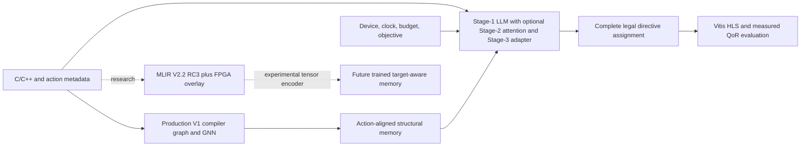
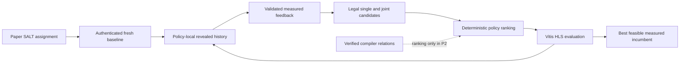
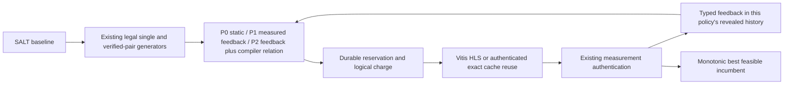

# MailoHLS / SALT-HLS

MailoHLS learns complete HLS directive configurations for C/C++ kernels under
an optimization objective, FPGA device, clock period and resource budget. SALT-HLS
is the extended framework name used in the research work.

The production pipeline uses the **V1 GNN**, action-aligned structural memory,
and selected LLM adapters. Stage 1 learns target-conditioned directives; Stage 2
adds structural cross-attention; Stage 3 optimizes preference pairs. Selected
artifacts and objective-specific availability are recorded in
[`FINAL_ARTIFACTS.json`](FINAL_ARTIFACTS.json). In particular, production Stage 2
and Stage 3 are selected for ADP; other stages/objectives have the explicit
fallback or pending status in that manifest.



MLIR V2.2 RC3 and its hardware overlay are experimental representations. They
are **not interchangeable with production V1 tensors or checkpoints**. The
readiness pilot did not establish improved target generalization. Semantic
features and resumable V2.2 supervised training live on research branches;
the latest recorded full paired run has no selected checkpoint or QoR result.
See [development status](docs/framework-development-status.md) for branch links
and the boundary between implemented, evaluated and planned functionality.

On `research/refinement-mechanism`, synthesis-feedback research compares random,
coordinate, composition, structural and hybrid refinement plus a matched-pair
control from fixed stored SALT predictions. Authenticated R11 completed 144
logical evaluations on GAN, covariance and Kalman (seed 123, eight calls per
context, ZCU104/10 ns). Best observed ADP improvements are 42.694%, 28.754% and
0.142%; structural wins only one of three matched comparisons and hybrid does
not outperform simpler exploitation overall. All three selected finalists passed
the original finite C-simulation tests, reauthenticated on 2026-11-01. Historical
relation-label quality limits attribution; no universal structural advantage,
RTL equivalence or post-route gain is established. This optional experiment is
independent of the parallel model-training work. See the
[methodology](README.md#merged-experiments-refinement-search-readme-md)
and [measured results](README.md#merged-experiments-refinement-search-results-md).

## Start here

| Need | Guide |
|---|---|
| Understand stages, schemas and code ownership | [Architecture](docs/architecture.md) |
| Install and reproduce selected experiments | [Reproducibility](docs/reproducibility.md) |
| Inspect experiment questions and limitations | [Experiment index](docs/experiments.md) |
| Inspect compiler graphs and uncertainty | [V2.2 compiler guide](docs/structural-graph-v22.md), [review status](docs/V22_FINAL_RELEASE_REVIEW.md) |
| Inspect FPGA graph enrichment | [Target-aware graph guide](docs/target-aware-mlir-v22/README.md) |
| Verify or restore registered graph artifacts | [Artifact policy](docs/reproducibility.md#artifacts) |
| Contribute without breaking historical results | [Developer guide](docs/development.md) |

## Installation and a small example

Use an isolated environment with the dependencies in `requirements.txt`.
GPU/CUDA, model weights, Vitis and the pinned Polygeist toolchain are separate
requirements for their respective workflows. Nothing below launches training
or synthesis:

```bash
python scripts/artifacts.py list
python scripts/artifacts.py verify --artifact salt-hls-graphs-v22-20261027-rc3
python -m LLM_branch.common.directive_domain_workflow --workflow train --domain-policy tcad
```

Graph verification needs only the Python standard library. Directive inspection
uses the shared domain contract; execution and domain shifts require explicit
flags documented by that module. Existing checkpoint policies are not relabeled.

For model training and inference, follow [reproducibility](docs/reproducibility.md)
and [maintained launcher choices](docs/shell-scripts.md). Cloning the source
repository does not download pretrained model weights. Frozen compiler graph archives and original measurements remain tracked. Historical checkpoint evidence, generated graphs, synthesis snapshots and derived
CSV tables can be restored directly from their sealed original Git objects:

```bash
python scripts/artifacts.py restore-git --artifact harp-generated-graphs-v1
```

See [reproducibility](docs/reproducibility.md) for the other artifact IDs and
catalog recovery. Normal development does not require GitHub Releases. Generated
outputs remain ignored; selected model weights are supplied separately.

## Repository map

`GNN_branch/`, `LLM_branch/` and `Preprocessing/` own the maintained implementations.
`Data/` and `evaluation_set/` hold benchmark inputs and measurements.
`experiments/` contains research methods and reports; `scripts/` contains
launchers and utilities; `tests/`, `docs/` and `toolchain/` hold regression checks,
guides and pinned compiler provenance. `HARP-rep/` preserves the modified baseline.
`src/` contains historical implementations and documented compatibility entries.
Do not infer production status from directory or checkpoint names containing
`final`.

## Six-branch development structure

| Branch | Responsibility |
|---|---|
| `main` | Finalized framework and selectively integrated, validated improvements. |
| `mlir-target` | Immutable historical MLIR baseline. |
| `llvm-ir` | Immutable historical LLVM baseline. |
| `research/stage1-refinement` | Stage-1 supervision, recovery and measured-quality research. |
| `research/gnn-refinement` | Graphs, semantic tensors, hardware awareness and GNN research. |
| `research/refinement-mechanism` | HLS feedback, directive refinement and search research. |

Use configurations and result directories for experiment variants within these
three research branches. Keep unfinished work there and selectively integrate
validated improvements into `main`. Update a shared research branch with
`git fetch origin` followed by `git merge origin/main`; preserve local work first.
Do not force-rewrite shared history. Detailed conventions are in
[development](docs/development.md).

## FGR-v1 paper-configuration pilot

This branch contains a second, separate refinement evidence line. FGR-v1
compares three policy arms over a shared legal candidate framework:



The three arms are `fgr_static` (deterministic ordering), `fgr_feedback`
(revealed numerical measurements), and `fgr_structural` (the same feedback
plus verified compiler relations for ranking). The initial SALT configuration
is logical evaluation one. A policy can only use its own authenticated
revealed history; the physical cache can provide a measurement only after the
policy pays its logical query. The policy does not use hidden cache contents,
unqueried outcomes or another arm's history. Synthesis remains authoritative
for QoR and feasibility.

### Paper inventory and context audit

Nine rows in `paper_plots/SALT_experiments.jsonl` satisfy
`stage=predicted-directives` and `objective=ADP`. No repository manuscript or
plot configuration establishes a specific eight-kernel subset, so all nine
remain inventoried. Eight configurations round-trip through the current source,
metadata and TCAD domain; Rosetta 3D rendering remains blocked because the
paper assignment lists 15 actions while tracked metadata has 12, with L8/L9/L12
kind mismatches. Its analysis-only `ap_int.h` is excluded by the synthesis
runner; no source/action repair is inferred.

Paper QoR is historical context, not the fresh baseline. The JSONL does not
carry source, metadata, top function, Tcl, tool, vendor-header, device or clock
identity. Authenticated exact-context R11 measurements are reusable for GAN,
covariance and Kalman, and the paper-to-R11 discrepancies are explicitly
reported; their causes are unknown. Jacobi's fresh baseline happened to match
paper cycles numerically, which does not prove context identity. Every FGR gain
uses the fresh authenticated SALT assignment under the sealed ZCU104
`xczu7ev-ffvc1156-2-e`, 10 ns, full-resource, TCAD, Vitis HLS 2021.1 context.
See [`paper_inventory.md`](README.md#merged-experiments-refinement-feedback-paper-evaluation-paper-inventory-md)
and [`baseline_comparison.md`](README.md#merged-experiments-refinement-feedback-paper-evaluation-baseline-comparison-md).

### Authenticated pilot status and interpretation

The GAN and jacobi-2d pilot has **42/48 logical evaluations**: each of six
policy/kernel arms reached seven queries. Budget prefixes 1, 2 and 4 are
complete; budget 8 is incomplete. It used 27 physical attempts (26 successful,
one interrupted), five authenticated R11 cache reuses and ten within-pilot
shared reuses. The failed Jacobi static query was interrupted after about 4,608
seconds and over 100 GiB peak RSS; it has no QoR and was not automatically
retried. GAN's baseline is an exact-context authenticated R11 reuse; Jacobi's
baseline was freshly synthesized once and shared across histories.

| Kernel | Policy | Improvement at B=4 | Best at equal observed q=7 | Interpretation |
|---|---|---:|---:|---|
| GAN | `fgr_static` | 0.06% | 0.06% | Small measured change. |
| GAN | `fgr_feedback` | 6.73% | 6.75% | Improved over its fresh SALT baseline in this trajectory. |
| GAN | `fgr_structural` | 6.73% | 6.75% | Same selected improvement as feedback; no incremental structural gain observed. |
| jacobi-2d | `fgr_static` | 31.35% | 37.12% | Strongest q=7 endpoint, but its seventh query failed and has no QoR. |
| jacobi-2d | `fgr_feedback` | 0.00% | 36.22% | Improvement appeared later in this trajectory. |
| jacobi-2d | `fgr_structural` | 0.00% | 19.45% | Improved over baseline but trailed the other arms at the observed endpoint. |

These gains are measured HLS ADP improvements over each fresh SALT baseline,
not post-route or board results. The pilot is incomplete, covers two kernels
(one previously studied), and has unequal successful-query histories after
one failure. The seven-query endpoint is descriptive, not the predeclared B=8
comparison. It supports that refinement can find measured improvements in
these trajectories; it does not establish that feedback ranking beats static
ordering generally. Structural ranking showed no incremental benefit over
feedback on GAN and performed worse on Jacobi at the observed endpoint. No
FGR-selected candidate has C-simulation, co-simulation or equivalence evidence.

The full paper protocol is prepared, not executed. Eight verified kernels and
the unresolved ninth row imply logical upper bounds of 192 or 216 evaluations
for three policies x eight queries. The full campaign is gated on resolving the
manuscript subset or explicitly documenting exclusions, reconciling Rosetta's
source/action identity, and addressing the high-memory Jacobi candidate. Pilot
runtime and disk observations are planning references only, not guarantees.
See the [pilot measurements](README.md#merged-experiments-refinement-feedback-paper-evaluation-pilot-results-md),
[protocol and resume commands](README.md#merged-experiments-refinement-feedback-paper-evaluation-readme-md),
and [`full_paper_protocol.json`](experiments/refinement_feedback/paper_evaluation/full_paper_protocol.json).

### Reading the evidence together

R11 and FGR-v1 answer different questions and must remain separate. R11 is a
completed six-policy historical study on GAN, covariance and Kalman with eight
logical evaluations per policy/kernel; its authenticated conclusion is
`REFINEMENT_BENEFICIAL_BUT_STRUCTURAL_GAIN_UNPROVEN`. FGR-v1 is a new three-arm
policy evaluation on paper configurations, with separate protocol identity
and fresh-baseline rules. R11 retrospective best-of-six results cannot be
combined with FGR curves or used to tune FGR. Neither study proves general
performance across the paper kernel suite. The full documentation index is in
[`experiments/refinement_search/README.md`](README.md#merged-experiments-refinement-search-readme-md)
and [`experiments/refinement_feedback/paper_evaluation/README.md`](README.md#merged-experiments-refinement-feedback-paper-evaluation-readme-md).

---

## Consolidated research documentation
The following dated notes were merged from their former files so the branch has one explanatory entry point. Their original document boundaries and content are retained below; status statements remain tied to the dates and protocols recorded in each section. Machine-readable receipts and execution artifacts remain in their original paths.

<a id="merged-experiments-refinement-readme-md"></a>
<details>
<summary>Consolidated from <code>experiments/refinement/README.md</code></summary>

## Local HLS refinement

This optional experiment tests legal changes around a stored SALT prediction.
It compares single-action edits, compiler-verified pairs, and matched pairs
without a verified relationship. For each pair it measures the baseline, each
single edit, and both edits together. It does not run the LLM, retrain the GNN,
or implement an iterative optimizer.

### Code map

| File | Responsibility |
| --- | --- |
| `experiment.py` | One CLI: prepare, reuse measurements, run/resume, and summarize. |
| `configurations.py` | Complete assignments, source-domain checks, deterministic selection, corpus audit and factorial analysis. |
| `relations.py` | Authenticate MLIR graphs, verify relationships and preserve sparse action identities. |
| `synthesis.py` | Materialize sources, invoke Vitis, parse reports, compute ADP and authenticate evidence. |

Directive policies are shared with model workflows in
[`LLM_branch/common/directive_domains.py`](LLM_branch/common/directive_domains.py).
The original training, inference and GNN entry points remain the standard
framework interfaces described in the root README.

### Prepare and execute

From the repository root, using the normal MailoHLS Python environment:

```bash
## Preparation never launches HLS.
python -m experiments.refinement.experiment --mode prepare \
  --kernels GAN covariance Kalman --seed 123

## Optional: import compatible measured results instead of synthesizing again.
## Use a NEW output directory when changing preparation settings.
python -m experiments.refinement.experiment --mode prepare \
  --output-dir experiments/refinement/results/reused_measurements \
  --reuse /path/to/existing/measured/experiment

## Explicit synthesis on a Vitis host. Repeating this command resumes.
python -m experiments.refinement.experiment --mode run \
  --vitis-hls /opt/Xilinx/Vitis_HLS/2021.1/bin/vitis_hls

python -m experiments.refinement.experiment --mode summarize
```

The default output is ignored `experiments/refinement/results/local_refinement/`.
Use `--output-dir` consistently across commands. `--limit N` bounds new jobs in
one invocation; `--timeout` sets seconds per job. `--retry-failed` explicitly
allows another attempt. Successful authenticated jobs are never repeated.
Durable reservations, including retries and imported charged costs, enforce a
48-evaluation cap. Baseline failures block further jobs for that kernel.
Charged costs from multiple archives are added conservatively; use the latest
aggregate archive when histories overlap.

The initial deployment is ADP, ZCU104 `xczu7ev-ffvc1156-2-e`, requested clock
10 ns, full resource limits, Vitis HLS 2021.1. Different source, header, tool,
clock, target or synthesis settings cannot be mixed in a comparison.

#### Sources and compiler graphs

Baselines come from complete ADP `predicted-directives` rows in
`paper_plots/SALT_experiments.jsonl`. Sources are under `evaluation_set/`;
Kalman maps explicitly to `serrano-kalman-filter`. `--config` accepts source,
metadata and top-function overrides; `--baselines` overrides the prediction file.

Supply authenticated `GAN.gexf`, `covariance.gexf` and `Kalman.gexf` with
`--graphs-dir`. The default ignored cache is `results/compiler_graphs/`.
The tracked Kalman graph is also supported. When a graph is missing, preparation
tries the pinned native pipeline documented in [`toolchain/README.md`](toolchain/README.md):

```bash
POLYGEIST_BUILD=/path/to/locked/build MLIR_PYTHON=/path/to/python3.11 \
python -m experiments.refinement.experiment --mode prepare \
  --output-dir experiments/refinement/results/prepared_with_compiler
```

`--polygeist-build`, `--mlir-python` and `--graph-timeout` provide CLI overrides.
Unavailable compiler evidence is reported as blocked; no relationships are
invented. Sparse inactive sites retain their original values and are not edited.
For Coroni, prepare locally and transfer the package, shared dependencies and
sealed output at the same repository-relative paths. Running and summarizing
require Python 3.8+; preparation additionally needs CPU torch/networkx and, when
regenerating graphs, the native MLIR toolchain. No model weights are needed.

### Domain and selection rules

The `tcad` policy uses powers of two no greater than n plus integer divisors of n
at least two. There are no separate 64/1024 caps. Array factors are checked
against the selected dimension; partial decoding keeps only legal completions.
Pipeline and partial unroll may coexist. Disabled and complete partitions keep
the framework's existing tuple encodings.

Loop sizes must be compiler-proven static trip counts for new unroll proposals.
Approximate metadata bounds are not substituted for unknown counts. Unchanged
historical values can have explicit baseline-only exceptions; edits cannot use
those exceptions to introduce invalid tuples. Existing checkpoint behavior is
available through `--domain-policy legacy`, without a second implementation tree.

Selection is deterministic and independent of measured QoR. It chooses diverse
single-action edits and up to two verified pairs per kernel, preferring loop
unroll plus accessed-array partition factor. Numeric edits prefer the nearest
supported increase, falling back to decreases. A control matches action types,
field counts, factor magnitude and policy novelty as closely as available.
No verified relationship does not establish semantic independence.

All pair endpoints change, all configurations are complete, and canonical
signatures deduplicate shared cells. The manifest records the considered pool,
selection reasons, relation evidence, compiler count reconciliation and hashes.
Unknown/shared-helper relations never qualify as verified structural pairs.

### Outputs and interpretation

The working output has seven main files:

- `manifest.json`: sealed inputs, code hashes, domains, considered candidates,
  relation evidence, context and budget.
- `candidates.jsonl`: frozen complete assignments.
- `measurements.jsonl`: authenticated QoR, statuses and evidence paths.
- `attempts.jsonl`: durable synthesis accounting.
- `summary.csv`: best feasible results per kernel/neighborhood.
- `factorials.csv`: all cells and attribution metrics.
- `report.md`: measured results and limitations.

Source/graph snapshots, reused evidence and HLS attempts live in dedicated
subdirectories. Large projects, logs and generated results stay out of Git.
`--mode audit-domains` writes a separate `domain_audit.json` in a fresh output
and audits the existing SFT corpus against supplied metadata. `--sft-dataset`
changes the corpus; `--domain-audit` includes an existing audit in preparation.
Corpus coverage is not a compiler trip-count audit of every training kernel.

```bash
python -m experiments.refinement.experiment --mode audit-domains \
  --output-dir experiments/refinement/results/domain_audit
```

Area is the mean BRAM/DSP/FF/LUT utilization against full device capacities;
ADP is latency cycles times that mean. Every resource limit is checked
individually. Failed, missing, infeasible or incomparable cells cannot be winners.
HLS estimated timing is reported separately from resource feasibility.

For minimized ADP, interaction is `J(AB)-J(A)-J(B)+J(0)` and joint-over-single gain
is `[min(J(0),J(A),J(B))-J(AB)]/J(0)`. A favorable interaction alone does not mean
ADP improved. Small, unreplicated comparisons and imperfect controls cannot
establish general structural superiority. Synthesis does not prove functional
equivalence; functional simulation status is recorded explicitly.

Measurement import reads both plain and historical prefixed artifact filenames
and rechecks sources, generated source, Tcl, tool/header identities, logs and
XML. Historical selector code is not required to authenticate physical results.
Exact earlier source is retained in Git history and an ignored local source
archive; earlier measured directories are preserved, not rewritten. Changed
code or frozen inputs require a new preparation directory.

### Tests

```bash
python -B -m pytest -q -p no:cacheprovider \
  tests/test_directive_domains.py tests/test_refinement.py
```

Tests use synthetic vendor reports and a test-only executable; they need neither
Vitis nor a GPU. Ordinary prepare/audit/test commands never launch synthesis.

### Independent refinement research branch

Develop feedback/search changes on `research/refinement-mechanism`. Stable
`experiments/refinement`, `refinement_search` and `v21_refinement` remain on main.
Reuse their shared configuration, materialization, cache and report utilities;
use modules/configurations for policy variants rather than new remote branches.
Stage-1/GNN proposals may become optional inputs, but no new algorithm or
synthesis run is introduced by this branch setup. Preserve objective/feasibility
definitions and measured-report identities when comparing policies.

</details>

<a id="merged-experiments-refinement-search-readme-md"></a>
<details>
<summary>Consolidated from <code>experiments/refinement_search/README.md</code></summary>

## Budgeted refinement with HLS feedback

One-pass SALT predicts a complete directive configuration with the frozen LLM,
objective adapter and compiler memory. This optional experiment starts from that
stored prediction and queries synthesis before choosing each next edit. It does
not run the LLM or GNN, change checkpoints, or replace standard inference.

The [authenticated R11 results](README.md#merged-experiments-refinement-search-results-md) answer the current scientific question:
measured refinement helps GAN and covariance, but structural and hybrid
superiority is unproven. All 144 logical queries and the three final winners'
existing C-simulation passes were reauthenticated on 2026-11-01. No additional
synthesis, simulation, training or policy retuning was needed for that assessment.
The supplementary stricter audit below qualifies historical relation labels.

The search engine has two modules: `policies.py` selects candidates from source
facts and one policy's observed history; `controller.py` validates, queries,
records and summarizes them. `benchmark.py` seals and schedules controlled
comparisons using that same engine. Complete assignment handling, compiler
verification, source materialization, Vitis execution, ADP and measurement
authentication come from the existing [`refinement`](README.md#merged-experiments-refinement-readme-md)
implementation. Historical code and prepared experiments remain unchanged.

### Policies fixed before measurement

| CLI name | Rule |
| --- | --- |
| `random` (P0) | Seeded random order over the legal single-action neighborhood of the current incumbent. |
| `coordinate` (P1) | Evaluate the next balanced single-action proposal; immediately regenerate around a measured improvement. |
| `compose` (P2) | Probe up to four single-action siblings at one reference. As soon as two distinct actions improve over that measured reference, propose their composition. |
| `structural` (P3) | Propose two changes on a verified compiler pair around the incumbent, even without beneficial individual results. |
| `hybrid` (P4) | Use composition and sibling probes, reserving logical queries 4, 8, 12 and 16 for verified structural exploration when available. Fall back to singles, then verified pairs when singles are exhausted. |

All methods measure the same original SALT configuration first and only install
a strictly better, feasible design. Ties keep the earlier incumbent. Failed and
infeasible queries consume budget without replacing it. An exhausted neighborhood
ends the search; a missing replay record is an unavailable observation, not a
synthesis failure or a fabricated objective.

Composition needs a common measured reference, so its four-probe sweep differs
from P1's immediate reanchoring. Its incumbent still updates immediately. A
composition is explicitly `reference+A+B`, with two previously observed distinct
action edits; it is not relabeled sequential coordinate search. Each current
action tuple must remain compatible with that reference or its observed edit.
Stale combinations and unrelated rollbacks are rejected. Joint effects are
measured, never assumed from the constituent gains.

Numerical proposals consider the nearest smaller and larger enabled value and a
disabled alternative. Directions alternate within numerical families, and
UNROLL, partition factor, PIPE, partition type, dimension and whole-tuple edits
are visited in round-robin order with seeded tie-breaking. This is a bounded
local neighborhood, not enumeration of every legal assignment. It never prefers
larger factors on the assumption of better QoR. Structural proposals prioritize
verified direct loop–array relationships and UNROLL/partition-factor edits,
using up to two alternatives per endpoint and round-robin pair exploration.
Conservative shared-helper relationships do not qualify. Graph disconnection
does not establish semantic independence.

New tuples follow the explicit TCAD policy: powers of two at most the resolved
size, plus all divisors at least two, with no independent 64/1024 cap. Array
factors depend on the selected dimension. Compiler-proven static loop counts,
inactive absolute action IDs and recorded baseline-only exceptions are reused
unchanged. Exceptions preserve historical designs; they cannot introduce new
illegal tuples. Each proposal records its domain classification and values newly
admitted compared with the historical policy.

### Logical budget and hidden physical cache

A **logical evaluation** reveals one chosen configuration's outcome to one
policy. The initial configuration costs one. A cached physical report still
costs one logical evaluation. A **physical synthesis** launches Vitis; exact
authenticated historical or newly shared results can avoid that launch.

The controller durably reserves a logical query **before** looking up its result.
Policies receive no cache signatures, historical winners, paper QoR, or other
policies' histories. Shared physical caching affects runtime, not available
policy knowledge. Compare best ADP at equal logical budgets, not physical jobs.
Physical costs depend on execution order; they are reported separately.

The initial validated request is ADP/ZCU104, `xczu7ev-ffvc1156-2-e`, 10 ns, full
BRAM/DSP/FF/LUT capacities and genuine Vitis HLS 2021.1 headers. Other objectives
or deployment contexts are rejected. Area is mean percentage utilization across
the four resources; ADP is area times latency cycles. Every resource budget is
checked separately. All reused and prospective results must match source,
metadata, materialized directives, Tcl, part, clock, tool/header identity and
report provenance. The historical GAN floating-point stub measurements cannot
be mixed with genuine Vitis-header results.

### Commands from the repository root

Use Python **3.8–3.11**, including the normal `mailohls-llm-v2` Python 3.10
environment locally and Python 3.8 on Coroni. Preparation also needs CPU
torch/networkx for the existing compiler verifier; run/resume and summarize need
the shared source modules but no model weights or GPU. Python 3.12+ changed
floating-point `sum` rounding: the historical verifier's exact numerical checks
can reject otherwise identical reports by the last bit. Keep its original
arithmetic environment rather than weakening authentication or rewriting results.
Strict replay also compares auxiliary proposal annotations. The completed Coroni
run used Python 3.8.0 and glibc 2.27; another host's `log2` can differ by one
floating-point bit even when the chosen configuration is identical. Use the
recorded execution host for byte-exact prospective trace replay and summaries.
Source/QoR authentication and local CPU tests do not relax their checks.

```bash
## Uses the existing authenticated local experiment and all five policies.
## This is also the default mode; it never launches synthesis.
python -B -m experiments.refinement_search.controller --mode prepare \
  --output-dir experiments/refinement/results/search/replay \
  --execution replay --kernels GAN covariance Kalman \
  --max-evaluations 8 --seed 123

python -B -m experiments.refinement_search.controller --mode replay \
  --output-dir experiments/refinement/results/search/replay

python -B -m experiments.refinement_search.controller --mode summarize \
  --output-dir experiments/refinement/results/search/replay

## Prepare a separate prospective pilot. No HLS runs yet.
python -B -m experiments.refinement_search.controller --mode prepare \
  --output-dir experiments/refinement/results/search/pilot \
  --execution synthesis --max-evaluations 8

## On Coroni, first select one kernel/policy and allow only three logical queries.
python3.8 -B -m experiments.refinement_search.controller --mode run \
  --output-dir experiments/refinement/results/search/pilot \
  --kernels GAN --policies coordinate --limit 3 \
  --vitis-hls /opt/Xilinx/Vitis_HLS/2021.1/bin/vitis_hls

## Resume that search; --limit bounds additional queries, not its total budget.
python3.8 -B -m experiments.refinement_search.controller --mode run \
  --output-dir experiments/refinement/results/search/pilot \
  --kernels GAN --policies coordinate \
  --vitis-hls /opt/Xilinx/Vitis_HLS/2021.1/bin/vitis_hls

## Explicitly opt into the full prepared batch only after the smoke test.
python3.8 -B -m experiments.refinement_search.controller --mode run \
  --output-dir experiments/refinement/results/search/pilot --allow-batch \
  --vitis-hls /opt/Xilinx/Vitis_HLS/2021.1/bin/vitis_hls
```

`--input-dir` selects the existing authenticated refinement experiment (default
`experiments/refinement/results/local_refinement`). Repeat `--measurements PATH`
to add compatible archives during preparation. Use a new output directory to
change policies, seed, code, context or budget. `--max-evaluations 16` enables the
larger comparison. `--timeout` bounds each Vitis job. To validate actual physical
execution instead of cache lookup, prepare a separate one-policy smoke directory
with `--fresh-synthesis`; this setting is sealed and forces a fresh job for each
new query. It does not repeat a completed query on resume.

A fresh Git checkout does not contain ignored measurement archives. First run
`python -m experiments.refinement.experiment --mode prepare` to create the source
and compiler preparation described in its README, or supply an existing sealed
archive with `--input-dir`. Authenticated measurements are optional for a
prospective run; replay without them will correctly report missing coverage.

Transfer the prepared output **at the same repository-relative path**, both
refinement packages, and the common modules listed in
`shared/manifest.json`'s `code_sha256` to Coroni. Preserve snapshot and proof
subdirectories, not just CSV files. A minimal bundle needs no checkpoints or
training datasets. Code/input hashes are checked before every run. Locks prevent
concurrent execution of one policy; a global lock protects shared physical
receipts. Physical reservations are durable. A reserved job without a final
`result.json` stops for log inspection instead of silently launching twice.

### Outputs and interpretation

All output is ignored under `experiments/refinement/results/search/`. One frozen
shared directory contains snapshots, verified relations and hidden authenticated
proofs. Each `KERNEL/POLICY/` has five main files:

- `manifest.json`: sealed source/context/code/policy/seed/budget.
- `search_trace.jsonl`: paid proposals, reference edits, incumbent edits,
  rationale, relation evidence, resource/latency/ADP outcomes and incumbent updates.
- `measurements.jsonl`: only that policy's revealed measurements and reuse costs.
- `summary.csv`: budget points 1, 2, 4, 8, 16 and separate logical/physical costs.
- `report.md`: observed trajectory and scientific limitations.

Shared prospective projects and durable physical attempt receipts are stored
under `physical/`; root `summary.csv` and `report.md` combine the isolated runs.
The controller recomputes policy decisions from journals on resume, checking that
each outcome follows its paid query. Completed physical results and saved
logical observations survive interrupted trace updates without duplicate jobs.

Replay deliberately continues after missing observations, retaining the best
known incumbent. If a budget prefix contains an unavailable outcome, its fair
`best_ADP` is blank; `best_observed_ADP` is only a partial observation. Such runs
validate the controller but cannot rank policies. Genuine neighborhood exhaustion
can carry forward the best result with an explicit early-termination label.
Paused or budget-limited runs do not extrapolate to larger budgets.

Report single-action, composition and structural improvements separately, along
with TCAD-expanded values. A joint improvement does not automatically establish
a compiler-guidance benefit. The small local neighborhoods, fixed deployment,
single seed and unreplicated HLS reports limit generalization. No functional
simulation/equivalence or post-route timing is established by these synthesis
runs. Controller overhead records per-query selection, authentication and
persistence time, excluding physical HLS runtime; preparation, report generation
and crash downtime are outside that counter.

Coordinate refinement is a conceptual baseline informed by
[AutoDSE](https://github.com/UCLA-VAST/AutoDSE); this experiment does not reproduce
its bottleneck analysis. [MPM-LLM4DSE](https://github.com/wslcccc/MPM-LLM4DSE) and
[Prometheus](https://github.com/UCLA-VAST/Prometheus) are future comparison points,
not components implemented here. No novelty claim follows from adding feedback.
[HARP](https://github.com/UCLA-VAST/HARP) and
[NLP-DSE](https://web.cs.ucla.edu/~pouget/papers/nlp_dse.pdf) motivate future
representation/ranking and analytical screening work; neither is integrated in
this controller. The supplied [Reflex-HLS DOI](https://doi.org/10.1145/3849869)
could not be fetched here. Its requested planning/materialization/feedback
principles are methodological guidance, not a claim of reproducing that system.

```bash
python -B -m pytest -q -p no:cacheprovider \
  tests/test_refinement_search.py tests/test_refinement.py tests/test_directive_domains.py
```

Tests use synthetic observations and a CPU test executable through the existing
HLS runner. They never require Vitis or expose hidden measurements to policies.

### Controlled matched-budget benchmark

The benchmark compares the five unchanged policies at 1, 2, 4 and 8 logical
evaluations. `composition` is accepted as an alias for the engine's `compose`.
One additional `matched` control explores legal pairs without a verified compiler
relationship. It matches structural templates in action types, changed field
families/counts and domain novelty, then minimizes the difference in log2 factor
magnitude. Magnitudes can differ; every score is recorded. These actions are
called `no_verified_relation`, never functionally independent.

The main three-kernel/one-seed pilot has at most **120 logical calls**. The matched
control has a separately declared maximum of **24**. The scheduler visits one
query per context in round-robin order. Each context still uses the original
controller, has its own budget/history, and cannot inspect the cache before its
paid query. All physical reuse is authenticated. A reserved job is recovered by
its owning engine, so interruption cannot turn a physical run into a free reuse.

```bash
## Freeze the protocol before synthesis; adopt the existing original R1 pilot.
python -B -m experiments.refinement_search.benchmark --mode prepare \
  --output-dir experiments/refinement/results/search/benchmark_r11 \
  --search-dir experiments/refinement/results/search/pilot \
  --execution synthesis --seeds 123 --max-evaluations 8 \
  --import-search experiments/refinement/results/search/smoke

## Compatible Vitis host: small wrapper smoke first (includes cached observations).
python3.8 -B -m experiments.refinement_search.benchmark --mode run \
  --output-dir experiments/refinement/results/search/benchmark_r11 \
  --kernels GAN --policies coordinate --limit 4 \
  --vitis-hls /opt/Xilinx/Vitis_HLS/2021.1/bin/vitis_hls

## Explicit bounded batch. Repeat the same command to resume.
python3.8 -B -m experiments.refinement_search.benchmark --mode run \
  --output-dir experiments/refinement/results/search/benchmark_r11 --allow-batch \
  --vitis-hls /opt/Xilinx/Vitis_HLS/2021.1/bin/vitis_hls

## Original execution host: strictly reconstruct histories and rebuild tables.
python3.8 -B -m experiments.refinement_search.benchmark --mode summarize \
  --output-dir experiments/refinement/results/search/benchmark_r11

## Prepare a separate replay protocol; no Vitis is launched.
python -B -m experiments.refinement_search.benchmark --mode prepare \
  --output-dir experiments/refinement/results/search/benchmark_replay \
  --execution replay --import-search experiments/refinement/results/search/smoke
python -B -m experiments.refinement_search.benchmark --mode replay \
  --output-dir experiments/refinement/results/search/benchmark_replay

python -B -m pytest -q -p no:cacheprovider \
  tests/test_refinement_benchmark.py tests/test_refinement_search.py \
  tests/test_refinement.py tests/test_directive_domains.py
```

Omit `--search-dir` for a fresh controlled experiment. `--seeds 123 456` prepares
additional predeclared seeds; seeds are never selected from final QoR. Changing
protocol settings or source code requires a new output directory.
`--groups main` or `--groups control` selects the declared comparison group;
`--limit` bounds additional logical queries across the selected contexts.

The original R1 manifests hashed every Python file in this directory. Adding
the benchmark would otherwise invalidate them. Its scoped adapter instead hashes
the **actual unchanged original engine files** plus all original compiler/domain
dependencies, with exactly the original file set. It separately seals the new
benchmark file in `protocol.json`. It does not trust expected hashes in place of
actual hashes or relax source/report authentication. Use the benchmark entry
point to adopt/resume those original queues. The original engine Python files
and historical manifests are not edited. New controlled preparations should also
use this entry point, keeping the wrapper and engine provenance separate.

The five main output files are `protocol.json`, `search_traces.jsonl`,
`measurements.jsonl`, `summary.csv` and `report.md`. Per-policy journals remain in
their original prepared locations. The protocol records those paths, source and
graph hashes, original engine hashes, tool identity, Git/worktree state, initial
journal hashes, scheduling/matching rules and separate accounting limits. PNG/PDF
curves use measured ADP divided by the original baseline; a cross-kernel mean is
shown only with complete kernel coverage. Missing replay prefixes stay blank.
Early exhaustion carries results forward explicitly. No larger-budget value is
extrapolated from a paused run.

The completed run includes `execution_environment.json` and a sealed
`optimization_curve_data.json`, exported after strict replay on Coroni and bound
to the exact trace/measurement hashes. This allows portable plotting with local
matplotlib without changing the frozen execution code or rounding its annotations:

```bash
python -B - <<'PY'
from experiments.refinement_search import benchmark as b, controller as ctl
from experiments.refinement import configurations as c
out = b.DEFAULT_OUTPUT
protocol = b.load_protocol(out)
data = ctl._read_sealed(out / 'optimization_curve_data.json')
assert data['protocol_seal'] == protocol['seal']
for path, digest in data['journal_sha256'].items():
    assert c.sha256(c.repo_path(path)) == digest
b._plot(out, protocol, data['curves'])
PY
```

For new runs, `--mode summarize --plot` works when matplotlib is installed in the
same numerical environment used for execution. In the completed audit, all 144
candidate choices and all source/QoR measurements also verified locally; only
three auxiliary distance annotations differed by one bit. No tolerance was added
to measured QoR or candidate legality. Additional authenticated historical cache
proofs are recorded under `historical_cache/`; cache availability can change
physical cost, while every queried result still costs one logical evaluation.

The report contrasts coordinate/compose, structural/matched and compose/hybrid.
The first contrast includes the sibling-sweep difference, so it is not a pure
composition-toggle ablation. Explicit composition increments are also recorded.
Compose is the hybrid's exploitation-only counterpart. Existing balanced factor
ordering is retained, with initial pool directions sealed and actual query
directions counted. It does not favor only increases; lower-first resets can
still bias short trajectories. None of these rules are retuned after synthesis.
Positive gains below **0.5%** are flagged as small and physically unvalidated;
the threshold is a reporting convention, not a significance test.

#### Functional checks outside the synthesis-selection budget

Each aggregate measurement has `validation_status=not_tested` until a matching
executed receipt exists. Once complete results identify finalists, prepare one
original-source versus final-design C-simulation comparison per kernel:

```bash
python -B -m experiments.refinement_search.benchmark --mode validate \
  --output-dir experiments/refinement/results/search/benchmark_r11

## Explicitly execute the prepared checks on the Vitis host.
python3.8 -B -m experiments.refinement_search.benchmark --mode validate \
  --output-dir experiments/refinement/results/search/benchmark_r11 --execute-csim \
  --vitis-hls /opt/Xilinx/Vitis_HLS/2021.1/bin/vitis_hls
```

Generated testbenches use identical zero, alternating and seed-123 bounded inputs
for the original source and candidate. GAN checks all outputs, covariance checks
outputs and its mutated input arrays, and Kalman checks all packed outputs.
Tolerances are `1e-6 + 1e-6*abs(reference)` for float outputs and `1e-9 +
1e-9*abs(reference)` for doubles; nonfinite results fail. Genuine vendor headers
are required and simplified analysis stubs are excluded. Logs, source/testbench
hashes, output hashes, return codes, comparisons and runtime are recorded under
`functional/`, independently of selection-time evaluation costs.
`csim_pass` means agreement on those finite inputs; it does not verify generated
RTL or establish post-route improvement. No equivalence checker is integrated,
so `equivalence_verified` is never assigned by this benchmark.

### Authenticated R11 assessment

The scientific comparisons are H1: refinement versus the initial SALT assignment;
H2: structural versus matched; H3: coordinate versus compose; H4: compose versus
hybrid. Incumbent monotonicity follows from best-feasible selection and is not
evidence of a superior policy. Each context has the same original assignment,
legal space, target, tool/header identities and eight-query budget. Query one is
the baseline, and cached, failed or infeasible queries still consume a query.

For kernel `k`, policy `p` and paid prefix `b`, define `J*(k,p,b)` as the minimum
ADP among successful feasible observations in the prefix, then
`N(k,p,b) = J*(k,p,b) / ADP(original SALT,k)` and improvement `100*(1-N)`.
The area/ADP formulas and four independent resource checks above are unchanged.
Normalization is undefined for unavailable/infeasible baselines. Missing replay
observations invalidate prefixes; pauses never extrapolate. Explicit completely
observed neighborhood exhaustion may carry an incumbent forward.

The separate [`experiments/refinement_analysis.py`](experiments/refinement_analysis.py)
strictly replays the paid journals, checks measured baseline equality and aggregate
exports, reconstructs normalized curves/costs, computes only valid common-reference
factorials and authenticates executed functional checks. It never launches
synthesis or simulation. Its optional live-tool check uses only the existing
version/identity probe. Its location is outside the directories globbed into the
original core hash contract; frozen engine and benchmark files remain unchanged.

Restore the ignored evidence roots from
`/home/bonus24/mailohls_search_20261026_NqbK0V/` on Coroni at the recorded relative
paths: `benchmark_r11`, `pilot`, `smoke`, including all copied reuse proofs.
The optional covariance single-edit control also needs `local_refinement`.
[RESULTS.md](README.md#merged-experiments-refinement-search-results-md) records recovery locations and source/tool hashes.
On the original Python/glibc environment, select a fresh assessment file outside
the frozen archive:

```bash
python3.8 -B -m experiments.refinement_analysis \
  --input-dir experiments/refinement/results/search/benchmark_r11 \
  --output /tmp/r11-assessment-fresh.json \
  --live-tool /opt/Xilinx/Vitis_HLS/2021.1/bin/vitis_hls
```

Portable verification checks the committed Coroni assessment seal and restored
input hashes without claiming exact foreign-libc policy replay:

```bash
python -B -m experiments.refinement_analysis \
  --verify-export experiments/refinement_search/evidence/r11/assessment.json \
  --compiler-output /tmp/r11-compiler-diagnostic-fresh.json \
  --tables-dir /tmp/r11-tables --plot
```

Compiler diagnostics need CPU torch/networkx; plotting needs matplotlib. No model
or GPU is used. The existing plot exporter reads the original sealed curve data.
CSV exports preserve raw/normalized ADP, actual budgets, candidate identities,
reference/baseline changes, matching distances, domain sizes and physical costs.

The optional historical single-edit control is authenticated using
`experiments.refinement.experiment.read_measurements` on `local_refinement`,
selecting covariance signature
`ccf8badf9fca12b41c2237797e636099c9c5c32a3e9dd9048d41f92a7a61769b`.
All 33 archived observations authenticate; the selected single-edit result has
identical comparison context and hardware metrics to the R11 structural winner.
Its separate sealed receipt is retained with the assessment exports.

#### Actual conclusions and evidence limitations

R11 completed 120 main-policy plus 24 control calls: 86 new syntheses, 58 reuses,
99 distinct assignments, 137 feasible observations and seven BRAM-infeasible
observations. No query is pending or unavailable. All selected winners passed the
original finite C-simulation checks. The measured decision is
`REFINEMENT_BENEFICIAL_BUT_STRUCTURAL_GAIN_UNPROVEN`.

Best ADP improvements are GAN 42.694281% (matched), covariance 28.754456%
(compose), Kalman 0.141797% (matched). Structural wins one of three matched
contrasts. Hybrid wins GAN modestly, loses substantially on covariance, and ties
Kalman. Only 0.453627 baseline percentage points of covariance's gain came from
its explicit composition. Complete curves and physical interpretation are in
[RESULTS.md](README.md#merged-experiments-refinement-search-results-md); the three-kernel/one-seed result is not universal.

All 21 paid matched controls have zero recorded magnitude distance, but endpoint
legal action-tuple counts differ in 17 cases. Equal action kinds/field changes
and novelty do not imply equal local opportunity or causal isolation.

The separate diagnostic reexecutes the historical graph verifier, then the
existing `strict_callsite_and_access_v1` auditor on the same snapshots. Nine GAN
array–loop relations become unresolved when call summaries are excluded as
concrete-access proof. These include all GAN structural/hybrid pairs. Seven
Kalman pairs instead gain direct evidence under the native write-orientation
correction; three nonimproving historical matched queries use those pairs.
The control means no relation verified by R11's verifier, never semantic
independence. No historical eligibility, relation, trace or QoR is rewritten.
A stronger verifier requires a new sealed experiment.

Original relation facts reproduce. Dependence-edge list iteration may vary with
Python hash randomization; the supplementary diagnostic compares full edge
multisets including multiplicity. This does not alter exact original policy
replay or relax source/QoR authentication.

The assessment verifies original source, materialized candidate, testbench/plan,
header/tool identity, completion logs, return codes, output hashes, lengths and
finite values, then reruns the binary-output comparator. Four prior design
checks cover the three winners and an earlier GAN finalist, with zero error and
mismatches. No new Vitis job is needed. Finite C simulation establishes neither
exhaustive equivalence nor RTL correctness.

Per-query overhead combines selection, authentication and persistence and excludes
HLS runtime. Separate subphase timers and full end-to-end elapsed time were not
recorded and remain unavailable. Physical counts depend on cache and order. The
recorded-unique-candidate runtime sum is only a retrospective cold-cache workload
proxy using historical runtimes, not a new physical-speed comparison.

### Design Decisions and Rationale

| Decision | Alternatives considered | Rationale | Scientific consequence | Validation |
| --- | --- | --- | --- | --- |
| Authenticate existing R11 before new execution | Rerun benchmark; add an algorithm | All required evidence exists | Zero new synthesis; historical measurements remain authoritative | Exact Coroni replay: 18 contexts / 144 queries |
| Separate reporter; preserve frozen source | Modify sealed summarizer | Hash contracts protect historical decisions | No candidate-selection change | Frozen hashes; original 108-test baseline |
| Equal logical budgets | Equal realized physical counts | Cache/order changes execution cost without changing paid knowledge | Physical cost is secondary | Existing accounting/cache-isolation tests |
| Preserve matching; expose domain sizes | Retune matching after results | Avoid post hoc optimization and expose confounding | Zero distance is not causal isolation | Exact replay and cardinality exports |
| Separate stronger-verifier diagnostic | Relabel or repair R11 eligibility | Call-summary evidence limits historical labels | A changed verifier needs a new experiment | Existing strict auditor; edge-fact/multiplicity tamper tests |
| Common-reference feasible factorials only | Combine unrelated states; add single gains | ADP is not additive | Explicit composition gain separated from search ordering | New context/feasibility regressions |
| Preserve ordering and domain policy | Retune from seed-123 winners | Avoid post hoc selection | Direction/expansion effects remain limitations | Actual reference-edit and domain audit |
| Reauthenticate executed C simulations | Repeat identical completed checks | Matching passes exist for every winner | Functional evidence without extra runtime | Source/testbench/log/binary checks; original mismatch/nonfinite/dimension tests |
| Leave missing costs/prefixes undefined | Estimate timers; carry paused results | Avoid invented precision/coverage | Incomplete curves cannot rank policies | Baseline/prefix/exhaustion/aggregate regressions |
| No extra seeds or learned selector now | Two full seeds, LLM agent, RL/ranker | Current bounded conclusion supported; evidence quality needs attention first | Three-kernel/one-seed limitation remains | Complete gates; resource preflight; no model loading |

#### Implementation change log

The implementation commit is recorded below after validation. The later
documentation commit is discoverable with `git log --follow` for this file;
a commit cannot embed its own content-derived SHA.

| Commit SHA | Modified files | Category / reason | Scientific contract affected | Tests | Experiment / evidence |
| --- | --- | --- | --- | --- | --- |
| `b9687e59dce518c9735e18e4ee59b7d09425946b` | `experiments/refinement_analysis.py`, `tests/test_refinement_analysis.py`, `evidence/r11/*` | Reporting improvement and verifier-sensitivity evaluation; versioned reproducible assessment and explicit evidence-quality analysis were missing | No search-policy, source, metric, budget, historical protocol or functional threshold change | Before: 108 passed. After: 143 passed / 1 prerequisite skip, including 14 new tests | R11 and authenticated historical covariance single-edit control; no new synthesis or C simulation |

The new reporter adds cross-policy/export consistency checks, normalized coverage
semantics, common-reference composition calculations, actual cost and matching
diagnostics, functional evidence verification and compact exports. Alternatives
were changing the frozen summarizer or relying on ignored reports alone. The
separate module preserves comparability and rejects changed code, inputs, seals,
QoR and functional evidence. This is a reporting extension plus supplementary
evaluation, not a search-policy change or new synthesis experiment.

```bash
python -B -m pytest -q -p no:cacheprovider \
  tests/test_refinement_benchmark.py tests/test_refinement_search.py \
  tests/test_refinement.py tests/test_directive_domains.py \
  tests/test_refinement_analysis.py tests/test_structural_audit.py
git diff --check
```

The existing optional saved-memory/encoder-artifact test skips when its local
research tensors are absent. No threshold was changed to obtain passing tests.

#### Related work and scope

[AutoDSE](https://arxiv.org/html/2009.14381v2) uses bottleneck-guided coordinate
optimization, parameter ordering and space partitioning. R11's coordinate policy
is a conceptual comparator, not a reproduction of that full system.
[MPM-LLM4DSE](https://arxiv.org/html/2601.04801v1) combines multimodal QoR prediction
and LLM optimization; R11 uses deterministic selection and actual HLS feedback.
[HARP](https://github.com/UCLA-VAST/HARP) studies hierarchical GNN representations
and surrogate-assisted exploration. [NLP-DSE](https://escholarship.org/content/qt072909j7/qt072909j7_noSplash_23f734e0aee37780cda8b8403d29c93c.pdf)
uses analytical performance/resource models and constrained pragma optimization.
These are conceptual comparisons; none is reproduced under R11's protocol.

The supplied characterization of [Reflex-HLS](https://doi.org/10.1145/3849869)
describes a training-free Planner–Actor–Critic feedback loop. Publisher full text
was inaccessible during this assessment, so no independently verified detailed
reproduction or numerical comparison is claimed. Feedback alone is not novel.
The possible contribution is whether verified action relationships improve
strict-budget refinement from an LLM starting point; R11 does not establish that
general advantage.

</details>

<a id="merged-experiments-refinement-search-results-md"></a>
<details>
<summary>Consolidated from <code>experiments/refinement_search/RESULTS.md</code></summary>

## Authenticated R11 refinement results

**Scientific decision: `REFINEMENT_BENEFICIAL_BUT_STRUCTURAL_GAIN_UNPROVEN`.**

Assessment date: 2026-11-01. Evidence state: `COMPLETE_AUTHENTICATED`.
All 18 contexts reached eight paid logical evaluations. All three selected
finalists have authenticated, executed C-simulation passes. The current task
reauthenticated the existing experiment; it launched **zero new syntheses and
zero additional C simulations**. No policy was retuned and no model was loaded.

### Identity and evidence recovery

- Research branch: `research/refinement-mechanism`; initial head
  `49a32d07fa2630e570447aae08d0a22de5daa044`.
- R11 preparation Git commit: `98698167a146a7be9ec711cc817a746734d384f2`.
- Validated assessment implementation/evidence commit: `b9687e59dce518c9735e18e4ee59b7d09425946b`.
- Protocol seal: `b4ed8b95ee8d64dcc91406216659229db8b20efb7c14b614a6ae6ccc3fd98868`.
- Original host: `bonus24@coroni.microlab.ntua.gr`.
- Original execution root: `/home/bonus24/mailohls_search_20261026_NqbK0V/`.
- Evidence under that root: `experiments/refinement/results/search/benchmark_r11/`,
  plus sibling `pilot/`, `smoke/`, and the benchmark `historical_cache/`.
- Original local recovery copy: `/home/elvouvali/MailoHLS/experiments/refinement/results/search/`.
- Dedicated worktree recovery copy: `/tmp/MailoHLS-refinement-mechanism/experiments/refinement/results/search/`.
- Execution: Vitis HLS **2021.1**, Python **3.8.0**, glibc **2.27**;
  `xczu7ev-ffvc1156-2-e`, requested clock **10 ns**, seed **123**,
  full BRAM/DSP/FF/LUT capacities **624 / 1728 / 460800 / 230400**.
- Live Vitis executable SHA256:
  `18046ed76282160f2290b0fa36ffcf8e9e6068e883e14e6325a10bdfe9315896`.
- Vendor `ap_fixed.h` SHA256:
  `bb9b88dae1a2d39a81f5f068632e9a217ed3e6e1b6c3baed92041c5dbcdf9e11`.
- Vendor `ap_int.h` SHA256:
  `a8695b7a66192b2b4300c64883a01e3911c619f9686b0018876d5af4176d0445`.

The [sealed assessment](experiments/refinement_search/evidence/r11/assessment.json) records all 144 paid
assignments, source/report identities, full finalist configurations, functional
receipts, and an input-file hash inventory. It was generated with exact policy
replay on Coroni and then verified by hashes locally. The original sealed curve
export agrees with the reconstructed journals. The original engine and benchmark
files match their frozen hashes. These hash seals establish recorded integrity;
they are not signatures from an independent certification authority.

| Kernel | Original source SHA256 | Graph SHA256 |
| --- | --- | --- |
| GAN | `40c0d7706c7d4ed88978366cd022ffa1868a2dcb19a8e82fa02d39346a6ae03f` | `eefc52bf7652eb0cda3609358ac2b8d98472a90ceec1337615c488c0ef1d08b3` |
| covariance | `2df25e667247b05dfd0dfe3c25f6580864a8fbbca4d2ff50996b5a52b7cb0b98` | `fdf5e4de970a391a37394d5ea5191fd09b57054648d4a13de41dab573d805b23` |
| Kalman | `3c36824db4be6be09b110a20cd5c5b655d14a4973bf4a0ec1820d544b98b81b1` | `bcb06f71f45ef22649d7e7729abc66af0b67a688c1787a1125c3502ee2fc0238` |

Metadata, template, header, baseline-signature, engine and Tcl identities are
also recorded in the sealed protocol and assessment. Every successful result
was reparsed from its actual HLS XML and matched to its exact assignment, source,
headers, Tcl settings, completion log, tool receipt and deployment context.

### Equal logical-budget results

Area is the arithmetic mean of four resource-utilization percentages against
full physical capacity; ADP is latency cycles times that area proxy. Feasibility
checks every resource separately. The initial measured SALT assignment costs
one logical evaluation; reused and infeasible queries also cost one.

`N@b = best feasible ADP in paid prefix b / original measured SALT ADP`.
Ratios below one improve the baseline. Rounded display values below have full
precision in [contexts.csv](experiments/refinement_search/evidence/r11/contexts.csv). All listed prefixes are
complete; none is extrapolated from a pause or missing replay observation.

| Kernel | Policy | N@1 | N@2 | N@4 | N@8 | Improvement@8 % |
| --- | --- | ---: | ---: | ---: | ---: | ---: |
| GAN | random | 1.000000000 | 0.939337666 | 0.939337666 | 0.861173566 | 13.882643 |
| GAN | coordinate | 1.000000000 | 1.000000000 | 0.999428463 | 0.999428463 | 0.057154 |
| GAN | compose | 1.000000000 | 1.000000000 | 0.999428463 | 0.999428463 | 0.057154 |
| GAN | structural | 1.000000000 | 1.000000000 | 0.990085660 | 0.989507986 | 1.049201 |
| GAN | hybrid | 1.000000000 | 1.000000000 | 0.999428463 | 0.989507986 | 1.049201 |
| GAN | matched | 1.000000000 | 0.879717486 | 0.616895102 | 0.573057187 | 42.694281 |
| covariance | random | 1.000000000 | 1.000000000 | 0.993212415 | 0.993212415 | 0.678758 |
| covariance | coordinate | 1.000000000 | 0.974341579 | 0.938128508 | 0.910745862 | 8.925414 |
| covariance | compose | 1.000000000 | 0.974341579 | 0.974341579 | 0.712455439 | 28.754456 |
| covariance | structural | 1.000000000 | 1.000000000 | 1.000000000 | 0.721635284 | 27.836472 |
| covariance | hybrid | 1.000000000 | 0.974341579 | 0.974341579 | 0.951125309 | 4.887469 |
| covariance | matched | 1.000000000 | 1.000000000 | 1.000000000 | 0.980264048 | 1.973595 |
| Kalman | random | 1.000000000 | 1.000000000 | 0.999618869 | 0.999618869 | 0.038113 |
| Kalman | coordinate | 1.000000000 | 1.000000000 | 1.000000000 | 0.999823778 | 0.017622 |
| Kalman | compose | 1.000000000 | 1.000000000 | 1.000000000 | 0.999823778 | 0.017622 |
| Kalman | structural | 1.000000000 | 1.000000000 | 1.000000000 | 1.000000000 | 0.000000 |
| Kalman | hybrid | 1.000000000 | 1.000000000 | 1.000000000 | 0.999823778 | 0.017622 |
| Kalman | matched | 1.000000000 | 1.000000000 | 1.000000000 | 0.998582029 | 0.141797 |

Raw ADP, using the same authenticated observations:

| Kernel | Policy | ADP@1 | ADP@2 | ADP@4 | ADP@8 |
| --- | --- | ---: | ---: | ---: | ---: |
| GAN | random | 19447.464906350 | 18267.736301694 | 18267.736301694 | 16747.642708890 |
| GAN | coordinate | 19447.464906350 | 19447.464906350 | 19436.349958545 | 19436.349958545 |
| GAN | compose | 19447.464906350 | 19447.464906350 | 19436.349958545 | 19436.349958545 |
| GAN | structural | 19447.464906350 | 19447.464906350 | 19254.656124800 | 19243.421827702 |
| GAN | hybrid | 19447.464906350 | 19447.464906350 | 19436.349958545 | 19243.421827702 |
| GAN | matched | 19447.464906350 | 17108.274927384 | 11997.045851140 | 11144.509527744 |
| covariance | random | 1903145.910300926 | 1903145.910300926 | 1890228.146122685 | 1890228.146122685 |
| covariance | coordinate | 1903145.910300926 | 1854314.191767940 | 1785395.432870371 | 1733282.262442130 |
| covariance | compose | 1903145.910300926 | 1854314.191767940 | 1854314.191767940 | 1355906.655164931 |
| covariance | structural | 1903145.910300926 | 1903145.910300926 | 1903145.910300926 | 1373377.239293981 |
| covariance | hybrid | 1903145.910300926 | 1854314.191767940 | 1854314.191767940 | 1810130.241825810 |
| covariance | matched | 1903145.910300926 | 1903145.910300926 | 1903145.910300926 | 1865585.513310185 |
| Kalman | random | 8678366.581469242 | 8678366.581469242 | 8675058.986417158 | 8675058.986417158 |
| Kalman | coordinate | 8678366.581469242 | 8678366.581469242 | 8678366.581469242 | 8676837.263326880 |
| Kalman | compose | 8678366.581469242 | 8678366.581469242 | 8678366.581469242 | 8676837.263326880 |
| Kalman | structural | 8678366.581469242 | 8678366.581469242 | 8678366.581469242 | 8678366.581469242 |
| Kalman | hybrid | 8678366.581469242 | 8678366.581469242 | 8678366.581469242 | 8676837.263326880 |
| Kalman | matched | 8678366.581469242 | 8678366.581469242 | 8678366.581469242 | 8666060.905253964 |

Complete three-kernel aggregates use normalized ratios, never raw ADP:

| Policy | Mean N@1 | Mean N@2 | Mean N@4 | Mean N@8 | Geomean@8 | Median@8 | Improved / unchanged | Wins@8 |
| --- | ---: | ---: | ---: | ---: | ---: | ---: | --- | ---: |
| random | 1.000000000 | 0.979779222 | 0.977389650 | 0.951334950 | 0.949122842 | 0.993212415 | 3 / 0 | 0 |
| coordinate | 1.000000000 | 0.991447193 | 0.979185657 | 0.969999368 | 0.969075157 | 0.999428463 | 3 / 0 | 0 |
| compose | 1.000000000 | 0.991447193 | 0.991256681 | 0.903902560 | 0.892916730 | 0.999428463 | 3 / 0 | 1 |
| structural | 1.000000000 | 1.000000000 | 0.996695220 | 0.903714423 | 0.893810985 | 0.989507986 | 2 / 1 | 0 |
| hybrid | 1.000000000 | 0.991447193 | 0.991256681 | 0.980152358 | 0.979926497 | 0.989507986 | 3 / 0 | 0 |
| matched | 1.000000000 | 0.959905829 | 0.872298367 | 0.850634421 | 0.824723294 | 0.980264048 | 3 / 0 | 2 |

Wins above include the matched control: matched wins GAN and Kalman; compose
wins covariance. Among the five main policies, random wins GAN and Kalman,
and compose wins covariance. A mean near-tie between structural and compose
changes ordering under the geometric mean; neither aggregate establishes
superiority. Three kernels and budget prefixes are not independent replications.
Finalists are selected retrospectively across six eight-query trajectories
(48 logical policy observations per kernel). Their best-observed gains are not
a guarantee for a policy chosen in advance with only eight total observations.


[Standalone PDF](experiments/refinement_search/evidence/r11/optimization_curves.pdf). This is the existing
plot exporter driven by sealed original curve data. Panels use different
y-axis ranges; Kalman is zoomed and every Kalman gain is below 0.5%.

### Logical versus physical cost

| Kernel | Policy | Logical / unique | New syntheses | Reuses | HLS seconds | Controller seconds | Feasible / infeasible | Failed / unavailable |
| --- | --- | ---: | ---: | ---: | ---: | ---: | --- | --- |
| GAN | random | 8 / 8 | 6 | 2 | 376.470 | 9.804 | 8 / 0 | 0 / 0 |
| GAN | coordinate | 8 / 8 | 5 | 3 | 310.224 | 8.074 | 8 / 0 | 0 / 0 |
| GAN | compose | 8 / 8 | 2 | 6 | 120.933 | 8.120 | 8 / 0 | 0 / 0 |
| GAN | structural | 8 / 8 | 7 | 1 | 445.115 | 11.360 | 8 / 0 | 0 / 0 |
| GAN | hybrid | 8 / 8 | 2 | 6 | 128.593 | 8.044 | 8 / 0 | 0 / 0 |
| GAN | matched | 8 / 8 | 7 | 1 | 439.751 | 12.682 | 8 / 0 | 0 / 0 |
| covariance | random | 8 / 8 | 7 | 1 | 240.174 | 10.926 | 8 / 0 | 0 / 0 |
| covariance | coordinate | 8 / 8 | 7 | 1 | 92.566 | 10.840 | 8 / 0 | 0 / 0 |
| covariance | compose | 8 / 8 | 2 | 6 | 55.611 | 7.763 | 8 / 0 | 0 / 0 |
| covariance | structural | 8 / 8 | 7 | 1 | 170.052 | 10.940 | 8 / 0 | 0 / 0 |
| covariance | hybrid | 8 / 8 | 2 | 6 | 25.618 | 7.849 | 8 / 0 | 0 / 0 |
| covariance | matched | 8 / 8 | 7 | 1 | 107.723 | 11.043 | 8 / 0 | 0 / 0 |
| Kalman | random | 8 / 8 | 6 | 2 | 172.104 | 9.676 | 6 / 2 | 0 / 0 |
| Kalman | coordinate | 8 / 8 | 5 | 3 | 142.943 | 8.056 | 7 / 1 | 0 / 0 |
| Kalman | compose | 8 / 8 | 1 | 7 | 28.408 | 6.362 | 7 / 1 | 0 / 0 |
| Kalman | structural | 8 / 8 | 6 | 2 | 174.859 | 11.160 | 7 / 1 | 0 / 0 |
| Kalman | hybrid | 8 / 8 | 1 | 7 | 28.109 | 7.922 | 7 / 1 | 0 / 0 |
| Kalman | matched | 8 / 8 | 6 | 2 | 182.833 | 10.069 | 7 / 1 | 0 / 0 |

**Totals:** 120 main-policy + 24 control queries; 99 distinct assignments;
86 new Vitis executions + 58 authenticated reuses; 137 feasible observations
and seven BRAM-infeasible observations; zero synthesis failures, timeouts or
unavailable observations. Recorded new HLS runtime is **3242.085 s**, and
combined controller/authentication/persistence overhead is **170.690 s**.

Physical ledgers also include three earlier smoke executions, giving 89
reserved/completed executions across the recovered search roots. These are
not 89 new jobs charged to the 144-query R11 comparison. All reservations have
final results; no pending query or unresolved physical reservation remains.

Individual selection versus authentication/persistence times were not recorded;
neither is invented. Full end-to-end elapsed execution time is unavailable.
The historical sealed post-execution audit records a **3707.454 s physical-phase
span**, including the smoke/batch gap and controller work; it is not full experiment
wall time or the sum of isolated policy runtimes.

Cache lookup follows durable logical reservation. The original policy API sees
only source/graph facts and its own revealed history; exact replay reproduced
all 144 decisions. Physical cost depends on execution order. In particular,
compose/hybrid appear cheap partly because earlier policies supplied their
reports. The exported `recorded_unique_candidate_runtime_proxy_seconds` sums
authenticated original runtimes of each queried assignment as a retrospective
cold-cache workload proxy; it is not a new isolated speed benchmark.

### Mechanism comparisons

Positive differences below favor the second policy and are percentage points
of the original baseline ADP:

| Kernel | Comparison | At budget 2 | At budget 4 | At budget 8 |
| --- | --- | ---: | ---: | ---: |
| GAN | coordinate → compose | 0.000000 | 0.000000 | 0.000000 |
| GAN | matched → structural | -12.028251 | -37.319056 | -41.645080 |
| GAN | compose → hybrid | 0.000000 | 0.000000 | 0.992048 |
| covariance | coordinate → compose | 0.000000 | -3.621307 | 19.829042 |
| covariance | matched → structural | 0.000000 | 0.000000 | 25.862876 |
| covariance | compose → hybrid | 0.000000 | 0.000000 | -23.866987 |
| Kalman | coordinate → compose | 0.000000 | 0.000000 | 0.000000 |
| Kalman | matched → structural | 0.000000 | 0.000000 | -0.141797 |
| Kalman | compose → hybrid | 0.000000 | 0.000000 | 0.000000 |

#### Coordinate versus compose

GAN and Kalman tie at all requested comparison budgets and evaluate no explicit
composition. Covariance compose is worse at budget 4 but better at budget 8.
Coordinate repeatedly decreases `UNROLL_L2` (10→8→5→4→2), obtaining 8.925414%.
Common-reference sibling sweeps instead reach `PIPE_L6=1` and a beneficial
`UNROLL_L2=5` edit. The only explicit composition occurs at query 8:

| Cell | Authenticated ADP |
| --- | ---: |
| Common reference (UNROLL_L2=8) | 1854314.1917679398 |
| A: UNROLL_L2=5 | 1810130.2418258102 |
| B: PIPE_L6=1 | 1364539.8332609953 |
| AB | 1355906.6551649305 |

All four cells are feasible, authenticated and share one comparison context.
`Δint = +35550.77184606483`: favorable negative interaction is **not** observed.
Nevertheless, the joint design beats the best single by **0.465573% of its
common-reference ADP**, or **0.453627 percentage points of the original SALT
ADP**. This is one useful composition, not evidence that all of the 19.829042-point
compose/coordinate gap is caused by composition. The remaining policy difference
includes sibling-probe order and reanchoring.

#### Structural versus matched

Structural improves over matched only on covariance, by 25.862876 baseline
percentage points. Matched wins GAN by 41.645080 points and Kalman by 0.141797
points. There is no cross-kernel structural-search advantage in this sample.

All **21/21** paid matched proposals have recorded log2-magnitude distance zero.
Action kinds, changed field families/counts and domain novelty match their
source-only structural templates. This does not equalize endpoint domains:
legal TCAD action-tuple counts differ in **6/7 GAN**, **4/7 covariance**, and
**7/7 Kalman** pairs. For example, GAN query 2 matches endpoint domain sizes
34/22 against 20/22; Kalman query 2 compares 70/38 against 14/38.
Full action IDs, directive changes, matching scores and cardinalities appear
in [queries.csv](experiments/refinement_search/evidence/r11/queries.csv). Incumbents also diverge; the comparison
is exploratory, not a randomized isolation of compiler information.

Covariance structural query 5 changes the nested loops `L6/L7`: `PIPE_L6 0→1`
and `UNROLL_L7 0→2`. Its result is 1373377.2392939813 ADP. The relation is
same-function loop nesting with proven-dependence evidence, rather than an
array-banking pair. Independent authentication of the original `local_refinement`
archive verifies a `PIPE_L6`-only design with identical latency, resources,
estimated clock, ADP and comparison context; all 33 archived measurements
authenticate without a rejection. Its [control receipt](experiments/refinement_search/evidence/r11/covariance_single_control.json)
records the exact assignment and evidence hashes. This is historical measured
evidence, not a new synthesis or a newly sampled factorial.
No necessary joint interaction is demonstrated. Across structural plus hybrid
queries, improvements occur in 3/9 GAN, 1/9 covariance and 0/9 Kalman queries.

GAN matched query 3 has only one net baseline edit, `UNROLL_L10 0→4`, and
achieves **37.792986%** ADP improvement. This factor is native-admissible.
The final matched winner follows multiple accepted pair steps; its full gain
cannot be assigned to one synergistic pair. This identifies action/factor
prioritization as a plausible bottleneck, without proving its counterfactual
performance at a fixed budget.

#### Compiler-evidence sensitivity

The [separate diagnostic](experiments/refinement_search/evidence/r11/compiler_diagnostic.json) reexecutes the
unchanged historical relation verifier against authenticated graph snapshots.
All facts and full dependence-edge multisets reproduce; unordered dependence
list iteration can vary with Python hashing. Historical sealed records are not
rewritten, and strict policy replay is still performed on Coroni.

The existing `strict_callsite_and_access_v1` auditor then checks the same graphs
as a separately labeled sensitivity analysis. **Nine GAN array–loop relations**
change from historical `direct_verified` to `conservative_unknown`: call-effect
summaries are insufficient concrete memory-access proof. This includes every
GAN pair used by structural/hybrid, including improving `L1/L6` and `L3/L11`.
Conversely, seven Kalman array–loop relations gain direct evidence under the
existing native write-orientation correction. Three paid matched-control queries
(steps 2, 3 and 6) then have direct evidence, although none improves the incumbent.
The original control therefore means **no relation verified by the frozen R11
verifier**, not semantic independence or absence under every stronger verifier.
These limitations further preclude a causal structural-guidance claim. A future
verifier change requires a new sealed protocol, not retrospective relabeling.

#### Compose versus hybrid

Hybrid reserves evaluations **4 and 8**, displacing two single-action probes
per kernel. Selection-only replay of the compose alternative at all six
reservations finds single-action proposals, not immediately ready compositions.
Only GAN query 8 improves its incumbent. Hybrid gains 0.992048 points over
compose on GAN, loses **23.866987** points on covariance, and ties on Kalman.
On covariance the reserved probes delay the `PIPE_L6` sibling probe beyond the
budget, preventing the observed compose trajectory from completing. This is
consistent with exploitation opportunity cost; it does not assign synthetic
QoR to the unqueried hybrid alternative. No hybrid superiority is supported.

#### Directions, domains and failures

The actual trajectories include 82 numerical increases, 60 decreases and 11
disables, counted per changed UNROLL/ARRAY_F field relative to its reference.
Improving queries involve 19 increases, 20 decreases and one disable; a joint
query can contribute multiple field counts. This is not a success-rate estimate
from independent proposals. Lower-first reanchoring still biases short coordinate
runs, particularly covariance. Ordering was not retuned after observing QoR.

Sixteen queried configurations contain values outside the native domain, but
only eleven queries introduce such a value relative to their reference; later
GAN control queries inherit `UNROLL_L7=15`. GAN’s native `UNROLL_L10=4` result
shows substantial headroom without that expansion. Covariance’s final compose
design uses newly admitted divisor 5. Domain expansion and search ordering
cannot be attributed entirely to compiler guidance.

All seven infeasible observations are on Kalman and exceed BRAM capacity.
Kalman starts at 604/624 BRAMs; several larger/less-partitioned variants are
unproductive or infeasible. Its structural policy never improves the baseline.
There are no failed, timed-out, or missing measurements in this comparison.

### Finalists and physical interpretation

| Kernel / policy | Baseline → final cycles | Baseline → final area proxy (%) | Baseline → final ADP | Gain % | HLS estimated clock ns |
| --- | --- | --- | --- | ---: | --- |
| GAN / matched | 3231 → 2745 | 6.019023493 → 4.059930611 | 19447.464906350 → 11144.509527744 | 42.694281 | 7.068 → 7.095 |
| covariance / compose | 2188412 → 414492 | 0.869646991 → 3.271249277 | 1903145.910300926 → 1355906.655164931 | 28.754456 | 7.163 → 7.672 |
| Kalman / matched | 327772 → 327772 | 26.476839332 → 26.439295929 | 8678366.581469242 → 8666060.905253964 | 0.141797 | 7.3 → 7.3 |

Resource order below is BRAM / DSP / FF / LUT:

| Kernel | Original counts | Final counts | Feasible |
| --- | --- | --- | --- |
| GAN | 83 / 80 / 4619 / 11849 | 31 / 80 / 5181 / 12713 | yes |
| covariance | 0 / 17 / 2412 / 4542 | 0 / 28 / 28005 / 12412 | yes |
| Kalman | 604 / 2 / 5515 / 17971 | 604 / 2 / 5251 / 17757 | yes |

GAN reduces cycles by **15.041783%** and area proxy by **32.548351%**;
BRAM falls while FF/LUT rise. Covariance reduces cycles by **81.059691%**
while area proxy rises **276.158293%**: the ADP gain is a latency/area trade-off.
Kalman keeps the same cycles and reduces FF/LUT, yielding only **0.141797%**
ADP improvement. The requested clock is 10 ns; all selected HLS estimates are
below it, but this is **not post-route timing**. No implementation area, power
or physical-board improvement was measured. The 0.5% small-gain flag is a
reporting convention, not a statistical significance threshold.

Complete assignments and hashes are in `assessment.json`; net baseline edits:

- GAN: `ARRAY_F_L1 2→4`, `ARRAY_F_L3 5→2`, `UNROLL_L10 0→4`,
  `UNROLL_L4 0→2`, `UNROLL_L6 10→8`, `UNROLL_L7 10→15`.
- Covariance: `PIPE_L6 0→1`, `UNROLL_L2 10→5`.
- Kalman: `ARRAY_F_L2 4→8`, `UNROLL_L4 2→4`.

### Functional validation

| Kernel / selected policy | Candidate signature | Status | Max absolute error | Mismatches |
| --- | --- | --- | ---: | ---: |
| GAN / matched | `f404e536b2959a2c8cf13c42394dcf1b2775ecd60b99cd56a39bda197c4c87e4` | csim_pass | 0.0 | 0 |
| covariance / compose | `35351c6d4724e16fb13bfbb7220705f18380969925e6fef5ab2e1ca6660285db` | csim_pass | 0.0 | 0 |
| Kalman / matched | `04da81ddb8bf46eb4566f2a5adc0462197f9854c72d5626b24c1aabcb5696e75` | csim_pass | 0.0 | 0 |

These are original-source versus materialized-candidate comparisons, not a
SALT-versus-refinement executable comparison. Original source, candidate,
complete assignment, generated testbench, vendor headers, output binary hashes
and logs were checked. Output lengths and finite values were revalidated, and
both C-simulation projects have completion markers and return code zero.

The three original patterns are zero, alternating ±0.25, and seed-123 bounded
deterministic values. GAN checks 1176 floats; covariance checks 43440 doubles
including mutated input arrays, covariance matrix and means; Kalman checks
786432 unpacked floats. Tolerances remain `1e-6 + 1e-6*abs(ref)` for floats
and `1e-9 + 1e-9*abs(ref)` for doubles. No thresholds were altered.

An earlier GAN coordinate finalist also passed, giving four executed design
checks / eight C-simulation projects and **86.144 s** total recorded runtime,
separate from search selection costs. The native single-change GAN intermediate
was not separately simulated. C simulation covers these finite inputs only;
neither exhaustive equivalence nor RTL correctness is established.

### Scientific decision and next experiments

1. **Measured feedback helps:** the best observed policies improve GAN by
   42.694281% and covariance by 28.754456%; Kalman’s 0.141797% gain is small.
2. **Structural advantage is unproven:** structural wins one of three matched
   contrasts; matching and historical verifier quality limit attribution.
3. **Composition can help:** one valid covariance composition improves the best
   single, without favorable negative interaction; other kernels supply no
   explicit composition evidence.
4. **Hybrid is not better overall:** its small GAN advantage is outweighed by
   the covariance opportunity cost in this study.
5. **Selected programs agree on executed inputs:** all three winners pass the
   original finite C-simulation checks.

Additional seed-456/789 syntheses were not launched: the present conclusion is
bounded and negative about universal structural superiority, all required R11
prefixes and functional checks are complete, and Coroni has only about 41 GiB
free on its home filesystem plus another user’s active Vivado job. Two new
seeds would allocate up to 288 logical calls before reuse. A rigorous future
study should predeclare seeds, quantify incremental unique physical cost, and
first separate stronger compiler-evidence eligibility from site/factor ordering.
Changing the verifier is a new experiment, not unchanged-policy seed robustness.
No learned ranker, LLM agent or RL controller is justified by this small dataset;
priority is evidence quality, simple ordering controls and broader frozen contexts.

### Reproduction and validation

Use the [methodology guide](README.md#merged-experiments-refinement-search-readme-md) for commands.
Restore the ignored search roots at their recorded repository-relative paths;
run strict authentication on Coroni, then portable verification and plotting.
No model checkpoint or GPU is required. The original numerical differences
in three auxiliary distance annotations remain untouched; measured QoR
authentication is exact. A self-contained raw-evidence bundle is not included
in Git; recovery locations and hashes are recorded above.

- Before changes: **108 passed, 0 failed, 0 skipped**.
- After changes: **143 passed, 0 failed, 1 skipped**.
- The skip is the existing saved-research-memory/encoder-artifact test; those
  optional local tensors are absent in this dedicated worktree.
- New analysis regressions: **14 passed**; mandatory original four files
  remain covered, plus the existing structural-audit tests.
- `git diff --check` is required before each research commit.
- Frozen `policies.py`, `controller.py`, `benchmark.py`, shared refinement code,
  model training, selected weights and historical protocols were not modified.

</details>

<a id="merged-experiments-refinement-feedback-readme-md"></a>
<details>
<summary>Consolidated from <code>experiments/refinement_feedback/README.md</code></summary>

## Feedback-Guided Refinement v1 (FGR-v1)

FGR-v1 is an experimental ranking adapter for the frozen refinement search engine. It consumes only a policy's authenticated, already-paid observations and existing legal candidate generators. It does not train models or predict unobserved QoR.



### Evidence separation

- **Compiler facts:** existing authenticated relation records, active/inactive action contract, and TCAD source-domain checks. Only `direct_verified` and `indirect_verified` relations enable joint proposals. An unknown relation is not independence.
- **Measured observations:** latency cycles, four resource counts, status, feasibility, estimated HLS clock, and comparison context copied from the authenticated result only after that policy's query is paid.
- **Derived quantities:** utilization, area proxy, ADP, deltas, and budget headroom. Area and ADP retain `synthesis.evaluate_metrics` definitions. Physical-capacity utilization is separate from requested-budget headroom; zero budget is explicitly handled.
- **Unknowns:** missing metrics and optional report diagnostics remain unavailable. HLS estimated clock is never called post-route timing. This version does not infer scheduling, dependency, or memory-port causes from aggregate resources.
- **Ranking assumptions:** P1 assumes observations by directive family can support conservative local priority; P2 also gives verified relationship evidence priority for a joint candidate. Neither is a causal model or proof of benefit. Seeded hashes resolve ties.

### Policies

- `fgr_static` (P0) follows deterministic ordering over the common legal single plus verified-pair candidate pool and does not rank using measured effects.
- `fgr_feedback` (P1) prioritizes families with observed improvements and diversifies away from over-observed or unproductive families. It does not use relation evidence to rank.
- `fgr_structural` (P2) uses the same observations and pool; verified relation evidence participates in lexicographic joint-versus-single ranking. Singles and joint candidates remain eligible after baseline-only feedback.

Candidates are deduplicated by canonical complete-assignment signature. The inherited generator enforces legal tuples, domains, active sites, and safe pair composition. Proposal code is separately hashed in experiment inputs; physical identity keeps the unmodified engine hash contract. Scoped adapter hooks restore in `finally`.

### Commands

From the repository root with Python 3.8–3.11:

```sh
PYTHONPATH=. python3 -m experiments.refinement_feedback.experiment --mode prepare \
  --output-dir experiments/refinement/results/fgr_v1/prospective --execution replay \
  --kernels GAN covariance Kalman --policies fgr_static fgr_feedback fgr_structural --max-evaluations 8
PYTHONPATH=. python3 -m experiments.refinement_feedback.experiment --mode replay \
  --output-dir experiments/refinement/results/fgr_v1/prospective
PYTHONPATH=. python3 -m experiments.refinement_feedback.experiment --mode summarize \
  --output-dir experiments/refinement/results/fgr_v1/prospective
PYTHONPATH=. python3 -m pytest -q tests/test_refinement_feedback.py tests/test_refinement.py \
  tests/test_refinement_search.py tests/test_refinement_benchmark.py tests/test_v21_refinement.py
```

Replay does not launch synthesis. The historical archive may lack newly selected candidates; those remain unavailable and cannot support complete comparisons. For prospective synthesis, prepare in a fresh isolated directory on a compatible Vitis HLS 2021.1 host:

```sh
PYTHONPATH=. python3 -m experiments.refinement_feedback.experiment --mode prepare \
  --output-dir experiments/refinement/results/fgr_v1/prospective_fresh --execution synthesis \
  --fresh-synthesis --kernels GAN --policies fgr_static fgr_feedback fgr_structural --max-evaluations 8
PYTHONPATH=. python3 -m experiments.refinement_feedback.experiment --mode run \
  --output-dir experiments/refinement/results/fgr_v1/prospective_fresh --kernels GAN \
  --policies fgr_static fgr_feedback fgr_structural --allow-batch --limit 1 --vitis-hls vitis_hls
```

The upper bound is 8 logical queries per policy. Three arms across three kernels cost **72 logical evaluations**, including each initial SALT configuration. A three-arm GAN smoke run costs at most 24. Physical synthesis count depends on authenticated cache reuse and failures, while every logical query remains charged. Prepare, replay, summarize, and tests never launch synthesis.

`fgr_report.json` records per-query changes, rationale, outcome, reuse accounting, runtime, timing availability, and single/joint counts. Existing controller reports provide best feasible ADP at available prefixes 1/2/4/8 and do not extrapolate incomplete replay curves. Synthetic test fixtures are not hardware results.

### Research status

`IMPLEMENTED_AND_TESTED` means implementation and CPU-only synthetic checks pass. It does not mean `MEASURED_HARDWARE_IMPROVEMENT_DEMONSTRATED`. The latter requires new authenticated complete matched-budget prospective results. A learned refinement model needs multiple frozen contexts and predeclared seeds, repeated context-matched action effects, calibrated incremental benefit over P1/P2, and a held-out evaluation.

</details>

<a id="merged-experiments-refinement-feedback-paper-evaluation-readme-md"></a>
<details>
<summary>Consolidated from <code>experiments/refinement_feedback/paper_evaluation/README.md</code></summary>

## SALT-HLS paper baseline evaluation

This directory contains the source/spec inventory, baseline audit, and sealed prospective protocol for the first FGR-v1 paper-configuration evaluation.

### Audit result

`paper_plots/SALT_experiments.jsonl` has **nine** rows matching `stage=predicted-directives` and `objective=ADP`. No manuscript or plot configuration in the inspected repository identifies a particular eight-kernel subset; all nine remain inventoried.

Eight rows round-trip to complete action tuples and pass the TCAD baseline policy. Their compiler graphs were generated locally with the pinned Polygeist toolchain and authenticated against the current source and metadata. Rosetta 3D rendering is blocked: the paper assignment declares 15 actions, while the tracked source metadata declares 12, with L8, L9, and L12 having mismatched action kinds. It remains in the inventory and is not silently repaired or synthesized.

The tracked `evaluation_set/rosetta-3d-rendering/ap_int.h` calls itself an analysis surrogate. The shared synthesis runner omits local `ap_int.h` and `ap_fixed.h` headers and supplies include directories from the installed Vitis tool; Coroni's genuine vendor headers match authenticated R11 hashes. Rosetta still cannot proceed until its source/action identity is reconciled from authoritative evidence.

The post-run inventory now computes historical paper area/ADP independently of directive materialization. This fixes Rosetta's inventory row to retain its paper QoR while leaving its source/action mismatch blocked. It changed reporting only; no prepared source, search policy, physical context, or measured candidate was changed.

### Historical baseline reconciliation

The paper JSONL has no source, metadata, top, Tcl, executable, vendor-header, device, or requested-clock provenance. Authenticated R11 baselines for GAN, covariance, and Kalman use the same current source/metadata hashes and assignments. R11's Vitis executable/header identities match Coroni Vitis HLS 2021.1 and the requested ZCU104/10 ns/full-capacity context; these measurements therefore qualify as exact-context authenticated baseline reuse in this protocol.

The observed differences are retained in `baseline_comparison.md`: GAN is 4,040 paper cycles versus 3,231 authenticated R11/fresh-baseline cycles; covariance is 77,532 versus 2,188,412 cycles; Kalman cycles match at 327,772 but paper and R11 resource counts differ. Jacobi's fresh baseline is 2,048,761 cycles, numerically equal to its paper row, but this equality cannot establish that the historical paper measurement used the same source/tool/context. The paper archive lacks enough provenance to assign causes. The FGR gain denominator is always the fresh authenticated SALT baseline under this protocol, never the historical paper value.

### Reproduction

All preparation commands are synthesis-free. Run from the repository root with Python 3.11 and the pinned local compiler environment:

```sh
PYTHONPATH=. /home/elvouvali/.mlir-python311/bin/python -m experiments.refinement.experiment \
  --mode prepare --output-dir experiments/refinement/results/paper_verified_reuse_20261101 \
  --kernels GAN Kalman covariance jacobi-2d syr2k trmm-opt chstone-aes chstone-jpeg \
  --domain-policy tcad --config experiments/refinement_feedback/paper_evaluation/paper_sources_v1.json \
  --graphs-dir experiments/refinement/results/paper_inventory_20261101/graphs \
  --reuse experiments/refinement/results/local_refinement --graph-timeout 120
PYTHONPATH=. /home/elvouvali/.mlir-python311/bin/python -m experiments.refinement_feedback.paper_evaluation.audit \
  --prepared-dir experiments/refinement/results/paper_verified_reuse_20261101 \
  --output-dir experiments/refinement_feedback/paper_evaluation
PYTHONPATH=. /home/elvouvali/.mlir-python311/bin/python -m experiments.refinement_feedback.experiment \
  --mode prepare --input-dir experiments/refinement/results/paper_verified_reuse_20261101 \
  --output-dir experiments/refinement/results/fgr_paper_pilot_20261101 --execution synthesis \
  --kernels GAN jacobi-2d --policies fgr_static fgr_feedback fgr_structural \
  --max-evaluations 8 --seed 123
```

This produces the frozen experiment under the ignored `experiments/refinement/results/` directory. `pilot_protocol.json` seals the commit, manifests, paper/source identities, tool/header hashes, budget, and disk guard. The pilot's maximum charged cost is 48 queries: two kernels × three policies × eight evaluations. Historical exact-context cache reuse is allowed only after each policy has paid its logical query.

### Coroni preflight and controlled execution

The completed preflight found Vitis HLS 2021.1 at `/opt/Xilinx/Vitis_HLS/2021.1/bin/vitis_hls`, Python 3.8, 40 CPUs, 168 GiB available RAM, no active bonus24 synthesis process, and 61 GiB free disk. Representative existing projects occupy 19–94 MiB. The run protocol keeps at least 20 GiB free and checks disk/jobs before every bounded invocation. Do not install packages system-wide; the HLS runner does not require Torch or compiler graph generation on Coroni.

To transfer only required runtime code and the prepared pilot, from this repository root:

```sh
tar -czf /tmp/fgr_paper_pilot_047beda.tar.gz \
  GNN_branch/build_structural_memory.py GNN_branch/insert_placeholders.py GNN_branch/mlir_graph_gen.py \
  LLM_branch/common/__init__.py LLM_branch/common/directive_domain_workflow.py \
  LLM_branch/common/directive_domains.py LLM_branch/common/mailohls_contract.py \
  experiments/refinement/__init__.py experiments/refinement/configurations.py \
  experiments/refinement/experiment.py experiments/refinement/relations.py experiments/refinement/synthesis.py \
  experiments/refinement_search/__init__.py experiments/refinement_search/benchmark.py \
  experiments/refinement_search/controller.py experiments/refinement_search/policies.py \
  experiments/refinement_feedback \
  experiments/refinement/results/fgr_paper_pilot_20261101 paper_plots/SALT_experiments.jsonl
scp /tmp/fgr_paper_pilot_047beda.tar.gz bonus24@coroni.microlab.ntua.gr:/home/bonus24/fgr_paper_pilot_047beda.tar.gz
ssh bonus24@coroni.microlab.ntua.gr 'mkdir -p /home/bonus24/fgr_paper_eval_047beda && tar -xzf /home/bonus24/fgr_paper_pilot_047beda.tar.gz -C /home/bonus24/fgr_paper_eval_047beda'
```

First validate imports and manifests on Coroni, then run **only baseline queries** (one logical round):

```sh
ssh bonus24@coroni.microlab.ntua.gr 'cd /home/bonus24/fgr_paper_eval_047beda && PYTHONPATH=. /usr/bin/python3.8 -m experiments.refinement_feedback.experiment --mode run --output-dir experiments/refinement/results/fgr_paper_pilot_20261101 --kernels GAN jacobi-2d --policies fgr_static fgr_feedback fgr_structural --allow-batch --limit 1 --vitis-hls /opt/Xilinx/Vitis_HLS/2021.1/bin/vitis_hls'
```

Summarize and inspect all six baseline histories and the physical ledger before asking for further candidate queries:

```sh
ssh bonus24@coroni.microlab.ntua.gr 'cd /home/bonus24/fgr_paper_eval_047beda && PYTHONPATH=. /usr/bin/python3.8 -m experiments.refinement_feedback.experiment --mode summarize --output-dir experiments/refinement/results/fgr_paper_pilot_20261101'
```

Each subsequent `--limit 1` invocation across both kernels and three policies charges at most six logical queries and advances each trajectory one step. Recheck `df -h`, owned Vitis jobs, pending reservations, receipts, and current feedback before every invocation. Keep a copy of the remote `experiments/refinement/results/fgr_paper_pilot_20261101` tree and the protocol as the resumable journal. Do not retry failed reservations automatically. Pull the completed small JSON/CSV/Markdown journals and receipts back for review; keep Vitis project databases/logs outside Git.

### Full paper set

The manuscript's eight-versus-nine distinction remains unresolved. Keep all nine paper rows in the inventory. Eight pass current source/action preparation; Rosetta remains blocked by the documented action identity mismatch. The full study therefore remains **prepared, not executable as an exact nine-kernel reproduction**.

`full_paper_protocol.json` records the validated context and upper bounds: 216 logical evaluations for all nine rows or 192 for an independently confirmed eight-kernel selection. These are logical limits, not physical synthesis counts. No full campaign was launched.

The pilot produced 42 logical queries across 29 distinct complete configurations (13 GAN and 16 Jacobi), 27 physical attempts (26 successful and one interrupted), five authenticated cache reuses, and ten within-experiment shared reuses. Its 1.8 GiB output footprint is about 68 MiB per physical attempt. A simple observed-rate planning scenario is about 139 physical attempts / 9.3 GiB for 216 logical queries or 123 / 8.2 GiB for 192; this excludes uncertainty and is not a guarantee. Successful pilot synthesis mean/median were 136.4/45.2 seconds, with one successful Jacobi candidate at 1,448.9 seconds and one interrupted Jacobi candidate at 4,608.3 seconds. Do not extrapolate these runtimes as a completion guarantee.

#### Pilot result

The pilot used the sealed `pilot_protocol.json`, Vitis HLS 2021.1, ZCU104 `xczu7ev-ffvc1156-2-e`, 10 ns, full physical budgets, and TCAD. `pilot_results.json` and `pilot_results.md` were produced by the synthesis-free `summarize_pilot` tool from authenticated run histories and physical ledgers.

All six arms reached seven charged logical queries. Budgets 1, 2, and 4 are complete and directly comparable; budget 8 is incomplete in every arm. GAN's baseline reused the authenticated exact-context R11 measurement. Jacobi's baseline was synthesized once and shared with the other policy histories. One Jacobi static L1 query was interrupted after over an hour and over 100 GiB peak RSS; it is recorded as failed and has no QoR. No automatic retry occurred. Memory recovered after interruption. See `pilot_results.md` for matched ADP curves, and the ignored output directory `experiments/refinement/results/fgr_paper_pilot_20261101/` for the resumable histories, receipts, Tcl, reports, logs, and physical ledger.

At budget 4, feedback and feedback+structure both improve GAN ADP by 6.73% while static improves 0.06%. On Jacobi, static improves 31.35%, while feedback and structural remain at the baseline. At the incomplete equal-query-7 endpoint, feedback reaches 36.22% and structural 19.45% improvement on Jacobi; static's seventh query failed, so its best QoR remains the measured sixth-query design. The compiler-verified joint Jacobi L2+L4 candidate was measured and worsened ADP. This two-kernel development pilot does not establish a general policy advantage. HLS explicitly reported memory-port II violations for Jacobi array B at `kernel.cpp:27`; the diagnostics were inspected after the run and were not used by ranking. No candidate received C-simulation, co-simulation, or equivalence validation.

To reproduce the synthesis-free report:

```sh
PYTHONPATH=. python -m experiments.refinement_feedback.paper_evaluation.summarize_pilot \
  --output-dir experiments/refinement/results/fgr_paper_pilot_20261101
```

To resume the pilot later, first inspect the failed attempt, resolve the high-memory Jacobi behavior, and verify adequate Coroni memory/disk and no owned Vitis jobs. Then run exactly one query per arm and recheck all histories before another round:

```sh
PYTHONPATH=. /usr/bin/python3.8 -m experiments.refinement_feedback.experiment \
  --mode run --execution synthesis \
  --output-dir experiments/refinement/results/fgr_paper_pilot_20261101 \
  --kernels GAN jacobi-2d --policies fgr_static fgr_feedback fgr_structural \
  --allow-batch --limit 1 \
  --vitis-hls /opt/Xilinx/Vitis_HLS/2021.1/bin/vitis_hls
```

Do not resume automatically while the Jacobi candidate-generation/runtime issue remains unresolved. `full_paper_protocol.json` gives exact preparation, execution, and summarize commands for a later separately sealed full study.

### Functional correctness

The paper rows and current source tree do not establish the paper's original testbench provenance. This pilot records synthesis only. The R11 finite C-simulation checks for selected GAN/covariance/Kalman designs do not validate the new FGR-selected candidates. No FGR candidate is labeled C-sim or co-sim passed without a separate actual validation run.

</details>

<a id="merged-experiments-refinement-feedback-paper-evaluation-baseline-comparison-md"></a>
<details>
<summary>Consolidated from <code>experiments/refinement_feedback/paper_evaluation/baseline_comparison.md</code></summary>

## Historical paper versus authenticated R11 baselines

Paper rows contain no source, metadata, top, Tcl, executable, vendor-header, device, or requested-clock provenance. R11 measurements below are independently authenticated and belong to their recorded source/tool/context. Source/metadata columns compare R11 against the current configured inputs, not against undocumented paper inputs. Differences are descriptive; no cause is assigned without provenance.

| Kernel | Paper cycles | Paper ADP recomputed | R11 cycles | R11 ADP | Source / metadata match | Assignment match | Auth |
|---|---:|---:|---:|---:|---|---|---|
| GAN | 4040 | 51783.96879451567 | 3231 | 19447.46490635016 | True / True | True | authenticated_reuse |
| Kalman | 327772 | 8676837.26332688 | 327772 | 8678366.581469242 | True / True | True | authenticated_reuse |
| covariance | 77532 | 67425.47048611111 | 2188412 | 1903145.9103009258 | True / True | True | authenticated_reuse |
| jacobi-2d | 2048761 | 2575882.7221318 | None | None | None / None | False | unavailable |
| syr2k | 500201 | 636124.398184317 | None | None | None / None | False | unavailable |
| trmm-opt | 162721 | 1672866.4003725403 | None | None | None / None | False | unavailable |
| chstone-aes | 2347 | 4664.527331229968 | None | None | None / None | False | unavailable |
| chstone-jpeg | 250566 | 9907747.056490384 | None | None | None / None | False | unavailable |
| rosetta-3d-rendering | 621801 | 2154352.4839618388 | None | None | None / None | False | unavailable |

The new comparison contract uses an exact-context authenticated measurement as the fresh SALT baseline when reusable; otherwise it measures the SALT assignment. FGR improvements are computed only against that baseline. Paper-to-R11/fresh discrepancies are reported separately and are not mixed into the FGR gain formula.

</details>

<a id="merged-experiments-refinement-feedback-paper-evaluation-paper-inventory-md"></a>
<details>
<summary>Consolidated from <code>experiments/refinement_feedback/paper_evaluation/paper_inventory.md</code></summary>

## SALT-HLS paper baseline inventory

All nine `predicted-directives` / `ADP` rows are retained. No source specifies an exact eight-kernel subset, so the eight-versus-nine manuscript distinction remains unresolved.

| Kernel | Paper cycles | Paper ADP (recomputed) | Top | Actions / active / inactive | TCAD baseline | Graph / relations | Source SHA256 | Metadata SHA256 |
|---|---:|---:|---|---|---|---|---|---|
| GAN | 4040 | 51783.968795 | `forward_propagation` | 11 / 11 / [] | True (exception=False) | available / 20 | `40c0d7706c7d4ed88978366cd022ffa1868a2dcb19a8e82fa02d39346a6ae03f` | `cc93afeefd25bf7de0769e5755fc56cef0585f6d851cc94f1bb7db6efdf27eb5` |
| Kalman | 327772 | 8676837.263327 | `krnl_KALMAN` | 13 / 11 / ['L7', 'L8'] | True (exception=False) | available / 20 | `3c36824db4be6be09b110a20cd5c5b655d14a4973bf4a0ec1820d544b98b81b1` | `0921349a2f8eeccb1943237b51e62af9429b4b8b0210e566dd72eb0ba6f2e122` |
| covariance | 77532 | 67425.470486 | `kernel_covariance` | 7 / 7 / [] | True (exception=False) | available / 7 | `2df25e667247b05dfd0dfe3c25f6580864a8fbbca4d2ff50996b5a52b7cb0b98` | `a155498307bb5cd73d67fc72b4271604525231aaff45d9c3f4452780492c41e0` |
| jacobi-2d | 2048761 | 2575882.722132 | `kernel_jacobi_2d` | 5 / 5 / [] | True (exception=False) | available / 5 | `c0eb8f07e3ccca7406d523f914a53a248f8fb05fe8a590a08d4b9df3a8245add` | `986f6ad3326f8b4d417e4120264f5288393043c593b93376de9bf6583fea662f` |
| syr2k | 500201 | 636124.398184 | `kernel_syr2k` | 4 / 4 / [] | True (exception=False) | available / 4 | `05523cce2b3d9d08d199117ebad213e8455b0b587af2942022cda4a9140d5d72` | `ab6b58669c20ccfcf13a355f8a3b183eb2d82fd7543af7f2fb7e30e2fbe4ed2b` |
| trmm-opt | 162721 | 1672866.400373 | `kernel_trmm` | 3 / 3 / [] | True (exception=False) | available / 2 | `46104ef90a2daf3c191c5693d0bbbdedda4f1eb0fa7bf03c3b3f1c1bc69041da` | `6553e5a88210142ccb0b2fd57972c8ad220844628ece1dd4eb72df36b5d19697` |
| chstone-aes | 2347 | 4664.527331 | `chstone_aes` | 6 / 6 / [] | True (exception=False) | available / 1 | `84dc4d166a25e2d979cbf91e2cb7aaa132c3a035041fb26410267405e1830c6d` | `4d4061f17c5a371e5aded338a820574e40adc13eaa7bedca4b6127792ea9aa85` |
| chstone-jpeg | 250566 | 9907747.056490 | `chstone_jpeg` | 21 / 21 / [] | True (exception=False) | available / 14 | `7b8d959c1cf4a6923bea880057744193db5f11c43a0b48391b91b9477e33b3aa` | `d162e372de1f03eecff8b21c1870f716fa4e6737f6ff5ca974418bb6eb61fd68` |
| rosetta-3d-rendering | 621801 | 2154352.483962 | `rendering` | 12 / unknown / unknown | None (exception=unknown) | not_attempted_source_contract_mismatch / None | `b29d67e5e90401fff70ce477d1135c25284f8e84662fcc4121e88cd9c52faee9` | `75350c282f1ce5e47b40d1ac030e9977a8c4115c381010fb0d2849a6a8af22b5` |

Paper ADP is recomputed with the existing mean-of-four physical-capacity utilization formula. Historical paper values are not compared to fresh FGR outcomes unless contexts authenticate as identical.

### Synthesis header audit

Synthesis materialization omits application-local `ap_int.h` / `ap_fixed.h` files from the project and adds genuine headers from the validated Vitis installation. Every such run must authenticate actual header hashes in its tool identity. Rosetta's tracked `ap_int.h` is explicitly identified as analysis-only and is never copied by the existing synthesis runner.

</details>

<a id="merged-experiments-refinement-feedback-paper-evaluation-pilot-results-md"></a>
<details>
<summary>Consolidated from <code>experiments/refinement_feedback/paper_evaluation/pilot_results.md</code></summary>

## FGR-v1 paper-configuration pilot results

**Status: `PILOT_INCOMPLETE`.** All six arms reached logical budget 7, but budget 8 is incomplete.

### Matched measured prefixes

ADP is the repository's measured latency-cycles × area-proxy objective. Improvement is relative to each kernel's fresh authenticated SALT baseline. Lower ADP is better.

| Kernel | Policy | B=1 ADP (gain) | B=2 ADP (gain) | B=4 ADP (gain) | B=8 |
|---|---|---:|---:|---:|---|
| GAN | fgr_feedback | 19447.465 (0.00%) | 18137.909 (6.73%) | 18137.909 (6.73%) | incomplete |
| GAN | fgr_static | 19447.465 (0.00%) | 19447.465 (0.00%) | 19436.350 (0.06%) | incomplete |
| GAN | fgr_structural | 19447.465 (0.00%) | 18137.909 (6.73%) | 18137.909 (6.73%) | incomplete |
| jacobi-2d | fgr_feedback | 2575882.722 (0.00%) | 2575882.722 (0.00%) | 2575882.722 (0.00%) | incomplete |
| jacobi-2d | fgr_static | 2575882.722 (0.00%) | 2205967.542 (14.36%) | 1768279.970 (31.35%) | incomplete |
| jacobi-2d | fgr_structural | 2575882.722 (0.00%) | 2575882.722 (0.00%) | 2575882.722 (0.00%) | incomplete |

### Equal observed endpoint after seven logical queries

This is an incomplete exploratory endpoint, not the preregistered B=8 result. The failed query remains charged and has no QoR.

| Kernel | Policy | Best measured ADP through q=7 | Gain vs baseline | Failed queries |
|---|---|---:|---:|---:|
| GAN | fgr_feedback | 18134.945 | 6.75% | 0 |
| GAN | fgr_static | 19436.350 | 0.06% | 0 |
| GAN | fgr_structural | 18134.945 | 6.75% | 0 |
| jacobi-2d | fgr_feedback | 1643003.520 | 36.22% | 0 |
| jacobi-2d | fgr_static | 1619708.248 | 37.12% | 1 |
| jacobi-2d | fgr_structural | 2074907.208 | 19.45% | 0 |

### Fresh SALT baseline measurements

The GAN baseline is an authenticated R11 cache reuse in the exact pinned context; Jacobi was physically synthesized once and shared across the other arms.

| Kernel | Latency cycles | BRAM | DSP | FF | LUT | Area proxy | ADP | HLS clock estimate | Baseline provenance |
|---|---:|---:|---:|---:|---:|---:|---:|---:|---|
| GAN | 3231 | 83 | 80 | 4619 | 11849 | 6.019023493144587 | 19447.46490635016 | 7.068 ns | authenticated R11 cache |
| jacobi-2d | 2048761 | 0 | 17 | 6211 | 6215 | 1.2572880497685186 | 2575882.7221318 | 7.042 ns | new Vitis synthesis |

### Evidence and cost

- Logical queries: 42/48; all six arms have seven charged queries.
- Distinct complete configurations across policy histories: 29 ({"GAN": 13, "jacobi-2d": 16}).
- Physical attempts: 27 (26 successful, 1 interrupted/failed).
- Logical observation types: `{"authenticated_reuse": 5, "new_synthesis": 27, "shared_reuse": 10}`.
- Recorded Vitis runtime, including the interrupted job: 8154.6 s; successful attempts: 3546.3 s.
- The GAN baseline came from an authenticated exact-context R11 cache entry; each policy paid its own first logical query. Jacobi's fresh baseline was physically synthesized once and reused across the other two histories.
- A Jacobi `fgr_static` L1 query was interrupted after approximately 4,608 s of recorded HLS runtime and over 100 GiB peak RSS. It is recorded as failed and contributes no QoR. No automatic retry was performed.
- Vitis reported explicit memory-port scheduling/II warnings for Jacobi array `B` at `kernel.cpp:27` during the costly L4 candidate. This post-hoc report evidence was not fed into the online policy.

### Observed candidate outcomes

The JSON report lists every selected action, selection rationale, authenticated observation type, measured latency/resources/clock, and report/source/Tcl/receipt hashes. At budget 4, GAN feedback and feedback+structure both reach 6.73% improvement while static reaches 0.06%; Jacobi static reaches 31.35% while feedback and structural remain at baseline. The compiler-verified Jacobi L2+L4 joint action was measured at ADP 3,665,207.93 and did not improve the incumbent. Later structural pairs used `proven_memory_dependence` for L2+L5 and `loop_nesting` for L1+L2 and L4+L5; none improved over Jacobi P0 at the equal q=7 endpoint.

These are two development workloads, one previously studied, and an incomplete budget-8 pilot. They do not establish policy superiority or generalization. No FGR candidate has C-sim, co-sim, or functional-equivalence evidence from this pilot.

</details>
