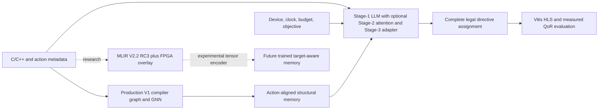
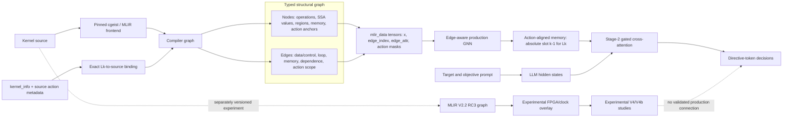
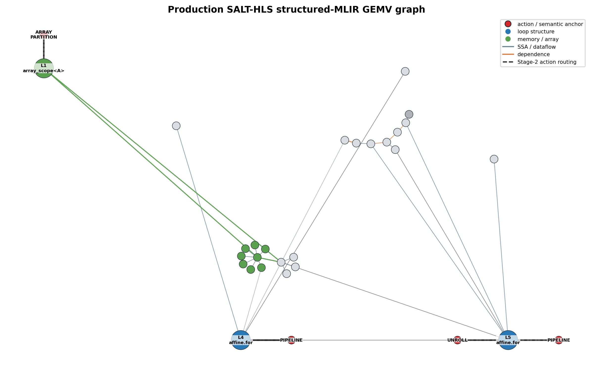
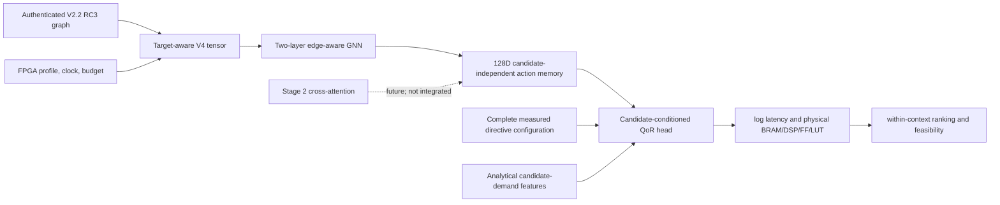
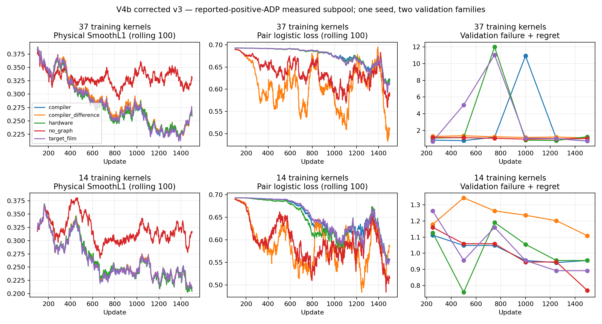

# MailoHLS / SALT-HLS

Revision-2 architecture evidence and Davinci handoff: [Architecture decisions](docs/architecture_freeze/ARCHITECTURE_DECISIONS.md). GPU qualification remains pending.

[Target-conditioned architecture qualification](docs/architecture-finalization/README.md): retained latency endpoint, measured limits, and executable configuration.

## Research branch status — 5 November 2026

Production remains on the existing V1 GNN and its current Stage-2 contract.
The selected structural representation for the **next GNN research comparison**
is the native MLIR V2.2 RC3 canonical compiler graph, V4 semantic tensorization,
and source-verified absolute `Lk → slot k−1` action alignment. Keep the FPGA
hardware overlay separate. This is not a production promotion or a replacement
for V1 artifacts.

V4b full-cohort corrected-v3 training, matched controls, evaluation, and
alignment interventions are complete. Evidence is mixed: compiler memory does
not consistently beat the independent no-graph model; hardware messages do not
show a reliable extra gain; action-difference attention did not improve
selection; and meaningful held-out device/clock preference coverage is absent.
Validation contains only two families. No V4b model is connected to Stage-2.
See the [corrected-v3 report](#v4b-final-scientific-report--corrected-v3-2026-11-04),
the [GNN architecture guide](docs/gnn-refinement/README.md), and the
[GEMV graph-to-embedding walkthrough](docs/gnn-refinement/README.md#worked-example-gemv-32-by-32-from-c-code-to-compiler-graph-to-gnn-embeddings).

This branch also contains a standalone authenticated GEMV RC3 graph and actual
trained V4b embedding exports. They are out-of-cohort inference evidence, not
new measurements or training records. The walkthrough links their exact source,
manifests, figures, arrays and checkpoint identities.

MailoHLS learns complete HLS directive configurations for C/C++ kernels under
an optimization objective, FPGA device, clock period and resource budget. SALT-HLS
is the extended framework name used in the research work.

The production pipeline uses the **V1 GNN**, action-aligned structural memory,
and selected LLM adapters. Stage 1 learns target-conditioned directives; Stage 2
adds structural cross-attention; Stage 3 optimizes preference pairs. Selected
artifacts and objective-specific availability are recorded in
[`FINAL_ARTIFACTS.json`](FINAL_ARTIFACTS.json). In particular, production Stage 2
and Stage 3 are selected for ADP; other stages/objectives have the explicit
fallback or pending status in that manifest.



## Structural pathway: compiler graph to action memory

The production structural path preserves compiler structure, then aligns its
learned representation to the source action IDs used by directive generation.
The graph is not a picture of the C++ syntax tree alone: nodes and typed edges
represent operations, values, control/region structure, loops, memory actions,
and verified directive anchors.



**What each stage means:** the frontend and native analysis create graph facts;
`mlir_data.py` turns node and edge attributes into the tensors consumed by the
GNN; the GNN produces representations associated with compiler action anchors;
the memory exporter stores those representations in stable absolute `Lk-1`
slots; Stage-2 lets directive-position token states attend to the selected
memory under the configured slot/relation mask. The target request remains in
the LLM prompt. An inactive or missing `Lk` keeps its identity and mask state;
later actions are never renumbered to close a gap.

The action binding is source- and metadata-validated. A loop anchor can be
associated with loop directives, and an array anchor with array-partition
directives. Compiler relations provide context for routing; an absent or
unknown relation is not proof that actions are independent. Numerical hardware
features in the V2.2/V4 experiments do not change the production V1 memory or
checkpoint contract. The dashed experimental branch in the diagram stops at
research evaluation because V4/V4b has not earned Stage-2 integration.

### A concrete graph example: GEMV

The branch already contains a real compiler graph visualization. It is a
readable, reduced neighborhood of the checked-in production GEMV GEXF, not a
hand-drawn or synthetic graph. It retains the selected action anchors and
production edges from their two-hop semantic neighborhood; the figure shows
31 nodes and 44 edges. The full graph and its action manifest remain available
beside the figure.



In the checked-in `kernel_info.txt`, `L1` is the partitionable array `A` at
source line 5, `L4` is the outer loop at line 12, and `L5` is the inner loop
at line 16. The red directive nodes and dashed routing lines show which
action-aligned memory slots serve directive positions. Those dashed lines are
Stage-2 routing links, not compiler dependence claims. The orange dependence
edge is retained from the compiler graph with its `proven` evidence label;
the remaining visible edges show dataflow, loop/region, memory, or action-scope
relationships. The graph contains no target clock, resource budget, measured
QoR, or candidate-selected directive values.

The visualization is reproducible from
[`paper_figures/render_gemv_mlir_paper.py`](paper_figures/render_gemv_mlir_paper.py)
and the checked-in graph at
[`paper_examples/gemv/gemv_mlir.gexf`](paper_examples/gemv/gemv_mlir.gexf).
The reduced-graph manifest records the selected actions, node/edge provenance,
and source graph hash:
[`paper_figures/gemv_mlir_reduced.json`](paper_figures/gemv_mlir_reduced.json).
The original MLIR, expanded figure and vector exports are also available:
[`gemv.mlir`](paper_examples/gemv/gemv.mlir),
[`full SVG`](paper_figures/gemv_mlir_paper.svg),
[`PDF`](paper_figures/gemv_mlir_paper.pdf), and
[`L1`](paper_figures/gemv_mlir_zoom_L1.svg) / [`L4`](paper_figures/gemv_mlir_zoom_L4.svg)
action neighborhoods.

MLIR V2.2 RC3 and its hardware overlay are experimental representations. They
are **not interchangeable with production V1 tensors or checkpoints**. The
readiness-pilot and incomplete-run statements in the following historical
sections describe earlier snapshots. The completed V4b evidence and its
limitations are summarized above and in the dated final report.
See [development status](docs/framework-development-status.md) for branch links
and the boundary between implemented, evaluated and planned functionality.

The earlier, smaller V4 directive-preference probe trained three matched
directive-preference models for 300 updates: compiler-only memory,
device/clock-FiLM memory, and the existing hardware-message graph. Hardware
messages did not improve held-out ADP selection over compiler-only memory;
FiLM's small pair-accuracy gain came with worse feasible top-1 selection and
regret. All arms missed the 21 meaningful budget-driven winner changes, and
validation had no meaningful device or clock winner changes. The result is
limited to two validation families and one seed; it does not justify Stage-2
integration or a richer hardware graph. See the [full results and audit](README.md#merged-experiments-v22-gnn-training-results-md)
and [current next-step brief](README.md#merged-experiments-v22-gnn-training-next-steps-brief-md).
V4 remains experimental; production still uses the V1 GNN.

## Start here

| Need | Guide |
|---|---|
| Understand stages, schemas and code ownership | [Architecture](docs/architecture.md) |
| Install and reproduce selected experiments | [Reproducibility](docs/reproducibility.md) |
| Inspect experiment questions and limitations | [Experiment index](docs/experiments.md) |
| Inspect compiler graphs and uncertainty | [V2.2 compiler guide](docs/structural-graph-v22.md), [review status](docs/V22_FINAL_RELEASE_REVIEW.md) |
| Inspect FPGA graph enrichment | [Target-aware graph guide](docs/target-aware-mlir-v22/README.md) |
| Verify or restore registered graph artifacts | [Artifact policy](docs/reproducibility.md#artifacts) |
| Contribute without breaking historical results | [Developer guide](docs/development.md) |

## Installation and a small example

Use an isolated environment with the dependencies in `requirements.txt`.
GPU/CUDA, model weights, Vitis and the pinned Polygeist toolchain are separate
requirements for their respective workflows. Nothing below launches training
or synthesis:

```bash
python scripts/artifacts.py list
python scripts/artifacts.py verify --artifact salt-hls-graphs-v22-20261027-rc3
python -m LLM_branch.common.directive_domain_workflow --workflow train --domain-policy tcad
```

Graph verification needs only the Python standard library. Directive inspection
uses the shared domain contract; execution and domain shifts require explicit
flags documented by that module. Existing checkpoint policies are not relabeled.

For model training and inference, follow [reproducibility](docs/reproducibility.md)
and [maintained launcher choices](docs/shell-scripts.md). Cloning the source
repository does not download pretrained model weights. Frozen compiler graph archives and original measurements remain tracked. Historical checkpoint evidence, generated graphs, synthesis snapshots and derived
CSV tables can be restored directly from their sealed original Git objects:

```bash
python scripts/artifacts.py restore-git --artifact harp-generated-graphs-v1
```

See [reproducibility](docs/reproducibility.md) for the other artifact IDs and
catalog recovery. Normal development does not require GitHub Releases. Generated
outputs remain ignored; selected model weights are supplied separately.

## Repository map

`GNN_branch/`, `LLM_branch/` and `Preprocessing/` own the maintained implementations.
`Data/` and `evaluation_set/` hold benchmark inputs and measurements.
`experiments/` contains research methods and reports; `scripts/` contains
launchers and utilities; `tests/`, `docs/` and `toolchain/` hold regression checks,
guides and pinned compiler provenance. `HARP-rep/` preserves the modified baseline.
`src/` contains historical implementations and documented compatibility entries.
Do not infer production status from directory or checkpoint names containing
`final`.

## Six-branch development structure

| Branch | Responsibility |
|---|---|
| `main` | Finalized framework and selectively integrated, validated improvements. |
| `mlir-target` | Immutable historical MLIR baseline. |
| `llvm-ir` | Immutable historical LLVM baseline. |
| `research/stage1-refinement` | Stage-1 supervision, recovery and measured-quality research. |
| `research/gnn-refinement` | Graphs, semantic tensors, hardware awareness and GNN research. |
| `research/refinement-mechanism` | HLS feedback, directive refinement and search research. |

Use configurations and result directories for experiment variants within these
three research branches. Keep unfinished work there and selectively integrate
validated improvements into `main`. Update a shared research branch with
`git fetch origin` followed by `git merge origin/main`; preserve local work first.
Do not force-rewrite shared history. Detailed conventions are in
[development](docs/development.md).

## V4b GNN research status

**Current status (5 November 2026):** the V4b full-cohort audit, matched
training, evaluation, capacity control, and alignment interventions are
complete. The authenticated cohort contains 37 training and three validation
kernels; Kalman remains untouched. Meaningful device/clock preference changes
are sparse in training and absent in held-out families. Results are mixed and
do not show a reliable compiler-memory, hardware-message, or action-difference
selection advantage. No V4b result justifies Stage-2 integration; production
continues to use V1 memory. See the
[V4b results and limitations](README.md#merged-experiments-v22-gnn-training-results-md),
[frozen evaluation/resume protocol v2](README.md#merged-experiments-v22-gnn-training-v4b-protocol-v2-md),
the [implementation guide](README.md#merged-experiments-v22-gnn-training-v4b-readme-md),
and the [standalone GEMV structural walkthrough](docs/gnn-refinement/README.md#worked-example-gemv-32-32--from-c-code-to-compiler-graph-to-gnn-embeddings).

### Interpretation across V4 studies

The branch contains multiple experiments that answer different questions; they
must not be collapsed into one model result.

| Study | What it establishes | What it does not establish |
|---|---|---|
| Fixed-context learnability | A candidate-QoR model can reduce training error on 24 measured assignments from one context; the 1,000-update run reduced standardized loss and latency MAE. | Held-out prediction, target generalization, or improved measured selection. Its predicted-best candidate stayed the same from step 1. |
| Three-arm directive-preference probe | Compiler-only, device/clock-FiLM, and hardware-message arms can be trained and compared with matched initialization and selected validation pools. | A hardware-message advantage. All arms missed the 21 meaningful validation budget winner changes; the validation set had no meaningful device/clock reversals. |
| V4b full-cohort audit | Strict source/action eligibility and exact target/budget preference coverage can be audited without filling unknown action fields. Of 55 kernels, 37 train and three validation kernels satisfy the complete-assignment contract. Meaningful preference reversals are sparse and none were found in its two validation families. | A completed V4b training result. Both GPU smokes stopped during repeated CPU feature preparation before any optimizer update or checkpoint. |

For the three-arm held-out probe, hardware messages changed representations and
some rank scores but did not produce consistent improvements in QoR, feasible
top-1 selection or measured-pool regret over numerical target conditioning.
The validation comprises two families and one seed; it is evidence against a
current integration claim, not proof that a larger, better-covered study could
never benefit. The full results give per-context metrics, cohort identities,
hashes and preserved failed attempts in
[`experiments/v22_gnn_training/RESULTS.md`](README.md#merged-experiments-v22-gnn-training-results-md)
and [`AUDIT.md`](README.md#merged-experiments-v22-gnn-training-audit-md).

### Research boundary and next decision

Production remains the V1 GNN and its selected action-aligned memory. V2.2/V4
encoders and their tensor contracts are experimental and cannot be substituted
into production checkpoints solely because embedding widths match. No V4/V4b
checkpoint has been selected for Stage-2, and no result here demonstrates
measured HLS improvement from changing GNN memory.

The evidence supports a narrow next step: expand family-disjoint validation
coverage, selected without QoR, so that meaningful target- or budget-dependent
winner changes are actually present; verify feature preparation is bounded
before requesting another GPU training run. A candidate/target control without
learned graph memory is needed to attribute any later gain to graph structure.
Do not treat the existing two-family probe as a basis for tuning and then as a
held-out evaluation. See the [V4 next-step brief](README.md#merged-experiments-v22-gnn-training-next-steps-brief-md)
and [V4b audit](README.md#merged-experiments-v22-gnn-training-audit-md).

---

## Consolidated research documentation
The following dated notes were merged from their former files so the branch has one explanatory entry point. Their original document boundaries and content are retained below; status statements remain tied to the dates and protocols recorded in each section. Machine-readable receipts and execution artifacts remain in their original paths.

<a id="merged-experiments-v22-gnn-training-readme-md"></a>
<details>
<summary>Consolidated from <code>experiments/v22_gnn_training/README.md</code></summary>

## V4 target-aware GNN training

**Current state (2026-11-01):** the bounded directive-preference study has
completed on the A2. Three matched 300-update arms compared compiler-only
memory, zero-gated device/clock FiLM modulation, and the existing hardware
message graph on 1,344 training and 288 validation measurements. The
hardware-message model did not improve held-out ADP preference accuracy or
measured-pool regret over compiler-only memory. FiLM had a small preference
accuracy gain but worse feasible top-1 and top-1 regret. The validation set has
no meaningful device or clock winner changes, and all three models failed to
identify the 21 meaningful budget-driven winner changes. This is evidence
against a current hardware-aware memory benefit, with only two validation
families and one seed. See the latest study in [`RESULTS.md`](README.md#merged-experiments-v22-gnn-training-results-md),
auditing in [`AUDIT.md`](README.md#merged-experiments-v22-gnn-training-audit-md), and the current decision in
[`NEXT_STEPS_BRIEF.md`](README.md#merged-experiments-v22-gnn-training-next-steps-brief-md). Exact outputs are linked below.

The earlier 20-update QoR pilot, 100/300/600-update QoR studies and
budget-independent QoR ablation remain historical, unchanged. No experimental
V4 memory was integrated into Stage 2; the production V1 memory and checkpoints
are untouched. The V100S was not used.

### What the experiment is meant to test

The experiment compares two matched candidate-conditioned regressors:

1. **Numerical conditioning:** V2.2 compiler graph, static action workload and
   semantic edge features; messages touching FPGA/resource nodes removed;
   numeric device, clock and budget context enters the prediction head.
2. **Hardware message passing:** the same encoder and head, with graph messages
   through the FPGA/resource nodes enabled. It receives the same late numeric
   target context as arm 1.

Both arms use the same complete directive assignments, candidate-demand input,
loss, measured records, optimizer and seed. The V4 encoder remains a
two-layer `TransformerConv` and returns 128D absolute-slot action memories.
V4 widens affine-map semantic support without changing tensor dimensions or
frozen graph contents.
Candidate directives and candidate-demand descriptors enter only the QoR
head; they are never attached to the static graph memory.

Both arms use the same target/context vector. Only the numerical arm's graph
edge set differs. An earlier draft zeroed the late context for the numerical
arm, which changed two conditioning pathways at once; the current trainer
retains identical numeric context in both arms.



The implementation predicts `log(1 + latency_ms)` and `log(1 + physical
resource count)`, standardized using **training rows only**. The resource
fractions in GNΩSIS are converted to physical counts using the authenticated
profile. A budget never changes these labels. Inference applies `expm1` and a
zero lower bound, so predicted physical latency and resources are nonnegative.
There is no cap at device capacity.

The objective is:

\[
\mathcal L = \operatorname{SmoothL1}(\hat y,y)
              + 0.1\,\mathcal L_{pairwise}.
\]

The pairwise logistic term is formed only among candidates from one
kernel/device/clock group and only when measured scores differ by more than 5%
relative. Its predicted monotonic `log1p` score is divided by a robust
within-training-context score spread, fitted on training records only. This
fixes the mismatch between physical units and a shared pairwise-loss
coefficient without changing ranking direction or using validation/test data.
The coefficient remains 0.1. Area is the existing arithmetic mean of the four
physical utilization fractions; ADP ordering within a fixed clock uses latency
times that area proxy. Feasibility comes only from measured resource counts
against an explicit budget. Budget contexts are 100% and 50% of physical
capacities; QoR labels remain unchanged across them.

### Authenticated data audit

The preflight reconstructs the compact GNΩSIS JSONL from the committed
preprocessed tables and verifies its hash against the selected manifest and
seed-123 family split. It authenticates every one of the 55 GNΩSIS source,
metadata, local-header, APL, CSV and graph chains against the frozen 63-snapshot
MLIR V2.2 RC3 release. It validates measured assignments with the shared
source-aware directive-domain implementation.

| Audit item | Verified count/result |
|---|---:|
| Raw CSV records | 219,864 |
| Existing preprocessing-valid measurements | 175,874 |
| Aggregated unique design points | 150,026 |
| Authenticated graph snapshots / matched GNΩSIS kernels | 63 / 55 |
| Seed-123 split | 50 train / 4 validation / 1 test kernels |
| Split records | 130,310 train / 13,011 validation / 6,705 test |
| Complete source-domain-valid assignments | 149,227 |
| Records excluded: APL action has no measured CSV column | 45,080 |
| Records excluded: source-aware joint tuple violation | 799 |
| Records eligible after explicit exclusions | 104,147 |
| Compiler-unresolved action rows retained with source values and masks | 8,258 |
| External-device/clock records in the selected training JSONL | 0 |

Rows from a kernel with an action lacking an APL measurement column are
excluded: preprocessing writes the source action's disabled default into the
serialized target, but that is not a measured directive label. We do not infer
it. The 799 invalid joint tuples (300 at L3, 339 at L4 and 160 at L6) are
excluded rather than repaired. In contrast, source-measured values for
compiler-unresolved but registered actions are retained as candidate inputs;
their compiler-derived action embeddings remain masked. The eligible split is
88,466 train / 8,976 validation / 6,705 test records, across 37 / 3 / 1
kernels respectively. The test remains Kalman alone, so this is a narrow
held-out-family evaluation even after it becomes runnable.

The machine-readable fresh audit is in the preflight output directory linked
from [`AUDIT.md`](README.md#merged-experiments-v22-gnn-training-audit-md). Its
graph archive SHA256 is
`feb2c2d469bf6672248ad0f3a88099ac9627b3b10b8e139a0fab050d532a1b73`; the
reconstructed selected dataset SHA256 is
`afdf4af8e6defc559871a6ec92185e6321313979ff3f1495806e5b037d5ab820`.
The audit verifies source/metadata/APL/CSV/graph correspondence. The training
protocol rechecks it and binds the resulting identities to the experiment.

### Candidate and target inputs

The complete assignment includes PIPELINE, UNROLL and ARRAY_PARTITION type,
factor and dimension values in absolute `Lk -> k-1` slots. The full assignment
is checked against the existing source-specific TCAD tuples. The separate
candidate-demand tensor is obtained from `candidate_demand_tensor()` and
contains the existing nominal unroll, arithmetic/access and supported banking
features with their knownness encoding. These are analytical descriptors, not
synthesized operator counts, memory ports or schedules.

Static compiler memory remains identical when candidates differ. The
candidate-demand tensor is supplied directly to the candidate head in every
training and evaluation call. No gold directive winners, Pareto ranks or
measured QoR values are features.

### Training and evaluation protocol

The default optimizer is AdamW (`3e-4`, weight decay `1e-4`), gradient norm
clipping at 1, seed 123, 8 candidate configurations per update, and up to 8,000
updates per model arm. Training samples one kernel/device/clock group per
update, then samples candidates within that context. It samples one of the
three repository objectives and one of two explicit budget contexts.

Validation evaluates up to 256 configurations per context in deterministic
configuration-hash order every 500 updates. The validation selection score is
`0.4 * feasibility_error + 0.2 * ranking_error + 0.2 * bounded_regret + 0.2 *
bounded_QoR_error`, macro-averaged across validation contexts. Feasibility
error uses both budget levels; ranking error is normalized Spearman error over
PARETO_LATENCY/AREA/ADP; QoR error combines latency MAPE and normalized
physical-resource MAE. Test metrics are computed once after validation
checkpoint selection. The selected validation step and metrics are saved with
the checkpoint. The V4 evaluator reports objective-specific Spearman/Kendall
correlations and undefined reasons, top-1/3/5/10 measured-pool feasible
selection and regret, false-feasible selections, empty-pool outcomes and
budget-induced QoR shifts. Periodic validation remains a deterministic subset
and labels subset regret explicitly. The frozen checkpoint-selection score is
unchanged. If every ranking correlation is undefined, its predeclared score
uses an explicit neutral zero correlation fallback; the report marks that
fallback and gives defined/undefined counts and reasons. The bounded evaluation described in `RESULTS.md` ran on the A2; the full
8,000-update protocol and full 104,147-record candidate-pool evaluation remain
unrun.

The readiness pilot's historic three-kernel results are not modified or
reinterpreted. That pilot did not include family-held-out evaluation and did
not pass candidate-demand tensors during its original training loop. Its
metrics are not results for this training implementation.

### Learnability and target-conditioning follow-up (2026-11-01)

The fixed-context diagnostic used the existing V4 model, RC3 graph and one
training-family context (Stencil2D, ZCU104, 10 ns). It trained on 24 distinct
measured assignments selected by complete-assignment Hamming diversity without
using QoR for selection. Regression-only loss fell from standardized SmoothL1
0.3363 for the constant predictor to 0.0940 after 1,000 updates. Latency MAE
fell from 0.4023 ms to 0.2479 ms; within-set Spearman was 0.701. The model's
predicted best was 1.05% above the best measured latency, but it did not select
the exact best assignment. This establishes candidate-dependent memorization
on this set, not held-out learning.
The separate 200- and 1,000-update manifests/results, including selected
assignment hashes and checkpoint identities, are in
[`results/fixed_context_learnability_200_s123_manifest.json`](experiments/v22_gnn_training/results/fixed_context_learnability_200_s123_manifest.json),
[`results/fixed_context_learnability_s123_manifest.json`](experiments/v22_gnn_training/results/fixed_context_learnability_s123_manifest.json),
[`results/fixed_context_learnability_200_s123_results.json`](experiments/v22_gnn_training/results/fixed_context_learnability_200_s123_results.json),
and [`results/fixed_context_learnability_s123_results.json`](experiments/v22_gnn_training/results/fixed_context_learnability_s123_results.json).

A separate 100-update comparison used 5 training families and 2 held-out
validation families, each across ZCU104/U200 and 3.33/5/10 ns. It compared the
same V4 graph encoder with hardware-resource messages enabled or removed, plus
a small candidate/demand/numerical-context MLP. The graph arms shared the exact
initial weights and 100-update sampling trace. The fixed-step results were not
selected on validation. The MLP is a simple control, not a parameter-matched
ablation (338,053 parameters versus 116,081 for either graph model).

The 480 training records use 16 directive assignments per kernel shared across
all six target contexts. Validation contains 180 records: 16 hash-selected
Viterbi assignments per context and the 14 PathFinder assignments shared
across all six. Validation assignment selection did not inspect QoR. The test
family (Kalman) was excluded from training, selection and evaluation. Exact
identities and overlap counts are in
[`results/target_coverage_audit_s123.json`](experiments/v22_gnn_training/results/target_coverage_audit_s123.json)
and [`results/target_condition_probe_s123_manifest.json`](experiments/v22_gnn_training/results/target_condition_probe_s123_manifest.json).

| Validation measure (12 kernel/device/clock groups) | Candidate + target | Numerical GNN | Hardware GNN |
|---|---:|---:|---:|
| Latency MAPE, macro | 0.6888 | 0.6126 | 0.6066 |
| Latency MAE, ms, macro | 6.4723 | 6.5538 | 6.3968 |
| Resource MAE / capacity `[BRAM,DSP,FF,LUT]` | `[.02395,.00071,.04305,.21402]` | `[.02395,.00104,.04314,.21046]` | `[.02395,.00104,.04314,.21095]` |
| Latency Spearman, macro | 0.2360 | 0.0791 | 0.1473 |
| Latency Kendall, macro | 0.2231 | 0.0494 | 0.1098 |
| Latency top-1 measured-pool regret, macro | 7.3810 | 0.2865 | 2.3451 |
| Latency top-3 measured-pool regret, macro | 0.2755 | 0.0605 | 0.0029 |
| 100% budget accuracy / always-feasible baseline | 1.000 / 1.000 | 1.000 / 1.000 | 1.000 / 1.000 |
| 50% budget accuracy / always-feasible baseline | .816 / .816 | .816 / .816 | .816 / .816 |
| 50% false-feasible assignments / selected actually feasible | 31 / 9 of 12 | 31 / 10 of 12 | 31 / 9 of 12 |

Latency top-1 regret is highly context-sensitive: the hardware arm is best on
top-3 but has much worse macro top-1 regret than the numerical arm. Under the
50% budget all arms have the same accuracy as predicting every candidate
feasible, so that score is not evidence of a learned feasibility rule. At 100%
all selected candidates are feasible by construction of the measured pool.
Area/ADP regret is undefined in one Viterbi/U200/5 ns context because its
measured optimum is exactly zero; the corrected summary excludes that one
context (11/12 defined), rather than reporting a huge epsilon-denominator
percentage. The raw output is preserved and the corrected, denominator-aware
summary is in [`results/target_condition_probe_s123_summary.json`](experiments/v22_gnn_training/results/target_condition_probe_s123_summary.json).

Exact target pairing supports 91 assignment-pair observations across 10 clock
comparison groups and 45 across 5 device comparison groups, from only two
validation kernels. These pairs overlap and are not independent samples. On
PathFinder, the hardware arm gets the clock-change sign right in many paired
cases but has large absolute paired-delta errors; it gets the device-change
latency sign wrong in all three device groups. Viterbi intersections are sparse
(one to three selected assignments per nonempty pair). These are weak target
response diagnostics, not evidence of cross-device generalization.

The hardware relation rows receive finite nonzero mean gradient norm
`1.04e-4`; the numerical arm receives zero for those rows. Disabling hardware
edges in the trained hardware model changes action memories (mean relative
L2 shift 0.509), selected latency candidates in 10/12 validation contexts, and
macro latency Spearman from 0.147 enabled to -0.220 disabled. Yet enabled
messages worsen mean top-1 latency regret from 0.697 to 2.345. Thus the path is
used, but its contribution is mixed and does not show a reliable selection
benefit. This ablation is distinct from the separately trained numerical arm.

Predicted physical QoR changes when only the requested budget changes for the
same candidate/device/clock. Mean absolute predicted latency shifts are 0.0124
ms (candidate MLP), 0.1105 ms (numerical GNN), and 0.1417 ms (hardware GNN).
This violates the desired physical-QoR budget invariance, even though measured
labels are reused unchanged. It is evidence for a future, separately versioned
model contract with physical QoR conditioned on program/candidate/device/clock
and feasibility derived against the requested budget. No V4 schema or graph was
changed in this diagnostic.

**Interpretation:** V4 can memorize some candidate-dependent QoR on one fixed
context. The 100-update cross-family experiment does not establish accurate
QoR, target-aware device response, or a consistent incremental benefit from
hardware messages. The hardware arm is not ready for Stage-2 use. The next
smallest useful step is a predeclared 300–600 update continuation of the exact
same deterministic three-arm cohort when the A2 is available, followed by the same
validation protocol. Do not change graph features, loss or target semantics
simultaneously.

The run completed on the A2 UUID
`GPU-1a87c5a7-652d-d582-29e8-a5fccb11ce35` in 7.56 seconds GPU time after
94.96 seconds of authenticated data loading and 136.59 seconds of feature
preparation. Selected graph, assignment and demand tensors were precomputed
once in memory and shared across arms and validation; this follow-up did not
write a reusable on-disk tensor cache. Peak CUDA allocation was not recorded.
Model weights and raw run artifacts remain in `/tmp`; tracked receipts include
raw output, corrected summary and exact cohort identities. Reproduction commands and
checksums are in [`RESULTS.md`](README.md#merged-experiments-v22-gnn-training-results-md) and [`AUDIT.md`](README.md#merged-experiments-v22-gnn-training-audit-md).

### Reproduction

The complete versioned protocol, isolated runtime, authenticated graph release,
safe detached launch, monitoring and exact resume commands are in
[`RUN_PROTOCOL.md`](README.md#merged-experiments-v22-gnn-training-run-protocol-md). The verified runtime is an isolated
Python 3.10.20 environment using existing CUDA PyTorch 2.6.0+cu124, PyG 2.6.1
and SciPy 1.15.3. The launcher selects and pins a GPU by UUID, not by assumed
CUDA ordinal, and refuses a busy GPU. It requires a clean source branch and a
new output directory.

Previous V3 A2 profiling completed forward/backward/update checks for
Stencil2D, GEMM and AES without OOM. AES tensorization was 60,297,588 CPU
bytes; its measured-candidate update peaked at 656,113,664 allocated CUDA
bytes. These are historical V3-compatible results, not V4 GPU validation.
See [`AUDIT.md`](README.md#merged-experiments-v22-gnn-training-audit-md) for provenance.

### Checkpoint and Stage-2 memory contract

Selected checkpoints are written only under the fresh ignored output directory
and carry graph, overlay, tensor, demand and candidate-head schema identifiers,
normalization statistics and validation/test metric records. The encoder's
candidate-independent action memory remains `[1, 64, 128]` with registered,
matched, unresolved and source-only masks. Candidate-demand features and
measured QoR are not exported. Target/context-specific memory cache keys must
include graph identity, profile, clock and budget. No Stage-2 loader or training
integration is included here.

The V4 memory is not compatible with V1 memory checkpoints. It is trained for
candidate-conditioned QoR, while Stage-2 needs candidate-independent memory
that improves directive generation. Any future Stage-2 study must compare
Stage-1 prompt-only, Stage-2 with production V1 memory, V4 numerical memory,
and V4 hardware memory on identical directive-generation cases. The current
probe gives no evidence to replace the production V1 memory.

### Current outcome and limitations

The earlier V100S smoke is preserved and failed at its first validation because
`Counter` was missing from the evaluator imports; it completed five numerical
updates and produced no selected checkpoint. That import defect is fixed. A
separate early cohort attempt exposed missing measured action columns for
Sort-Radix L6, so that validation kernel was excluded rather than assigned a
fabricated label. The replacement Viterbi cohort is fully mapped. The A2 was
verified idle before completed probes. A later corrected-report retry was
refused when an unrelated VLLM process occupied it; no GPU process was
signalled.

Even after that run, Kalman is one test family; U50 and 6.67 ns remain outside
the training contexts and are needed for claims about target generalization.
The graph does not provide a synthesis-exact resource-binding or schedule
model, and Stage-2 remains future work. Nothing here establishes improved HLS synthesis QoR
or target generalization.

### Branch provenance

The consolidated branch `research/gnn-refinement` includes the resumable trainer from
`bf93db9`; semantic coverage corrections/audits from `26c2247` are incorporated
without changing the frozen RC3 program graph or hardware-overlay schemas.
The current tensor schema is `salt-hls-target-tensors-v4-semantic-wide-affine-experimental`.
It keeps dimensions, action slots, candidate/static separation and the two-layer
encoder. Existing corpus values are unchanged where the earlier cap was never
exceeded; new verified wider affine maps are no longer masked unnecessarily.

Original V3 GPU preflight receipts above remain historical; they are not V4 GPU
measurements. A V3 checkpoint or old worktree is not a V4 checkpoint. The
schema/source/protocol checks reject incompatible resume. The current V4 run
status and any QoR conclusion are reported only in `RESULTS.md`.

The complete catalog is recovered with `scripts/artifacts.py restore-git` from
original commit `42f52df`; its history is retained here. The Hotspot export is
retained at commit `4a308a0`, including its authenticated archive and guide.
Original research heads are preserved as provenance parents after deliberately
selecting their current modules, not by importing their old runtime/data trees.

### Design decisions and rationale

| Decision | Alternatives considered | Why selected | What remains unchanged | Validation |
|---|---|---|---|---|
| Keep numerical device, clock and budget context in both arms | Make the numerical arm target-free | Isolates hardware-resource relational messages as the experimental variable | Candidate head, labels and all other inputs | CPU tensor-equivalence and model-path tests |
| Keep hardware nodes but remove every edge touching them in the numerical arm | Remove nodes or zero their features | Preserves IDs while blocking hardware-node information; pooling includes compiler nodes only | Program-node features and absolute action slots | CPU test mutates a hardware feature and verifies numerical action memories stay fixed |
| Record initial parameter hashes and per-update sampled identities | Assume equal seed means identical training | Makes initialization and sampling parity auditable and fails fast on divergence | Seed, sampler and optimizer settings | Deterministic unit test plus run-time pair checks |
| Preserve the existing validation-selection score | Select a new metric after observing results | Avoids outcome-driven checkpoint selection | Existing 0.4/0.2/0.2/0.2 score | Selection-score regression; expanded metrics are report-only |
| Count false-feasible and empty-pool outcomes; retain undefined correlations | Average only successful picks or silently substitute a rank score | Keeps failures and undefined populations visible | Physical feasibility and measured-pool objective definitions | Focused empty-pool, tie and false-feasible tests |
| Add regression-only fixed-context memorization before target generalization | Treat validation failure as proof the GNN cannot learn | Separates candidate-head learnability from family generalization | V4 encoder, graph and output schema | 24-design training-only probe; constant baseline and train-set rank |
| Freeze all-six-context assignment intersections for training; use hash-only validation selection | Select favorable validation QoR or use loose directive similarity | Makes true clock/device pairs observable without validation-label selection | RC3 graphs, dataset and family split | Exact SHA assignment intersections in target-coverage audit |
| Add a non-graph candidate/demand/target MLP only as a diagnostic | Compare graph models only | Checks whether candidate plus numeric target can explain these labels | Candidate and target feature contract | Same selected measured validation pools; parameter-count difference disclosed |
| Mark relative regret undefined at near-zero measured optima | Divide by an arbitrary epsilon | Avoids enormous meaningless area/ADP percentages | Raw predictions and measured labels | Authenticated zero area/ADP optimum in Viterbi/U200/5 ns; focused unit test |

V4 checkpoints and optimizer states are incompatible with V3 and must use a
fresh protocol identity. This experiment does not change the frozen compiler
graphs, target overlay, candidate-demand contract, training split or production
V1 GNN. Prior V3 GPU measurements remain historical and are not V4 results.


### Bounded V4 fast probe (2026-11-01)

The previous full-corpus validation path repeatedly enriched candidates and
recomputed demand descriptors for thousands of rows. The fast probe uses the
existing V4 tensorizer, encoder, candidate head, loss and evaluator, but
authenticates a fixed small cohort and computes each selected graph/context,
complete directive vector and candidate-demand tensor once. A hashed cache is
shared by both arms and all validation calls. Cache keys bind the RC3 graph,
V4 schema, source/action mapping, feature implementation, target context,
assignment and demand schema. Equality checks compare cached values with the
public V4 construction paths. This changes when features are computed, not
what information the models receive.

| Decision | Alternative | Reason and scientific effect | Validation |
|---|---|---|---|
| Precompute 112 selected candidates and 28 graph tensors | Recompute each validation | Avoid repeated compiler feature work while preserving exact inputs | 28 graph, 112 candidate-vector and 112 demand equality checks |
| Keep V4 graph/tensor schemas unchanged | Add/derive new semantic features | Isolate existing hardware-message representation | RC3 archive and tensor schema hashes recorded in cohort manifest |
| Use five training kernels and two validation kernels from distinct held-out families | Random row split or test-family tuning | Test transfer to two represented unseen families without splitting related kernel rows | Seed-123 family membership checked before selection |
| Select training candidates by directive Hamming diversity; validation candidates by hash order | Select validation winners using QoR | Training diversity is useful; validation labels must not choose the pool | Selection rules and candidate hashes frozen in manifest |
| Use 20 matched updates per arm, seed 123 | Continue the old 8,000-step plan | Bound the diagnostic; assess feasibility before a larger study | Identical initial-state and sample-trace hashes |
| Run one hardware-edge ablation after matched training | Add model variants | Check whether the learned hardware path changes representations and decisions | Embedding/prediction/ranking deltas recorded |

Exact inputs and results: [`fast_probe_s123_cohort_manifest.json`](experiments/v22_gnn_training/results/fast_probe_s123_cohort_manifest.json) and
[`fast_probe_s123_summary.json`](experiments/v22_gnn_training/results/fast_probe_s123_summary.json). Model
weights and the detailed update journal stay outside Git at
`/tmp/v22-gnn-v4-fast-probe-s123-r4/training/`. Reproduction commands:

```bash
PYTHONPATH=. /tmp/mailohls-v22-gnn-env-20261030/bin/python \
  -m experiments.v22_gnn_training.fast_probe prepare \
  --release-dir /tmp/salt-v22-training-release \
  --output /tmp/v22-gnn-v4-fast-probe-s123-r5 \
  --preparation-limit-seconds 600

CUDA_VISIBLE_DEVICES=GPU-1a87c5a7-652d-d582-29e8-a5fccb11ce35 PYTHONPATH=. \
  /tmp/mailohls-v22-gnn-env-20261030/bin/python \
  -m experiments.v22_gnn_training.fast_probe run \
  --output /tmp/v22-gnn-v4-fast-probe-s123-r5 \
  --run-output /tmp/v22-gnn-v4-fast-probe-s123-r5/training \
  --gpu-name A2 --gpu-uuid GPU-1a87c5a7-652d-d582-29e8-a5fccb11ce35 \
  --updates 20 --candidates-per-update 8 --gpu-limit-seconds 1200
```

The first attempt selected Sort-Radix, whose L6 registration has no
authenticated measured column; it failed explicitly and was preserved. The
final manifest instead uses Viterbi and PathFinder baseline validation graphs.
No test-split measurements were loaded into the cohort cache.

### Corrected 300-update evidence and design decisions

The follow-up corrected target-difference scoring: a latency delta is
meaningful only when it exceeds `max(1e-5 ms, 1% of the larger paired
latency)`. The absolute tolerance corresponds to one 10 ns cycle expressed in
milliseconds. Exact complete-assignment hashes are required. Near-zero pairs
are excluded from sign accuracy but retained in error summaries. The
zero-area/ADP audit traced nine Viterbi/U200/5 ns measurements to source CSV
rows whose four utilization fields are present and literally zero. Conversion
is consistent with those recorded percentages; unavailable sub-percent raw
counts prevent deciding whether the values are exact or rounded. The labels
were preserved and relative regret at zero optimum remains undefined.

The matched 300-update models improved some ranking measures, but not
consistently. Hardware latency Spearman improved from 0.147 at 100 updates to
0.392 at 300; its top-1 regret remained 2.345, and latency MAPE rose from
0.607 to 1.001. All arms predict every 50%-budget candidate feasible, matching
the always-feasible baseline (149/180 correct). Meaningful device evidence is
only 3 of 45 exact pairs; the remaining 42 are near-zero. The numerical GNN
gets the direction of clock changes right in 0.958 of the meaningful pairs,
but its paired-delta MAE is still 7.29 ms. The hardware arm's clock direction
accuracy is 0.042. These results do not establish reliable target response.

The original V4 model also lets the requested budget change predicted
physical QoR. The separately versioned physical-QoR/budget-separation run
reduced this drift below `5e-7 ms`, but did not consistently improve
validation: hardware latency Spearman fell to 0.243 and top-1 regret rose to
6.457. Budget separation fixes a semantic inconsistency; it does not prove
better learning.

| Problem | Evidence | Decision | Alternatives | Test/result |
|---|---|---|---|---|
| Target-difference threshold compared a delta with itself | Any nonzero delta almost always passed | Threshold against original paired latency and one-cycle absolute tolerance | Keep defective test | Synthetic boundary tests; 91/91 clock pairs meaningful, only 3/45 device pairs |
| Zero area/ADP optimum | Nine raw rows have present, literal zero utilization values | Preserve labels; use null relative regret and report absolute regret | Add an arbitrary epsilon or infer hidden counts | Provenance audit found no conversion defect |
| Physical QoR changed with budget | Original V4 shifts latency by 0.412 ms (numerical) and 0.629 ms (hardware) between 100% and 50% budget | Test a separately versioned budget-independent QoR pathway | Rewrite historical V4 | Drift < `5e-7 ms`; selection did not improve consistently |
| Hardware messages may be undertrained | 300-step hardware ranking improves, while other metrics and edge ablation are mixed | Keep current graph and encoder | Add layers, relations, or gates | Edge ablation results differ between formulations; utility is unproven |

Exact receipts are in `RESULTS.md`. The original 300-update run used seed 123,
the frozen cohort, and 20.66 GPU seconds on A2; data loading and feature
preparation took 94.28 s and 144.47 s. The budget-independent run took 18.70
GPU seconds and preserved the same sample trace and initial graph-model
parameters under a separate schema. Checkpoints and raw reports remain
outside Git. The model remains experimental; candidate-conditioned QoR
prediction does not validate V4's candidate-independent action memory for
Stage-2.

A fresh 600-update run subsequently showed that the graph models can fit the
fixed training context (latency MAE fell from about 1.15 to 0.34 ms), but
held-out metrics were mixed or worse than at 300 updates. Hardware-arm latency
Spearman was 0.243 and top-1 regret 2.618 at 600, compared with 0.392 and
2.345 at 300. At 600, the numerical arm predicted clock-change signs correctly
on 95.8% of meaningful pairs but had 7.32 ms paired-delta MAE. Hardware had
59.5% sign accuracy and 7.37 ms MAE. Candidate memorization therefore works;
target-difference magnitude and family-held-out QoR remain unreliable. The
authenticated training cohort offers 480 exact assignment clock pairs and 240
device pairs before filtering, so one predeclared clock-difference supervision
ablation is justified. Device transfer remains weakly evaluated. See the 600
step receipts and limitations in `RESULTS.md`.

### Directive-preference memory probe (2026-11-01)

This newest experiment changes the primary outcome from absolute QoR regression
to pairwise ranking of complete measured directive assignments. It compares
three candidate-independent memory paths with one shared, shallow preference
scorer:

1. **Compiler-only:** the V4 encoder with edges touching hardware nodes
   removed. The scorer still receives numerical device, clock, budget and
   objective context.
2. **Target-FiLM:** compiler-only memory with a zero-initialized gated
   modulation from authenticated device capabilities and requested clock. The
   requested budget and objective remain in the scorer.
3. **Hardware messages:** the existing V4 hardware-resource nodes and typed
   edges, plus the same numerical scorer context as arm 1.

The GNN memory is generated before a candidate is known. Candidate assignments
and analytical demand enter only the common scorer. No QoR, preference label or
selected-winner feature enters the memory. The scored objective is ADP by
default; latency and the existing area proxy are supplementary tasks. A
feasible candidate outranks an infeasible one; two infeasible candidates do
not form an objective pair; feasible objective pairs within 5% are ties and
are omitted. The lower model score means preferred. This pairwise ranking
probe is not DPO and does not modify the Stage-3 workflow.

The cohort is 14 training kernels across 12 families (1,344 measurement rows)
and three validation kernels across two disjoint families (288 rows). Each
selected kernel/target has up to 16 complete measured assignments; contexts
with less support are not padded with fabricated measurements. The fixed
validation pool includes ZCU104/U200 at 3.33, 5 and 10 ns and budget views at
100/75/50/25/10%. Budget views share physical measurements and are correlated.
No Kalman/test rows were loaded. The frozen cohort, pair audit and target
coverage receipt are under
[`results/directive_preference_v1/`](experiments/v22_gnn_training/results/directive_preference_v1).

One-time CPU preparation authenticates and tensorizes each of the 102
kernel/device/clock graph contexts, then prepares candidate vectors and demand
descriptors once. A run-scoped cache is shared by all arms and validation
calls, so compiler enrichment is not repeated during validation. The current
run checked cached versus existing construction on one candidate per graph
context and exercised multi-candidate cache reuse in the focused tests; this is
not a claim that every one of the 1,632 assignments was independently
re-materialized for equality. Cache artifacts remain outside Git. The cache is
bound to the cohort manifest; it is not a general-purpose reusable cache.

All arms use seed 123, AdamW (`3e-4`, `1e-4` decay), the same 300 sampled
updates and preference-pair trace, and validation at 100/200/300. Checkpoint
selection uses validation-only ADP preference accuracy, macro-averaged over
validation families. All three selected step 100. Compiler and
hardware-message models each have 107,565 parameters; target-FiLM has 171,694.
No parameter-matched FiLM control was run, so its small preference-accuracy
gain cannot be attributed solely to conditioning instead of added capacity.

#### Latest result and design decisions

| Decision | Alternatives | Reason | Scientific impact | Test/result |
|---|---|---|---|---|
| Train complete-action preference pairs as primary | Regress every physical QoR label as primary | The intended output is directive selection; physical QoR regression was already studied | Measures preference and measured-pool selection directly | Fixed pool and validation pair reports; full details in `RESULTS.md` |
| Use a small zero-gated FiLM arm | Add device IDs, a larger FPGA graph, or more GNN layers | Tests a simple transferable-profile modulation without changing RC3 | Isolates a low-complexity target-memory path | Gate gradients and matched/mismatched-memory selection ablation |
| Keep budget/objective in the scorer, not structural memory | Generate a distinct memory for every request | Budget is a feasibility limit and objective is a decision request | Memory remains physical-context-specific and candidate-independent | Budget preference reversals are evaluated on exact candidate intersections |
| Freeze 14 train / 3 validation kernels before training | Select kernels from favorable validation results | Structural support and target coverage were used; validation QoR was not | Limits leakage but leaves only two validation families | Authenticated cohort and source/graph identities |
| Stop at 300 updates per arm | Run thousands of updates or tune one arm | Predeclared bounded comparison showed weak validation changes and the A2 budget was ample | One-seed pilot only; no convergence claim | Same initialization and pair trace hashes across arms |
| Defer richer hardware topology and Stage-2 integration | Promote V4 memory based on gradients or score changes | Neither hardware messages nor target-FiLM improved feasible selection consistently | Avoids equating pathway activity with directive utility | Correct/zero/shuffled/global/mismatched memory selection results |

On validation, pair accuracy was 0.6714 for compiler-only, 0.6824 for
target-FiLM, and 0.6663 for hardware messages. Primary ADP pair accuracy was
0.7222/0.7246/0.7126. ADP top-1 measured-pool regret was
0.3412/0.5319/0.4439, respectively; feasible top-1 selection succeeded in
85/88 contexts for compiler and hardware messages and 83/88 for FiLM. The
target-conditioned arms did not correctly identify any of 21 meaningful
budget-driven winner changes in the held-out coverage report. Validation has
zero meaningful device or clock winner changes, so those axes cannot establish
general target response. Correct memory changed many decisions relative to
zero memory, but shuffled/global memory was often comparable; this supports
some use of nonzero structural features, not a reliable advantage from action
alignment or target conditioning. Full values, per-family results and the
paired memory ablation are in [`RESULTS.md`](README.md#merged-experiments-v22-gnn-training-results-md).

The exact completed launch used `/tmp/MailoHLS-gnn-directive-preference-ba6f39a`
at source commit `fdd66e63db1ec40cb6ed11e23590ee93541c07b2`, the pinned Python
3.10.20/PyTorch 2.6.0+cu124/PyG 2.6.1 environment, and A2 UUID
`GPU-1a87c5a7-652d-d582-29e8-a5fccb11ce35`. The durable output and hashes are
recorded in `RESULTS.md`; model weights, full cache and the 39 MB raw result
remain outside Git. V4 remains unsuitable for Stage-2 integration: action
memory has not shown stable held-out target-conditioned selection gains, and
the new feature space is not compatible with V1-trained cross-attention.

### V4b: full-cohort action-aligned preference learning

V4b is a separately versioned experiment that treats feasible directive
selection as its primary goal. It retains the RC3 compiler graphs and the
existing two-layer V4 encoder. Its physical QoR head receives the program,
complete legal candidate and physical device/clock context; requested budget
is removed from every path into predicted QoR and applied afterward to
predicted resource counts. A common fixed-ADP decision pathway compares four
controls: independently trained candidate/target MLP without graph memory,
compiler-only V4 memory, hardware-message V4 memory, and compiler memory with
an antisymmetric action-difference comparator. The common hybrid loss is
training-normalized physical SmoothL1 plus a fixed 0.1 pairwise logistic term.
No objective identifier enters structural memory.

The full authenticated CPU audit admits 37 training kernels and three
validation kernels under the complete-action contract. Fourteen non-Kalman
kernels with unmeasured registered APL actions remain excluded, because their
values cannot be recovered without unsupported assumptions. The target audit
finds sparse meaningful target-driven winner changes, and none in validation.
The GPU comparison has not run: the host NVIDIA driver was inaccessible and
CUDA was unavailable in the pinned environment. See the [V4b methods and
receipts](README.md#merged-experiments-v22-gnn-training-v4b-readme-md) and [results](README.md#merged-experiments-v22-gnn-training-results-md). V4b is not ready for
Stage-2 integration, and no result here changes production V1 memory.

</details>

<a id="merged-experiments-v22-gnn-training-audit-md"></a>
<details>
<summary>Consolidated from <code>experiments/v22_gnn_training/AUDIT.md</code></summary>

## V4 implementation and data audit

**Latest audit state:** the authenticated three-arm directive-preference study
completed at source commit `fdd66e6`; its run-specific hashes, cohort, selected
checkpoints, data boundaries and preserved failed attempts are recorded in the
final audit section. No test rows, Stage-2 changes, synthesis jobs or
production artifacts were used.

### Scope and provenance

This audit distinguishes the completed bounded V4 GPU probe from historical V3
receipts and from the abandoned full-run smoke. The current branch is
`research/gnn-refinement`, with probe code at commit `815c8b3`. The V4 result
summary and fixed cohort manifest are checked in alongside this audit; model
weights and feature caches remain outside Git.

The frozen graph is MLIR schema `salt-hls-mlir-structural-v2.2`, release RC3.
Its archive SHA256 was independently checked as
`feb2c2d469bf6672248ad0f3a88099ac9627b3b10b8e139a0fab050d532a1b73`. The
fresh extracted read-only release is `/tmp/salt-v22-training-release`. The
CPU audit output is `/tmp/v22-gnn-v4-verification-20261101/data-audit.json`;
the audit stdout receipt is `audit.stdout.json` in the same directory.

### Fresh V4 data audit

Command, from the repository worktree:

```bash
PYTHONPATH=. /tmp/mailohls-v22-gnn-env-20261030/bin/python -m experiments.v22_gnn_training.audit \
  --release-dir /tmp/salt-v22-training-release \
  --output /tmp/v22-gnn-v4-verification-20261101/data-audit.json
```

Result: `pass_with_explicit_exclusions`.

| Check | V4 run result |
|---|---:|
| Frozen graph snapshots / GNΩSIS kernels | 63 / 55 |
| Reconstructed distinct GNΩSIS rows | 150,026 |
| Source-domain-validated assignments | 149,227 |
| Eligible measured records | 104,147 |
| Split eligible records | 88,466 train / 8,976 validation / 6,705 test |
| Source/domain exclusions | 45,080 missing APL measurement fields + 799 invalid full tuples |
| Source-measured unresolved-action rows retained with masks | 8,258 |
| External/unapproved target rows admitted | 0 |

Identity hashes reproduced:

| Identity | SHA256 |
|---|---|
| Selected dataset | `afdf4af8e6defc559871a6ec92185e6321313979ff3f1495806e5b037d5ab820` |
| Selected manifest | `7a9540e3412621849db2e83d8c0c4a4ba0ac820e87685e29f9071f0981ecc01b` |
| Preprocessing manifest | `b9c44ab46ff850cc8ebd5b7f471a680ca0c3ed8796e9fdd9a84281bb2a54a5b7` |
| Seed-123 family split | `d0886fa8be67329b25dc6923bd6d1fb5e1372df60f2f0feffe6ad07f83ec360c` |
| RC3 graph release manifest | `1c75bf22bd1bc6263e68118a8438ccf3bbf1eb8e7d675149f010d6f2a0a1a6e3` |

The clean worktree initially lacked ignored preprocessed CSVs. The audit was
re-run only after restoring tables whose SHA256 matched the committed manifest;
that first environmental failure is not counted as a data-contract pass or a
semantic test failure. No source, measurements, split or graph was changed.

### Matched-arm and leakage contract

V4 schema: `salt-hls-target-tensors-v4-semantic-wide-affine-experimental`.
Frozen graph schema: `salt-hls-mlir-structural-v2.2`. The V4 change widens
affine-map semantic support; the frozen RC3 graph and feature widths remain
unchanged.

The numerical arm retains hardware nodes for stable node indices but removes
all directed message edges with a hardware endpoint. `SmallGraphEncoder`
encodes nodes, but `memories()` pools only compiler-node categories. Therefore
disconnected hardware node values cannot enter the numerical arm's pooled
program representation or action embeddings through message passing. Both
arms still receive the same explicit numerical target context in the
candidate head. Hardware nodes can affect action embeddings in the hardware
arm only through typed forward/reverse hardware relations. Candidate directive
values and candidate-demand descriptors enter only the candidate-conditioned
head; measured QoR, winners and split membership are not static graph
features. Normalization is fitted on training rows.

A synthetic CPU gradient-path regression confirms that the typed hardware
relation embeddings receive finite nonzero gradients when those messages are
present, and exactly zero gradients for those relation rows after the
numerical-arm edge filter. This verifies the software path only; it is not a
V4 GPU update or a learning result.

New audit hooks record initial state hashes and per-update context,
configuration hashes, objective and budget fraction. At run time the hardware
arm refuses to proceed if initialization or sampled identities differ from
the numerical arm. Hashing the initial state establishes initialized
parameter equality; it does not guarantee bitwise-equal CUDA training updates.
GPU nondeterminism must be reported if present.

### Current CPU tests

Interpreter: Python 3.10.20, PyTorch 2.6.0+cu124, PyG 2.6.1, SciPy 1.15.3.
This isolated environment does not expose CUDA to the sandbox. In this task,
`test_v22_gnn_training_contracts.py` plus `test_v22_gnn_resume.py` completed
with 25 passed; `test_target_graph_v22.py` completed with 58 passed; and
`test_mlir_graph_v2.py`, `test_structural_audit.py`, and
`test_directive_domains.py` completed with 86 passed and 15 skipped. The
semantic-feature and action-demand suites completed as part of an earlier
focused run (35 passed across all four files); the two semantic-feature and
action-demand modules were unchanged afterward. Updated training-contract and
resume coverage was rerun in the 25-test command. The 15 skips are due to unavailable
compiled R1.2 fixtures, external GAN/graph archives, a historical V2
comparison, and optional saved local research artifacts; they are not counted
as successful semantic validation. The A2 profile, V4 GPU gradient preflight
and graceful GPU interruption/resume test have not run in this task. The
bounded probe did run actual GPU updates and recorded finite hardware-relation
gradients; it did not substitute for those separate preflight tests.

### Historical GPU availability evidence (pre-pilot)

The fresh host-level inventory at 2026-11-01 09:05 UTC showed:

| GPU | UUID | State |
|---|---|---|
| A2 | `GPU-1a87c5a7-652d-d582-29e8-a5fccb11ce35` | occupied by `./cudaa`, PID 1181701, using 1,220 MiB; 13,650 MiB free but utilization 100% |
| V100S | `GPU-cea3d9e4-d189-a5b9-cf2e-9bd77b8218fb` | occupied by the independent Stage-1 Python process PID 1128864, using 13,402 MiB; utilization 100% |

The safe V4 smoke launcher was retried with no shared-GPU override. It refused
to start because the A2 had active compute process PID 1181701. It exited
before creating the requested run directory; no trainer, checkpoint or
training state was created. Neither GPU process was signaled or modified.
Although free memory exceeded the launcher threshold, active compute and
100% utilization independently make the A2 unavailable under this protocol.

### Historical V3 receipts (not V4 validation)

The previous V3 audit reported 115 relevant tests passing and an A2 profile
with 656,113,664 peak allocated CUDA bytes on AES. It also reported finite
candidate, demand and hardware-relation gradients in real-candidate updates.
Those receipts are retained in Git history and are not evidence that V4 passed
GPU preflight or training. V4 requires fresh GPU smoke and interruption/resume
validation.

### Completed bounded V4 probe

The current authenticated run and exact output paths are:

- Cohort/cache: `/tmp/v22-gnn-v4-fast-probe-s123-r4/`
- Training receipts/checkpoints: `/tmp/v22-gnn-v4-fast-probe-s123-r4/training/`
- Tracked summary: `results/fast_probe_s123_summary.json`
- Tracked selected-context manifest: `results/fast_probe_s123_cohort_manifest.json`
- Source commit: `815c8b3`; protocol hash: `a8e03450dd265432d1932ee8f0ea5e904545dea52128aa6d94f4101e1e212e90`

The final cohort contains 80 training and 32 validation candidates in 10 train
and 4 validation kernel/device contexts. Training families are GEMM, MD-KNN,
SpMV-ELLpack, Stencil2D and Rodinia Dilate. Validation families are MachSuite
Viterbi and Rodinia PathFinder. Both devices are represented at 10 ns. The test
split is not loaded into the selected feature cache or run inputs. Validation
candidates are chosen by configuration-hash order only; their measured QoR is
used only for evaluation.

Preparation took 248.84 seconds total, including 150.82 seconds for the
existing full authentication/data reconstruction, 9.82 seconds for 28 graph
tensors and 38.78 seconds for 112 candidate feature preparations. Once
prepared, training and validation reuse the exact tensors. Exact checks passed
for 28 graph tensors, 112 complete assignment vectors and 112 candidate-demand
descriptors. The cache binds RC3, dataset/split hashes, action/source mappings,
V4 tensor and demand schemas, and implementation source hashes.

The A2 was freshly identified and idle immediately before launch; the V100S
was left untouched. No Stage-1 trainer was found by process-name check. The
probe completed two matched arms, 20 updates each, in 3.53 seconds total GPU
phase time. Initial model hashes and sample traces matched. The protocol and
checkpoint SHA256 values are in the tracked JSON summary. Peak CUDA allocation
was not recorded; no hardware-resource measurements were generated.

The old V100S smoke is preserved at
`/home/elvouvali/MailoHLS-GNN-runs/v22-gnn-v4-v100s-smoke-s123-r3/`: five
numerical updates completed before evaluator validation failed with
`NameError: Counter is not defined`. The missing import is in the current
source. It was not resumed or overwritten. A separate initial cohort attempt
failed because Sort-Radix L6 has no source-authenticated measurement column;
subsequent cohort uses fully mapped Viterbi. Those failed preparation receipts
are retained in their separate r1/r2/r3 directories.

Focused verification in the pinned isolated Python 3.10.20 environment:
`48 passed` across the fast-probe, V4 training-contract, semantic-tensor and
action-demand suites; `py_compile` and `git diff --check` passed. Previously
completed broad suites are historical and not recounted as fresh.

The hardware path has finite gradients and visibly changes action embeddings.
However, primary matched-model ranking, QoR and top-k measured-pool results do
not show consistent selection benefit; one validation context has very large
latency regret. The one-seed, 20-update pilot is not evidence of broad
generalization, training convergence, synthesis QoR, or Stage-2 improvement.

### Directive-preference probe: integrity and execution receipt

The latest complete study is the target-aware directive-preference run at
source commit `fdd66e63db1ec40cb6ed11e23590ee93541c07b2`. Its protocol hash is
`93cba7f8a7a1057c7b149776d7f5fb25de396a7535f643ceb7d8d2b29c8940e5`; cohort
identity is `2ac3074d770c98169a52d0d27935d1e5eec67fff4db57b0ff010111d8f5b297d`.
The versioned receipt directory is
[`results/directive_preference_v1/`](experiments/v22_gnn_training/results/directive_preference_v1).
The large feature cache, raw 39 MB result and three checkpoints remain outside
Git at:

```text
/home/elvouvali/mailohls-gnn-runs/directive-preference-v1-20261101-fdd66e6-attempt01/
```

#### Data and split identity

The run re-used the authenticated dataset (`afdf4af8e6defc559871a6ec92185e6321313979ff3f1495806e5b037d5ab820`), seed-123 family split
(`d0886fa8be67329b25dc6923bd6d1fb5e1372df60f2f0feffe6ad07f83ec360c`),
preprocessing manifest (`b9c44ab46ff850cc8ebd5b7f471a680ca0c3ed8796e9fdd9a84281bb2a54a5b7`) and RC3 archive
(`feb2c2d469bf6672248ad0f3a88099ac9627b3b10b8e139a0fab050d532a1b73`). The
selected roster is 14 training kernels/12 families and three validation
kernels/two families. There are 1,344 selected train and 288 selected
validation physical measurement rows; 1,632 selected measurement rows total.
The row identity retains kernel, complete assignment hash, device, clock and
source-table row. Preference groups add objective and budget without copying or
modifying physical labels. The artifact records `test_data_loaded: false` and
an empty test-kernel roster; Kalman was not loaded for training, validation,
cohort selection or normalization.

The authenticated audit SHA256 is
`ee45e422dc18b416fe82f264dd5437ea1195dd87911d9daa24170e702047fd95`. The
tracked files have SHA256 values:

| File | SHA256 |
|---|---|
| `preference_audit_receipt.json` | `68d9a61d61ca5c3896e7797cad47051070fe560a58521194cbcf178957137a44` |
| `preference_cohort_manifest.json` | `4d66a3f69390f6876073a3190d9ffd2092a5230309f085639f48ea2826f89edc` |
| `preference_pair_audit.json` | `1d52e51c361474c6bb7a68d38238ddefc9a3795a10ef29a2d72cae2292677491` |
| `preference_target_coverage.json` | `1c1d40c23074b4a10d0dfadbc5aa610c1e10f63a2fc2055397acc82064c839ec` |
| `compact_results.json` | `2b559fc95d420e57ae389874322e471fb8e70edf297a4f567e70c1d7393497ba` |

The cohort manifest hash is the canonical protocol identity stored in the
manifest, not the SHA256 of its pretty-printed JSON file. The audit receipt's
pair and target-coverage hashes are canonical JSON hashes. File hashes above
are separately recorded to detect transport or edit changes.

The pair audit contains 124,399 training and 24,061 validation preference
pairs over 1,260/270 contexts. This apparent pair count is not an independent
sample count: candidate pairs reuse the same measured rows across objectives
and budget levels. For example, validation has 4,881 feasible/infeasible
pairs, 19,180 feasible objective pairs, 4,232 excluded near-ties and 4,107
both-infeasible pairs. No zero-area ambiguous pair was selected for strict
comparison; the historical zero-utilization rows and their source provenance
remain unchanged.

#### Feature and representation audit

The probe prepared 102 graph tensors, 102 cached non-budget-enriched demand
graphs, and 1,632 candidate vectors/demand descriptors. Feature preparation
took 906.91 s including authenticated data/cohort setup. It checked graph
tensor, candidate-vector and demand equality against existing V4 constructors
for one candidate per graph target context (102 equivalence contexts). It did
not independently rematerialize every candidate against the slow reference
path. Candidate cache generation still used the existing `candidate_vector`
and `candidate_demand_tensor`; the focused test exercises reuse with two
distinct candidate assignments. This scope is explicit and does not claim
1,632 slow-path equality calls.

The cache is process/run scoped and bound by the authenticated cohort hash and
protocol source hashes. It is not a cross-run cache API. Candidate demand
construction took 672.13 s, target graph tensorization 75.17 s, shared demand
graph enrichment 40.63 s, reference equality checks 84.68 s and cache
serialization 2.29 s. No feature preparation runs inside periodic validation;
each full 270-context validation takes approximately 1.4 s using the in-memory
cache.

Compiler-only and hardware-message arms each contain 107,565 trainable
parameters. Target-FiLM contains 171,694. The common parameter initialization
hash is identical across arms, and the sampled preference-pair trace hash is
identical. FiLM's extra 64,129 parameters were not matched by a numerical
capacity control. Each memory is generated without candidate assignments,
candidate demand, measured QoR or preference labels. Budget and objective enter
the shared decision scorer; requested budget is not used to create a distinct
physical memory. The hardware path's relation embedding gradients were finite
and nonzero; the numerical arm has no update path through those relation rows.

#### Run completion and preserved failures

The final process exited with status `0` after all three 300-update arms,
validation at 100/200/300, validation-selected checkpointing and all five
memory-ablation variants. GPU phase runtime was 73.50 s on the A2 UUID
`GPU-1a87c5a7-652d-d582-29e8-a5fccb11ce35`; peak allocated CUDA memory was
242,267,136 bytes. V100S remained unused. The selected checkpoint hashes and
full output paths are in `RESULTS.md` and `compact_results.json`.

The two failed compute attempts and one launch-only refusal were retained in
separate output directories. One failed when the fixed-context report included
a scalar Tensor not accepted by strict JSON; another failed when an unset
validation score was represented as `-inf`. Both were corrected by explicit
scalar/null reporting and regression-tested. The launch-only attempt refused
the intentionally nonempty output because its PID record had been placed
inside it; no training/GPU work occurred. These failures are not pooled into
the successful experiment's update count or result.

The minimal code fixes were committed and pushed before the successful run:
`a208646` converts fixed-context pair accuracy to a Python scalar, and `fdd66e6`
serializes an unset best-validation score as JSON `null`. The final run's
protocol binds commit `fdd66e6`; its source tree was clean. No model, data,
feature, objective or checkpoint-selection change was made by these fixes.

The reproducible command (using a fresh empty output path) is:

```bash
cd /tmp/MailoHLS-gnn-directive-preference-ba6f39a
CUDA_VISIBLE_DEVICES=GPU-1a87c5a7-652d-d582-29e8-a5fccb11ce35 PYTHONPATH=. \
  /tmp/mailohls-v22-gnn-env-20261030/bin/python \
  -m experiments.v22_gnn_training.directive_preference_probe \
  --release-dir /tmp/salt-v22-training-release \
  --preprocessed-dir /home/elvouvali/MailoHLS/LLM_branch/Data/preprocessed_CSVS \
  --authenticated-audit /tmp/mailohls-v22-preference-full-audit-20261101.json \
  --output /home/elvouvali/mailohls-gnn-runs/NEW-EMPTY-DIRECTORY \
  --updates 300 --preparation-limit-seconds 1800 \
  --gpu-limit-seconds 1200 --device cuda --gpu-name A2 \
  --gpu-uuid GPU-1a87c5a7-652d-d582-29e8-a5fccb11ce35
```

The verified runtime was Python 3.10.20, PyTorch 2.6.0+cu124 and PyG 2.6.1.
The full tracked code-source hash map and protocol are in the compact report.
No Stage-2/Stage-3 training, synthesis, production artifact modification or
test-label evaluation occurred.

#### Focused verification

After the two diagnostic serialization fixes, the isolated environment passed
45 tests across `test_v22_directive_preference.py`,
`test_v22_gnn_training_contracts.py`, `test_v22_gnn_resume.py` and
`test_v22_gnn_fast_probe.py`. The unchanged semantic tensor and action-demand
regression modules passed 12 tests. Total focused tests: 57 passed, zero
failed/skipped. Python compilation and `git diff --check` passed. The branch
does not claim a fresh full-corpus regeneration or the separate V4 GPU
interruption/resume test.

### Learnability and target-conditioning follow-up (2026-11-01)

The branch was fetched and verified at `c8f823f63c557e60bcf0057d7bfcd1363d77a1ae`
in the clean `/tmp/MailoHLS-gnn-refinement` worktree. The original checkout,
Stage-1 and refinement worktrees were not changed. The active implementation
uses RC3 archive SHA256
`feb2c2d469bf6672248ad0f3a88099ac9627b3b10b8e139a0fab050d532a1b73`, dataset
SHA256 `afdf4af8e6defc559871a6ec92185e6321313979ff3f1495806e5b037d5ab820`,
and split SHA256 `d0886fa8be67329b25dc6923bd6d1fb5e1372df60f2f0feffe6ad07f83ec360c`.
The new coverage report authenticates exact graph/source/metadata identities
for five train and two validation kernels and records an empty test-kernel
list. Kalman/test measurements were not selected or used for fitting or
evaluation.

#### Target coverage and leakage boundaries

The new audit uses exact complete-assignment hashes to establish shared target
designs. Every training kernel has at least 16 assignments shared across
ZCU104/U200 at 3.33/5/10 ns. PathFinder has 14 assignments shared across all
six contexts; Viterbi has none, so its candidates are hash-selected by context
and paired calculations use exact overlaps only. The target coverage JSON
reports per-context candidate counts, overlap, measured latency/resource
variation, feasibility at 100/50/10%, action registration/match counts, and
source/graph identities. Physical measurement identity excludes request
budget; the evaluator changes feasibility limits while retaining the same
physical QoR labels.

The frozen cohort contains 480 training records (30 kernel/device/clock
contexts) and 180 validation records (12 contexts). Training assignments are
selected from the six-way intersection by directive Hamming diversity, with
no QoR label used. Validation selection is hash-only and likewise QoR-blind.
QoR normalization is fitted on selected training records. Static graph memory
does not receive candidate directives, candidate demand, QoR or split
membership. Candidate and analytical demand tensors enter only the QoR
prediction pathway. Test rows do not enter the selected records or feature
tensors.

#### Fixed-context learnability

The reproduction runs use new output directories:

```bash
CUDA_VISIBLE_DEVICES=GPU-1a87c5a7-652d-d582-29e8-a5fccb11ce35 PYTHONPATH=. \
  /tmp/mailohls-v22-gnn-env-20261030/bin/python \
  -m experiments.v22_gnn_training.learnability_probe \
  --release-dir /tmp/salt-v22-training-release \
  --output /tmp/v22-v4-fixed-learnability-repro-200 \
  --kernel machsuite-stencil2d --profile zcu104 --clock-ns 10 \
  --candidates 24 --updates 200 --gpu-name A2 \
  --gpu-uuid GPU-1a87c5a7-652d-d582-29e8-a5fccb11ce35 \
  --preparation-limit-seconds 600 --gpu-limit-seconds 1200

CUDA_VISIBLE_DEVICES=GPU-1a87c5a7-652d-d582-29e8-a5fccb11ce35 PYTHONPATH=. \
  /tmp/mailohls-v22-gnn-env-20261030/bin/python \
  -m experiments.v22_gnn_training.learnability_probe \
  --release-dir /tmp/salt-v22-training-release \
  --output /tmp/v22-v4-fixed-learnability-repro-1000 \
  --kernel machsuite-stencil2d --profile zcu104 --clock-ns 10 \
  --candidates 24 --updates 1000 --gpu-name A2 \
  --gpu-uuid GPU-1a87c5a7-652d-d582-29e8-a5fccb11ce35 \
  --preparation-limit-seconds 600 --gpu-limit-seconds 1200
```

The tracked manifests/results record exact selected assignment hashes, data
identities, hashes for the V4 graph/feature implementation used by the run,
baselines, checkpoint identities and update history. The learnability helper's
own source hash was added to the script after these runs, so it is not claimed
as an authenticated field in those historical receipts. Weights remain in
`/tmp`. The 1,000-update run starts fresh with the same seed; its first 200
updates match the separate 200-update trajectory. It is training-set
memorization only.

#### Matched three-arm experiment

The completed run used the A2 UUID
`GPU-1a87c5a7-652d-d582-29e8-a5fccb11ce35`; the V100S was not used. Authenticated
data loading took 94.96 s, feature preparation 136.59 s, and all three
100-update arms plus validation 7.56 s total GPU time. Peak CUDA memory was not
instrumented. Numerical and hardware GNNs share a 116,081-parameter initial
state and exact sample trace. The candidate+target MLP has 338,053 parameters,
so it is a simple non-graph reference rather than a matched-capacity ablation.
The 180 validation rows come only from Viterbi and PathFinder; Kalman was not
used.

Reproduction command (use a new output directory and verify A2 availability
immediately before launching):

```bash
CUDA_VISIBLE_DEVICES=GPU-1a87c5a7-652d-d582-29e8-a5fccb11ce35 PYTHONPATH=. \
  /tmp/mailohls-v22-gnn-env-20261030/bin/python \
  -m experiments.v22_gnn_training.target_condition_probe \
  --release-dir /tmp/salt-v22-training-release \
  --output /tmp/v22-v4-target-conditioned-probe-reproduction \
  --gpu-name A2 --gpu-uuid GPU-1a87c5a7-652d-d582-29e8-a5fccb11ce35 \
  --updates 100 --candidates-per-update 8 \
  --preparation-limit-seconds 600 --gpu-limit-seconds 1200
```

The completed raw result is preserved in `/tmp/v22-v4-target-conditioned-probe-s123-20261101-r2/`.
Its SHA256, exact cohort and corrected, denominator-aware summary are tracked
in `results/`. The raw result's near-zero area/ADP relative regrets in
Viterbi/U200/5 ns must not be averaged: that measured optimum is exactly zero.
The corrected summary marks those regrets undefined and reports 11/12 defined
contexts. A focused test covers this rule.

The first three-arm attempt trained and checkpointed all arms but failed while
serializing a tuple-keyed intermediate prediction map; it is preserved in its
original `/tmp` directory. The successful `-r2` attempt fixed the report
boundary. A later corrected-report rerun was refused by the GPU guard because
the A2 was occupied by `VLLM::EngineCore` (10,528 MiB, observed PID 1655798).
No process was signalled, and the previous completed checkpoints/results were
preserved.

#### Verification and limits

The latest focused run of the new tests plus V4 training-contract tests passed
23 tests. Semantic-tensor/action-demand tests passed separately (12 tests); a
combined run before the near-zero helper change passed 34. Python compilation
passed for the new probe modules. After the final changes, the complete relevant
focused suite passed **120 tests** and `git diff --check` passed. No graph,
target overlay, V4 feature schema, production GNN, Stage-2,
measurements or training split changed. This one-seed, 100-update, two-family
validation does not establish broad transfer or Stage-2 benefit.

### Follow-up audit: corrected 300-step runs (2026-11-01)

The metric fix uses exact candidate-assignment identity and paired source
latencies. Meaningful latency change is
`abs(ΔL) > max(1e-5 ms, .01 * max(abs(L1),abs(L2)))`; `1e-5 ms` is one 10 ns
cycle. The corrected complete-pool report contains 91 clock-pair observations
across 10 overlapping groups and 45 device-pair observations across 5 groups.
These correspond to only two validation kernels. Clock: 91 meaningful, 0
negligible. Device: 3 meaningful, 42 negligible. The three meaningful device
pairs are from Viterbi; PathFinder's measured changes are below threshold.
Overlapping assignments are not independent observations. The previous
historical sign summary was computed with a defective threshold and must not
be cited; corrected historical 100-step evaluations are included in the
attempt-03 `results.json`.

Zero-area provenance audit: 9 Viterbi/U200/5 ns source CSV rows have all four
utilization columns present and literally equal to zero. The preprocessed
table preserves these values and the established percentage/capacity
conversion yields the zero area proxy and ADP. Raw CSV provides no count-level
resource precision, so rounding versus true zero is unresolved. No conversion
bug was found and source labels were not changed. Audit receipt:
`results/zero_area_measurement_audit.json` (raw CSV SHA256
`2e074830a6ad6597eab08d88264d5a8cbf51c47dbebe9369578a22c307cf507d`,
preprocessed CSV SHA256
`8fa65d6659b5d42fdf0826b2af38e26c1bef56ae5da835de6cbabedd2d6be4de`).

#### New 300-update original V4 run

- Branch source: commit `dd31514eaeef933c12032c8cd93ca8ae6d339fa2`.
- Dataset SHA256: `afdf4af8e6defc559871a6ec92185e6321313979ff3f1495806e5b037d5ab820`.
- Split SHA256: `d0886fa8be67329b25dc6923bd6d1fb5e1372df60f2f0feffe6ad07f83ec360c`.
- RC3 archive SHA256: `feb2c2d469bf6672248ad0f3a88099ac9627b3b10b8e139a0fab050d532a1b73`.
- Cohort: same seed-123 480 training / 180 validation rows, five train and two validation families; test/Kalman excluded.
- Manifest SHA256: `d52e8fd7f161e42205ce0c66d78c44f3e40dbbf8b3b6d6c75cffb5680c13a225`.
- Result SHA256: `fec061f0dde2a72db6e99ca8d2eded3a3c7be1e908e268763c2ee57f6229107e`.
- Output: `/home/elvouvali/mailohls-gnn-runs/v4-corrected-300-s123-20261101/attempt-03`.
- A2 UUID `GPU-1a87c5a7-652d-d582-29e8-a5fccb11ce35`; 300 updates/arm, 20.66 s GPU total, 121.6 MB maximum allocation; 94.28 s dataset loading and 144.47 s features.
- Numerical/hardware initial parameter hash and sampled training trace matched. CUDA output checkpoints were not bitwise identical across retry attempts; attempt-02 has no completed report and contributes no results.

The new run still predicts every validation candidate feasible at 50% and
10%, matching always-feasible accuracy (149/180 and 83/180 respectively).
Budget-only physical latency drift at 100%-to-50% was 0.412 ms numerical and
0.629 ms hardware. Hardware edge inference ablation shifts latency Spearman
0.392 to 0.349 and top-1 regret 2.345 to 2.790, a modest effect on these
contexts, not a stable benefit.

#### Separately versioned physical-QoR/budget ablation

The next run used schema
`salt-hls-v4-physical-qor-budget-independent-v1`, same candidate cohort,
sample trace and matched initial graph-model hash. It used a separate output
directory and fresh initialization. Budget is excluded from the physical
prediction graph path; resource feasibility still uses requested budgets.
Result SHA256 `338b978fca62482c951be145e1811dd7c829c1b014eff350dce97b8e7c936c90`,
manifest SHA256 `b1dda912241fc10e5db2b2f449bc13d053fec7d2fbe23cf9e69d974649dd3209`,
output `/home/elvouvali/mailohls-gnn-runs/v4-corrected-300-s123-20261101/attempt-04-budget-independent`.
Feature prep was 142.71 s and GPU work 18.70 s. Budget-only latency drift was
at most `4.61e-7 ms`, attributable to batch floating-point variation. This
correctness property is achieved, but held-out hardware selection worsened
(latency Spearman 0.243, top-1 regret 6.457); no predictive improvement is
claimed.

Both runs kept the graph archive, source/action registry, measured labels,
family split, model architecture and production artifacts unchanged. No
Stage-2, test, synthesis or full-corpus regeneration was performed.

Focused verification after the metric fix passed **49 tests** across
`test_v22_target_contrasts.py`, `test_v22_gnn_training_contracts.py`,
`test_v22_gnn_resume.py`, `test_target_graph_semantic_tensor_v22.py`, and
`test_action_demand_tensor_v22.py` using the pinned Python 3.10 environment.
Python compilation and `git diff --check` also passed. A 600-step launch was
blocked by the code's clean-source guard because documentation edits were
uncommitted; it made no optimizer updates. This is preserved as a failed
preflight receipt, not an experiment. The retry completed in a fresh output
after commit `2e2617f00f53a5df3b2757b0477c0c46ad70e2ea`.

### 600-update run receipt

Output: `/home/elvouvali/mailohls-gnn-runs/v4-corrected-300-s123-20261101/attempt-06-600-updates`.
Manifest SHA256 `16148104959661fde4f1bf2835bfb2fab87df513ef31b61cf97cbd1afda5d89b`,
results SHA256 `0605618f86a542f86e0d1f6fd176841e3e7cc7c271d951ffabeccf68b0fa0bf8`.
Data-load/feature times were 94.04/143.55 s; GPU train/evaluate was 44.17 s;
peak allocation 121.6 MB. It started fresh, not from optimizer state. Initial
parameter hash, seed and cohort match the 300-update study.

At step 600, fixed-context latency MAE was 0.344 ms for both graph arms (from
1.146 numerical / 1.160 hardware at initialization). Held-out hardware latency
Spearman/top-1 regret were 0.243/2.618, versus 0.392/2.345 at step 300;
numerical values were 0.161/2.649 versus 0.313/2.790. All arms still had 31
false-feasible outputs at 50%. Clock sign accuracy was 0.958 numerical and
0.595 hardware, but paired-delta MAE remained about 7.3 ms. Device sign used
only three meaningful observations and is not a general result. These
receipts support fixed-context learnability but not reliable held-out QoR.

## V4b full-cohort audit (2026-11-02)

This section records the separate V4b audit; earlier V4 audit results remain
unchanged.

### Authenticated inventory and eligibility

The existing authenticated V4 audit passed with explicit exclusions. The
V4b audit restricted `PreparedData` to the 37 complete-assignment training
kernels and three complete-assignment validation kernels; it did not load
Kalman records for training or validation. It authenticated the 55-kernel
inventory, seed-123 split, 150,026 aggregated points, dataset SHA256
`afdf4af8e6defc559871a6ec92185e6321313979ff3f1495806e5b037d5ab820`, split
SHA256 `d0886fa8be67329b25dc6923bd6d1fb5e1372df60f2f0feffe6ad07f83ec360c`,
and RC3 archive SHA256
`feb2c2d469bf6672248ad0f3a88099ac9627b3b10b8e139a0fab050d532a1b73`.
The strict non-test cohort contains 88,466 train and 8,976 validation rows.

Fourteen non-Kalman kernels have missing measured APL/CSV fields for registered
actions. Each action ID, source/graph identity, and exclusion status is
recorded in `v4b/receipts/eligibility.json`. The existing source/action
registration does not prove that an absent measurement field means the
directive was disabled, and placeholder defaults are not measurements. No
alternate authenticated mapping was found. All 14 remain excluded rather than
imputed. Sort-Radix L6 remains excluded.

The original full audit reads and validates the seed-split assignment syntax
as part of dataset integrity checking. V4b subsequently constructs its
training/evaluation records only from the selected 40 non-test eligible
kernels. No Kalman QoR labels entered the V4b pair audit, training, or model
selection; no V4b training ran in this session.

### Target and preference support

The exact full-assignment audit produced 360 possible target comparison rows,
13,338 overlapping exact-assignment intersections in paired comparisons, and
2,400 budget-pair rows. Device comparisons had 104/120 paired contexts and
3,605 paired assignments; clock comparisons had 209/240 contexts and 9,733
paired assignments. Counts overlap and are not independent. At 5% measured
winner margin, only two full-budget device contexts and no full-budget clock
contexts changed the ADP winner. Across budgets, six device contexts in three
families and one clock context in one family had any meaningful winner
reversal. None occurred in the two validation families.

The budget audit records 98 winner changes, but only eight comparison rows
exceeded the 5% margin on both sides; those rows come from two unique
training kernel/device/clock contexts. This is insufficient held-out evidence
for reliable budget-conditioned winner adaptation. Physical QoR does change
across device/clock for many exact assignment pairs; the receipts report
latency, area-proxy and ADP paired delta distributions at 1%, 5% and 10%
thresholds separately from directive-preference changes.

### Candidate cohort and integrity

The frozen candidate manifest uses a QoR-blind support-first, Hamming-diverse
selection with deterministic assignment-hash tie breaks. It contains 240
contexts, 3,664 selected observations (3,376 training; 288 validation), and
7–16 candidates per context. Exact target coverage is calculated separately
over every eligible assignment, not just the selected pool. Pair audit
identities are hashed with their authenticated physical measurement keys.
Only ADP is primary; objective identity never enters memory. Feasible-versus-
infeasible pairs are retained; both-infeasible, 5%-near-tie and ambiguous
Viterbi/U200/5 ns zero-area ADP pairs are excluded from preference ordering.

### CPU verification and GPU gate

The focused V4b suite passed **16 tests, 0 failed, 0 skipped**, including the
explicit V100S guard, cache parity, and graph-identity cache-isolation
regressions. The final combined suite passed **65 tests, 0 failed, 0 skipped**. V4b Python compilation, runner
`--help`, and `git diff --check` passed. An earlier combined run exposed an
omitted zero-valued audit count; the API was corrected and the final suite
passed.

The final full-cohort CPU audit completed in 79.54 seconds in the pinned
Python 3.10 environment. Its source commit is `aa8e4fa7c8a15c315149586dc2abf9de8e580d88`;
the exact script hashes are embedded in `v4b/receipts/eligibility.json` and
match the current `audit.py`, `preferences.py`, `models.py`, and
`train_probe.py`. The four tracked receipt SHA256 values are:

| Receipt | SHA256 |
|---|---|
| `eligibility.json` | `f7a02bab6580ab80b8b31c8d64f2dd15a0775101bc9c27ac72c035227dedcb0c` |
| `preference_cohort_manifest.json` | `6761887d85f86bb5757c3500559a2a9e8cad44f949a1099dcc0f8647f169e46c` |
| `preference_pair_audit.json` | `e7d0bee10e85b2ae7b6730a2d44db3b0fac97e61a7c925a17a808fc4cac77142` |
| `preference_target_coverage.json` | `cbe0843a4c6d31772a5082b5e78dec9fdb2c22aa6cb7226af71830e045e0d475` |

The sandbox has no NVIDIA device nodes and local PyTorch reports CUDA
unavailable. Direct SSH inspection found the A2 occupied by an unrelated Ray
worker initially and the V100S idle. Two user-authorized V100S one-update
smokes reached CPU feature preparation but did not reach GPU allocation:
PID 2250277 exited after 31:25 elapsed/34:17 CPU, and PID 2290688 exited after
30:11 elapsed/33:20 CPU. Both received SIGINT after their 30-minute
preparation cap; neither made an optimizer update or checkpoint. V100S memory
remained at 4 MiB during both attempts. The second run used the first overlay
cache. The current code additionally memoizes program validation, static
action descriptors, action relations, and loop semantics per authenticated
graph identity, and candidate tensors per complete assignment. Focused tests
pass; two authenticated candidates exactly match cached and uncached demand
vectors, and one shared assignment matches across U200/10 ns and U200/3.33 ns.
For eight assignments on MachSuite GEMM-blocked, demand preparation took
0.520 s without analysis caching and 0.071 s with it (7.32x in this
single-kernel microbenchmark). The full-cohort runtime of this latest cache
remains unmeasured.

</details>

<a id="merged-experiments-v22-gnn-training-results-md"></a>
<details>
<summary>Consolidated from <code>experiments/v22_gnn_training/RESULTS.md</code></summary>

## V4 experimental results

**Latest result:** the 2026-11-01 three-arm directive-preference probe completed
with 300 updates per arm on the A2. Hardware messages did not improve feasible
ADP selection over compiler-only memory; FiLM's small preference-accuracy
gain came with worse feasible selection/regret. All arms missed the 21
meaningful validation budget winner changes, while validation had no meaningful
device/clock winner changes. Classification:
`TARGET_PREFERENCE_COVERAGE_INSUFFICIENT`. The latest full report is the final
section below. Historical V4 QoR experiments are preserved unchanged.

### Bounded matched pilot — 2026-11-01

A small family-disjoint probe completed on the NVIDIA A2. This is the first
completed V4 training result in this branch; it supersedes the earlier
“training not run” status below but does not replace the historical V3 results.

- Source commit: `815c8b3` (`research/gnn-refinement`).
- V4 tensor schema: `salt-hls-target-tensors-v4-semantic-wide-affine-experimental`.
- Frozen graph archive SHA256:
  `feb2c2d469bf6672248ad0f3a88099ac9627b3b10b8e139a0fab050d532a1b73`.
- Dataset SHA256: `afdf4af8e6defc559871a6ec92185e6321313979ff3f1495806e5b037d5ab820`.
- Seed-123 family split SHA256:
  `d0886fa8be67329b25dc6923bd6d1fb5e1372df60f2f0feffe6ad07f83ec360c`.
- Protocol SHA256:
  `a8e03450dd265432d1932ee8f0ea5e904545dea52128aa6d94f4101e1e212e90`.
- Cohort manifest SHA256:
  `80ec5ef03d3585d53cb1da520e50dae1706290a4c1c182ce452dd26945271822`.
- GPU: A2 UUID `GPU-1a87c5a7-652d-d582-29e8-a5fccb11ce35`.
- Both arms completed 20 optimizer updates. GPU phase: 3.53 seconds; no error or OOM. Peak CUDA allocation was not instrumented.
- Initial model-state hashes matched exactly; per-update sampled identities matched exactly.
- Each arm has a fixed-step probe checkpoint, not a production or validation-selected model.

#### Frozen small cohort

| Partition | Kernels | Families | Device contexts | Candidates |
|---|---|---|---:|---:|
| Train | GEMM-NCubed, SpMV-ELLpack, Stencil2D, MD-KNN, Rodinia Dilate | 5 training families | 10 (ZCU104/U200 at 10 ns) | 80 |
| Validation | MachSuite Viterbi, Rodinia PathFinder baseline | `machsuite_viterbi`, `rodinia_pathfinder` | 4 (ZCU104/U200 at 10 ns) | 32 |

Each context has eight candidates. Training candidates were selected by a
deterministic greedy Hamming-distance procedure over complete directive
assignments with hash tie-breaks. Validation candidates were the first eight
configuration hashes; validation QoR did not affect cohort selection. The two
validation kernels are family-disjoint from training and from each other.
Viterbi and PathFinder measured outcomes vary within these selected pools. At
50% capacity, PathFinder/ZCU104 has only five of eight candidates measured
feasible; therefore feasibility is observable in only a small part of this
validation cohort. The full 104,147-record authenticated dataset was not used
for fitting, and no test rows were included.

The pilot intentionally used only the 10 ns clock: it compared the two devices
while keeping frequency fixed and the cohort small. It therefore did not test
clock-conditioned behavior at 3.33 or 5 ns. Those contexts exist in the
authenticated dataset, but shared complete-assignment coverage for the selected
validation kernels has not yet been checked. See
[`NEXT_STEPS_BRIEF.md`](README.md#merged-experiments-v22-gnn-training-next-steps-brief-md) for a bounded follow-up plan.

The initial candidate cohort used Sort-Radix but the preflight correctly
rejected it: its source registration includes L6 but the authenticated action
mapping has no measured column for L6. Its failed attempt and audit receipt
remain outside the final cohort; it was replaced with fully mapped Viterbi
from a different validation family. No label was fabricated.

#### One-time feature preparation

The final cache at `/tmp/v22-gnn-v4-fast-probe-s123-r4/` was prepared from
RC3 and the authenticated seed-123 tables. Times were measured by the probe:

| Stage | Seconds |
|---|---:|
| Authenticated data and graph loading | 150.82 |
| Graph tensorization (28 target/budget graph tensors) | 9.82 |
| Candidate feature preparation (112 records) | 38.78 |
| Cache serialization | 0.26 |
| Total preparation including equality checks and setup | 248.84 |

All 28 graph tensors, 112 complete candidate vectors and 112 candidate-demand
descriptors passed exact tensor equality against the existing V4 APIs. Graph
and candidate tensors are reused during both arms and validation. The old
thousands-candidate repeated validation path is not used. The machine-readable
selection and identity are in
[`results/fast_probe_s123_cohort_manifest.json`](experiments/v22_gnn_training/results/fast_probe_s123_cohort_manifest.json).

#### Matched validation results

All values below use the same 32 measured configurations (four kernel/device
contexts), with QoR normalization fitted only on the 80 training candidates.
Latency ranking statistics are defined in all four contexts. Feasibility
counts aggregate the four contexts at both 100% and 50% budgets (64
candidate-budget outcomes). The top-k statistics cover eight
context-budget groups; each source pool contains eight candidates, so top-10
is trivially the entire measured pool and is not an informative result.

| Metric | Numerical | Hardware messages | Hardware − numerical |
|---|---:|---:|---:|
| Latency MAPE (macro) | 0.8123 | 0.8156 | +0.0034 |
| Latency MAE, ms (macro) | 19.590 | 19.618 | +0.029 |
| Resource MAE / capacity (macro) | 0.04893 | 0.04897 | +0.00004 |
| Latency Spearman (macro, 4/4 defined) | 0.1171 | 0.1026 | −0.0145 |
| Latency Kendall tau (macro) | 0.1809 | 0.1815 | +0.0007 |
| Top-1 feasible measured-pool regret | 0.3683 | 5.6788 | +5.3105 |
| Top-3 feasible measured-pool regret | 0.0000 | 0.3264 | +0.3264 |
| Feasibility accuracy (both budgets) | 0.9531 | 0.9531 | 0.0000 |
| False-feasible candidate-budget outcomes | 3 / 64 | 3 / 64 | 0 |
| No predicted-feasible contexts | 0 / 8 | 0 / 8 | 0 |
| Latency top-1 false-feasible selections | 0 / 8 | 0 / 8 | 0 |

Latency regret is relative to the best measured feasible candidate in the
selected eight-candidate pool, not the full GNΩSIS candidate pool or an
unmeasured global optimum. The absolute errors are high. Resource MAE by
physical unit `[BRAM18K, DSP, FF, LUT]` was approximately `[16.545, 5.802,
22051, 57562]` for numerical and `[16.545, 5.865, 22057, 57613]` for hardware.
Normalized resource errors were about `[2.281, 0.210, 2.720, 14.362]` and
`[2.281, 0.213, 2.721, 14.373]` percentage points, respectively. These small
validation counts make macro estimates highly sensitive to one context.

Per-context latency values (full-capacity primary scenario):

| Kernel / device | Numerical: MAPE / Spearman / regret | Hardware: MAPE / Spearman / regret |
|---|---:|---:|
| Viterbi / U200 | 0.6805 / −0.286 / 1.438 | 0.6860 / 0.262 / 0.019 |
| Viterbi / ZCU104 | 0.7815 / 0.548 / 0.000 | 0.7852 / −0.238 / 22.661 |
| PathFinder / U200 | 0.8878 / 0.503 / 0.000 | 0.8901 / 0.503 / 0.000 |
| PathFinder / ZCU104 | 0.8994 / 0.299 / 0.071 | 0.9013 / 0.419 / 0.071 |

The hardware arm helps substantially in one Viterbi/U200 context and harms
Viterbi/ZCU104; the two PathFinder top-1 regrets are unchanged. This is not a
consistent advantage. Both arms select feasible top-1 designs in all eight
context-budget groups, but the validation cohort has few infeasible candidates
and feasibility accuracy is not a strong discriminator here.

#### Hardware-message ablation

With the trained hardware model held fixed, disabling hardware message edges
changed action embeddings in every validation context (relative active-action
L2 shift about 0.52; pooled-program L2 shifts 0.076–0.153). Hardware relation
rows received finite nonzero gradient norms (`6.61e-5` to `2.34e-4`); the
numerical arm's hardware-relation gradient norm was zero. Mean absolute
prediction changes `[latency ms, BRAM, DSP, FF, LUT]` were approximately
`[0.0153, 0, 0.0071, 2.002, 170.49]`.

The ablation changed latency Spearman from −0.0351 with messages disabled to
0.1026 enabled, but changed the selected latency candidate in **0 of 4**
full-capacity validation contexts. Its latency MAPE shifted only from 0.8175
to 0.8156 and measured-pool latency regret remained 5.6877. This shows that
the pathway is active and can alter ranking scores; it does not demonstrate
improved candidate selection. The ablation is not a separately trained
numerical model.

#### Training trajectory and interpretation

The numerical arm's first/last update losses were 0.3625/0.5307 (minimum
0.2736); the hardware arm's were 0.3631/0.5342 (minimum 0.2716). Losses did
not decrease monotonically over these 20 randomly sampled updates. The run is
too short to claim convergence or robust learning. It does establish that both
matched arms can execute end-to-end, produce finite updates, validate on a
small measured pool, and expose a working hardware-message pathway.

**Scientific conclusion:** hardware messages changed representations and
some rank scores, but this pilot does not show consistent improvement in QoR,
feasible selection, or measured-pool regret over numerical target conditioning.
The unusually large hardware-arm Viterbi/ZCU104 regret dominates its average.
Because this is one seed, only 20 updates, two validation families and four
device/kernel contexts, it also cannot establish that hardware messages are
ineffective in a properly trained model.

### Earlier V4 smoke and preserved evidence

The prior V100S smoke remains at
`/home/elvouvali/MailoHLS-GNN-runs/v22-gnn-v4-v100s-smoke-s123-r3/`. It made
five numerical-arm updates then failed at first validation because
`Counter` was not imported. No hardware arm or checkpoint selection completed.
The missing import is fixed in the probe source. The earlier full validation
attempt was not resumed and no old run files were overwritten.

The first bounded cohort attempt found that Sort-Radix L6 has no authenticated
measurement column; the second attempt corrected family-label resolution;
the third corrected the canonical resource-order reference. All audit files
were preserved in their separate `/tmp/v22-gnn-v4-fast-probe-s123*` output
directories. The final r4 run completed successfully.

### Test record

In the isolated Python 3.10.20 / PyTorch 2.6.0+cu124 / PyG 2.6.1 environment:

```text
8 fast-probe tests: passed (the added output-protection test ran separately)
48 combined fast-probe, training-contract, semantic-tensor and action-demand tests: passed before that final test was added
py_compile for fast_probe.py and train.py: passed
Git diff whitespace check: passed
```

The earlier historical V4 tests and their skips are described in
[`AUDIT.md`](README.md#merged-experiments-v22-gnn-training-audit-md); they are not counted as freshly rerun here. No full
63-graph regeneration, test-split evaluation, test-label access, HLS synthesis,
Stage-1/Stage-2 training, or production checkpoint modification occurred.

### Decision

`NO_USEFUL_HELD_OUT_LEARNING_OBSERVED`.

The bounded pilot is technically successful and the hardware path is
computationally active, but the loss did not trend downward and the validation
errors and measured-pool regrets remain poor. The experiment therefore does
not show useful held-out QoR learning or a reliable hardware-message advantage.
It also does not establish that longer, properly selected training cannot
learn. The next useful step, if pursued, is a predeclared modest multi-seed
comparison with more validation families and a candidate set that provides
stronger feasibility variation—not another large all-candidate validation
loop. No such run is launched by this report.

### Historical V4 preflight (superseded current status)

Before the bounded pilot, the 8,000-update protocol had not run. An earlier
V100S smoke and an A2 availability check were blocked; those records remain
historical evidence only and are not the current experiment status. The
historical full-data audit identity and exclusions remain unchanged.

### Fixed-context learnability and six-context target probe — 2026-11-01

This follow-up tests candidate-conditioned learnability, target response, and
the incremental value of hardware-resource messages. It does not modify RC3,
the V4 tensor schema, production checkpoints, or Stage-2.

#### Fixed-context learnability

The context is `machsuite-stencil2d / zcu104 / 10 ns` in the training split.
Twenty-four distinct measured assignments were chosen by deterministic
complete-assignment Hamming diversity, without QoR-based selection. One
hardware-enabled `CandidateQoRModel` was trained with regression-only
SmoothL1, AdamW `3e-4`, weight decay `1e-4`, seed 123, and no ranking loss.
This is an in-sample memorization diagnostic.

| Step | Standardized train SmoothL1 | Latency MAE (ms) | Latency MAPE | Train Spearman | Predicted-best regret |
|---:|---:|---:|---:|---:|---:|
| Constant mean baseline | 0.3363 | 0.4023 | — | — | — |
| 1 | 0.3293 | 0.3804 | — | 0.388 | 1.05% |
| 100 | 0.3199 | 0.3761 | — | 0.397 | 1.05% |
| 200 | 0.1925 | 0.2679 | 0.8013 | 0.510 | 1.05% |
| 1,000 | 0.0940 | 0.2479 | 0.6848 | 0.701 | 1.05% |

The 1,000-update run started fresh from the same seed; its first 200 updates
match the separate 200-update trajectory at recorded checkpoints. Standardized
loss fell 72% and latency MAE fell 38% relative to the constant baseline. The
predicted best was 1.05% slower than the pool optimum, not the exact winner.
The model therefore shows candidate-dependent memorization on this set, not
held-out learning. The best-candidate identity did not change from step 1,
which qualifies the top-1 result. GPU time: 3.57 s (200 updates) and 15.25 s
(1,000); peak CUDA allocation: 23,386,112 bytes. Weights remain in
`/tmp/v22-v4-fixed-learnability-s123-1000-20261101/`.

#### Authenticated coverage and frozen cohort

The RC3 archive (`feb2c2d4…a1b73`), dataset (`afdf4af8…d5ab820`) and seed-123
family split (`d0886fa8…ec360c`) match the previous audit. Only the five
training kernels and two validation kernels entered this coverage analysis;
Kalman/test measurements were excluded. Every training kernel has at least 28
exact assignments shared across all six target contexts. PathFinder has 14
six-way assignments; Viterbi has none, so its pool is selected independently
by hash for each context and paired results use exact overlaps only.

| Partition | Contexts | Configurations | Selection |
|---|---:|---:|---|
| Train: 5 kernels/families | 30 | 480 | 16 exact assignments/kernel shared across six targets; Hamming-diverse, QoR-blind |
| Validation: Viterbi, PathFinder | 12 | 180 | 14 PathFinder assignments shared six ways; 16 Viterbi hashes/context; QoR-blind |

Exact overlaps, context counts, QoR variation, feasibility and source/graph
identities are in [`results/target_coverage_audit_s123.json`](experiments/v22_gnn_training/results/target_coverage_audit_s123.json).
The exact selection identities are in
[`results/target_condition_probe_s123_manifest.json`](experiments/v22_gnn_training/results/target_condition_probe_s123_manifest.json).

#### Three-arm held-out probe

Each arm ran 100 matched updates, eight candidates/update, AdamW `3e-4`, weight
decay `1e-4`, clipping at 1, and the existing `SmoothL1 + 0.1 * ranking_loss`.
Numerical and hardware GNNs share the same 116,081 parameters, initial state
SHA256 `f4f5f98a…e2f89956`, and sample trace. The candidate-only MLP uses
candidate, analytical demand and numerical target inputs but no graph; its
338,053 parameters make it a simple control, not a parameter-matched ablation.
All checkpoints are fixed at update 100; validation did not select a model.

| Validation metric, macro over 12 contexts | Candidate + target | Numerical GNN | Hardware GNN |
|---|---:|---:|---:|
| Latency MAPE | 0.6888 | 0.6126 | 0.6066 |
| Latency MAE (ms) | 6.4723 | 6.5538 | 6.3968 |
| Resource MAE / capacity `[BRAM,DSP,FF,LUT]` | `[.02395,.00071,.04305,.21402]` | `[.02395,.00104,.04314,.21046]` | `[.02395,.00104,.04314,.21095]` |
| Latency Spearman / Kendall | .2360 / .2231 | .0791 / .0494 | .1473 / .1098 |
| Latency top-1 / top-3 measured-pool regret | 7.3810 / .2755 | .2865 / .0605 | 2.3451 / .0029 |
| Area / ADP Spearman | .2831 / −.2787 | .3308 / .3879 | .3571 / .3275 |
| Area top-1 regret (11/12 defined) | 4.1838 | 1.7682 | 1.5688 |
| ADP top-1 regret (11/12 defined) | 7.6971 | .6811 | 11.6841 |
| 100% budget accuracy / always-feasible baseline | 1.000 / 1.000 | 1.000 / 1.000 | 1.000 / 1.000 |
| 50% budget accuracy / always-feasible baseline | .816 / .816 | .816 / .816 | .816 / .816 |
| 50% false-feasible / false-infeasible candidates | 31 / 0 | 31 / 0 | 31 / 0 |
| 50% contexts selecting actually feasible design | 9/12 | 10/12 | 9/12 |

Regret is measured-pool regret, not regret against every HLS design. The
Viterbi/U200/5 ns measured area and ADP optima are exactly zero, so relative
regret is undefined there. The corrected summary sets that context to null and
uses 11/12 contexts; the raw report is retained separately and its original
epsilon-denominator values must not be averaged. All arms match an
always-feasible classifier at 50%, so feasibility accuracy is not learned
evidence here.

#### Target contrasts, budget semantics and message ablation

Exact paired validation comparisons contain 91 assignment-pair observations
across 10 nonempty clock groups and 45 across 5 device groups. They overlap and
come from only two kernels. Full-budget macro sign accuracy over comparison
groups is 0.621/0.867/0.467 for clock changes (candidate-only/numerical/hardware)
and 0/0/0 for device changes. Clock paired-latency-delta MAE remains about
6.9 ms. Viterbi overlaps are sparse; PathFinder supplies most pairs. These are
descriptive, not independent statistical trials.

For the same candidate/device/clock, changing only the requested budget
changed predicted physical latency by 0.0124 ms (candidate-only), 0.1105 ms
(numerical), and 0.1417 ms (hardware) on average. Measured physical QoR labels
are held constant across budget requests. This is a model-conditioning defect
for the desired physical-QoR semantics. A future versioned experiment should
predict QoR from program/candidate/device/clock and derive feasibility against
the requested budget; no graph or V4 schema was changed here.

Hardware relation rows received finite mean gradient norm `1.04e-4`; the
numerical arm's corresponding relation-row gradient was zero. Disabling
hardware edges changed action memories (mean relative L2 shift 0.509) and the
selected latency candidate in 10/12 contexts. Macro latency Spearman changed
from −0.220 without the edges to 0.147 with them, while top-1 latency regret
worsened from 0.697 to 2.345. The path is active but its selection effect is
mixed, not a reliable benefit. This is an inference-time ablation, not a
separately trained numerical model.

The run used Python 3.10 / PyTorch 2.6.0+cu124 / PyG 2.6.1 and A2 UUID
`GPU-1a87c5a7-652d-d582-29e8-a5fccb11ce35`. Data loading took 94.96 s,
feature preparation 136.59 s and all GPU training/evaluation 7.56 s; peak CUDA
memory was not instrumented. Weights and caches remain outside Git in
`/tmp/v22-v4-target-conditioned-probe-s123-20261101-r2/`. The tracked corrected
summary is [`results/target_condition_probe_s123_summary.json`](experiments/v22_gnn_training/results/target_condition_probe_s123_summary.json);
raw results are in [`results/target_condition_probe_s123_raw.json`](experiments/v22_gnn_training/results/target_condition_probe_s123_raw.json).

A later corrected-report rerun was refused by the safety guard because the A2
had become occupied by `VLLM::EngineCore`; no process was signalled. The
completed earlier checkpoints were preserved. The zero-optimum correction is
unit-tested and applied in the tracked summary; it does not alter model
weights. This remains one seed, 100 updates, two validation families and a
small pool. It cannot establish broad generalization, synthesis QoR, or
Stage-2 benefit.

**Conclusion:** the existing model can partially memorize one fixed context.
The 100-update cross-family models remain weak; target-conditioned device
response is not reliable; hardware messages offer no consistent selection
advantage. V4 embeddings are not ready for Stage-2. The next bounded experiment
is 300–600 updates on this same frozen three-arm cohort when the A2 is free,
with no simultaneous change to graph features, loss or selection. If
budget-induced QoR drift persists, test a separately versioned
physical-QoR/feasibility separation.

### Corrected 300-update continuation and budget separation (2026-11-01)

This section supersedes the earlier target-difference **sign** summary only;
it does not alter historical raw receipts or weights. Target differences are
now considered meaningful only when
`abs(ΔL) > max(1e-5 ms, 0.01 * max(abs(L1),abs(L2)))`. The `1e-5 ms` absolute
tolerance is one 10 ns cycle expressed in milliseconds. Near-zero pairs remain
in paired-delta MAE/RMSE but are excluded from sign accuracy. Exact assignment
hashes are required. Pair observations overlap across device/clock groups and
are descriptive, not independent samples.

The Viterbi/U200/5 ns zero area/ADP optimum comes from nine source CSV rows
whose four utilization fields are present and literally `0`. Preprocessing
preserves those values; percentage-to-capacity conversion consequently yields
zero resource counts, area proxy and ADP. The CSV contains no sub-percent raw
counts or precision metadata, so exact zero cannot be distinguished from
rounded/truncated sub-percent use. No conversion defect is evidenced. Labels
remain unchanged; relative regret at zero optimum is undefined, with absolute
measured-pool regret reported separately. See
[`results/zero_area_measurement_audit.json`](experiments/v22_gnn_training/results/zero_area_measurement_audit.json).

#### Matched validation: historical 100 updates vs new 300 updates

The three arms used the frozen 480-row train / 180-row validation cohort, seed
123, same candidate sampling trace, 300 updates, and the existing optimizer
and `SmoothL1 + 0.1 ranking` loss. Numerical and hardware GNNs shared initial
parameter SHA256 `f4f5f98a…e2f89956`. The new run was freshly initialized, not
resumed from step 100. All 180 validation rows are from Viterbi and PathFinder;
the Kalman test split was not loaded. Table values are macro averages over 12
program/device/clock contexts. Relative area/ADP regrets omit the one
zero-optimum context.

| Arm/checkpoint | Latency MAE ms | MAPE | Latency Spearman | Top-1 regret | Top-3 regret | Area Spearman | ADP Spearman |
|---|---:|---:|---:|---:|---:|---:|---:|
| Candidate + target, 100 | 6.4723 | 0.6888 | 0.2360 | 7.3810 | 0.2755 | 0.2831 | −0.2787 |
| Numerical GNN, 100 | 6.5538 | 0.6126 | 0.0791 | 0.2865 | 0.0605 | 0.3308 | 0.3879 |
| Hardware GNN, 100 | 6.3968 | 0.6066 | 0.1473 | 2.3451 | 0.0029 | 0.3571 | 0.3275 |
| Candidate + target, 300 | 17.9620 | 6.9100 | 0.0996 | 5.5892 | 0.2028 | −0.1157 | −0.1616 |
| Numerical GNN, 300 | 5.9332 | 1.0676 | 0.3131 | 2.7901 | 0.3575 | 0.5101 | 0.2171 |
| Hardware GNN, 300 | 5.8389 | 1.0013 | 0.3916 | 2.3451 | 0.1775 | 0.5372 | 0.2880 |

More updates improved mean latency Spearman for both GNNs, but did not
consistently improve all metrics. Hardware top-1 regret remained unchanged;
its MAPE rose. Predicted latency ranges remain compressed against measured
ranges, especially on Viterbi. Candidate-only's 300-update result was worse
than its 100-update result and is reported rather than omitted. Fixed
Stencil2D training diagnostics show the regression SmoothL1 at step 300 was
0.423 (numerical) and 0.445 (hardware), versus 0.387 for both near
initialization; training does not show a clear fixed-context fit improvement.
The 300-update training/evaluation took 20.66 GPU seconds; peak allocation was
121.6 MB. Data load was 94.28 CPU seconds and feature preparation 144.47 CPU
seconds.

#### Corrected target contrasts at full budget

There are 91 exact clock-pair observations across 10 overlapping groups and
two kernels. All 91 exceed the meaningful-difference threshold. Device
comparisons have 45 observations, but only 3 are meaningful (all Viterbi); 42
PathFinder device pairs are negligible. Per-kernel macro results:

| Arm, 300 updates | Clock Δ MAE ms | Clock sign accuracy | Device Δ MAE ms | Meaningful device pairs | Device sign accuracy |
|---|---:|---:|---:|---:|---:|
| Candidate + target | 7.795 | 0.042 | 8.865 | 3/45 | 0.000 |
| Numerical GNN | 7.292 | 0.958 | 8.313 | 3/45 | 0.000 |
| Hardware GNN | 7.400 | 0.042 | 8.319 | 3/45 | 0.000 |

The numerical GNN often predicts the clock-change direction correctly, but
its delta magnitude error remains large. Hardware GNN's clock sign result is
poor at 300 updates. There is insufficient meaningful device-pair coverage to
claim device conditioning. Corrected historical 100-update clock sign
accuracy is 0.083 / 0.917 / 0.042 (candidate/numerical/hardware); device sign
accuracy is zero for the three meaningful pairs in all arms. These replace
the old uncorrected sign rates.

#### Feasibility and physical-QoR/budget separation

At 50% capacity, 149/180 rows are feasible and 31 are infeasible. Every arm
predicts all rows feasible: accuracy 0.8278, exactly the always-feasible
baseline, with 31 false-feasible and zero false-infeasible. At exploratory
10%, 83/180 are feasible; all arms still predict every row feasible (accuracy
0.4611). Feasibility is not learned.

For an identical program, candidate, device and clock, changing only the
requested budget changes original-V4 mean latency predictions by 0.4121 ms
(numerical) and 0.6291 ms (hardware) for 100% vs 50%, and 0.7577/1.0978 ms for
100% vs 10%. The measurements themselves do not change with this external
feasibility request. This confirms budget/QoR conflation.

A separately versioned 300-update ablation feeds full-capacity graph context
to the physical-QoR model and uses budgets only for feasibility/ranking. The
resulting budget-only latency drift is below `5e-7 ms`, numerical roundoff
from batched calls. This enforces the physical invariant but does not reliably
improve selection:

| Formulation | Arm | 100%-50% latency drift | Latency MAE ms | Spearman | Top-1 regret | 50% accuracy |
|---|---|---:|---:|---:|---:|---:|
| Original V4 | Numerical | 0.4121 | 5.9332 | 0.3131 | 2.7901 | 0.8278 |
| Original V4 | Hardware | 0.6291 | 5.8389 | 0.3916 | 2.3451 | 0.8278 |
| Budget-independent | Numerical | <0.0000005 | 6.0124 | 0.2860 | 0.4514 | 0.8278 |
| Budget-independent | Hardware | <0.0000005 | 5.9024 | 0.2426 | 6.4573 | 0.8278 |

The hardware-edge inference ablation for original V4 changes mean latency
Spearman from 0.3916 (enabled) to 0.3486 (disabled), and top-1 regret from
2.3451 to 2.7901. In the separated model, disabling edges changes Spearman
from 0.2426 to 0.2568 and top-1 regret from 6.4573 to 2.6183. The relation
path is active (mean relation-gradient norm `2.57e-4`, max `1.32e-3`) but not
consistently useful. The ablation is inference-only, not a separately trained
numerical model.

The completed original-V4 attempt-03 source commit is `dd31514`; its results,
manifest and checkpoints are stored outside Git at
`/home/elvouvali/mailohls-gnn-runs/v4-corrected-300-s123-20261101/attempt-03`.
Results SHA256:
`fec061f0dde2a72db6e99ca8d2eded3a3c7be1e908e268763c2ee57f6229107e`; manifest
SHA256: `d52e8fd7f161e42205ce0c66d78c44f3e40dbbf8b3b6d6c75cffb5680c13a225`.
The budget-independent attempt-04 is in the adjacent
`attempt-04-budget-independent` directory; result SHA256
`338b978fca62482c951be145e1811dd7c829c1b014eff350dce97b8e7c936c90`, manifest
SHA256 `b1dda912241fc10e5db2b2f449bc13d053fec7d2fbe23cf9e69d974649dd3209`.
Both used the A2 UUID `GPU-1a87c5a7-652d-d582-29e8-a5fccb11ce35`; each CPU
preparation was under four minutes and GPU work under 21 seconds. No test data
were used.

A conditional 600-update launch was initially refused before feature
preparation or GPU training because the research worktree had pending
documentation edits; the clean-source guard behaved as intended. The attempt
directory `/home/elvouvali/mailohls-gnn-runs/v4-corrected-300-s123-20261101/attempt-05-600-updates`
contains its data-audit receipt and must be preserved. It has zero optimizer
updates and is not a training result. A fresh retry is only valid after the
documentation is committed, in a new output directory, with a new recorded
source commit.

Attempt-02 trained and saved weights but failed before producing an
authenticated results report. Its model files differ from attempt-03 because
CUDA execution was not bitwise reproducible; only attempt-03 is treated as the
complete original-V4 run. No metrics are inferred from attempt-02.

**Conclusion:** there is partial candidate-ranking signal, and hardware
messages sometimes affect predictions, but reliable QoR calibration,
feasibility and device conditioning are not demonstrated. The budget split
fixes an input-contract inconsistency but does not prove better learning. V4
remains unsuitable for Stage-2 integration. The next single experiment should
be a clean-source 600-update convergence check, justified by falling aggregate
training loss and improved 300-step latency ranking, with the original cohort,
seed, loss, optimizer and schedule unchanged. The first launch was blocked
before training by the clean-source guard. Do not add graph depth or relations.
Paired target-difference supervision is deferred until this convergence check
and fixed-context fit are understood.

#### Fresh 600-update convergence check

After committing the documentation so the clean-source guard could pass, a
fresh 600-update run was executed from pinned initialization (not resumed),
same seed/cohort/optimizer/loss, on the same A2. Data load took 94.04 s,
feature preparation 143.55 s, and all three arms' GPU training/evaluation
44.17 s. Maximum allocated GPU memory was 121.6 MB. It used source commit
`2e2617f00f53a5df3b2757b0477c0c46ad70e2ea`, seed 123, 480 training and 180
validation measurements, and no test data. Result SHA256
`0605618f86a542f86e0d1f6fd176841e3e7cc7c271d951ffabeccf68b0fa0bf8`, manifest
SHA256 `16148104959661fde4f1bf2835bfb2fab87df513ef31b61cf97cbd1afda5d89b`.
The sampling trace SHA256 is `58a91c753d683912083bcb852208d36a18011f57f48ff6baa11c80c8175736d2`;
initial graph-arm state SHA256 is the same `f4f5f98a…e2f89956` used by the
matched numerical/hardware arms.

| Arm | Updates | Train loss first → last | Fixed-context latency MAE, step 0 → 600 | Fixed-context rank, step 0 → 600 | Validation latency MAE ms | MAPE | Spearman | Top-1 regret | Top-3 regret |
|---|---:|---:|---:|---:|---:|---:|---:|---:|
| Candidate + target | 600 | 0.359 → 0.262 | 1.299 → 0.167 | .693 → .839 | 13.367 | 4.710 | .189 | 7.372 | .035 |
| Numerical GNN | 600 | 0.353 → 0.296 | 1.146 → 0.344 | .360 → .722 | 5.931 | .497 | .161 | 2.649 | .0069 |
| Hardware GNN | 600 | 0.354 → 0.298 | 1.160 → 0.341 | .445 → .513 | 6.067 | .639 | .243 | 2.618 | .0039 |

The fixed-context results show that both graph models can fit this selected
training context by step 600, unlike the mixed 300-step intermediate. This is
training-set learnability only. Held-out results did not improve uniformly:
hardware latency Spearman fell from .392 at 300 to .243 at 600, while top-1
regret changed from 2.345 to 2.618; numerical Spearman fell from .313 to .161,
while MAE stayed about 5.93 ms. Candidate-only substantially deteriorated.
The extra updates therefore do not establish better generalization.

At full budget, 600-step clock sign accuracy / paired-delta MAE is .958 / 7.32
ms (numerical) and .595 / 7.37 ms (hardware). Device sign accuracy is 1.0 / 0.0
respectively, but these scores use only three meaningful Viterbi pairs; 42
PathFinder pairs remain negligible. Large delta errors persist. At 50% budget
all models still have TP=149, FP=31, FN=TN=0 (accuracy .8278, same as the
always-feasible baseline). Physical latency drift from changing only budget
remains .184 ms numerical and .300 ms hardware, so the original formulation
still violates the physical-QoR/budget invariant.

The 600 run satisfies the fixed-context learning gate but not the held-out
reliability gate. It does not justify new graph semantics or deeper message
passing. Paired target-difference supervision is now a reasonable *next
single-variable experiment* for the clock axis: the authenticated training
cohort has 16 exact assignment identities per each of five kernels across six
device/clock contexts, so potential supervision is 480 clock pairs and 240
device pairs before filtering. However, the validation device axis still has
only three meaningful pairs, so only clock differences can be evaluated with
any descriptive coverage; device-generalization claims must remain open.
Predeclare pair aggregation/normalization and coefficient before training.

### Directive-preference structural-memory probe (2026-11-01)

This is the latest experiment. It asks whether candidate-independent
compiler/hardware memory improves selection of feasible measured directive
assignments, rather than whether a GNN can regress absolute QoR. It preserves
the V4 RC3 graph/tensor contracts and all earlier result sections.

#### Authenticated cohort and preference construction

| Property | Training | Validation |
|---|---:|---:|
| Kernels / families | 14 / 12 | 3 / 2 |
| Authenticated measurement rows | 1,344 | 288 |
| Distinct complete assignment hashes in partition | 520 | 94 |
| Preference contexts (program × target × budget × objective) | 1,260 | 270 |
| Non-tie preference pairs | 124,399 | 24,061 |
| Feasible-over-infeasible pairs | 18,378 | 4,881 |
| Feasible objective pairs | 106,021 | 19,180 |
| Near ties excluded | 17,000 | 4,232 |
| Both-infeasible pairs excluded | 9,801 | 4,107 |

Each measured row comes from the authenticated seed-123 split and a complete
source-legal assignment. Selected contexts cover ZCU104/U200 at 3.33/5/10 ns,
with 16 measured assignments where available. The frozen roster uses graph,
action and target-support coverage, not validation QoR. Validation kernels are
MachSuite Viterbi and two Rodinia PathFinder implementations: two families,
not three. The budget levels (100/75/50/25/10%) create correlated views of the
same physical measurements, not additional syntheses. Kalman/test data were
not loaded.

Within one fixed program/target/budget/objective pool, a feasible design is
preferred over an infeasible one. Pairs where both designs are infeasible are
omitted. Among feasible designs, an objective gap greater than 5% defines a
strict pair; near ties are omitted. ADP is primary; the existing area and
latency objectives are supplementary. The known Viterbi/U200/5 ns zero-area
guard remained active; no selected pair triggered its ambiguous-zero
exclusion, and source measurements were unchanged.

#### Target-dependent preference coverage

Exact assignment intersections show which axes have meaningful preference
changes in validation. A meaningful change requires a different best measured
configuration with a gap greater than 5%.

| Axis | Meaningful winner changes | Meaningful invariants | Winner changes that are near ties | Unsupported empty pools |
|---|---:|---:|---:|---:|
| Device | 0 | 12 | 42 | 6 |
| Clock | 0 | 55 | 8 | 3 |
| Budget | 21 | 173 | 51 | 24 |
| Objective | 31 | 18 | 158 | 6 |

There is no validation evidence for device- or clock-driven winner changes.
Budget and objective comparisons do have meaningful reversals and can test
whether the decision head responds correctly. These comparisons overlap in
assignment pools and are not independent samples.

#### Matched training protocol

| Arm | Memory path | Trainable parameters |
|---|---|---:|
| Compiler-only | V4 compiler messages; hardware-node edges removed | 107,565 |
| Target-FiLM | Compiler memory plus zero-gated authenticated profile/clock modulation | 171,694 |
| Hardware messages | Existing hardware/resource nodes and typed edges | 107,565 |

All arms used seed 123, the same training groups, candidate pools, target,
budget and objective contexts, AdamW (`lr=3e-4`, `weight_decay=1e-4`), and 300
updates. Pair classes were balanced in minibatches. Shared parameter
initialization hashes and sampled-pair trace hashes matched across arms.
Checkpoint selection used validation-only ADP preference accuracy,
macro-averaged across the two validation families; all arms selected step 100.
No parameter-count-matched FiLM control was run.

The training-only fixed-context diagnostic used 16 GEMM-NCubed/U200/10 ns
assignments and 115 strict pairs. In 100 updates, pair loss changed from
0.69303 to 0.68623 while accuracy fell from 0.6957 to 0.6522. It does not
establish fixed-context preference learning. Full-training sampled losses
declined below initial values, but validation selection scores were highest at
step 100 and lower at steps 200/300. The selected checkpoint was step 100 for
all arms, so additional updates did not improve the predeclared validation
criterion.

#### Held-out preference and measured-pool results

All aggregate metrics use the same 270 validation decision contexts. Pair
accuracy is macro-averaged within family then across the two families. Regret
is relative to the best measured feasible assignment in the selected pool,
not a global optimum. Top-1 regret excludes infeasible selections and contexts
with no eligible measured feasible candidate; those outcomes are separate.

| Primary ADP metric | Compiler-only | Target-FiLM | Hardware messages |
|---|---:|---:|---:|
| ADP pair accuracy, family macro | 0.7222 | 0.7246 | 0.7126 |
| ADP feasible top-1 success | 85 / 88 (96.59%) | 83 / 88 (94.32%) | 85 / 88 (96.59%) |
| ADP false-feasible selections | 3 / 88 | 5 / 88 | 3 / 88 |
| ADP empty feasible pools | 2 / 90 | 2 / 90 | 2 / 90 |
| ADP top-1 measured-pool relative regret | 0.3412 | 0.5319 | 0.4439 |
| ADP top-3 measured-pool relative regret | 0.1764 | 0.2045 | 0.1874 |

All-objective pair accuracy was 0.6714 compiler-only, 0.6824 FiLM and 0.6663
hardware messages. Across all objectives, selected actual feasibility was
255/264, 249/264 and 253/264. Six of 270 contexts had no measured feasible
candidate; the remaining 9/15/11 infeasible selections in supported contexts
are false-feasible decisions.

| Validation family | Model | ADP pair accuracy | Feasible top-1 | Top-1 regret | Top-3 regret |
|---|---|---:|---:|---:|---:|
| MachSuite Viterbi | Compiler-only | 0.6338 | 27 / 28 | 0.0659 | 0.0236 |
| MachSuite Viterbi | Target-FiLM | 0.6419 | 27 / 28 | 0.0659 | 0.0047 |
| MachSuite Viterbi | Hardware messages | 0.6081 | 27 / 28 | 0.0659 | 0.0236 |
| Rodinia PathFinder | Compiler-only | 0.8106 | 58 / 60 | 0.4694 | 0.2451 |
| Rodinia PathFinder | Target-FiLM | 0.8074 | 56 / 60 | 0.7566 | 0.2944 |
| Rodinia PathFinder | Hardware messages | 0.8170 | 58 / 60 | 0.6199 | 0.2623 |

Hardware messages improve PathFinder ADP pair accuracy by about 0.0065 over
compiler-only, but worsen its top-1 regret by about 0.1505. They reduce
Viterbi pair accuracy by about 0.0257. This is not a consistent selection
improvement. FiLM's ADP pair-accuracy gain over compiler-only is 0.0024, with
worse feasible top-1 and regret.

#### Target-conditioned preference response

Among the 21 meaningful budget-driven winner changes, all arms correctly
identified **zero**. Compiler-only remained invariant-but-wrong in 20 and
changed to the wrong winner in one; FiLM did so in 15 and 6; hardware messages
in 19 and 2. On meaningful budget invariants, the correct complete winner was
selected in 52/173 contexts by compiler-only, 52/173 by FiLM and 22/173 by
hardware messages. For objectives, all arms missed the 31 meaningful winner
changes and correctly selected only 2/18 meaningful invariants.

Validation contained no meaningful device or clock winner changes, so these
axes cannot test learned changes. Of 12 meaningful device invariants, each arm
selected the complete winner in 3. For clock, compiler-only and FiLM got 16/55
invariants right and hardware messages got 4/55. Near-tie changes were not
counted as correct target response.

#### Memory and hardware-path ablations

The same selected weights were evaluated with correct, zeroed, shuffled,
active-slot-global-mean and target-mismatched memory. Entries below are
primary ADP pair accuracy / top-1 regret.

| Model | Correct | Zero | Shuffled | Global mean | Target-mismatched |
|---|---:|---:|---:|---:|---:|
| Compiler-only | 0.7222 / 0.3412 | 0.6939 / 0.3512 | 0.7254 / 0.3412 | 0.7230 / 0.3412 | 0.7222 / 0.3412 |
| Target-FiLM | 0.7246 / 0.5319 | 0.6745 / 0.5481 | 0.7327 / 0.5077 | 0.7225 / 0.4145 | 0.7246 / 0.5319 |
| Hardware messages | 0.7126 / 0.4439 | 0.6777 / 0.5562 | 0.7132 / 0.4439 | 0.7103 / 0.4439 | 0.7126 / 0.4439 |

Zeroing memory changed top-1 selections in 31/270 compiler-only, 116/270
FiLM and 107/270 hardware-message contexts, showing sensitivity to nonzero
memory. Shuffling slots changed only 5, 8 and 5 top-1 choices respectively;
its pair accuracy was slightly higher than correct memory in each arm. The
measured pool does not show a robust selection benefit from correct
per-action alignment. FiLM target-mismatching changed no top-1 or complete
candidate order; mean score change was `8.5e-8`. Hardware target-mismatching
changed complete order in 13/270 contexts but no top-1, and changed one top-3
membership; mean score change was `1.19e-4`. This is weak target-memory
sensitivity, not useful target conditioning. The FiLM gate remained near zero
(`0.0011` at its selected step 100); hardware relation embeddings had finite
nonzero sampled gradients (`1.09e-4` at step 1, `2.43e-4` at step 300).
Neither observation proves decision utility.

#### Runtime, provenance and artifacts

The completed run used source commit
`fdd66e63db1ec40cb6ed11e23590ee93541c07b2`, A2 UUID
`GPU-1a87c5a7-652d-d582-29e8-a5fccb11ce35`, Python 3.10.20, PyTorch
2.6.0+cu124 and PyG 2.6.1. CPU authentication/cohort/feature preparation
took 906.91 s; candidate-demand construction accounted for 672.13 s,
graph tensorization 75.17 s, graph enrichment 40.63 s, equality checks 84.68 s
and cache serialization 2.29 s. GPU training, validation and memory ablations
took 73.50 s; peak CUDA allocation was 242,267,136 bytes (231.1 MiB). Each
full 270-context validation took about 1.4 s because features were reused.

| Artifact | Identity |
|---|---|
| Dataset SHA256 | `afdf4af8e6defc559871a6ec92185e6321313979ff3f1495806e5b037d5ab820` |
| Seed-123 split SHA256 | `d0886fa8be67329b25dc6923bd6d1fb5e1372df60f2f0feffe6ad07f83ec360c` |
| RC3 graph release SHA256 | `feb2c2d469bf6672248ad0f3a88099ac9627b3b10b8e139a0fab050d532a1b73` |
| Cohort manifest identity | `2ac3074d770c98169a52d0d27935d1e5eec67fff4db57b0ff010111d8f5b297d` |
| Protocol SHA256 | `93cba7f8a7a1057c7b149776d7f5fb25de396a7535f643ceb7d8d2b29c8940e5` |
| Compact results SHA256 | `2b559fc95d420e57ae389874322e471fb8e70edf297a4f567e70c1d7393497ba` |
| Raw results SHA256 (outside Git) | `11a9755dd9263d0dcdf7a6b5ed32886b253e5718f47c489276ed9b00ab52fb6a` |

Selected checkpoints are all from step 100:

| Checkpoint | SHA256 | Durable path |
|---|---|---|
| `compiler_selected.pt` | `4078026800d035f7f5b16d15cfbaee91e9717b60bc76fa7b2ee3ca7170b098f3` | `/home/elvouvali/mailohls-gnn-runs/directive-preference-v1-20261101-fdd66e6-attempt01/compiler_selected.pt` |
| `target_film_selected.pt` | `f29ad1ea30907d265f97ef72b1833683816d424b811aaac6645e35ed82f5b0aa` | `/home/elvouvali/mailohls-gnn-runs/directive-preference-v1-20261101-fdd66e6-attempt01/target_film_selected.pt` |
| `hardware_messages_selected.pt` | `c67f66e1ac7fa192ac81d8e68f6a1b001b7c5f3580c0d2862bccd3678cf12173` | `/home/elvouvali/mailohls-gnn-runs/directive-preference-v1-20261101-fdd66e6-attempt01/hardware_messages_selected.pt` |

The compact report is
[`results/directive_preference_v1/compact_results.json`](experiments/v22_gnn_training/results/directive_preference_v1/compact_results.json).
The full raw report, cache and model weights remain outside Git. The exact run
exited successfully (`0`). Earlier attempts remain preserved: one reached the
diagnostic then failed Tensor-to-JSON serialization; one exposed an unset
`-inf` progress score after one compiler-arm update; a launch-only attempt was
refused because its PID file made the output directory nonempty. None
overwrote the completed experiment.

#### Conclusion and next experiment

**Classification: `TARGET_PREFERENCE_COVERAGE_INSUFFICIENT`.** The held-out
data contain 21 meaningful budget reversals, which all arms missed, but no
meaningful device or clock winner reversals. Target-aware memory variants did
not outperform compiler-only memory in feasible ADP selection; hardware
messages had worse top-1 regret, while FiLM's small pair-accuracy gain came
with worse feasible selection. Validation has only two families and one seed.
The scorer shows some pairwise signal, but the fixed-context diagnostic did
not improve accuracy and selection still incurs substantial regret.

No larger FPGA graph, deeper GNN, Stage-2 integration or refinement scorer is
justified. The next single useful study is an authenticated, family-disjoint
validation expansion, selected without QoR, that contains meaningful matched
device/clock preference changes. Keep the encoder frozen for that coverage
audit; do not train another variant until the evaluation can measure the
claimed target effect. A head-only candidate/target control is also needed
before claiming compiler structure adds value. V4 is not ready for Stage-2
cross-attention integration.

### V4b full-cohort action-aligned preference study (2026-11-02)

#### Status

**Classification: `EXPERIMENT_INCOMPLETE_RESOURCE_LIMIT`.** The authenticated
full-cohort eligibility, exact target-pair, budget-winner, candidate-pool and
selected-pool preference-pair audits completed on CPU. The sandbox cannot
access CUDA devices directly, but direct host inspection found the V100S idle
and the A2 occupied by a separate Ray worker. A V100S one-update smoke was
started; it spent 31:25 elapsed (34:17 CPU) repeatedly preparing candidate
features and had not reached GPU execution. The identified V4b process (PID
2250277) received SIGINT at the 30-minute preparation cap and exited cleanly.
No checkpoint or optimizer update was produced. The previous V4 numbers above
remain historical and are not V4b results.

#### Eligibility and source-action exclusions

| Property | Training | Validation | Test reservation |
|---|---:|---:|---:|
| Original split kernels | 50 | 4 | 1 |
| Strict complete-assignment eligible kernels | 37 | 3 | 0 |
| Eligible families | 17 | 2 | 0 |
| Eligible measured rows | 88,466 | 8,976 | Not loaded for V4b |

The full authenticated inventory remains 55 kernels and 150,026 aggregated
design points. Fourteen of the 54 non-Kalman kernels are excluded because at
least one source-registered action has no measured APL/CSV directive field.
No existing alternate authenticated mapping or proof of a fixed applied
directive value was found. Those states remain unknown; no disabled defaults
were inserted. The excluded IDs are recorded individually in the eligibility
receipt (including Sort-Radix L6). The eligible row total is 97,442.

#### Full exact-assignment target and budget coverage

| Comparison | Paired kernel/target contexts | Exact assignment-pair count* | Meaningful ADP winner reversals at full budget | Meaningful reversals at any budget | Validation reversals |
|---|---:|---:|---:|---:|---:|
| ZCU104 ↔ U200, same clock | 104/120 | 3,605 | 2 | 6 contexts across 3 families | 0 |
| Clock pairs, same device | 209/240 | 9,733 | 0 | 1 context in 1 family | 0 |

*Assignment-pair counts overlap across device/clock comparisons and are not
independent observations. Paired contexts span 19 families overall; the
validation partition spans two families. All 5% winner-margin classifications
and 1%/5%/10% physical-delta sensitivity counts are in the machine-readable
receipt.

Across the five requested resource budgets there were 98 raw winner changes
in 2,400 budget-pair rows, but only eight rows met the 5% meaningful-margin
rule. Those eight are repeated budget comparisons from two unique
kernel/device/clock contexts in two families. The exact audit therefore shows
that the available data contain some target-dependent preference changes, but
they are sparse and clustered. The held-out validation families contain no
meaningful device, clock, or budget winner reversal in the full exact-pool
audit. A learned target-adaptive preference claim cannot be evaluated
reliably on this split.

The primary 16-candidate manifest was selected without looking at QoR: support
across target contexts first, followed by deterministic complete-directive
Hamming diversity and hash tie-breaks. It covers 240 physical contexts (222
training and 18 validation), selecting 3,376 training and 288 validation
candidate observations. Pools range from 7 to 16 candidates; no configurations
were fabricated. The full exact-pool coverage audit is separate from these
selected training/evaluation pools.

The selected-pool ADP pair audit creates pairs only within one program/device/
clock/budget context. Feasible candidates outrank infeasible candidates;
both-infeasible pairs and objective near-ties are omitted. The ambiguous
Viterbi/U200/5 ns all-zero resource rows are excluded from ADP comparisons
where they could determine the ordering, without modifying source measurements.
Physical QoR is reused unchanged for all budget views.

#### V4b model controls and execution status

The isolated implementation contains a budget-invariant physical-QoR head
with feasibility calculated afterward, a candidate/target control with no
learned structural-memory encoder, compiler-only and hardware-message V4
encoders, zero-gated target-FiLM modulation of compiler memory, and a
compiler-only action-difference comparator. The candidate/target control
shares the same authenticated analytical candidate-demand descriptors and
action masks; “no graph” means no learned graph-memory encoder, not that the
analytical demand descriptors are graph-free. The pair head is antisymmetric
and returns zero for identical candidates. The shared hybrid objective is
physical-QoR SmoothL1 plus a predeclared 0.1 pairwise logistic loss. Parameter
counts are 126,930 (candidate/target control), 127,538 (compiler), 191,667
(target-FiLM), 127,538 (hardware), and 152,319 (compiler plus difference
comparator). FiLM and difference arms have extra capacity; no parameter-
matched controls for those added modules were run.

The first smoke exposed repeated authenticated overlay construction in the
existing `PreparedData.candidate_inputs()` call: one overlay was rebuilt for
each candidate. V4b first cached one overlay per kernel, but a second attempt
still spent 30:11 elapsed (33:20 CPU) in candidate preparation before GPU
work. Both attempts were gracefully interrupted at the preflight cap and
created no checkpoints. Inspection then found that candidate-demand analysis
also reran program validation, static-action extraction, relation queries and
loop-semantics queries for each assignment. The current V4b cache reuses one
overlay per kernel, analysis results per authenticated graph identity, and
candidate vectors/demands per `(kernel, complete-assignment hash)` across
physical targets. These are memoized outputs from the existing APIs; no
features or labels changed. The tensor API's candidate-demand vector contains
program/directive features; target metadata is discarded. One authentic
assignment matched exactly across U200/10 ns and U200/3.33 ns, and two
additional candidate vectors/demands matched exactly between cached and
uncached calls. In a one-kernel CPU microbenchmark, eight demand vectors took
0.520 s uncached and 0.071 s with static analysis/query caching (7.32x); this
small-kernel timing is not a full-cohort estimate. The optimized full-cohort
preparation has not yet been timed.

These are implementation/test findings, not selection results. Neither
compiler graph memory nor hardware messages have yet been trained on the full
cohort under V4b. The A2 availability gate stopped before training, so there
are no checkpoints, training curves, validation preference accuracy, feasible
selection rates, measured-pool regrets, or memory-alignment ablations to
report. The next gate is to expose an independently available A2 and run the
frozen five-arm command in `v4b/README.md`; do not use the reserved V100S.

| V4b arm | Held-out ADP pair accuracy | Feasible top-1 success | ADP top-1 regret | Feasible top-3 success/regret | Status |
|---|---:|---:|---:|---:|---|
| Candidate/target control | Not run | Not run | Not run | Not run | No checkpoint |
| Compiler V4 | Not run | Not run | Not run | Not run | No checkpoint |
| Target-FiLM V4 | Not run | Not run | Not run | Not run | No checkpoint |
| Hardware-message V4 | Not run | Not run | Not run | Not run | No checkpoint |
| Compiler action-difference | Not run | Not run | Not run | Not run | No checkpoint |

The full CPU audit completed in 79.54 seconds in the pinned environment; that
is data authentication/coverage time. Two selected-pool preparation attempts
exceeded 30 minutes before reaching GPU work. The current graph-analysis cache
is a subsequent code fix and must be timed in a fresh smoke before any
optimizer run. GPU training time, model validation time, and peak GPU
allocation remain unmeasured.

#### Reproducibility receipts

The CPU audit receipts are tracked under
[`v4b/receipts/`](experiments/v22_gnn_training/v4b/receipts): eligibility, the 16-candidate cohort
manifest, the selected-pool preference-pair audit, and exact target/budget
coverage. They authenticate dataset SHA256
`afdf4af8e6defc559871a6ec92185e6321313979ff3f1495806e5b037d5ab820`, split
SHA256 `d0886fa8be67329b25dc6923bd6d1fb5e1372df60f2f0feffe6ad07f83ec360c`,
and RC3 graph archive SHA256
`feb2c2d469bf6672248ad0f3a88099ac9627b3b10b8e139a0fab050d532a1b73`. The
eligibility receipt identifies source commit `aa8e4fa7c8a15c315149586dc2abf9de8e580d88`
and hashes the audit, preference builder, model implementation, and runner.
Receipt-file SHA256 values are recorded in `AUDIT.md`. No HLS
synthesis, Kalman/test-label evaluation, Stage-2/3 training, or production
artifact change occurred.

</details>

<a id="merged-experiments-v22-gnn-training-next-steps-brief-md"></a>
<details>
<summary>Consolidated from <code>experiments/v22_gnn_training/NEXT_STEPS_BRIEF.md</code></summary>

## Next-step brief: target-aware directive-preference evidence

### Current decision after the preference probe (2026-11-01)

The three-arm, 300-update directive-preference run is complete and documented
in [`RESULTS.md`](README.md#merged-experiments-v22-gnn-training-results-md). On 270 shared validation contexts, hardware
messages did not beat compiler-only memory on ADP pair accuracy or measured
top-1/top-3 regret. FiLM's small ADP pair-accuracy gain came with fewer
feasible top-1 selections and higher regret. All three arms missed all 21
meaningful validation budget-driven winner changes. The validation data contain
no meaningful device- or clock-driven winner changes, so those axes cannot
support a response claim. Two validation families and one seed are insufficient
for a general conclusion.

#### Next single step

Perform a label-independent coverage audit for a family-disjoint validation
cohort that has exact matched candidate assignments and meaningful measured
preference changes across device and clock. Keep the encoder frozen during
this audit. Do not launch another training variant until the validation set
contains evidence that can test the target-conditioning claim.

Before claiming that compiler structure itself contributes, add a small
candidate-plus-numerical-target scorer control with the same decision head and
protocol. The current zero-memory ablation is only an inference-time
distribution-shift diagnostic, not an independently trained no-graph baseline.
Do not build a richer FPGA graph, add GNN layers, integrate into Stage 2, or
modify the refinement controller on this evidence.

The selected V4 memory remains candidate-independent `[64,128]` action slots,
but it is a new feature space and cannot be substituted into V1-trained
cross-attention weights. A future Stage-2 test would retrain/adapt cross-
attention and compare prompt-only, V1 memory, V4 compiler memory and V4 target
memory on identical directive cases. A future refinement policy may use the
validated memory only to prioritize legal compiler-verified proposals; Vitis
measurements must still determine acceptance. Neither integration is part of
this result.

The current classification is **`TARGET_PREFERENCE_COVERAGE_INSUFFICIENT`**.
This reflects absent meaningful held-out device/clock reversals; it does not
hide that the available budget reversals were all missed. The result supports
no present hardware-message selection benefit.

### Historical status before the directive-preference experiment

### Current evidence (2026-11-01)

The existing V4 candidate-conditioned GNN can partially memorize a fixed
24-design Stencil2D/ZCU104/10 ns training set. At 1,000 regression-only updates,
standardized train SmoothL1 fell from the constant baseline 0.3363 to 0.0940;
latency MAE fell from 0.4023 ms to 0.2479 ms; train Spearman reached 0.701.
Its predicted best was 1.05% slower than the measured best and never selected
the exact winner. This demonstrates limited in-sample candidate learnability,
not generalization.

A matched 100-update experiment trained candidate+target, numerical GNN and
hardware-message GNN arms on 480 assignments across five training families
and six target contexts. It evaluated 180 measured configurations across
Viterbi and PathFinder, both held-out families, without using Kalman/test data.
The hardware model slightly improved latency MAPE and latency top-3 regret
over the numerical model, but had much worse top-1 latency regret. Feasibility
at 50% capacity exactly matched the always-feasible baseline. Device-change
latency signs were wrong in the paired validation groups. The hardware edge
path changes embeddings and outputs, but its ablation is mixed and does not
show a consistent selection benefit.

The probe also found budget-induced changes to predicted physical QoR for the
same candidate/device/clock: mean latency shifts were 0.0124 ms for the
candidate-only model, 0.1105 ms for the numerical GNN, and 0.1417 ms for the
hardware GNN. Measured physical QoR is independent of a later request budget.
If this persists, test a separately versioned physical-QoR/feasibility split;
do not alter the current V4 schema retroactively.

The A2 was later observed occupied by `VLLM::EngineCore` (PID 1655798 at the
last check). Do not signal or share it. The V100S is reserved for Stage-1.
Check both GPUs immediately before any new run.

### Single next experiment

When the A2 is actually idle, continue with **300–600 updates per arm** on the
same frozen three-arm cohort and same seed 123. This tests whether the poor
family-held-out results were mainly caused by only 100 updates. Reuse the
authenticated graph release, cohort manifest, feature logic, candidate pools,
optimizer, loss, and validation metrics. Do not tune the cohort or model on
validation QoR. Preserve the completed 100-step run and all checkpoints.

Use a fresh output directory and the existing V4 environment. First check
`nvidia-smi`, disk/RAM, and process identity. Never use `--allow-shared-gpu` or
fall back to the V100S. If the A2 is occupied, stop at CPU-only checks.

Example command (after confirming availability; `--output` must be new):

```bash
CUDA_VISIBLE_DEVICES=GPU-1a87c5a7-652d-d582-29e8-a5fccb11ce35 PYTHONPATH=. \
  /tmp/mailohls-v22-gnn-env-20261030/bin/python \
  -m experiments.v22_gnn_training.target_condition_probe \
  --release-dir /tmp/salt-v22-training-release \
  --output /tmp/v22-v4-target-conditioned-probe-s123-300step \
  --gpu-name A2 --gpu-uuid GPU-1a87c5a7-652d-d582-29e8-a5fccb11ce35 \
  --updates 300 --candidates-per-update 8 \
  --preparation-limit-seconds 600 --gpu-limit-seconds 1200
```

This current entry point trains from the pinned seed at the requested update
count rather than resuming the 100-step optimizer state. It is a deterministic
longer-budget comparison, not an optimizer-state resume. Keep the 100-step
results as the baseline and compare each arm on identical validation contexts.
Do not run a second seed unless this continuation shows clear learning and
resource limits permit it.

If longer training improves rankings but hardware messages remain inconsistent,
do not add graph layers. If the physical QoR budget drift remains, design one
separately versioned physical-QoR/feasibility ablation after the continuation.
Stage-2 integration remains deferred: V4 candidate-conditioned QoR prediction
does not establish that its candidate-independent action memory improves LLM
directive generation.

### Reproducibility artifacts

- Target coverage: [`results/target_coverage_audit_s123.json`](experiments/v22_gnn_training/results/target_coverage_audit_s123.json)
- Exact target cohort: [`results/target_condition_probe_s123_manifest.json`](experiments/v22_gnn_training/results/target_condition_probe_s123_manifest.json)
- Raw and corrected results: [`results/target_condition_probe_s123_raw.json`](experiments/v22_gnn_training/results/target_condition_probe_s123_raw.json), [`results/target_condition_probe_s123_summary.json`](experiments/v22_gnn_training/results/target_condition_probe_s123_summary.json)
- Fixed-context learnability: [`results/fixed_context_learnability_s123_results.json`](experiments/v22_gnn_training/results/fixed_context_learnability_s123_results.json)
- Full methods and interpretation: [`README.md`](README.md#merged-experiments-v22-gnn-training-readme-md), [`RESULTS.md`](README.md#merged-experiments-v22-gnn-training-results-md), [`AUDIT.md`](README.md#merged-experiments-v22-gnn-training-audit-md)

Production remains on the V1 GNN. Do not export V4 checkpoints or action
memories into Stage-2.

### Superseding status after corrected 300-step study

The recommendation above has been executed and superseded. Original V4 was
trained for 300 matched updates/arm in
`/home/elvouvali/mailohls-gnn-runs/v4-corrected-300-s123-20261101/attempt-03`;
a separate physical-QoR/budget-independent 300-step ablation is in
`attempt-04-budget-independent`. Both used the A2, same frozen seed-123 cohort,
and less than 21 seconds of GPU work. See `RESULTS.md` for run and checkpoint
hashes.

The key corrected facts are: (1) the numerical GNN correctly predicts the
direction of clock changes in 95.8% of meaningful paired observations, but
paired-delta MAE is 7.29 ms; (2) only 3/45 device contrasts are meaningful, so
device dependence cannot be assessed; (3) all models predict every 50% and
10% candidate feasible, equal to the always-feasible baseline; (4) the
hardware arm's 300-step ranking improves over its 100-step ranking, but
top-1 regret stays 2.345 and the result is not consistent across all metrics;
(5) separating feasibility budgets from physical prediction enforces
budget-invariant QoR (drift below `5e-7 ms`) but does not improve hardware-arm
selection.

The 600-update run was completed in a clean-source fresh output (not resumed);
the earlier dirty-tree attempt-05 was preserved and made zero updates. At 600,
fixed-context latency MAE improved from about 1.15 to 0.34 ms, confirming
candidate learnability. Held-out metrics were mixed or worse than at 300, and
feasibility remained the always-feasible baseline. No graph or encoder changes
are justified. The next single experiment should be a paired target-difference
loss ablation on the same training cohort, with one control arm and pair
selection/normalization/coefficient predeclared. Training coverage contains
480 potential exact assignment clock pairs and 240 device pairs before
filtering, but held-out device coverage has only three meaningful pairs.
Evaluate clock-pair response descriptively and do not make a device-transfer
claim. Keep Stage-2 integration deferred.

### V4b full-cohort action-preference status (2026-11-02)

The 2026-11-01 V4 analysis above remains historical. The separate V4b CPU
eligibility and target-preference audit is complete; its manifests and
machine-readable receipts are under `v4b/receipts/`. It confirms 37 usable
training kernels and three validation kernels (19 families total, 17 train / 2
validation), with 14 non-Kalman kernels excluded for unknown registered-action
values. Exact measured pools contain some target-dependent preferences but
very sparse meaningful winner changes: two full-budget device contexts and no
full-budget clock contexts; the held-out families have no meaningful device,
clock or budget winner reversals.

V4b implements physical-QoR/budget separation, complete-assignment ADP pair
construction, candidate/target and compiler controls, target-FiLM modulation,
hardware messages, and an antisymmetric action-difference head. A direct host
query found the V100S idle (A2 was occupied). Two one-update smokes were
started there, but each exceeded 30 minutes in CPU preparation before GPU
work and was gracefully interrupted by verified PID. V4b now caches one
overlay per kernel, static program/action analysis per graph identity, and
candidate vectors/demands per complete assignment across targets. CPU
regressions and an authenticated cross-clock example check equality against
the existing path. The newest cache has not yet been timed, and no V4b
checkpoint or selection result exists.
The current conservative classification is
`EXPERIMENT_INCOMPLETE_RESOURCE_LIMIT`.

Next: rerun the one-update smoke on an explicitly selected, independently idle
GPU using the cached feature path, then launch the frozen five-arm schedule
only if preparation and validation complete within the resource budget. Do not
inspect Kalman, expand the candidate pool based on validation labels, or
integrate memory into Stage-2. Because
validation has no meaningful target preference reversal, an additional
family-disjoint target-sensitive validation cohort may be required before
claiming that target modulation learns correct device/clock changes.

</details>

<a id="merged-experiments-v22-gnn-training-run-protocol-md"></a>
<details>
<summary>Consolidated from <code>experiments/v22_gnn_training/RUN_PROTOCOL.md</code></summary>

## V4 target-aware GNN run protocol

### Current frozen contract

- Research branch: `research/gnn-refinement`.
- Graph schema/release: `salt-hls-mlir-structural-v2.2`, RC3.
- RC3 archive SHA256: `feb2c2d469bf6672248ad0f3a88099ac9627b3b10b8e139a0fab050d532a1b73`.
- Overlay schema: `salt-hls-target-enriched-v22-v1`.
- Tensor schema: `salt-hls-target-tensors-v4-semantic-wide-affine-experimental`.
- Candidate QoR head: `salt-hls-v22-candidate-qor-head-v1-experimental`.
- Selected data SHA256: `afdf4af8e6defc559871a6ec92185e6321313979ff3f1495806e5b037d5ab820`.
- Seed-123 family split SHA256: `d0886fa8be67329b25dc6923bd6d1fb5e1372df60f2f0feffe6ad07f83ec360c`.
- Eligible measured records: 88,466 train / 8,976 validation / 6,705 test.
- CUDA runtime: isolated Python 3.10.20, PyTorch 2.6.0+cu124, PyG 2.6.1, SciPy 1.15.3 at `/tmp/mailohls-v22-gnn-env-20261030/bin/python`.
- Intended GPU: NVIDIA A2 UUID `GPU-1a87c5a7-652d-d582-29e8-a5fccb11ce35`.

V4 uses a fresh protocol identity. Never label V3 weights or training state as
V4, or resume V3 state as V4. The experiment fingerprints code, environment,
data, split, graph archive, feature schemas and training arguments. The
detached launcher refuses dirty source worktrees, mismatched resume identities,
active runs and busy GPUs. Do not use `--allow-shared-gpu`; it must not fall
back to the reserved V100S.

### Frozen matched experiment

The numerical arm removes all edges incident to hardware nodes but retains the
same numerical device/clock/budget vector. The hardware arm retains those
typed messages. Both arms use the same two-layer 64-wide TransformerConv,
128D absolute action slots, complete directive candidate, demand descriptor,
QoR labels and candidate head. Candidate directives and measurements enter
only the candidate-conditioned prediction pathway.

Frozen settings: seed 123; AdamW at `3e-4`, weight decay `1e-4`; 8 candidate
designs per update; maximum 8,000 updates per arm; ranking coefficient 0.1;
gradient clipping 1.0; validation every 500 updates, at most 256 candidates
per context; patience 8; checkpoint interval 250; budget fractions 1.0 and
0.5; latency, area and ADP objectives. Do not tune these settings after
observing validation or test outcomes.

The selected validation score is unchanged: 0.4 feasibility error, 0.2
ranking error, 0.2 bounded evaluated-pool regret and 0.2 bounded QoR error.
After both arm checkpoints are selected, run the complete validation report
and only then the held-out test report. The test split is Kalman alone and is
not an untouched benchmark; no broad family, U50 or unseen-clock claim follows.

### Restore and verify the authenticated graph release

From a clean `research/gnn-refinement` worktree:

```bash
python scripts/artifacts.py verify --artifact salt-hls-graphs-v22-20261027-rc3 --extract-to /tmp/salt-v22-training-release
sha256sum GNN_branch/MLIR_graphs/salt-hls-graphs-v22-20261027-rc3.tar.gz
```

The extracted release must contain `release.json`; do not regenerate RC3 graphs.
Before the audit, ensure the authenticated preprocessed CSV tables are present
under `LLM_branch/Data/preprocessed_CSVS/`. These tables are ignored generated
inputs; restore only copies whose hashes match the committed preprocessing
manifest.

```bash
PYTHONPATH=. /tmp/mailohls-v22-gnn-env-20261030/bin/python -m experiments.v22_gnn_training.audit \
  --release-dir /tmp/salt-v22-training-release \
  --output /tmp/v22-gnn-v4-audit/data-audit.json
```

Expected audit identity and explicit exclusions are documented in `AUDIT.md`.

### Required preflight before GPU launch

Run CPU tests and the data audit first. Then verify available memory, disk,
threads and active host processes. Inspect GPU state immediately before each
GPU operation:

```bash
nvidia-smi -L
nvidia-smi --query-gpu=index,uuid,name,memory.total,memory.used,memory.free,utilization.gpu --format=csv
nvidia-smi --query-compute-apps=pid,process_name,used_gpu_memory --format=csv
```

The selected A2 must match the UUID above and be idle. Never touch or share the
V100S. Run V4 tensorization, memory profiling and the paired optimizer smoke
only on an idle A2. The real graceful interruption/resume smoke must complete
on a disposable V4 output before full training. If A2 is occupied, stop at CPU
validation; do not launch, wait indefinitely, or use another GPU.

The current CPU test command is:

```bash
PYTHONPATH=. /tmp/mailohls-v22-gnn-env-20261030/bin/python -m pytest -q \
  tests/test_v22_gnn_resume.py tests/test_v22_gnn_training_contracts.py \
  tests/test_target_graph_semantic_tensor_v22.py tests/test_action_demand_tensor_v22.py \
  tests/test_target_graph_v22.py tests/test_mlir_graph_v2.py \
  tests/test_structural_audit.py tests/test_directive_domains.py
```

The actual V4 profiling CLI is:

```bash
PYTHONPATH=. /tmp/mailohls-v22-gnn-env-20261030/bin/python -m experiments.v22_gnn_training.profile_memory \
  --release-dir /tmp/salt-v22-training-release \
  --output /home/elvouvali/MailoHLS-GNN-runs/v22-gnn-v4-memory-profile.json \
  --expected-gpu A2
```

### Fresh smoke and full training commands

Run from the clean, committed research worktree. Use a new, durable output
directory and verify sufficient free space first.

```bash
cd /tmp/MailoHLS-gnn-refinement
mkdir -p /home/elvouvali/MailoHLS-GNN-runs
PYTHONPATH=. /tmp/mailohls-v22-gnn-env-20261030/bin/python -m experiments.v22_gnn_training.launch \
  --gpu-name A2 --release-dir /tmp/salt-v22-training-release \
  --output /home/elvouvali/MailoHLS-GNN-runs/v22-gnn-v4-smoke-s123 --steps 10 --candidates 8 \
  --val-every 5 --checkpoint-every 5 --progress-every 1 --skip-test
```

Only after that two-arm smoke and a separate graceful interruption/resume
smoke pass, launch the predeclared full comparison in a different empty
directory:

```bash
PYTHONPATH=. /tmp/mailohls-v22-gnn-env-20261030/bin/python -m experiments.v22_gnn_training.launch \
  --gpu-name A2 --release-dir /tmp/salt-v22-training-release \
  --output /home/elvouvali/MailoHLS-GNN-runs/v22-gnn-v4-s123 --steps 8000 --candidates 8 \
  --checkpoint-every 250 --progress-every 25
```

The launcher applies its default validation cadence and patience when omitted.
No Stage-1, HLS synthesis, or second GNN run is part of this protocol.

For the disposable resume smoke, use a separate empty output and the same
arguments in both invocations:

```bash
PYTHONPATH=. /tmp/mailohls-v22-gnn-env-20261030/bin/python -m experiments.v22_gnn_training.launch \
  --gpu-name A2 --release-dir /tmp/salt-v22-training-release \
  --output /home/elvouvali/MailoHLS-GNN-runs/v22-gnn-v4-resume-smoke-s123 \
  --steps 100 --candidates 8 --val-every 5 --checkpoint-every 5 \
  --progress-every 1 --skip-test
```

Wait until `progress.jsonl` records an atomic checkpoint at update 5, then
send SIGTERM only to this smoke's detached launcher PID from its
`launcher_pid.json`:

```bash
python -c "import json,os,signal; p=json.load(open('/home/elvouvali/MailoHLS-GNN-runs/v22-gnn-v4-resume-smoke-s123/launcher_pid.json'))['pid']; os.kill(p,signal.SIGTERM)"
```

Confirm an `interrupted` status and a completed
`training_state.pt`. Resume with:

```bash
PYTHONPATH=. /tmp/mailohls-v22-gnn-env-20261030/bin/python -m experiments.v22_gnn_training.launch \
  --gpu-name A2 --release-dir /tmp/salt-v22-training-release \
  --output /home/elvouvali/MailoHLS-GNN-runs/v22-gnn-v4-resume-smoke-s123 \
  --steps 100 --candidates 8 --val-every 5 --checkpoint-every 5 \
  --progress-every 1 --skip-test --resume
```

Verify
the completed update count and sample-identity trace continue without
duplicating update 5. Do not signal another PID or interrupt a production run.

### Monitor, resume, and verify completion

```bash
cat /home/elvouvali/MailoHLS-GNN-runs/v22-gnn-v4-s123/status.json
tail -n 20 /home/elvouvali/MailoHLS-GNN-runs/v22-gnn-v4-s123/progress.jsonl
cat /home/elvouvali/MailoHLS-GNN-runs/v22-gnn-v4-s123/exit_status.json
```

Resume only after both launcher and trainer have exited, the last atomic
`training_state.pt` is valid, the original source commit and protocol
fingerprint still match, and the A2 is idle:

```bash
PYTHONPATH=. /tmp/mailohls-v22-gnn-env-20261030/bin/python -m experiments.v22_gnn_training.launch \
  --gpu-name A2 --release-dir /tmp/salt-v22-training-release \
  --output /home/elvouvali/MailoHLS-GNN-runs/v22-gnn-v4-s123 --resume --steps 8000 \
  --candidates 8 --checkpoint-every 250 --progress-every 25
```

Completion requires both `numerical_selected.pt` and `hardware_selected.pt`,
matching protocol fingerprints, recorded validation-selected steps, completed
test evaluation, and `exit_status.json` with return code zero. Keep model
weights and large run logs outside Git.

### Historical V3 provenance

Earlier V3 runs used the same RC3 graph archive but a different tensor schema.
Their A2 profiling and the previous V100S pre-resumability attempt are
historical only. Neither is a V4 training result or V4 checkpoint. V4 begins
from a fresh initialization and a new empty output directory.

### V4b full-cohort action-preference protocol (2026-11-02)

This is a new protocol; it does not relabel or overwrite any V4 run. Its
frozen 16-candidate, QoR-blind, full-eligible cohort manifest is
`v4b/receipts/preference_cohort_manifest.json`; the paired preference and
target coverage receipts are beside it. Data identities are the authenticated
seed-123 split, RC3 graph release and dataset hashes recorded in
`v4b/receipts/eligibility.json`. Kalman is not loaded by the V4b runner.

Before launching, verify the selected GPU UUID, driver and zero active compute
processes; verify durable disk capacity and use a new empty output path. A2 is
the default and no automatic fallback occurs. The V100S is accepted only by
an explicit `--gpu-name V100S --gpu-uuid GPU-cea3d9e4-d189-a5b9-cf2e-9bd77b8218fb`
request; use it only when a user has authorized it and live inspection shows
it is idle. The pinned environment is Python 3.10.20, PyTorch
2.6.0+cu124 and PyG 2.6.1. The CPU-only audit command is:

```bash
PYTHONPATH=. /tmp/mailohls-v22-gnn-env-20261030/bin/python \
  -m experiments.v22_gnn_training.v4b.audit \
  --release-dir /path/to/authenticated-rc3-release \
  --authenticated-audit experiments/v22_gnn_training/data-audit.json \
  --output-dir /durable/path/v4b-audit-<unique-id> \
  --candidates-per-context 16
```

The bounded CUDA training command is:

```bash
CUDA_VISIBLE_DEVICES=GPU-cea3d9e4-d189-a5b9-cf2e-9bd77b8218fb \
SALT_HLS_GPU_UUID=GPU-cea3d9e4-d189-a5b9-cf2e-9bd77b8218fb \
PYTHONPATH=. /tmp/mailohls-v22-gnn-env-20261030/bin/python \
  -m experiments.v22_gnn_training.v4b.train_probe \
  --release-dir /path/to/authenticated-rc3-release \
  --authenticated-audit experiments/v22_gnn_training/data-audit.json \
  --manifest experiments/v22_gnn_training/v4b/receipts/preference_cohort_manifest.json \
  --output /durable/path/v4b-run-<unique-id> \
  --gpu-name V100S --gpu-uuid GPU-cea3d9e4-d189-a5b9-cf2e-9bd77b8218fb \
  --updates 1500 --validate-every 250 --seed 123
```

First run a separate one-update smoke (`--updates 1 --validate-every 1`) in a
fresh output directory. The V4b entry point verifies the explicitly selected
GPU inventory/UUID, active compute processes, utilization, free memory, and
the UUID environment; it aborts rather than sharing or falling back.

The runner refuses an existing output directory and refuses to run without
CUDA. All arms share a family-balanced sampled pair trace, fixed candidate
pools, train-only QoR normalization, AdamW settings, pair loss and validation
steps. It selects checkpoints only on validation feasible-selection failure
plus feasible top-1 ADP regret, with preference accuracy as a tie-break. A
Two V100S one-update smokes were attempted under the explicit user override;
candidate preparation exceeded 30 minutes before GPU work in both and each
was gracefully interrupted. V4b now caches the authenticated overlay once per
kernel, candidate vectors/demands once per complete assignment across targets,
and static program/action-query analysis by authenticated graph identity.
Exact output equality is tested, including one authentic assignment checked
across two clock contexts. This newest cache must pass a fresh smoke before
the 1,500-step run. Do not report preflight or audit outputs as model results.
The pairwise difference
arm's pool selection uses deterministic net wins; document possible
non-transitive cycles in any result. Stage-2 and production artifacts remain
out of scope.

</details>

<a id="merged-experiments-v22-gnn-training-v4b-readme-md"></a>
<details>
<summary>Consolidated from <code>experiments/v22_gnn_training/v4b/README.md</code></summary>

## V4b: full-cohort action-aligned preference learning

V4b is an isolated experiment. It does not change V1 production memory, V4
checkpoints, Stage-2/Stage-3, or the frozen MLIR V2.2 RC3 graph release.

### Current revision

The evaluation/resume v2 protocol and execution report are in
[`PROTOCOL_V2.md`](README.md#merged-experiments-v22-gnn-training-v4b-protocol-v2-md) and [`RESULTS_V2.md`](README.md#merged-experiments-v22-gnn-training-v4b-results-v2-md).
They supersede the runner status below; earlier audit and smoke history remains
preserved. V4 historical source/model contracts are unchanged.

### Scientific controls

The planned controls share the same V4 tensor schema, candidate assignments,
physical labels, and ADP preference construction:

| Arm | Structural input | Candidate decision path |
|---|---|---|
| Candidate/target control | No learned structural-memory encoder; common candidate and analytical-demand inputs plus physical target | Capacity-matched candidate/demand MLP |
| Compiler V4 | V4 `SmallGraphEncoder`, hardware-message edges removed | Pointwise QoR and budget-aware preference heads |
| Target-FiLM V4 | Compiler memory modulated by authenticated physical profile/capability and clock; zero-initialized gate | Same pointwise QoR and preference heads |
| Hardware V4 | Same encoder and parameterization, hardware edges retained | Same pointwise and preference heads |
| Compiler V4 difference | Compiler-only V4 encoder | Antisymmetric action-difference attention plus pointwise QoR |

Graph-based arms preserve two `TransformerConv` layers, width 64, two heads,
128D action memories, and 64 absolute action slots. The encoder API accepts only
the program/physical-target graph. Candidate directives, candidate demand,
requested budgets, objective identities, QoR labels, and preference labels do
not enter structural memory. Graphs must be tensorized at full physical device
capacity; the physical QoR head has no budget argument. Feasibility is computed
after prediction against `budget_fraction * physical_capacity`.

The five-arm comparison comprises the no-learned-memory candidate/target
control, compiler-only V4, target-FiLM V4, hardware-message V4, and compiler
V4 with action-difference comparison. The comparison head's candidate-specific action vectors combine an action
memory with that candidate's directive tuple and analytical demand. Attention
is computed over the absolute slots whose candidate representations differ.
Its signed projection is antisymmetric: swapping candidates negates the score,
and identical candidates yield exactly zero. Pool ranking uses deterministic
net wins; cycles are possible and ties use stable candidate hashes.

The hybrid loss is training-normalized physical-QoR SmoothL1 plus a fixed 0.1
pairwise logistic preference term. The term treats feasible candidates as
preferred to infeasible ones, compares ADP only among feasible candidates, and
excludes near ties under the established 5% convention. This is comparative
supervision, not DPO.

### Data contract and audit

Use the authenticated seed-123 family split and RC3 release. The strict
complete-assignment cohort is all eligible training kernels and eligible
validation kernels; Kalman is excluded. Candidate pools default to 16 per
kernel/device/clock context, selected by target support and directive Hamming
diversity without inspecting QoR. Target-response coverage uses exact complete
assignment-hash intersections from the entire eligible pool, not just the
selected 16. Budget views reuse the same physical measurements and are
correlated decision contexts.

Excluded actions with no measured APL/CSV column remain unknown. V4b does not
replace their values with disabled pragmas or preprocessing defaults. The
Viterbi/U200/5 ns zero-area ambiguity is retained in source data and excluded
from ADP winner ordering when it can determine the winner.

The authenticated full-cohort audit is complete. It reconstructs 55 original
kernels (50 train, four validation, one test), 150,026 aggregated design
points and 104,147 strict-V4 eligible rows before the test reservation. The
eligible non-test data comprise 88,466 training and 8,976 validation rows
across 37 training kernels/17 families and three validation kernels/two
families. The remaining 14 non-Kalman kernels have one or more registered
actions without measured APL/CSV fields. Their values remain unknown; no
authenticated alternate value mapping or fixed-state proof was found. They are
not imputed. The manifest and per-action exclusions are in `receipts/`.

The full exact-assignment target audit examined 360 kernel/target-pair rows.
Device comparisons were paired for 104/120 rows (3,605 overlapping exact
assignment pairs); clock comparisons were paired for 209/240 rows (9,733
overlapping assignment pairs). At the primary 5% winner-margin rule, only
two device-pair contexts at full budget and zero clock-pair contexts had a
meaningful ADP winner reversal. Across all five budgets, reversals appeared
in six device-pair contexts spanning three training families and one clock
context in one training family. Validation had no meaningful device or clock
winner reversal. These overlaps are correlated and do not establish broad
target-adaptive generalization.

The five-budget audit found 98 winner changes in 2,400 budget-pair rows, but
only eight rows met the 5% meaningful-margin rule; those eight rows reduce to
two unique kernel/device/clock contexts in two families. The 16-candidate
QoR-blind manifest covers 240 physical target contexts (222 train, 18
validation) with 3,664 selected observations; context pools contain 7–16
assignments. Preference pairs are audited separately by context/budget, with
both-infeasible and near-tie pairs excluded and feasible-over-infeasible pairs
retained.

Full receipts and SHA256 identities:

- `receipts/eligibility.json`
- `receipts/preference_cohort_manifest.json`
- `receipts/preference_pair_audit.json`
- `receipts/preference_target_coverage.json`

The full exact-assignment audit uses all eligible assignments. It is distinct
from the 16-candidate QoR-blind pool manifest used for a future matched model
comparison.

Example CPU audit command (use a new output directory):

```bash
PYTHONPATH=. python -m experiments.v22_gnn_training.v4b.audit \
  --release-dir /path/to/authenticated-rc3-release \
  --authenticated-audit experiments/v22_gnn_training/data-audit.json \
  --output-dir /durable/path/v4b-audit-<unique-id> \
  --candidates-per-context 16
```

The output contains eligibility, pair-identity, candidate-pool, and exact
target/budget coverage receipts. Do not use Kalman for training,
normalization, validation, candidate selection, or model selection.

### Current execution status

The V4b encoder controls, zero-gated Target-FiLM adapter, antisymmetric
action-difference comparator,
budget-invariant physical-QoR head, feasibility calculation, pair construction
and audit utilities are implemented with focused CPU tests. A CUDA-only
five-arm matched runner is provided as `train_probe.py`; it refuses to start without an
available GPU and loads only the manifest's 37 train/three validation kernels.
The local sandbox could not communicate with the NVIDIA driver and its pinned
PyTorch process reported CUDA unavailable. Direct host inspection after the
user requested V100S found it idle and CUDA
available (the A2 was occupied by an unrelated Ray worker). Two one-update
five-arm smokes spent 31:25 and 30:11 elapsed in CPU preparation before
reaching GPU work. Both exact PIDs were gracefully stopped at the 30-minute
cap; the V100S remained unused. The second run used an overlay cache, so V4b
also memoizes program validation, static action descriptors, action relations,
and loop semantics by authenticated graph identity. Candidate vectors/demands
are cached per complete assignment across physical targets. CPU regressions
and an authentic cross-clock example check exact output equality. The newest
cache has not been timed on the full cohort. Both output directories are
preserved without checkpoints. These smokes are not learning results; the
previous V4 metrics remain historical and are not V4b outcomes.

The default target is the isolated A2; there is no automatic fallback. For
the current user-authorized V100S attempt, select it explicitly by its verified
UUID after confirming that no process is using it. The script checks
`nvidia-smi`, device name/UUID, active compute processes, free memory,
utilization, and UUID-based `CUDA_VISIBLE_DEVICES`; it refuses to share either
GPU. The historical V4 protocol's V100S reservation remains in force outside
this explicit V4b request.

```bash
CUDA_VISIBLE_DEVICES=GPU-cea3d9e4-d189-a5b9-cf2e-9bd77b8218fb \
SALT_HLS_GPU_UUID=GPU-cea3d9e4-d189-a5b9-cf2e-9bd77b8218fb \
PYTHONPATH=. /tmp/mailohls-v22-gnn-env-20261030/bin/python \
  -m experiments.v22_gnn_training.v4b.train_probe \
  --release-dir /path/to/authenticated-rc3-release \
  --authenticated-audit experiments/v22_gnn_training/data-audit.json \
  --manifest experiments/v22_gnn_training/v4b/receipts/preference_cohort_manifest.json \
  --output /durable/path/v4b-run-<unique-id> \
  --gpu-name V100S --gpu-uuid GPU-cea3d9e4-d189-a5b9-cf2e-9bd77b8218fb \
  --updates 1 --validate-every 1 --seed 123
```

After that smoke succeeds, repeat with a different new output path and
`--updates 1500 --validate-every 250`. The smoke is not a model result and
must not be merged into the primary training comparison.

The run receipt will use a single family-balanced pair trace shared by all
five arms. It selects checkpoints using validation feasible-selection failure
plus feasible top-1 ADP regret, with preference accuracy only as a tie-break.
The current runner is an experimental initial implementation; pairwise
selection uses deterministic net wins and can be nontransitive. Candidate
memory/pathway ablations and Stage-2 integration remain separate follow-up
work. A complete GPU evaluation is required before scientific benefit can be
claimed.

The action-difference design follows the high-level comparative-learning idea
in [CompareXplore](https://github.com/NVlabs/CompareXplore): combine pointwise
physical prediction with pairwise comparison focused on candidate differences.
V4b changes the comparison unit to SALT's source-authenticated, absolute action
slots and enforces candidate-independent memory and pair antisymmetry. No
CompareXplore code is copied.

### Stage-2 boundary

Even a successful V4b measured-pool result would not establish that its memory
works with production V1-trained cross-attention. No V4b memory is exported or
integrated. A later Stage-2 experiment must retrain/adapt the cross-attention
under the `[64,128]` action-aligned, target-conditioned memory contract and
compare it against V1 memory and prompt-only conditioning.

### Design decisions and current limitations

| Decision | Alternatives considered | Reason and scientific effect | Validation |
|---|---|---|---|
| Keep the RC3 graph and V4 encoder frozen | Add resource node types/relations or increase depth | Historical full-cohort eligibility and V4 audits do not establish an encoder defect; holding this fixed isolates memory conditioning and candidate comparison | Existing graph/tensor tests plus V4b output shape and edge ablation tests |
| Use 37/3 strict complete-assignment train/validation kernels | Impute missing registered actions or mix recovered subsets | Fourteen exclusions contain unknown action states; defaults would fabricate assignments. The fixed cohort maximizes the already authenticated full assignments without cross-family leakage | Full eligibility receipt; no test kernels in V4b records |
| Use a support-first Hamming-diverse 16-candidate pool | Select validation winners or require all six targets | QoR-independent selection avoids winner leakage and exact target intersections remain separately auditable; contexts with fewer than 16 examples remain smaller | Frozen manifest hashes and deterministic selection test |
| Memoize V4b candidate analysis by authenticated program identity | Rebuild overlay/static action relations/loop semantics per row | The first two full-cohort smokes spent 30+ minutes in redundant CPU preparation; cached outputs preserve the existing descriptor functions and values | Exact cached/uncached parity on authenticated candidates, graph-identity cache isolation, 7.32x eight-candidate single-kernel microbenchmark |
| Separate physical QoR from requested feasibility budget | Preserve budget-conditioned physical predictions | The budget is a deployment limit, not a synthesis input. Resource feasibility is computed after QoR prediction from predicted counts and physical capacities | Full-capacity graph guard and exact QoR budget-invariance test |
| Add zero-gated profile FiLM as a simple target-memory arm | Add a richer FPGA graph or device-ID embedding | Profile capabilities and knownness masks exist in the authenticated registry; FiLM tests whether these physical facts can modulate action memory without a larger graph or ID shortcut | Zero-gate equality and finite-gate-gradient tests; full run not yet executed |
| Prefer complete-configuration ADP pairs as the learning target | Make absolute QoR the primary objective or train independent directive labels | The research goal is directive choice. Pair labels respect feasibility and near ties; physical QoR remains an auxiliary hybrid loss | Pair direction, feasibility, tie and ambiguous-zero tests |
| Compare five controls under one pair trace | Compare unmatched historical checkpoints | Candidate/target control, compiler, target-FiLM, hardware-message and action-difference arms isolate candidate-only, compiler-memory, modulation, relation-message and comparison-head effects | Matched initial graph parameter and deterministic pair-trace tests |
| Keep a no-learned-memory control capacity-near the graph models | Treat it as graph-free | It still shares the authenticated analytical candidate-demand descriptors and action masks, but has no learned GNN memory; it measures incremental learned-memory value beyond those common features | Parameter counts and shared-input contract; interpretation is explicitly limited |
| Defer Stage-2 and richer FPGA graph | Export V4b memory or add more topology | No V4b selection result exists and validation has no meaningful device/clock winner reversal. Neither downstream value nor additional topology is supported yet | Stage-2 contract remains read-only; no production artifact is modified |

The target-FiLM profile feature vector reuses the existing authenticated
capability-vector utility, including per-field knownness and requested clock;
no bare device-ID embedding is introduced. The target-FiLM gate starts at
zero, so its initial action memory exactly matches the compiler encoder. The
candidate/target control does use the common analytical demand descriptors,
which are compiler-derived; it is best interpreted as **no learned graph
memory**, not an input representation with no compiler information.

The audit shows the data contain some device and budget preference changes,
but almost all meaningful reversals are in training families. The validation
set cannot demonstrate target-conditioned winner adaptation. Therefore a
complete V4b GPU result on this split can compare generic held-out-family
selection, but it cannot substantiate broad device/clock preference transfer.
A later target-conditioning claim needs additional family-disjoint validation
measurements containing meaningful matched winner changes.

</details>

<a id="merged-experiments-v22-gnn-training-v4b-results-v2-md"></a>
<details>
<summary>Consolidated from <code>experiments/v22_gnn_training/v4b/RESULTS_V2.md</code></summary>

## V4b v2 execution and scientific status

The full-cohort data audit is reproduced. The revised runner fixes unexecuted
V4b evaluation, device-transfer and resumption defects. GPU evaluation is
pending; no new selection advantage is established.

### Authentication and coverage

Local and remote `research/gnn-refinement` HEAD initially matched
`aa8e4fa7c8a15c315149586dc2abf9de8e580d88`. The supplied workspace was detached
at `9a4533a` with substantial unrelated deletions; work used the existing branch
worktree `/tmp/MailoHLS-gnn-refinement`. Five existing dirty report/receipt edits
were preserved and excluded from this change's commit.

`receipts_v2/authentication.json` reconstructs all 54 non-Kalman kernels and
143,321 rows, checking source/APL/CSV/graph hashes. The original 55-kernel,
150,026-row inventory is reconciled using the historical authenticated test
count, without parsing Kalman labels. Strict usable data remain 37 training
kernels and three validation kernels: 88,466 + 8,976 = 97,442 rows, 17 + 2
families. Including the reserved historical test count gives 104,147 strict
records; none of those test observations enters V4b.

Fourteen non-test kernels have missing measured fields for registered actions.
The authentication receipt includes exact action IDs, source lines and APL
text per exclusion. Source placeholders do not prove an applied directive
state. No alternate mapping is registered in the authenticated selected
contract. Recovery requires authenticated configuration traces or separately
versioned new measurements. No B-class fixed-state recovery is admitted.

The recomputed QoR-blind pools exactly match the frozen manifest: 240 physical
contexts and 3,664 selected observations. Full exact intersections reproduce
the original coverage audit: 104/120 supported device pairs (3,605 matching
assignments) and 209/240 clock pairs (9,733 matching assignments). At 5%, two
full-budget device contexts and zero clock contexts have meaningful winner
changes. Across budgets, six device target-pair rows in three training families
and one clock row in one training family qualify. Held-out families have none.
Eight meaningful budget-pair rows reduce to two physical contexts in two
training families; validation has no meaningful budget winner transitions.
These counts are overlapping observations, not independent samples.

Threshold sensitivity is explicit in `receipts_v2/coverage_verification.json`:
at 1%, validation has two device target-pair rows in Viterbi; at 5% and 10%,
validation has none. The primary threshold stays 5%. The expanded
`receipts_v2/full_audit.json` includes resource-level physical deltas and
winner sensitivity. Zero-resource Viterbi/U200/5 ns ambiguity is excluded from
ADP ordering, with original measurements retained.

### Implementation validation

The v2 evaluator handles the dictionary-based difference arm, covers contexts
with no meaningful pairs, and selects checkpoints by family-macro feasible
selection failure plus regret. It reports candidate-level feasibility
confusion, measured-feasibility oracle filtering, physical prediction errors,
exact matched physical delta errors, ranking correlation, and memory ablations.
Budget-invariant predictions are asserted in every evaluation. CPU caches stay
on CPU during model execution.

Optimizer/model/RNG/sample-position states are atomic and protocol-bound.
The CPU interruption/resume regression exactly matches uninterrupted training.
Completed runs are rejected on resume; completed arms are retained when
resuming a partially completed multi-arm run. Parameters, gradient norms,
training sample identities, family coverage and peak GPU allocation are recorded.
The same fixed family-balanced schedule is shared by all controls.

See `PROTOCOL_V2.md` for frozen optimization, selection, tie and ablation rules.
The 1,500-update budget is an initial controlled budget, not evidence of
convergence. The no-graph control shares analytical compiler-derived candidate
descriptors, so its comparison isolates learned graph memory.

### Required scientific answers

1. **Usable kernels:** 40 of 54 non-Kalman kernels, because all registered
   candidate actions have authenticated measured values and source-legal tuples.
2. **Recover excluded kernels:** none proven recoverable under the present
   authenticated contract; unknown values are not defaulted.
3. **Device/clock reversals:** sparse meaningful changes exist in training;
   the held-out split has none at the primary 5% threshold.
4. **Improvement from 37 kernels:** not established until matched training and
   held-out evaluation complete. The historical 14-kernel run is an unmatched
   experiment; a direct causal cohort-size claim would require a matched
   14-kernel v2 sensitivity control.
5. **Graph versus independently trained no-graph:** pending measured results.
6. **Additional hardware-message benefit:** pending measured results.
7. **Action-difference benefit:** pending measured results.
8. **Budget response:** physical invariance and budget-sensitive feasibility
   are tested; learned meaningful held-out winner adaptation is unidentifiable
   on this split, which has zero qualifying transitions.
9. **Alignment useful:** not established by gradients, nonzero memory or
   attention. Held-out ablation regret and controlled perturbations are required.
10. **Bottleneck:** target-preference coverage is an established limitation;
    learning/encoder/comparison bottlenecks remain unresolved without results.

Current classification: **IMPLEMENTATION_VALIDATED_GPU_EVALUATION_PENDING**.
No V1/V4 production memory, RC3 release, Stage-2/3 or synthesis controller is
changed. No new synthesis or Kalman test evaluation is authorized or performed.

</details>

<a id="merged-experiments-v22-gnn-training-v4b-protocol-v2-md"></a>
<details>
<summary>Consolidated from <code>experiments/v22_gnn_training/v4b/PROTOCOL_V2.md</code></summary>

## V4b evaluation/resume protocol v2 — 2026-11-02

This protocol repairs the existing unexecuted V4b runner. Original V4 source,
checkpoints and experiment definitions remain unchanged. Earlier V4b audit
receipts and incomplete smoke attempts remain historical. V2 fingerprints
runtime sources independently of the frozen v1 candidate manifest.

The primary comparison is frozen before any new validation predictions:
37 training kernels / 17 families, three validation kernels / two families,
seed 123, 16 QoR-blind candidates per physical context (7–16 available),
ZCU104/U200 × 3.33/5/10 ns, budgets 1/.75/.5/.25/.1. No Kalman labels are
parsed. Missing actions remain unknown. No optional recovered cohort is admitted.

All five arms use independently optimized fresh models: no learned graph
memory, compiler, target-FiLM, hardware-message, compiler action-difference.
Compiler/hardware/difference encoders share initialization, never optimizer
state. The no-graph arm has separate parameters and initialization. All arms
receive the same analytical candidate descriptors; this isolates learned graph
memory, not all compiler information. Encoder geometry remains the RC3/V4
2-layer/64-wide/2-head/128-output/64-slot contract.

Training is bounded to 1,500 updates per arm, two physical observations and one
preference pair per update. One uniformly sampled training family, then one
nonempty context/budget, then one eligible pair is drawn using a shared seed-123
trace. Large families therefore do not get proportionally more updates.
AdamW lr 3e-4, weight decay 1e-4, gradient clip 1.0. Loss is training-only
normalized log1p physical SmoothL1 + **0.1** mean logistic pair loss. Feasible
beats infeasible; both-infeasible and <=5% ADP gaps are excluded. The coefficient
and architecture are not tuned on validation. Validation is every 250 updates.
Checkpoint selection minimizes family-macro selection failure plus conditional
feasible ADP top-1 regret; missing feasible regret contributes 1. Pair accuracy
breaks equal scores, then earliest step wins. Conditional regrets must always
be read alongside selection failure and feasible counts.

Pointwise physical predictions have no budget input. Feasibility uses predicted
physical counts versus explicit fraction × capacity. A separate budget-aware
preference pathway ranks predicted-feasible candidates. The difference arm
compares candidate-conditioned action states, uses symmetric attention inputs
and a bias-free signed projection. Both pair antisymmetry and identical-pair
zero are enforced. Pool ranking uses all-pairs net wins, O(N² × 64); ties use
canonical hashes. Cycles are possible. Standard pointwise scores induce a
transitive special case of the same aggregation rule. No objective token
enters structural memory.

Evaluate every validation context even if it has no meaningful pair. Report
per-context, per-family and family-macro results, physical errors, exact matched
physical-target delta errors, candidate feasibility confusion, top-1/top-3
measured-pool regret, and meaningful budget winner changes. Resource precision
is TP/(TP+FP), recall TP/(TP+FN), false-feasible FP/(FP+TN), false-infeasible
FN/(FN+TP). Undefined denominators are null. All-zero Viterbi/U200/5 ns resource
rows are omitted from ADP ordering, retaining their original physical labels.
The oracle diagnostic changes only the feasibility filter, never model inputs.
Budgets are correlated views, not independent replications. No significance
claim follows from two held-out families or one seed.

Postselection diagnostics use zero, fixed-seed shuffled, global-mean, and
opposite-device memory (same program/clock). Zero also removes global pooled
memory; slot shuffle/mean retain pooled state. The first hash-ordered measured
training pair differing at one matched action is selected without QoR and
perturbed by +0.1 per memory coordinate at that slot and one unrelated slot.
Report score changes; attention alone is not causal evidence.

The default is the A2 UUID `GPU-1a87c5a7-652d-d582-29e8-a5fccb11ce35` was initially authorized. The user subsequently explicitly authorized the
V100S instead (`ok do it in V100 instead then`). Its required UUID is
`GPU-cea3d9e4-d189-a5b9-cf2e-9bd77b8218fb`; host inspection must confirm it is
idle. This explicit override applies only to this V4b execution. Check host GPU processes, free memory,
disk and UUID immediately before CUDA. No sharing or fallback is permitted.
CPU authentication, tests and a fixed-context sanity check precede training.
A one-update smoke in a fresh output must complete before the 1,500-update run.
Limit preparation attempts to 30 minutes and the initial training attempt to
60 minutes wall time; interruption must save optimizer/RNG/sample position.
These are resource limits, not convergence criteria.

```bash
PYTHONPATH=. /tmp/mailohls-v22-gnn-env-20261030/bin/python \
  -m experiments.v22_gnn_training.v4b.train_probe \
  --release-dir /tmp/salt-v22-training-release \
  --authenticated-audit experiments/v22_gnn_training/data-audit.json \
  --manifest experiments/v22_gnn_training/v4b/receipts/preference_cohort_manifest.json \
  --output /durable/new/output --prepare-only --prepared-cache /tmp/v4b-prepared-v2.pt
```

CPU cache publication records source, manifest and environment hashes. Treat
pickle caches as trusted local artifacts only. For CUDA omit `--prepare-only`,
set `CUDA_VISIBLE_DEVICES` and `SALT_HLS_GPU_UUID` to the explicitly selected GPU UUID, pass matching `--gpu-name V100S
--gpu-uuid GPU-cea3d9e4-d189-a5b9-cf2e-9bd77b8218fb` for the authorized override, and use
`--updates 1 --validate-every 1` for the smoke, and a separate output for
`--updates 1500 --validate-every 250`. Resume the same invocation with `--resume`;
protocol changes are rejected. Atomic training states are saved every 25 updates
and at validation/safe interruption. Completed checkpoints are never overwritten
by a new experiment. Large caches, weights and GPU logs stay outside Git.

CompareXplore references inspected directly on 2026-11-02:
[src/model.py](https://github.com/NVlabs/CompareXplore/blob/main/src/model.py),
[src/node_att_diff.py](https://github.com/NVlabs/CompareXplore/blob/main/src/node_att_diff.py),
[src/pairwise.py](https://github.com/NVlabs/CompareXplore/blob/main/src/pairwise.py).
NodeAttDiff attends to candidate embeddings concatenated with their signed
difference and aggregates per graph. Its attention is not inherently swap
symmetric. The model combines pointwise regression and comparison losses;
pairwise.py forms within-kernel pairs with configurable pragma differences.
V4b uses these concepts only; no upstream implementation is copied.
Fetched SHA256 values, respectively:
`f1b2c96787bef206737da7454a504a8ea93b4cd1e8c734ed77cc44dad7057480`,
`2594f4fb781b2582152b8ea34c10965d60fb9bd84c52dd94753b27bc65cb7b33`,
`2090424c55134e157fe364bb2ad2aa5ae08c2443e7c435362ad2a2bc8a6ab55d`.

</details>

## V4b v2 authenticated execution — 2026-11-02

The CPU implementation passed 214 tests with 15 skips. After correcting the
FiLM adapter to accept the authenticated flat capability vector, the focused
suite passed 23 tests, including subset-cache normalization. All five models passed a three-update CPU sanity check
on the same authenticated measured training pair: finite loss, nonzero gradients,
and exactly budget-invariant physical predictions. This is a sanity check,
not held-out selection evidence. The receipt is
[`fixed_context_sanity.json`](experiments/v22_gnn_training/v4b/receipts_v2/fixed_context_sanity.json).

The first full CPU preparation completed in 802.36 seconds and produced a
335 MiB external cache. A second pass builds the final cache provenance; old
cache identities are rejected, not overridden. The largest prepared graph has
1,137 nodes and 5,922 directed edges. Model parameter counts are 126,930
(no learned graph memory), 127,538 (compiler/hardware), 152,319 (action
difference), and 191,667 (target-FiLM). Any difference/FiLM gain must be read
with this capacity difference; a favorable difference result triggers a
capacity-matched standard-head control before attributing it to action alignment.

Before any new validation predictions, a supplementary **matched 14-kernel
control** is declared, subject to the same resource limit: use exactly the
historical `directive_preference_probe.TRAIN_KERNELS` membership, the new v2
per-context pools, the same three validation kernels, seed, 1,500 updates,
losses, optimization and selection rules. Fit normalization using only that
subset's training records. This is a new v2 sensitivity cohort; it does not
modify or reinterpret the historical 300-update V4 experiment. If resources
prevent it, the effect of cohort size remains unresolved.

The user explicitly authorized V100S execution after the A2 became occupied.
Use only idle V100S UUID `GPU-cea3d9e4-d189-a5b9-cf2e-9bd77b8218fb`, and retain
the smoke-before-full-run requirement. No sharing, Kalman evaluation, synthesis,
or Stage-2/3/controller integration is part of this execution.

### V4b v3: global reported-zero ADP validity correction

The completed v2 37-kernel and matched 14-kernel runs are preserved, but their
primary relative-regret/checkpoint-selection results are invalid: the legacy
Viterbi-only exception missed all-zero resource percentages in other kernels.
For example, a PathFinder/U200/10 ns candidate reports 69.56562 ms and four
literal zero resource percentages. Its reported ADP is zero; dividing by a
1e-12 floor produced a spurious 33-billion relative regret. These values are
not evidence of architecture quality. The raw CSV provides percentages, not
unrounded resource counts, so exact zero versus rounded/truncated utilization
cannot be resolved. No counts or directives are imputed.

This is corrected under the **separate v3 protocol identity**, preserving both
v2 runs and their source commit `3bd2ae7`. The same architecture, candidate
identity pools, seed, physical labels/normalization, 0.1 hybrid coefficient,
optimizer, budgets, 5% gap, 1,500-update bound and checkpoint criterion remain.
All-zero-resource rows are marked ADP-unobservable uniformly across kernels
and targets; ADP supervision and selection are evaluated on the remaining
ADP-observable measured subpool. Original pools remain QoR-blind; no replacement
candidate is chosen by validation QoR. This validity subpool is a post-audit
measurement-quality correction, not the global original-pool optimum.
Physical predictions retain the original reported labels. Contexts with no
valid ADP pair receive pointwise-only updates, so unrankable kernels are not
silently omitted from physical learning. The family/context/budget sampling
rule includes these contexts uniformly in v3. Empty pair losses are exactly
zero. These corrections do not establish the truth of sub-percent resource
counts; resource precision remains a limitation.

The full non-test audit finds 2,281 training and 352 validation complete rows
with ambiguous all-zero area. `spcl_example_00` has no positive-ADP measurement:
it is usable for physical reported-QoR supervision but not ADP ordering.
Thus 40 kernels have complete directive assignments, while 39 have any
ADP-observable measurements (36 train, three validation). Both corrected
cohort sizes will use the same validity policy and evaluation functions.
No architecture or coefficient is tuned from these validation outcomes.


## V4b final scientific report — corrected v3, 2026-11-04

**Outcome: MIXED_COMPILER_MEMORY_EVIDENCE; ACTION_DIFFERENCE_NO_GAIN;
TARGET_PREFERENCE_COVERAGE_INSUFFICIENT.** The implementation, controlled GPU
experiments and diagnostics are complete. There is limited positive evidence
for compiler action alignment on the two validation families, but no demonstrated
benefit from hardware messages or the action-difference head. Stage-2/3 and the
synthesis-refinement controller remain outside this experiment.

This section supersedes earlier pending/incomplete V4b status sections above.
Original V4, invalid-regret v2 runs, and their receipts remain historical.
All results below use the explicitly versioned global zero-area correction,
not the invalid epsilon-normalized v2 regrets. Because this correction followed
a data-quality failure observed during validation, treat v3 as a corrective
research analysis, not an untouched confirmatory study.

### Cohort, observability and target coverage

Authentication reconstructed 54 non-Kalman kernels and 143,321 rows. Hashes and
the authenticated reserved count reconcile the original 55 kernels / 150,026
aggregated points without parsing Kalman labels. Forty non-test kernels have
complete measured directives: 37 train / three validation, 97,442 rows and
17 / two families. Fourteen exclusions have unknown registered-action values;
none has a proven fixed state or alternative mapping in the authenticated
contract. Source/APL evidence and exact IDs are retained in the authentication
receipts. Do not infer disabled directives from their placeholders.

Resource observability is a separate limitation. Of those complete rows, 2,281
training and 352 validation rows report four zero resource percentages, with no
unrounded counts or precision metadata. Thus 39 kernels have any positive-ADP
measurement (36 train / three validation); `spcl_example_00` supports reported
physical-QoR regression but no defensible ADP ordering. V3 retains its physical
supervision through pointwise-only updates. It neither edits labels nor invents
sub-percent resource counts.

The frozen QoR-blind assignment pools contain 3,664 observations across 240
physical contexts (7–16 candidates/context). V3 marks 305 selected training and
five selected validation observations ADP-unobservable. ADP metrics describe the
remaining **ADP-observable measured subpool**, not the original full pool or a
global optimum. No replacement candidate was chosen from validation QoR.

Original complete-assignment intersections support 104/120 device pairs
(3,605 matching assignments) and 209/240 clock pairs (9,733). Positive-ADP
intersections support 96/120 device pairs (2,849 assignments) and 196/240 clock
pairs (8,661). At the fixed 5% margin, the corrected full-data audit contains
11 device target-pair rows with a reversal across some budget, spanning six
training families, and one clock row in one training family. Validation has
**zero meaningful device, clock or budget winner changes**. Eight meaningful
full-data budget-pair rows reduce to two training physical contexts. Overlapping
target pairs and budget views are correlated; they are not replications.
Sensitivity at 1%, 5% and 10% is retained in the coverage receipts; 5% was not
tuned. Reported percentage quantization remains relevant even for positive ADP.

### Matched held-out selection

All five primary arms used 1,500 updates, validation every 250, seed 123,
AdamW 3e-4 / weight decay 1e-4, clip 1, and normalized physical SmoothL1 plus
0.1 mean pair logistic loss. Sampling is uniform over training families, then
context/budget and eligible pair; contexts without pairs receive physical-only
updates. Initialization uses deterministic streams derived from seed 123:
compiler/shared encoder 123, FiLM/difference additions 124, independent no-graph
125. No V1 weights are imported. Encoder geometry and RC3 remain frozen.

The 37-kernel trace saw all 37 training kernels, 219/222 physical contexts,
994 distinct complete assignments, and 1,343 distinct budget/pair identities.
Of 1,500 updates, 1,149 used ADP pairs, 235 feasibility pairs, and 116 were
physical-only. Family update counts ranged from 73 to 101. The same trace was
used by every full-cohort arm. Train-only normalization was independently refit
for the 14-kernel sensitivity. Its validation identities and applicable protocol
fields exactly match the full-cohort run.

The score is family-macro selection failure plus conditional feasible top-1
regret; lower is better. Feasible-selection rate is conditional on a measured
feasible reference existing. Regrets and top-3 results must be read with that
coverage, rather than rewarding abstention. Pair accuracy is family macro.

| Arm | Selected update | Parameters | Feasible selection | Top-1 regret | Top-3 regret | ADP pair accuracy | Score |
|---|---:|---:|---:|---:|---:|---:|---:|
| compiler | 1500 | 127,538 | 78.93% | 0.5264 | 0.0556 | 71.18% | 0.7371 |
| compiler_difference | 1500 | 152,319 | 84.01% | 0.9400 | 0.1483 | 66.80% | 1.0999 |
| hardware | 1250 | 127,538 | 83.16% | 0.6232 | 0.1611 | 70.81% | 0.7916 |
| no_graph | 1000 | 126,930 | 89.10% | 0.8494 | 0.0538 | 74.30% | 0.9585 |
| target_film | 250 | 191,667 | 87.40% | 0.5601 | 0.1896 | 70.10% | 0.6861 |
| compiler_capacity | 500 | 191,604 | 89.10% | 0.5234 | 0.0206 | 74.70% | 0.6325 |

The no-graph control has no learned GNN memory but shares the authenticated
analytical candidate descriptors. The compiler/no-graph parameter counts differ
by less than 0.5%, so this comparison isolates learned graph memory beyond those
common features. Compiler memory improves conditional regret and the fixed
score, but loses 10.17 percentage points of feasible selections. Its top-3 regret
and pair accuracy do not improve. This is mixed evidence, not a robust win.

Hardware messages worsen the compiler score and top-1/top-3 regret. Action
difference also worsens the score, regret and pair accuracy despite more
parameters. Its extra capacity therefore does not establish a comparison-head
benefit. FiLM's apparent score gain is explained by a competing capacity
control: widening only the standard candidate ActionMLP to 375 hidden units
produces 191,604 parameters versus FiLM's 191,667 (0.033% difference). The same
encoder, initial compiler state, normalization, sampled trace, losses, updates
and evaluator were verified. Width was calculated from parameter counts,
without validation tuning. This standard-head control beats FiLM on score and
top-3 regret; no target-modulation advantage is demonstrated.

### Does the larger cohort help?

| Arm | 14-kernel score | 37-kernel score | 14-kernel top-1 regret | 37-kernel top-1 regret |
|---|---:|---:|---:|---:|
| compiler | 0.9421 | 0.7371 | 0.8415 | 0.5264 |
| compiler_difference | 1.1085 | 1.0999 | 0.9994 | 0.9400 |
| hardware | 0.7579 | 0.7916 | 0.6150 | 0.6232 |
| no_graph | 0.7693 | 0.9585 | 0.6603 | 0.8494 |
| target_film | 0.8918 | 0.6861 | 0.8252 | 0.5601 |

The effect is architecture-dependent. Compiler and FiLM scores improve, the
difference score barely changes, and no-graph/hardware scores worsen. Compiler
conditional regret falls 37.5%, but its feasible-selection rate falls from
89.94% to 78.93%. The larger cohort does not establish a universal selection
advantage under this initial bounded optimization budget. This is a matched v3
sensitivity, not a comparison against the historical pairwise-only 300-update V4.

### Feasibility, physical prediction and alignment

Physical predictions have zero observed normalized drift across requested
budgets (asserted tolerance 1e-7). Budget information enters preference and
explicit capacity filtering only. Feasibility errors remain substantial:

| Arm | Precision | Recall | False-feasible rate | False-infeasible rate | Oracle-filter top-1 regret |
|---|---:|---:|---:|---:|---:|
| compiler | 92.00% | 80.59% | 61.16% | 19.41% | 0.4720 |
| compiler_difference | 91.16% | 85.68% | 70.54% | 14.32% | 0.8222 |
| hardware | 90.74% | 86.53% | 71.47% | 13.47% | 0.5542 |
| no_graph | 85.06% | 95.76% | 90.62% | 4.24% | 0.7527 |
| target_film | 88.22% | 90.76% | 81.47% | 9.24% | 0.5129 |
| compiler_capacity | 89.00% | 90.76% | 79.91% | 9.24% | 0.4699 |

Rates average context-level metrics within family, then families. False-feasible
means FP/(FP+TN); false-infeasible means FN/(FN+TP). High precision alongside a
high false-feasible rate reflects class imbalance, not reliable feasibility.
Oracle filtering is a diagnostic using measured feasibility, never model input.
Compiler regret remains 0.472 with oracle filtering: ranking error persists
alongside feasibility error. No held-out meaningful budget transition exists,
so correct winner-change adaptation is unidentifiable, not a success rate of zero.
Physical MAEs and exact matched clock/device delta errors are in the validation
receipts; they refer to reported resource proxies, not unrounded hardware counts.

| Memory intervention (compiler checkpoint) | Score | Changed budget views / 90 |
|---|---:|---:|
| Correct | 0.7371 | 0 |
| global_mean | 1.0320 | 11 |
| shuffled | 1.3967 | 12 |
| target_mismatched | 0.7371 | 0 |
| zero | 0.8918 | 25 |

Compiler top-1 regret rises from 0.5264 to 1.1859 with shuffled slots and 0.8721
with global-mean slots. Both validation families worsen under these two slot
interventions. This is selection evidence for correct alignment in this small
sample, beyond an active gradient or nonzero-memory sensitivity. Zero memory
also removes the pooled program state and is a broader intervention; it is not
the independently trained no-graph baseline. Target-mismatched memory changes
no selected candidate, providing no device-adaptation evidence. Budget views
are correlated, so the changed-view counts are not independent observations.

The difference model's controlled single-action pair assigns attention 1 to
slot 2. Adding 0.1 to each aligned memory coordinate changes its score from
-1.26343 to -1.24350; perturbing an unrelated slot leaves it unchanged. The
comparison direction does not flip. This shows local sensitivity, not causal
importance of attention or improved selection: its held-out regret is still
worse than the standard compiler scorer. Attention magnitude alone is not used
as evidence.

### Answers to the research questions

1. **Usable non-test kernels:** 40 have complete directives; 39 have any
   ADP-observable measurements. All 37 eligible training kernels receive
   physical supervision; 36 can contribute positive-ADP ordering.
2. **Recover exclusions:** none is proven recoverable in the authenticated
   mapping. Fixed directive states cannot be inferred from source placeholders.
3. **Device/clock reversals:** sparse corrected reversals exist in training,
   but none meaningful in the held-out families at 5%.
4. **Does 37 beat 14?** Mixed: compiler conditional regret/score improve while
   feasible-selection rate worsens; several other arms do not improve.
5. **Graph versus no-graph:** limited positive compiler score/regret evidence
   at matched capacity, with worse feasible-selection coverage and pair accuracy.
6. **Hardware messages:** no additional selection benefit over compiler-only.
7. **Action difference:** no improvement; the standard compiler head is better.
8. **Budget adaptation:** physical invariance and capacity-sensitive feasibility
   hold, but error rates are high and meaningful held-out winner transitions
   are unavailable to test adaptation.
9. **Correct alignment useful?** Yes, limited evidence on these two families:
   shuffling/averaging compiler slots worsens actual measured-subpool selection.
   It is not robust broad-family evidence and does not rescue the difference head.
10. **Remaining bottleneck:** resource precision and target-reversal coverage
    are established data limits. Feasibility calibration and candidate-head
    capacity also matter. The evidence does not isolate an encoder-depth defect
    or justify architecture search, more GNN layers, or Stage-2 integration.

### Reproduction, cost and artifacts

Primary corrected runs used source commit `f248497`, the explicitly authorized
idle V100S UUID `GPU-cea3d9e4-d189-a5b9-cf2e-9bd77b8218fb`, pinned Python 3.10 /
PyTorch 2.6.0+cu124 / PyG, and fresh checkpoints. The capacity control used
`d21f462` and verified all parent source hashes before training. The default A2
was not shared; no GPU fallback was automatic. Initial and final full CPU
feature preparations took 802.36 and 772.9 seconds; reported cached preparation
time is cache construction time, not fresh GPU-run startup time.

Per-arm training-plus-checkpoint-validation time was 38–84 seconds for the
full-cohort primary arms. Peak PyTorch allocation was approximately 27–69 MiB;
this excludes driver/context memory and is not total `nvidia-smi` occupancy.
Training is an initial 1,500-update controlled budget, not demonstrated
convergence. Recent sampled training pair accuracy is only about 64–72% in the
primary arms; lower losses alone do not establish selection quality.

The complete CPU suite passed 214 tests with 15 skips before the later quality
correction; the corrected focused V4/V4b suite passed 62 tests. The final complete
suite passed **218 tests, 15 skipped, zero failed** in 139.46 seconds; the
machine-readable result is `receipts_v3/cpu_test_receipt.json`. Real CPU measured-context sanity and CUDA
SIGTERM/resume smokes passed; resumed histories contain exactly updates 1–50.
Synthetic fixtures remain tests only. No synthesis or Kalman label evaluation
was performed. One seed, two validation families, checkpoint selection on those
families and the corrective analysis limit every inference here.

- Frozen manifests and authentication: `experiments/v22_gnn_training/v4b/receipts_v2/`.
- Corrected coverage, matched summaries, full per-kernel/device/clock/budget
  validation and ablations: `experiments/v22_gnn_training/v4b/receipts_v3/`.
- Binary weight and receipt hashes: `receipts_v3/artifact_manifest.json`.
- Loss/checkpoint curves: `receipts_v3/training_curves.png` and `.pdf`.
- Durable weights, raw histories and GPU logs:
  `/home/elvouvali/MailoHLS-GNN-runs/v4b-v2-20261102-8f3593b/`.



To reproduce the primary training implementation, use source commit `f248497`,
restore the authenticated preprocessing/RC3 inputs, run `authenticate`, the CPU
suite and smoke first, then invoke `python -m experiments.v22_gnn_training.v4b.train_probe`
with the frozen `receipts_v2/full_cohort/preference_cohort_manifest.json`, a new
output, `--quality-policy reported-zero-adp-ambiguous-v1 --updates 1500
--validate-every 250 --seed 123`. Explicitly set both GPU UUID environment
variables and matching `--gpu-name` / `--gpu-uuid` after an idle-device preflight.
The matched-14 manifest is under `receipts_v2/matched14/`; its normalization must
be refit, as implemented by `cohorts.py`. `summarize.py` verifies matched protocol
fields and validation pool identities. `capacity_control.py` inherits and
verifies the parent protocol and selects width solely by parameter count.
`plot_results.py` renders the recorded curves. Use unique output paths, preserve
completed artifacts, and keep caches/weights/logs outside Git.

### Standalone GEMV RC3 graph and embedding exports

The [GEMV RC3 artifact](paper_figures/gemv_rc3_20261105/README.md) provides the
native 32×32 GEMV graph (66 nodes, 106 edges, five matched action anchors),
canonical/compact JSON, GEXF, SVG/PNG/PDF views and source/compiler provenance.
It is separate from the frozen RC3 cohort and the earlier production V1 figure.

[Embedding exports](paper_figures/gemv_rc3_20261105/embeddings/) contain actual
trained V4b compiler, hardware-message and FiLM memories for ZCU104/U200 at
10 ns. These are out-of-cohort inference visualizations, without new measured
labels or performance claims. The packaged inspector resolves repository
imports automatically; the reproduction instructions explain the separate
GEMV input cache. Large caches and model checkpoints remain outside Git.
