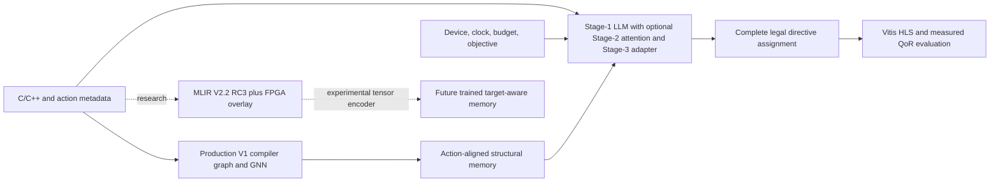

# MailoHLS / SALT-HLS

MailoHLS learns complete HLS directive configurations for C/C++ kernels under
an optimization objective, FPGA device, clock period and resource budget. SALT-HLS
is the extended framework name used in the research work.

The production pipeline uses the **V1 GNN**, action-aligned structural memory,
and selected LLM adapters. Stage 1 learns target-conditioned directives; Stage 2
adds structural cross-attention; Stage 3 optimizes preference pairs. Selected
artifacts and objective-specific availability are recorded in
[`FINAL_ARTIFACTS.json`](FINAL_ARTIFACTS.json). In particular, production Stage 2
and Stage 3 are selected for ADP; other stages/objectives have the explicit
fallback or pending status in that manifest.



MLIR V2.2 RC3 and its hardware overlay are experimental representations. They
are **not interchangeable with production V1 tensors or checkpoints**. The
readiness pilot did not establish improved target generalization. Semantic
features and resumable V2.2 supervised training live on research branches;
the latest recorded full paired run has no selected checkpoint or QoR result.
See [development status](docs/framework-development-status.md) for branch links
and the boundary between implemented, evaluated and planned functionality.

## Stage-1 research status on this branch

### Latest quality-aware SFT evidence — 2026-11-04

The quality-aware SFT prototype and training-selection fix are committed on this
branch. The final v4 single-reference and multi-reference latency adapters were
each run on three user-requested Kalman contexts: ZCU104/10 ns/full budget,
XCU200/10 ns/25% budget, and ZCU104/3.33 ns/full budget. All six production
constrained-decoder outputs are complete and source-legal (26 fields across 11
registered actions). Exact predictions and checkpoint/input hashes are in the
[Kalman inference report](experiments/stage1_quality_sft/results/kalman_v4_20261104.md).
These held-out probes do not establish resource feasibility, synthesis QoR,
multi-reference superiority or checkpoint eligibility for production/Stage-2.
See the [quality-aware SFT package](experiments/stage1_quality_sft/README.md).

### Historical recovery record

The research question is whether exact imitation of one selected measured
design weakens the learned conditional policy across FPGA, clock and resource
budget requests. The work is diagnostic: it does not change the production
checkpoint, domain rules, GNN or Stage-2 artifacts.

### Evidence and current state

| Evidence | Result | Interpretation |
|---|---|---|
| Token identity repair | Inference now validates the saved special-token mapping; swapped device-token identities are rejected. | A real correctness defect was repaired, but repair alone did not change the inspected Kalman argmax directives. |
| Matched 20-example training controls | Four small controls learned non-default values; stronger standard CE reached 97.08% teacher-forced value accuracy on the selected training examples. | Demonstrates learning capacity/memorization, not full-data generalization. The set covers 16 kernels/13 families and is target-imbalanced. |
| Eight-case validation pilot | No adapter achieved an exact reference design or a correct complete budget transition. Stronger CE changed outputs but did not establish better conditional decisions. | Output diversity and teacher-forced accuracy are insufficient acceptance criteria. |
| Full-data label ambiguity audit | A different feasible measured assignment was within 1% latency for 1,862 of 2,187 training requests. | Indicates weak/ambiguous exact winner labels; 1% is a sensitivity threshold, not a noise estimate. |
| Full-data legacy CE | 400 updates completed; best checkpoint was step 100. Step 100 had 27.83% core decision-balanced recall and 19.69% complete-action accuracy on the saved 62-case periodic bank. | Those bank figures are not the selected 383-case validation assessment. The matching all-context and measured-QoR decision remains pending. |

The follow-up audit reports 130,310 training measurements, 2,187 selected
contexts, 905 selected measurement-row identities and 772 distinct selected
program/directive assignments. At a 1% latency tolerance, the alternative
assignment often changes PIPELINE, UNROLL or an array decision. This establishes
label ambiguity in the available measurements, not a causal explanation for
model behavior or proof that a new objective will improve HLS outcomes.

No experimental adapter is promoted. The full-data `decision` and
`decision_balanced` runs are not counted as completed, no measured QoR gain has
been shown, and Kalman/test labels remain excluded from tuning. The current
tracked result record says the complete 383-context constrained-decoder
comparison and measured-candidate QoR review are pending. The November 2
working-tree assessment cross-reference is a separate audit artifact and marks
many source-to-V4 action joins as requiring independent column verification; it
must not be read as an outcome evaluation. Its [summary](experiments/stage1_recovery/assessments/20261102/observability_cross_reference.json)
and [training](experiments/stage1_recovery/assessments/20261102/train_v4_cross_reference.jsonl)
/ [validation](experiments/stage1_recovery/assessments/20261102/val_v4_cross_reference.jsonl)
cross-reference records retain source/action join uncertainty. See the [methodology and commands](README.md#merged-experiments-stage1-recovery-readme-md),
[chronological results](README.md#merged-experiments-stage1-recovery-results-md), and
[measurement evaluator](experiments/stage1_recovery/evaluate.py).

### Research logic

The controls separate three questions: whether the model can learn legal
non-default values; whether equal-site/value-only or sampled joint-action loss
improves on the original CE objective; and whether complete generated decisions
track target-conditioned measured choices. Training and validation use the
authenticated family split. Validation reports legal constant baselines,
field/value metrics, complete actions and budget-transition correctness.
Measured-candidate evaluation additionally requires exact source, kernel,
device, clock and complete-assignment identity; unmatched predictions have
unknown QoR rather than an imputed score. These requirements prevent directive
agreement from being presented as hardware improvement.

## Start here

| Need | Guide |
|---|---|
| Understand stages, schemas and code ownership | [Architecture](docs/architecture.md) |
| Install and reproduce selected experiments | [Reproducibility](docs/reproducibility.md) |
| Inspect experiment questions and limitations | [Experiment index](docs/experiments.md) |
| Inspect compiler graphs and uncertainty | [V2.2 compiler guide](docs/structural-graph-v22.md), [review status](docs/V22_FINAL_RELEASE_REVIEW.md) |
| Inspect FPGA graph enrichment | [Target-aware graph guide](docs/target-aware-mlir-v22/README.md) |
| Verify or restore registered graph artifacts | [Artifact policy](docs/reproducibility.md#artifacts) |
| Contribute without breaking historical results | [Developer guide](docs/development.md) |

## Installation and a small example

Use an isolated environment with the dependencies in `requirements.txt`.
GPU/CUDA, model weights, Vitis and the pinned Polygeist toolchain are separate
requirements for their respective workflows. Nothing below launches training
or synthesis:

```bash
python scripts/artifacts.py list
python scripts/artifacts.py verify --artifact salt-hls-graphs-v22-20261027-rc3
python -m LLM_branch.common.directive_domain_workflow --workflow train --domain-policy tcad
```

Graph verification needs only the Python standard library. Directive inspection
uses the shared domain contract; execution and domain shifts require explicit
flags documented by that module. Existing checkpoint policies are not relabeled.

For model training and inference, follow [reproducibility](docs/reproducibility.md)
and [maintained launcher choices](docs/shell-scripts.md). Cloning the source
repository does not download pretrained model weights. Frozen compiler graph archives and original measurements remain tracked. Historical checkpoint evidence, generated graphs, synthesis snapshots and derived
CSV tables can be restored directly from their sealed original Git objects:

```bash
python scripts/artifacts.py restore-git --artifact harp-generated-graphs-v1
```

See [reproducibility](docs/reproducibility.md) for the other artifact IDs and
catalog recovery. Normal development does not require GitHub Releases. Generated
outputs remain ignored; selected model weights are supplied separately.

## Repository map

`GNN_branch/`, `LLM_branch/` and `Preprocessing/` own the maintained implementations.
`Data/` and `evaluation_set/` hold benchmark inputs and measurements.
`experiments/` contains research methods and reports; `scripts/` contains
launchers and utilities; `tests/`, `docs/` and `toolchain/` hold regression checks,
guides and pinned compiler provenance. `HARP-rep/` preserves the modified baseline.
`src/` contains historical implementations and documented compatibility entries.
Do not infer production status from directory or checkpoint names containing
`final`.

## Six-branch development structure

| Branch | Responsibility |
|---|---|
| `main` | Finalized framework and selectively integrated, validated improvements. |
| `mlir-target` | Immutable historical MLIR baseline. |
| `llvm-ir` | Immutable historical LLVM baseline. |
| `research/stage1-refinement` | Stage-1 supervision, recovery and measured-quality research. |
| `research/gnn-refinement` | Graphs, semantic tensors, hardware awareness and GNN research. |
| `research/refinement-mechanism` | HLS feedback, directive refinement and search research. |

Use configurations and result directories for experiment variants within these
three research branches. Keep unfinished work there and selectively integrate
validated improvements into `main`. Update a shared research branch with
`git fetch origin` followed by `git merge origin/main`; preserve local work first.
Do not force-rewrite shared history. Detailed conventions are in
[development](docs/development.md).

---

## Consolidated research documentation
The following dated notes were merged from their former files so the branch has one explanatory entry point. Their original document boundaries and content are retained below; status statements remain tied to the dates and protocols recorded in each section. Machine-readable receipts and execution artifacts remain in their original paths.

<a id="merged-experiments-stage1-recovery-readme-md"></a>
<details>
<summary>Consolidated from <code>experiments/stage1_recovery/README.md</code></summary>

## Stage-1 directive learning and full-data recovery

Stage 1 must learn **complete directive decisions conditioned on a program and an optimization request**. Producing frequent values is insufficient. This directory is the canonical description of the data construction, historical failure, controlled recovery objectives, validation and reproduction procedure. [RESULTS.md](README.md#merged-experiments-stage1-recovery-results-md) separates completed measurements from unexecuted recipes.

The historical latency checkpoint remains immutable:
`mailohls_runs/stage1_final_final_latency_s123/best_custom_stage1`.
New runs use fresh directories. Nothing here promotes an adapter automatically, changes Stage 2, loads structural memory, or generates HLS measurements.

### Conditional-learning study (2026-11-01)

The selected measured winner is one legal complete design, not necessarily the
only useful design. Ordinary selected-target CE penalizes another feasible design
even when its measured latency is close to the best. The current study separates
three possible causes of weak conditional learning: near-optimal label ambiguity,
uneven directive-value support, and insufficiently learned device/clock/budget
contrasts. A lower teacher-forced CE does not establish a better optimization
policy; complete constrained outputs and exact measured-candidate quality are the
decision criteria.

The reproducible training-only audit is
`python -B -m experiments.stage1_recovery.ambiguity --prepared artifacts/diagnostics/stage1_full_data_recovery_data --output artifacts/diagnostics/stage1_training_ambiguity.json`.
It authenticates the original dataset and seed-123 split, parses only train rows,
uses complete source/device/clock/directive identity, rejects conflicting repeated
measurements and applies the production fractional resource-budget feasibility
rule. For each request, it compares the feasible measured pool with the minimum
measured latency using fixed engineering tolerances 0, 0.5%, 1% and 2%.
`0` means equal recorded latency, not proven physical equivalence. A negative
selected-winner replacement is never performed. The compact audited output is
[conditional_ambiguity_20261101.json](experiments/stage1_recovery/results/conditional_ambiguity_20261101.json).

| Tolerance | Contexts with another accepted complete design | Contexts with PIPE disagreement | UNROLL disagreement | Array disagreement |
|---|---:|---:|---:|---:|
| Exact recorded latency | 1,287 / 2,187 | 833 | 963 | 891 |
| 0.5% | 1,832 / 2,187 | 1,381 | 1,681 | 1,349 |
| 1% | 1,862 / 2,187 | 1,433 | 1,721 | 1,371 |
| 2% | 1,904 / 2,187 | 1,477 | 1,761 | 1,405 |

These request counts reuse 905 selected measured rows and are **not** independent
hardware measurements. The raw train partition contains 130,310 rows and no
conflicting or exact repeated design identities under the audited key. Alternative
sets are descriptive; they are not yet a new supervision policy. All 117,905
distinct measured training assignments were also checked against the frozen
source-domain registry, including complete field sets and sequential array-tuple
legality. The registry SHA256 is recorded in the result JSON.

| Decision | Alternatives considered | Reason | Scientific consequence |
|---|---|---|---|
| Retain seed-123 family split and all 2,187 selected train contexts | New split or target relabeling | Preserve the CE comparison and checkpoint contract | Validation/test labels do not fit supervision or balancing. |
| Audit tolerances 0, 0.5%, 1%, 2% before new training | Pick a favorable threshold afterward | Establish sensitivity of measured ambiguity | No tolerance is a noise confidence interval. |
| Compare existing `decision` and `decision_balanced` with `legacy` first | Immediately implement set-valued loss or DPO | Isolate decision weighting and class support using existing code | Quality-aware supervision remains a separate hypothesis. |
| Keep selection by the existing 62-case decision key; evaluate all 383 afterward | Select each arm by its best CE or use test labels | Match the historical CE run's selection rule | All full-validation metrics are post-selection evidence. |

The full-data legacy CE run was found in the older isolated worktree. Its frozen
protocol and selected data authenticate; it performed 400 successful updates,
zero skipped optimizer steps, early-stopped and retained step 100. The detached
postprocessor marked `TRAINING_DID_NOT_COMPLETE`, yet the root adapter and final
`[DONE]` receipt exist. A new read-only finalizer assessment from a copy reports
`training_completed_validation_pending`. The stale postprocessor status is not
evidence that the selected model passed full validation. See [RESULTS.md](README.md#merged-experiments-stage1-recovery-results-md)
for the dated evaluation state and limitations.

The existing `legacy`, `decision` and `decision_balanced` loss code is reused;
the ambiguity audit does not change any loss. The two new full-data arms use the
same 2,187 selected contexts, rates, tokenizer/backbone, rank-8 QLoRA, seed,
62-case periodic decision selector and 383-case post-selection evaluator as the
authenticated CE run. They execute sequentially on the verified V100S UUID.
The [study launcher](scripts/experiments/stage1_conditional_study.sh)
requires a complete 383-case CE/reference report, evaluates their exact
measured-candidate quality first, runs a two-update smoke for each policy,
then trains and evaluates the two arms in fresh output directories. It refuses
existing output paths and any V100S compute process. It does not use the A2.
The historical 383-case predictions are reused for the two later comparisons;
each new adapter is decoded on the same authenticated case sequence, and the
combiner rejects different case bytes, datasets, selected contexts or baselines.
This avoids repeating expensive historical inference without changing outcomes.

After the baseline report exists, the exact command on `liono` is:

```bash
mkdir -p artifacts/diagnostics/stage1_conditional_study_20261101
systemd-run --user --unit=mailohls-stage1-conditional-20261101 --collect \
  --working-directory="$(pwd)" /bin/bash -lc \
  'bash scripts/experiments/stage1_conditional_study.sh >> artifacts/diagnostics/stage1_conditional_study_20261101/supervisor.log 2>&1'
```

Read `artifacts/diagnostics/stage1_conditional_study_20261101/status` and the
policy-specific logs and reports. `systemctl --user status
mailohls-stage1-conditional-20261101.service` reports service state. An
interrupted run is preserved; this launcher
does not call an adapter-only save a valid optimizer-state resume and refuses a
second launch with an existing status file. The same historical evaluation
functions provide source-domain legality, complete actions, target transitions
and measured-pool QoR. Unmeasured outputs retain unknown QoR. No checkpoint is
promoted automatically.

#### Implementation change log

| Commit | Files | Nature and motivation | Scientific contract | Verification and evidence |
|---|---|---|---|---|
| `d4b7a10` | `ambiguity.py`, focused tests, compact JSON | Add authenticated train-only feasible-set sensitivity audit | Read-only; original selected labels and losses unchanged | 130,310 train rows; 2,187 requests; synthetic feasibility/duplicate/held-out tests passed. |
| `be78077` | Study launcher, root/method/results docs | Guard a sequential V100 comparison behind matched full baseline validation | Research outputs only; no checkpoint promotion | Launcher syntax and 176 CPU tests passed; model arms remain pending until actual completion. |
| `d679108` | Domain audit, focused tests, launcher gate | Verify every measured training assignment and wait on the durable baseline user service | Frozen domain registry; no target or loss changes | 117,905 distinct measured assignments legal; 63 focused CPU tests passed. |
| `36afbc6` | Evaluator helper, focused test, launcher | Reuse exact historical 383-case decoding for later arms | No target/metric change; case, dataset and baseline identity checked | 178 CPU tests passed, one CUDA-only test skipped; no new training result yet. |

### Model and output

The pinned backbone is `deepseek-ai/deepseek-coder-6.7b-base`, revision
`ce2207a8bfef3ee92bd7dd4cc31c52cfa0046912`. Training uses 4-bit NF4 with double quantization, rank-8 attention LoRA (`q_proj`, `k_proj`, `v_proj`, `o_proj`; alpha 16), and trainable deltas for special **input** token embeddings. Ordinary backbone parameters and output embeddings stay frozen. The production trainable-parameter validator rejects additional trainable groups. No GNN or cross-attention participates in Stage 1.

The prompt supplies source/action markers, objective, FPGA capacities, available resource budgets and requested clock. The response retains the existing deterministic syntax, for example:

```text
<L3>
auto{_PIPE_L3} = 1
auto{_UNROLL_L3} = 2
```

Array actions serialize type, factor and dimension. Absolute `Lk` identities and special-token ordering are unchanged. PIPE and UNROLL are separate legal choices: both may be positive when their source domains allow it. Their mutual exclusion in these selected training labels is an observation, not a legality rule.

Teacher forcing supplies earlier reference values while calculating the next-token loss. Validation instead uses the existing constrained autoregressive decoder: earlier predicted values become context, and errors can propagate. Teacher-forced value accuracy and generated complete-action accuracy therefore measure different behavior.

### Authenticated data construction

The existing pipeline is reused:

```text
GNΩSIS measured rows → fixed family split → shared resource-budget requests
  → objective-selected winners → training-only budget compaction
  → source/target serialization → legal-domain supervision → QLoRA
```

The reconstruction authenticates dataset bytes, source sidecar, split membership, historical contract and exported selections. It reproduces historical kind weights and all 62 saved selection cases. Test membership is checked for disjointness; test targets are not selected, exported or summarized.

The latency audit reproduced:

| Quantity | Training | Validation, reported separately |
|---|---:|---:|
| Raw measured rows in split | 130,310 | 13,011 |
| Objective-selected request contexts before compaction | 4,608 | 383 |
| Selected request contexts after training compaction | 2,187 | 383 |
| Distinct selected measured-row IDs | 905 | 87 |
| Distinct complete assignments, keyed by program | 772 | 78 |
| Kernels | 50 | 4 |
| Families | 18 | 3 |

The complete dataset has 150,026 rows. The held-out Kalman family has 6,705 rows; its labels are unused. The training split contains 117,905 distinct program/directive assignments before winner selection. Measurements repeated across target contexts and repeated budget winners are not independent synthesis observations. The 2,187 examples contain 1,282 repeated winner contexts beyond their 905 selected measured rows.

For this first recovery, preserve the historical latency task: measured ZCU104/U200 devices, 3.33/5/10 ns clocks, 16 generated budgets per case, minimum feasible candidate count 3, candidate pool 24, `top_k=1`, training target cap 4, **invariant cap disabled**. The current launcher default invariant cap is 1; explicitly setting `STAGE1_BUDGET_INVARIANT_MAX_DUPLICATES=-1` is essential for historical reproduction. Tight and full/loosest budgets and distinct selected targets remain represented. Invariant contexts remain training examples. Validation is not compacted.

The frozen historical source-domain registry is passed explicitly. Current source metadata can change independently; rebuilding a registry from today's metadata is a separate experiment. This recovery does not change domains, data bytes, family membership, winning labels or source serialization to suit a loss function.

Dataset SHA256:
`afdf4af8e6defc559871a6ec92185e6321313979ff3f1495806e5b037d5ab820`.
Canonical split-membership SHA256:
`143f187f6867afd853014be4ed2de3cb35a1ff635995c8459d74763227b2b341`.
The preparation manifest also records file-byte hashes, including the source templates and split file.

#### What the labels teach

The selected training contexts contain 14,788 complete loop-action occurrences:
969 `(PIPE=0, UNROLL=0)` (6.55%), 6,203 with positive PIPE and 7,616 with positive UNROLL. None has both positive in this selection, although the legal domain permits it. Complete array tuples, per-kind values, forced versus nonforced choices and device/clock budget ranges are recorded in `supervision_audit.json`. These occurrence counts include repeated contexts; balancing separately deduplicates measured row IDs.

An informative target contrast is an **observed change in the selected complete assignment** between comparable requests. The audit compares:

| Changed constraint | Changed pairs | Invariant pairs | Conditions held fixed |
|---|---:|---:|---|
| Budget | 6,560 | 2,374 | Program, device, clock, objective |
| Clock | 1,491 | 380 | Program, device, absolute resource limits, objective |
| Device | 117 | 32 | Program, clock, objective; full capacities on both devices |

Thus `N_examples=2187` and `N_informative_target_contrasts=8168` under these definitions. Pair counts overlap and are not independent samples. Device comparisons at unmatched partial budgets are excluded. The machine-readable audit preserves endpoint indices and changed fields.

All 6,560 changed budget pairs additionally have a measured feasibility boundary: at least one selected design does not fit the opposite budget. This involves 1,695 training contexts; 492 remain outside these changed-budget groups. Optional contrast emphasis requires this witness and rejects mere winner changes when both designs fit both budgets.

A critical limitation: in **1,862/2,187** training contexts, a different feasible measured assignment lies within 1% latency of the selected winner. The audit records the feasible candidate count and relative latency gap for every context. These are latency gaps, not repeated-measurement confidence intervals; winner changes are not statistically established hardware-policy boundaries. No labels are invented to increase contrast counts. Exact agreement with a nearly tied winner should not be mistaken for measured QoR improvement.

### Original failure and previous controls

Saved historical predictions collapse toward PIPE=0, UNROLL=0 and cyclic partition factor 2; no positive UNROLL appears in the audited saved outputs. On those outputs, complete designs and correct complete budget transitions are zero. Fixing tokenizer-ID reconstruction did not repair this policy. The checkpoint tokenizer and weights themselves were preserved.

Four **20-example** controls established memorization capacity, not generalization:

| Control | Teacher-forced value accuracy |
|---|---:|
| Historical weighted CE, 120 attempted updates | 68.42% |
| Stronger CE, 200 attempted updates | 97.08% |
| Value-only field CE, 200 attempted updates | 94.74% |
| Value-only CE plus sampled joint-action loss | 90.06% |

The stronger controls changed rates and training duration together. Actual successful updates were respectively 120, 198, 198 and 196. None solved a complete transition on the eight-case validation pilot. That pilot, the historical 62 cases and the full 383 selected validation contexts are different evaluation sets; do not compare their percentages as if the cases were identical. `run.py` preserves these historical controls, including their **field-normalized** experimental loss. The new production decision objective below is **action-normalized**. No joint-action loss is added to production.

### Configurable Stage-1 supervision

`--stage1_supervision_policy` selects `legacy` (default), `decision` or `decision_balanced`. Stage-2 use of the new policies is rejected. The new decision modes currently require specified-clock, no-EOS supervision; extending automatic-clock loss is outside this controlled comparison.

#### Historical RHS CE (`legacy`)

For nonforced field `j`, the existing pack tokenizes **RHS plus newline together**. Its supervised tokens have total mass `value_loss_weight × kind_weight[j]`, divided equally among those tokens. Fixed directive syntax and input-only special tokens already have zero loss. Newlines inside a nonforced RHS pack **are supervised**. The trainer takes the token-weighted per-example CE mean, followed by its historical sample-weighted batch reduction. This path retains identical IDs, labels and weights when `legacy` is selected explicitly or omitted.

Writing `S_j` for those RHS-plus-newline tokens and `c_j` for the historical kind weight:

\[
 L_{legacy}=\frac{\sum_j c_j\,|S_j|^{-1}\sum_{t\in S_j} CE_t}{\sum_j c_j}.
\]

This is an equal-field-mass objective with kind reweighting, rather than unweighted CE on the whole response. The repair must not incorrectly describe historical training as supervising the fixed schema.

#### Decision CE (`decision`)

All context IDs remain identical. The encoder identifies value tokens **inside the original RHS-plus-newline tokenization**. Offset boundaries are used when available; the checked fallback requires exact value/newline segmentation. A token crossing the value/delimiter boundary fails validation. Fixed syntax, delimiters, forced fields and input-only tokens receive zero decision weight.

For action `a`, nonforced fields `J_a`, and value-token positions `V_j`:

\[
 L_j=|V_j|^{-1}\sum_{t\in V_j}CE_t,\qquad
 L_a=|J_a|^{-1}\sum_{j\in J_a} L_j,\qquad
 L_{decision}=|A|^{-1}\sum_{a\in A}L_a.
\]

Only actions containing a nonforced field enter `A`. A long factor and a short factor have equal field mass; a loop and an array have equal action mass despite different serialized field counts. Forced values still appear as context and must be correctly emitted by inference. This remains autoregressive CE through the same model and Trainer, without a classifier head.

#### Conservative value balancing (`decision_balanced`)

Count nonforced values by directive kind using **distinct selected training measured-row IDs**, excluding repeated budget requests. For each kind, use the mean observed class count as the reference and take inverse-square-root frequency. A bounded monotone rescaling keeps the count-weighted mean at one, within configurable `[0.5,2.0]` bounds. Unseen values receive neutral weight one; no fictitious observations are added. The balancing counts and weights are stored in the training contract.

Multiply decision field masses by these weights and renormalize the example's total token mass to one. This optional extension can alter relative action mass; the unbalanced mode implements the exact equal-action formula above. It avoids an accidental global learning-rate change. Validation and test frequencies never fit training weights. Historical directive-kind weights remain recorded for compatibility but do not multiply the new action-normalized objective.

[Cui et al.](https://openaccess.thecvf.com/content_CVPR_2019/html/Cui_Class-Balanced_Loss_Based_on_Effective_Number_of_Samples_CVPR_2019_paper.html) motivate handling imbalance and repeated information. Our bounded inverse-square-root directive weighting is a modeling choice, **not** their effective-number formula or a demonstrated SALT improvement.

### Optional target-contrast emphasis

`--stage1_contrast_weight` defaults to **1**, meaning disabled. Values up to 2 modestly emphasize selected training requests participating in changed budget-target pairs with measured cross-budget infeasibility. Invariants retain positive weight; target labels and the sampler are unchanged. Weights are normalized to training mean one. Repeated contexts remain contexts, not additional HLS measurements. Clock/device emphasis is not enabled.

With batch size one, historical division by the batch sum cancels sample weights. Therefore this explicit option uses the existing sample-weight inputs with a **mean of training-normalized weighted losses**. It is isolated from legacy/default and Stage-2 behavior. Initial recovery leaves contrast weighting disabled, so objective/optimization and sampling effects remain separable. Near-tie caveats still apply.

### Optimization and checkpoint selection

Keep the original QLoRA architecture, dropout 0.10, paged AdamW8bit, LoRA weight decay 0.01, embedding weight decay zero, gradient checkpointing, clipping norm 1, batch size 1 and accumulation 8. Historical launcher defaults remain LoRA LR `1.5e-5` and embedding LR `5e-6`. The optimized-CE experiment explicitly uses `1e-4` and `2e-5`, with cosine scheduling, 5% warmup and two epochs. These rates are a starting point, not a demonstrated full-data optimum.

Setting `STAGE1_RECOVERY_PREPARED` authenticates the complete selected train/validation context multisets against reconstruction and seals code/input hashes and a source snapshot before loading model weights. A selection mismatch fails before training.

Fresh recovery starts from the pinned backbone and **fresh LoRA**, not the collapsed adapter. Existing-adapter initialization remains explicitly opt-in via production arguments. Output paths refuse overwrites. The reference checkpoint is never a recovery output path.

For 2,187 examples, covering one epoch needs `ceil(2187/8)=274` update opportunities. The Stage-1 early-stopping guard remains 274. Installed Transformers 4.51.0 computes epoch-based `max_steps` using **floor**, giving 546 total planned steps for two epochs, rather than 548. The existing scheduler is retained. `schedule_audit.json` records the actual Trainer schedule; `optimizer_audit.json` records AMP-skipped versus successful updates, scheduler position, group rates and periodic gradient norms. A saved best step alone does not reveal when training ended. On resume, audit history beyond the restored checkpoint is archived and excluded from the retained trajectory; abandoned physical work remains visible in that receipt.

Optional decision diagnostics extend the existing `StageValSelectionCallback`. They report:

- Nonforced value accuracy, core macro-balanced recall, per-value recall and positive PIPE/UNROLL recall (exact value and binary positivity separately).
- Complete loop, array and overall action accuracy; exact complete-design accuracy; forced-field accuracy separately.
- Kernel/family/device/clock/budget strata, source-domain legality, correct changed endpoints and complete transitions, and correct invariant predictions.
- A legal constant baseline fitted from **training** modes and evaluated on the exact same cases. Wrong but equal predictions do not count as correct invariance.

With diagnostics explicitly enabled, checkpoint selection is lexicographic: core nonforced balanced recall, complete-action accuracy, correct complete budget pairs, then minimum-kernel decision accuracy. A log-probability margin is only a final tie-breaker and cannot reset early-stopping patience. Historical default selection remains unchanged. Periodic selection can retain the historical 62-case bank; `--stage1_full_validation` explicitly selects all 383 contexts instead. The separate evaluation command below reports the full selected split on identical cases for the historical and candidate adapters.

Promotion is report-only: exceed both historical and legal-constant complete-action accuracy, recover meaningful nondefault recall, correctly solve authenticated target transitions, preserve syntax/domain legality, and inspect device/clock groups for collapse. Case-identity hashes must agree. A lower CE, more diverse values or arbitrary budget responsiveness does not pass this gate. Domain legality also does not prove that an unmeasured generated configuration meets physical resource budgets; no new synthesis validation is performed here.

### Reproduction

Use the existing environment; do not upgrade libraries. Verified versions are torch 2.6.0+cu124, Transformers 4.51.0, PEFT 0.18.1 and bitsandbytes 0.49.2. The authenticated compact dataset, source sidecars, split, historical domain registry/tokenizer and pinned backbone must be available locally. Generated data and adapters remain ignored.

```bash
export PYTHON=/home/elvouvali/miniforge3/envs/mailohls-llm-v2/bin/python
export HF_HUB_OFFLINE=1 TRANSFORMERS_OFFLINE=1 PYTHONDONTWRITEBYTECODE=1
export PREPARED=artifacts/diagnostics/stage1_full_data_recovery_data
"$PYTHON" -B -m experiments.stage1_recovery.prepare --output "$PREPARED"
"$PYTHON" -B -m experiments.stage1_recovery.prepare --output "$PREPARED" --audit
"$PYTHON" -B -m experiments.stage1_recovery.prepare --output "$PREPARED" --validate-tokens
"$PYTHON" -B -m pytest -q LLM_branch/tests tests/test_directive_domains.py
```

The token preflight checks every training example under all three policies without loading model weights. In this run, all three passed 2,187/2,187; sample lengths were 480–6,656, with no code truncation. Source/token IDs stay identical across policies. Detailed audit outputs are under `$PREPARED`.

Set shared experimental controls explicitly:

```bash
export CUDA_VISIBLE_DEVICES=GPU-cea3d9e4-d189-a5b9-cf2e-9bd77b8218fb
export OBJECTIVE=PARETO_LATENCY
export STAGE1_LR_LORA=1e-4 STAGE1_LR_EMBED=2e-5
export STAGE1_BUDGET_INVARIANT_MAX_DUPLICATES=-1
export STAGE1_DOMAIN_REGISTRY=mailohls_runs/stage1_final_final_latency_s123/directive_domain_registry.json
export STAGE1_RECOVERY_PREPARED="$PREPARED"
export STAGE1_DECISION_DIAGNOSTICS=1
export STAGE1_SUPERVISION_POLICY=legacy STAGE1_CONTRAST_WEIGHT=1
```

GPU optimizer smoke and fresh-adapter production smoke (use new output names):

```bash
"$PYTHON" -B -m pytest -q LLM_branch/tests/test_stage1_fp16_smoke.py
STAGE1_MAX_STEPS=2 STAGE1_EVAL_ON_START=0 \
  OUT=mailohls_runs/stage1_full_data_ce_smoke_reproduce_s123 \
  bash scripts/training/train_stage1.sh
```

One full-data optimized standard-CE recovery:

```bash
OUT=mailohls_runs/stage1_full_data_ce_recovery_s123 \
  bash scripts/training/train_stage1.sh
```

For a **later**, separately controlled objective comparison, select `STAGE1_SUPERVISION_POLICY=decision` and a fresh output directory; keep the same data, schedule and diagnostics. `decision_balanced` and `STAGE1_CONTRAST_WEIGHT=1.25` are explicit additional variables, not part of the initial run. `STAGE1_FULL_VALIDATION=1` enables all-context periodic selection and must be held identical between compared runs.

CPU reanalysis of existing saved selection predictions:

```bash
"$PYTHON" -B -m experiments.stage1_recovery.evaluate --prepared "$PREPARED" \
  --saved-metrics mailohls_runs/stage1_final_final_latency_s123/best_custom_stage1/best_selection_metrics.json \
  --output artifacts/diagnostics/stage1_reference_review_reproduce
```

Full validation of the reference and candidate on all 383 selected requests, using the production decoder (not test labels):

```bash
"$PYTHON" -B -m experiments.stage1_recovery.evaluate --prepared "$PREPARED" \
  --full-validation \
  --adapters mailohls_runs/stage1_final_final_latency_s123/best_custom_stage1 \
             mailohls_runs/stage1_full_data_ce_recovery_s123/best_custom_stage1 \
  --output artifacts/diagnostics/stage1_full_data_recovery_validation
```

After training and full validation, create a read-only assessment (no checkpoint replacement):

```bash
"$PYTHON" -B -m experiments.stage1_recovery.finalize \
  --full-run mailohls_runs/stage1_full_data_ce_recovery_s123 \
  --prepared "$PREPARED" \
  --full-validation-report artifacts/diagnostics/stage1_full_data_recovery_validation/report.json
```

Without the full validation argument, this command authenticates provenance and summarizes completed training and the saved 62-case comparison. It explicitly reports incomplete training if only intermediate checkpoints exist. The full run's exact implementation bytes are retained in `source_snapshot/`; this preserves reproduction even when later optional/reporting safeguards are added.

The historical eight-case evaluation and 20-example controls remain available through `evaluate.py` without `--full-validation` and `scripts/experiments/stage1_recovery_controls.sh`; their results remain separate.

#### Measured-candidate quality (validation only)

Exact agreement with the selected training label measures imitation. It does not tell us whether a different generated design is good. After the full constrained-decoder evaluation has written both `adapter_0_field_greedy.json` (historical checkpoint) and `adapter_1_field_greedy.json` (recovery checkpoint), the same evaluator can match predictions to raw measurements from validation-family rows:

```bash
"$PYTHON" -B -m experiments.stage1_recovery.evaluate \
  --prepared "$PREPARED" \
  --measured-quality-predictions \
    artifacts/diagnostics/stage1_full_data_recovery_validation/adapter_0_field_greedy.json \
    artifacts/diagnostics/stage1_full_data_recovery_validation/adapter_1_field_greedy.json \
  --output artifacts/diagnostics/stage1_full_data_recovery_measured_quality
```

This CPU-only pass also generates the legal constant baseline from training labels. Each output is aligned to its full request identity (kernel/source, device, clock, budget, objective and measured-row ID), so one measured row reused under two budgets is not conflated. A predicted design is measured only on exact source/kernel, device, measured clock and complete directive assignment. For each request, the comparison pool is every raw measured configuration in the validation split at that same source/device/clock; its denominator is the minimum-latency candidate feasible under the request budget. Latency retains the source dataset's `Latency_msec` unit (milliseconds). Fractional budgets use the same reported-utilization fraction rule as `design_fits_shared_budget`; rounded integer resource counts are only the prompt representation. Exact duplicate design receipts are collapsed only when latency and all four resource-utilization fields agree. Conflicting duplicate receipts fail closed.

An unmatched prediction has `measured_qor: null` and unknown regret. Regret and the within-1%/5% rates use only matched feasible outputs; the report separately gives match coverage, infeasible matches and per kernel/device/clock/budget-group coverage. These are selected, measured-only diagnostics: low match coverage cannot support a claim about the full generated policy. The selected-label match remains reported separately. Budget/clock/device transition reports give overlapping pair counts, participating request counts and separate descriptive macro-averages for complete transitions, changed fields and invariant pairs by fixed-context group; those pairs are not independent observations.

### Evidence boundaries and deferred work

See [RESULTS.md](README.md#merged-experiments-stage1-recovery-results-md) for newly executed tests, smoke/training status and authenticated receipts. The full-data implementation does not establish recovery until a completed adapter beats the reference and legal baseline on meaningful generated decisions and correct target transitions.

[LoRA](https://arxiv.org/abs/2106.09685) and [QLoRA](https://arxiv.org/abs/2305.14314) justify parameter-efficient adaptation, not our winner labels or objective. [Transformers Trainer](https://huggingface.co/docs/transformers/v4.51.3/main_classes/trainer) supports custom loss and checkpoint callbacks; this project keeps its installed 4.51.0 implementation and existing Trainer. Masked causal supervision is next-token prediction with ignored labels, not a new action classifier. The [HF completion-only explanation](https://huggingface.co/docs/trl/v0.23.1/sft_trainer#train-on-completion-only) illustrates the masking principle; TRL is not installed or used here. Our field/action masks are implemented directly in the existing Transformers trainer.

Joint-action ranking loss, [DPO](https://arxiv.org/abs/2305.18290), device-specific adapters/MoE, continuous target-conditioned residual adapters and Stage-2 structural integration are deferred. First establish full-data optimization and correct held-out-family target responses. Preference training would additionally require reliable measured alternatives and a defensible treatment of near ties; device-specialized architectures require evidence of an unresolved device-specific deficit. No such additional model is implemented here.

### Consolidated Stage-1 research branch

Continue work on `research/stage1-refinement`. This includes the full-data
recovery and validation-only measured-quality work from `72b42ae`, `f577a1a` and
`0b592a9`, over the finalized framework. Original commits remain in branch history.
No selected adapter is promoted, and existing running worktrees are untouched.
The Kalman registration/CSV modification is preserved only as the explicit
`dataset_variants/kalman-registration-v1` patch and manifest; canonical Data
remains identical to main. Audit and version any use of that variant independently.
Historical incomplete runs are not reported as successful training.

</details>

<a id="merged-experiments-stage1-recovery-results-md"></a>
<details>
<summary>Consolidated from <code>experiments/stage1_recovery/RESULTS.md</code></summary>

## Completed Stage-1 recovery experiments — 2026-10-28

### Conditional-learning follow-up — 2026-11-01

This section records new evidence separately from the 2026-10-29 launch-time
receipts below. The full-data legacy CE run's postprocessor wrote
`TRAINING_DID_NOT_COMPLETE`, but its final log contains the `[DONE]` adapter-save
receipt and the root adapter exists. From a preserved copy, the current
`finalize --full-run` authenticated its original protocol, dataset/split,
selected contexts, source snapshot and historical checkpoint. It reports
`training_completed_validation_pending`: 400 actual updates, zero AMP skips,
early stopping after step 400, best checkpoint at step 100. Protocol SHA256 is
`2d8fae40dedcf141268f6190f94073492eb3eecd244e9640b4691503d13895da`.
The original run and production adapter remain unchanged. The stale postprocess
status is a reporting failure, not an independently validated model result.

On its saved **62-case periodic selection bank**, step 100 has core nonforced
balanced recall 27.83%, complete-action accuracy 19.69%, zero exact complete
designs and zero correct complete budget transitions. Its teacher-forced CE was
0.5320. These are selected-bank diagnostics, not the all-383-context comparison
or measured hardware-quality result.

The new [authenticated training-only ambiguity audit](experiments/stage1_recovery/results/conditional_ambiguity_20261101.json)
used 130,310 training measurements, 2,187 selected contexts, 905 selected row
identities and 772 distinct selected program/directive assignments. All 117,905
distinct measured training assignments passed the frozen source-domain and
complete-tuple checks. It found
another distinct feasible complete assignment at the same recorded latency for
1,287 requests, within 0.5% for 1,832, within 1% for 1,862 and within 2% for
1,904. At 1%, the alternative set disagrees with the selected assignment in
PIPELINE for 1,433 requests, UNROLL for 1,721 and an array field for 1,371.
These requests overlap and can reuse the same measurement; the tolerance is an
engineering sensitivity, not a measured noise model. The audit supports the
*presence of ambiguous exact labels*, but it does not establish that ambiguity
causes model collapse or that a new loss improves conditional optimization.

The earlier authenticated training-value audit provides a distinct class-support
finding: among nonforced selected-context fields, `UNROLL=0` appears 7,172 times,
`UNROLL=2` 2,498 times and `UNROLL=27` only twice. The balancing fit correctly
deduplicates winner row IDs: its corresponding counts are 3,265, 1,239 and one.
This imbalance is a separate hypothesis from near-optimal ambiguity. Budget
transitions include 6,560 changed pairs with measured cross-budget infeasibility,
but the pairs overlap and do not prove the model learned that conditional rule.

The 383-context constrained-decoder comparison and measured-candidate QoR
review are pending until their actual output is verified. Full-data `decision`
and `decision_balanced` training have not been counted as completed. No adapter
has been promoted; no Kalman test labels informed this audit.

At **2026-10-31 22:44 UTC**, the persistent `mailohls-stage1-baseline-20261101`
user service was actively decoding on the V100S UUID
`GPU-cea3d9e4-d189-a5b9-cf2e-9bd77b8218fb`. The
`mailohls-stage1-conditional-20261101` user service was at `PREFLIGHT`, waiting
for that full baseline report. It is configured to compute matched measured
quality before either new training arm, then smoke/train/evaluate `decision` and
`decision_balanced` sequentially. The A2 is assigned to separate GNN research.
User-systemd linger is enabled. The first interactive baseline attempt was
stopped after producing only `cases.json`; its partial output was preserved as
`stage1_conditional_ce_full_validation_20261101_attempt1` before restarting
durably. Neither attempt is counted as a completed 383-case result.

The tokenizer defect is repaired. Four V100 training controls and all planned validation comparisons completed. **No experimental adapter qualifies as a production replacement.** The original checkpoint's adapter, training contract and tokenizer hashes remain unchanged.

See [measured results JSON](experiments/stage1_recovery/results/20261028.json), [method and reproduction guide](README.md#merged-experiments-stage1-recovery-readme-md), and the local detailed artifacts under `artifacts/diagnostics/stage1_recovery_20261028`.

### What changed

Inference loads the saved tokenizer and validates each special token's identity. Reconstructing a tokenizer now uses the same token order as training. Swapping ZCU104/U200 IDs is rejected even when vocabulary size and the unordered ID set match. New training contracts record an explicit token-to-ID map. The repaired reconstruction's entire vocabulary matches the saved checkpoint vocabulary.

The existing full-training launcher accepts optional learning-rate overrides while retaining its original defaults and overwrite guard. Experimental loss/search changes remain separate from the production trainer. They do not change the backbone architecture, existing checkpoints, prompts, legal directive domains, GNN, or Stage-2 artifacts.

### Learning-mechanism control

Each control starts from the same parent tensor state and the same 20 selected training examples. The initial teacher-forced value accuracy is 53.22%. Values count as correct only if all their ordinary tokens are correct; delimiters are excluded from this metric.

| Training control | Attempted / actual updates | Final value accuracy | Completely correct examples |
|---|---:|---:|---:|
| Original weighted CE, original rates | 120 / 120 | 68.42% | 5 / 20 |
| Original weighted CE, stronger rates | 200 / 198 | **97.08%** | **16 / 20** |
| Value-only, equal-site CE | 200 / 198 | 94.74% | 13 / 20 |
| Value-only CE + sampled joint-action loss | 200 / 196 | 90.06% | 11 / 20 |

The stronger setting changes both learning rates and training duration relative to the 120-step control. The three 200-step controls share rates and attempted update budgets. Skipped steps were recorded through Accelerate; all completed adapters have changed trainable hashes and unchanged parent file hashes.

This demonstrates that the architecture, trainable token rows and optimizer can learn non-default directive values. It does not prove that the original run had a specific optimizer defect or that a particular learning rate is optimal. Original optimization logs remain unavailable. The value-only and joint objectives did not improve memorization over standard CE in this control; the joint run also cost substantially more compute.

### Validation results

Eight cases cover all four validation kernels and three families. Each kernel contributes a same-device, same-clock pair with different budgets and reference targets. All cases use 10 ns; the pairs include both known devices. None uses Kalman or test-split targets.

Core balanced accuracy averages per-value recall over PIPELINE, UNROLL, array type and array factor at decision sites. Dimension is reported in the detailed results but excluded from this core score because this pilot's two nonforced dimension fields have only one reference value. Complete-action accuracy requires every field in an action to match. A correct budget transition requires both endpoints of every changed reference field in a pair to match.

| Adapter | Core balanced, field / joint decoding | Complete actions, field / joint decoding | Correct budget pairs |
|---|---:|---:|---:|
| Legal constant baseline | 34.82% | 8.06% | 0 / 4 |
| Original checkpoint | 33.38% / 34.82% | 9.68% / 9.68% | 0 / 4 |
| Stronger standard CE | 32.43% / **35.05%** | **24.19%** / 20.97% | 0 / 4 |
| Value-only CE | 33.52% / 31.01% | 14.52% / 12.90% | 0 / 4 |
| Joint-action training | 33.76% / 32.87% | 17.74% / 20.97% | 0 / 4 |

Every method has 0/8 exact reference-design matches. The stronger and alternative-loss adapters change predictions on one budget pair each, but those changes are not correct complete reference transitions. Output diversity alone therefore does not pass the gate. All 64 requested validation predictions completed: four adapters × eight contexts × two decoding methods. Validation took 45.1 minutes on the V100.

The original checkpoint's field decoder still selects zero for every one of the 48 pilot UNROLL fields. Stronger CE produces several nonzero factors and improves PIPELINE balanced accuracy, while worsening array-type/factor recall. Its 0.23 percentage-point core gain under joint decoding is too small and the pilot too narrow to establish generalization improvement.

Separately, re-scoring all 62 **stored** original validation outputs gives 30.00% five-kind decision-balanced accuracy versus 31.39% for the legal constant baseline. Those stored-case statistics are a different evaluation set and aggregation from the eight-case core score above; they should not be compared directly across tables.

### Interpretation and next experiment

The evidence narrows the issue to learning the conditional optimization policy and generalizing it, rather than a decoder that prohibits positive directives or an architecture that cannot learn values at all. The tokenizer issue was real, but correcting it alone leaves the original Kalman argmax directives unchanged, as established in the earlier audit.

The tiny training set deliberately tests memorization: 16 kernels from 13 training families, mostly U200 at 3.33 ns, no 5 ns examples, and limited dimension coverage. Its adapters must not be substituted for a fully trained model. These results do not establish that either new objective would fail with full training; they establish that neither is currently a demonstrated repair.

The justified next larger study is full-data CE optimization with adequate coverage and learning-rate/schedule comparisons, retaining all device/clock conditions and complex kernels. Evaluate against the legal constant baseline, nontrivial per-value scores, whole actions and budget transitions across the full validation set. The guide contains a fresh-output full-data recipe with rate overrides and an explicit compaction-policy setting. **That larger job was prepared, not launched by these diagnostic controls.** Kalman must remain outside hyperparameter selection; it has already been inspected diagnostically and cannot be called a fresh blind test.

No adapter was promoted, no gold directives were manually inserted into inference, and no values were forced merely to increase diversity. No HLS synthesis or new QoR measurements were performed. Agreement with measured directive references is not a measurement of latency/resource improvement.

### Verification and preservation

- CPU suite: **127 passed**, one CUDA-only test skipped in the sandbox.
- That CUDA FP16 test separately passed on the V100: **1 passed**.
- Launcher syntax, unchanged default rates, explicit rate overrides, and experiment/log overwrite protection were checked without launching full training.
- All four training runs share selected-example SHA-256 `df321329eb5a37c9276ec5c291bbda1643a75ce274feaf5456d1a3499616cfa0` and the same initial trainable tensor hash.
- The reproducible preparation command authenticates the dataset/split and matches all 62 saved validation references. Its train/validation exports match the earlier audit byte for byte.
- Preserved parent adapter SHA-256: `a15a0af1022370b08ee1e64cb9934a12e9f1c7ef1b96aaaf4ccfc406f4e0cc86`.
- Preserved parent contract SHA-256: `d2c63fdaf32199d5de3625dcd4a9358c34a79e48f6761f16948ca7a2c7120dd8`.
- Preserved parent tokenizer SHA-256: `eef84d1f080adcb66a40c467931055a8b95e3d37fd6534c7340aa6c63b966891`.

The first two controls' inherited metadata was normalized to the explicit experimental schema, with backups and hashes, without changing their weights. Experimental model cards label their limited purpose. No original graph archive, structural memory, measurement, checkpoint, main branch or unrelated worktree change was overwritten.

### Full-data recovery implementation and supervision audit — 2026-10-29

The new [full-data evidence summary](experiments/stage1_recovery/results/full_data_20261029.json) records the authenticated audit and new checks. This section does not revise the historical 20-example results above.

The historical selection was reproduced exactly: 2,187 training contexts, 905 distinct selected measured rows, 772 distinct program/directive assignments, 50 kernels and 18 families. Validation has 383 selected contexts from 87 measured rows and four kernels. All 62 historical saved selection references match. No test labels informed this audit, weighting or validation.

Training target contrasts include 6,560 changed budget pairs, 1,491 changed fixed-budget clock pairs and 117 changed full-budget device pairs. These overlapping pairs are not independent measurements. All 6,560 changed budget pairs have measured cross-budget infeasibility; 1,695 contexts participate and 492 do not. A different feasible measured assignment is within 1% latency in 1,862/2,187 training contexts. Exact winner labels therefore often express weak measured preferences rather than a robust hardware-policy boundary. The original labels and compaction are preserved for the initial controlled recovery.

Production now offers opt-in `decision` and `decision_balanced` loss policies alongside unchanged default `legacy`. The new objective normalizes value-only CE by complete action and excludes forced values/delimiters. Optional training-only bounded frequency and budget-contrast emphasis remain disabled in the first recovery. Stage 2 is unchanged.

Executed validation:

- CPU: `python -B -m pytest -q LLM_branch/tests tests/test_directive_domains.py` — **164 passed, one CUDA smoke skipped** in the sandbox.
- V100: `python -B -m pytest -q LLM_branch/tests/test_stage1_fp16_smoke.py` — **one passed**, separately.
- Token preflight: **2,187/2,187 examples under each of three policies**, identical target IDs, no supervised input-special tokens, no code truncation; 480–6,656 tokens.
- Fresh rank-8 DeepSeek production smoke: **two attempted and two successful updates**, finite nonzero LoRA and input-token gradients, finite validation CE, adapter/tokenizer/checkpoint saved. This is an interface check, not a recovery result.

The first smoke attempt was stopped during redundant serialization preprocessing. The successful model smoke used bounded pure-function serialization caches already used by reconstruction. Its outer Bash command returned 127 after Python completed because the launcher was edited while Bash was waiting, shifting the trailing read position. The model finished both updates and all saves; no optimizer failure occurred. The launcher was corrected, syntax/stub tested, and frozen before the full run. Both attempts and logs are preserved locally.

A **single optimized legacy-CE full-data run has been launched** in `mailohls_runs/stage1_full_data_ce_recovery_s123`, using fresh LoRA, LR `1e-4`/`2e-5`, historical invariant compaction, seed 123 and unchanged QLoRA architecture. The sealed `recovery_protocol.json` records input hashes and implementation hashes. Transformers 4.51.0 plans **546** steps; the conservative one-epoch early-stopping guard remains **274**. Actual updates, AMP skips and scheduler progress are recorded independently. Full-data learning and promotion are not yet established while this run is in progress.

On the **same 62 stored reference cases**, the new all-fields complete-action reanalysis finds historical adapter 8.32% versus legal constant 6.56%; core nonforced balanced recall is 25.00% versus 26.74%. Both have zero exact complete designs and zero correct complete budget pairs. These are not the eight-case metrics above, and neither set substitutes for full 383-context evaluation.

The reference adapter SHA256 remains `a15a0af1022370b08ee1e64cb9934a12e9f1c7ef1b96aaaf4ccfc406f4e0cc86`; its contract and tokenizer hashes also remain unchanged. No full-data decision-aware, balanced, contrast-weighted, joint-action or DPO variant has been launched.

Two additional defensive tests verified optional weighting/accounting: changed winners that both fit both budgets are not emphasized, and resuming an older checkpoint archives later abandoned audit receipts instead of double-counting their updates. Both were reproduced as failing cases before correction. These optional/resume safeguards do not change the fresh, contrast-disabled CE run; its exact earlier implementation bytes are archived under its `source_snapshot/`.

The final isolation check also omits Stage-1-specific metadata entirely from Stage-2 contracts, rather than adding a null field that would change a historical resume hash. This does not change the Stage-1 branch or the running CE optimization. Full validation uses a fixed evaluation seed and records dataset/selection hashes; the `finalize --full-run` command requires completed root artifacts and matching reference/candidate lineage before reporting a recovery.

Fresh reproductions can now set `STAGE1_RECOVERY_PREPARED` to authenticate the complete selected train/validation multisets and automatically seal the protocol/source snapshot before model loading. A CPU integration check accepted all 2,187/383 authenticated contexts regardless of row ordering, while a changed-label test failed closed. This replaces the manual protocol-sealing step used to launch the already running initial experiment; it does not restart or alter that experiment.

#### Live execution versus this recorded audit

The section above is a launch-time record, not a completed full-data model result. The single full run is executing independently of the documentation. Its exact initial code is in its `source_snapshot/`; a mechanical AST comparison confirmed unchanged loss construction, dataset, Trainer, selection callback, decision metrics and contrast-query definitions across the later optional/metadata safeguards.

For this execution, monitor `/tmp/stage1-full-data-ce-recovery.log` and `mailohls_runs/stage1_full_data_ce_recovery_s123/postprocess.status`. A waiting, detached postprocessor checks successful training completion and code hashes, then calls the existing full-validation evaluator for the reference and selected checkpoint and the read-only full-run finalizer. It launches no additional training variant. Its outputs will be:

- `artifacts/diagnostics/stage1_full_data_recovery_validation/report.json` — matched full-validation predictions and metrics.
- `mailohls_runs/stage1_full_data_ce_recovery_s123/full_run_report.json` — authenticated optimizer/schedule/checkpoint and promotion assessment.

`WAITING_FOR_TRAINING` is not a successful learning result. A failure or source-code mismatch stops postprocessing; no checkpoint is promoted. Generated artifacts remain ignored by Git. The final classification must be taken from completed measurements, not the launch-time snapshot.

### Assessment follow-up — 2026-10-29 19:58:52 UTC

The full-data run is **still executing**; this is a progress receipt, not its final result. The host GPU process is PID `2893110` on the assigned V100S, using about 18.8 GiB at 99% GPU utilization when checked. The audit records 88 successful updates out of the Trainer's 546-step plan, zero AMP-skipped updates, finite recorded embedding/LoRA gradient norms, and scheduler epoch 88. The postprocessor remains `WAITING_FOR_TRAINING`. The 274-step one-effective-epoch guard has not been reached. The final adapter and all-383-context assessment therefore remain pending.

The frozen protocol SHA-256 is `2d8fae40dedcf141268f6190f94073492eb3eecd244e9640b4691503d13895da`. Its selected context counts (2,187 train / 383 validation), dataset, split, source-sidecar, dataset-manifest and training-code snapshot hashes were rechecked successfully. The contract confirms a fresh adapter from the pinned DeepSeek backbone and `legacy` supervision with the stronger learning rates; this run does not test decision-aware CE. The historical reference adapter remains unchanged.

At the latest follow-up, 2026-10-29 20:03:15 UTC, it had advanced to **100/546** successful updates, still with zero skipped updates; selection files remained at steps 0 and 50 and the postprocessor was still waiting. Progress is reported from the append-only update audit and training log, not inferred from adapter files.

At 20:06:12 UTC, the host process was still alive on the assigned V100S at 100% utilization, with **100/546** successful updates, zero skipped updates, finite recorded gradient norms, teacher-forced validation loss `0.53197` at step 100, and postprocessing still waiting. The step-100 constrained-selection receipt had not yet been written at that instant; the best selected checkpoint remained step 0. This state is explicitly time-stamped because it is live and will change.

The latest periodic decision selection is step 50; the best-selection record is still step 0. The step-50 key has lower primary core nonforced balanced recall than step 0, although its complete-action component is higher; both show zero correct complete budget transitions so far. This is an interim selection trajectory, not a completed validation comparison or a promotion decision.

On the same 62 periodic cases, the current intermediate checkpoint metrics are:

| Snapshot | Core nonforced balanced recall | Complete loop actions | Complete array actions | All complete actions | Positive PIPE recall | Positive UNROLL recall | Exact designs | Correct changed budget pairs |
|---|---:|---:|---:|---:|---:|---:|---:|---:|
| Fresh adapter, step 0 | 26.16% | 0.00% | 10.57% | 2.84% | 100.00% | 12.92% | 0/62 | 0/67 |
| Step 50 | 19.32% | 24.85% | 0.81% | 18.38% | 54.48% | 2.25% | 0/62 | 0/67 |
| Training-derived constant | 26.74% | 3.29% | 15.45% | 6.56% | 0.00% | 0.00% | 0/62 | 0/67 |

All outputs in this table were legal under the source domains. Step 50 improves complete loop decisions on this small bank but loses array decisions, has lower core-balanced recall than both alternatives, and has no correct budget transition. The lexicographic predeclared selector therefore retains step 0; this is not evidence that a trained checkpoint is ready for Stage 2. The step-50 output has an exact measured-design match for **0/62** cases, leaving its measured QoR unknown throughout; this low coverage cannot be repaired by calculating regret on unmatched outputs. At 20:00:15 UTC the optimizer audit had advanced to **92/546** successful updates, still with zero skips; the job remained active.

Teacher-forced validation CE on that bank decreased from **1.1767** at step 0 to **0.5481** at step 50, while the predeclared core decision score decreased. This is why the final assessment uses constrained complete outputs and transitions rather than CE alone.

To validate the new measured-candidate evaluator before the full report exists, the step-50 saved predictions were checked against the authenticated 62-case periodic bank. They matched **0/62** raw measured complete designs, so their measured QoR/regret is unknown for every case. This subset is deliberately not accepted by the final full-validation CLI, which requires all 383 unique selected validation contexts. It is not used as the final model assessment.

The read-only measured-candidate evaluator was added on a separate worktree/branch. It reuses the validation split and measured rows only, checks exact source/device/clock/full-assignment identity, uses the production fractional resource-feasibility rule, and emits unknown QoR for unmatched outputs. CPU tests cover context mismatches, repeated measured rows under distinct budget requests, feasibility, regret, duplicate receipts, held-out row exclusion and overlapping target-pair accounting. Focused evaluation/recovery/domain tests pass **58 tests**; the complete `LLM_branch/tests` plus directive-domain suite passes **172 tests, one CUDA-only skip**. The earlier separate V100 FP16 smoke remains **1 passed**. The command and metric boundaries are documented in the canonical [README](README.md#merged-experiments-stage1-recovery-readme-md). No second training run was launched.

The authenticated validation split contains **13,011** raw measurement rows; the exact kernel/source/device/clock/directive identities were unique across all 13,011 in the validation-pool audit, so no duplicate aggregation was needed for this dataset. The evaluator still rejects conflicting duplicates if a future authenticated input contains them.

</details>

<a id="merged-experiments-stage1-recovery-dataset-variants-kalman-registration-v1-readme-md"></a>
<details>
<summary>Consolidated from <code>experiments/stage1_recovery/dataset_variants/kalman-registration-v1/README.md</code></summary>

## Experimental Kalman registration variant

This patch preserves the earlier L7/L8 APL/metadata/CSV correction without applying
it to canonical Data or selected checkpoint inputs. Its manifest pins both input
and variant SHA256 values. Review measurement correspondence before use; applying
it changes dataset identity. Use only a separate copy and version its split and
training contract. Original full files remain in the research branch history and
verified backup. No original QoR values are silently relabeled here.

</details>
