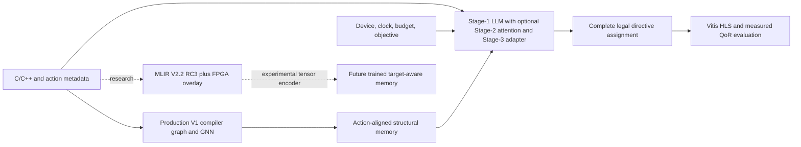

# MailoHLS / SALT-HLS

MailoHLS learns complete HLS directive configurations for C/C++ kernels under
an optimization objective, FPGA device, clock period and resource budget. SALT-HLS
is the extended framework name used in the research work.

The production pipeline uses the **V1 GNN**, action-aligned structural memory,
and selected LLM adapters. Stage 1 learns target-conditioned directives; Stage 2
adds structural cross-attention; Stage 3 optimizes preference pairs. Selected
artifacts and objective-specific availability are recorded in
[`FINAL_ARTIFACTS.json`](FINAL_ARTIFACTS.json). In particular, production Stage 2
and Stage 3 are selected for ADP; other stages/objectives have the explicit
fallback or pending status in that manifest.



MLIR V2.2 RC3 and its hardware overlay are experimental representations. They
are **not interchangeable with production V1 tensors or checkpoints**. The
readiness pilot did not establish improved target generalization. Semantic
features and resumable V2.2 supervised training live on research branches;
the latest recorded full paired run has no selected checkpoint or QoR result.
See [development status](docs/framework-development-status.md) for branch links
and the boundary between implemented, evaluated and planned functionality.

## Start here

| Need | Guide |
|---|---|
| Understand stages, schemas and code ownership | [Architecture](docs/architecture.md) |
| Install and reproduce selected experiments | [Reproducibility](docs/reproducibility.md) |
| Inspect experiment questions and limitations | [Experiment index](docs/experiments.md) |
| Inspect compiler graphs and uncertainty | [V2.2 compiler guide](docs/structural-graph-v22.md), [review status](docs/V22_FINAL_RELEASE_REVIEW.md) |
| Inspect FPGA graph enrichment | [Target-aware graph guide](docs/target-aware-mlir-v22/README.md) |
| Verify or restore registered graph artifacts | [Artifact policy](docs/reproducibility.md#artifacts) |
| Contribute without breaking historical results | [Developer guide](docs/development.md) |

## Installation and a small example

Use an isolated environment with the dependencies in `requirements.txt`.
GPU/CUDA, model weights, Vitis and the pinned Polygeist toolchain are separate
requirements for their respective workflows. Nothing below launches training
or synthesis:

```bash
python scripts/artifacts.py list
python scripts/artifacts.py verify --artifact salt-hls-graphs-v22-20261027-rc3
python -m LLM_branch.common.directive_domain_workflow --workflow train --domain-policy tcad
```

Graph verification needs only the Python standard library. Directive inspection
uses the shared domain contract; execution and domain shifts require explicit
flags documented by that module. Existing checkpoint policies are not relabeled.

For model training and inference, follow [reproducibility](docs/reproducibility.md)
and [maintained launcher choices](docs/shell-scripts.md). Cloning the source
repository does not download pretrained model weights. Frozen compiler graph archives and original measurements remain tracked. Historical checkpoint evidence, generated graphs, synthesis snapshots and derived
CSV tables can be restored directly from their sealed original Git objects:

```bash
python scripts/artifacts.py restore-git --artifact harp-generated-graphs-v1
```

See [reproducibility](docs/reproducibility.md) for the other artifact IDs and
catalog recovery. Normal development does not require GitHub Releases. Generated
outputs remain ignored; selected model weights are supplied separately.

## Repository map

`GNN_branch/`, `LLM_branch/` and `Preprocessing/` own the maintained implementations.
`Data/` and `evaluation_set/` hold benchmark inputs and measurements.
`experiments/` contains research methods and reports; `scripts/` contains
launchers and utilities; `tests/`, `docs/` and `toolchain/` hold regression checks,
guides and pinned compiler provenance. `HARP-rep/` preserves the modified baseline.
`src/` contains historical implementations and documented compatibility entries.
Do not infer production status from directory or checkpoint names containing
`final`.

## Six-branch development structure

| Branch | Responsibility |
|---|---|
| `main` | Finalized framework and selectively integrated, validated improvements. |
| `mlir-target` | Immutable historical MLIR baseline. |
| `llvm-ir` | Immutable historical LLVM baseline. |
| `research/stage1-refinement` | Stage-1 supervision, recovery and measured-quality research. |
| `research/gnn-refinement` | Graphs, semantic tensors, hardware awareness and GNN research. |
| `research/refinement-mechanism` | HLS feedback, directive refinement and search research. |

Use configurations and result directories for experiment variants within these
three research branches. Keep unfinished work there and selectively integrate
validated improvements into `main`. Update a shared research branch with
`git fetch origin` followed by `git merge origin/main`; preserve local work first.
Do not force-rewrite shared history. Detailed conventions are in
[development](docs/development.md).
