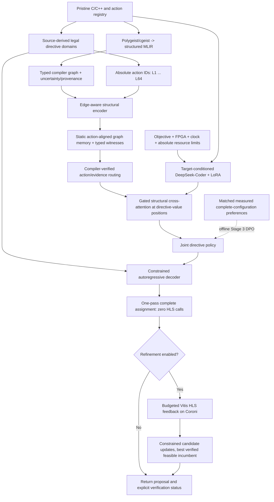

# SALT-HLS: Compiler-Grounded and Target-Aware Optimization of FPGA HLS Directives

**Research architecture and reproducibility guide · 11 November 2026**
**Status:** selected research specification; the proposed integrated latency policy is **unqualified**. The latest corrected Stage-2 and DPO trials changed none of nine natural generated assignments relative to Stage 1. Contract tests establish software behavior, not latency improvement.

Start with the [component status and evidence matrix](docs/ARCHITECTURE_EVIDENCE.md),
[reproduction guide](docs/REPRODUCIBILITY.md), [limitations](docs/LIMITATIONS.md),
and [current consolidation checks](docs/CONSOLIDATION_STATUS.md). A small
[GEMV inspection walkthrough](examples/README.md) connects source, actions and graph.
The [GEMV four-layer structural-memory study](experiments/gemv_structural_explainability/README.md)
exports actual trained action vectors and authenticated source/compiler/slot figures;
learned GMT retrieval and physical improvement remain unevaluated.

> **Central idea.** Select a **complete, source-valid HLS directive configuration** by combining a target- and objective-conditioned language model with **compiler-verified, action-aligned graph evidence**. Improve the policy using authentic measured whole-configuration preferences and, when explicitly requested, a small number of synthesis-guided refinements. FPGA constraints are feasibility requirements, not rhetorical prompt preferences.

This is the proposed continuation of [MailoHLS (Vouvali et al., 2026)](https://arxiv.org/abs/2606.07246). The published MailoHLS experiments and the newer SALT-HLS studies use different graph, model, checkpoint, objective and evaluation contracts. Their results must not be pooled as if they evaluated one identical policy.

## 1. Research question and scope

For a source program \(P\), its verified set of directive actions \(\mathcal A(P)\), an FPGA device \(D\), requested HLS period \(T\), resource capacities \(\mathbf B=(B_{BRAM},B_{DSP},B_{FF},B_{LUT})\), and objective \(o\), infer a **joint** configuration

\[
\hat{\mathbf d}=\pi_\theta(P,\mathcal A(P),G(P),D,T,\mathbf B,o),
\]

where \(G(P)\) is a reproducible compiler graph constructed **without** injecting candidate directive choices. For the primary research setting \(o=\texttt{PARETO_LATENCY}\), the desired decision is

\[
\min_{\mathbf d\in\mathcal D(P)} L(P,\mathbf d,D,T)
\quad\text{subject to}\quad
R_j(P,\mathbf d,D,T)\le B_j\;\;\forall j,
\]

with actual admissibility, synthesizability, resource feasibility and timing qualification checked separately. The deployed optimizer is a **bounded heuristic** for this difficult combinatorial problem, not an exact solver or a guarantee of globally Pareto-optimal hardware. Source-valid tuples can still fail synthesis, C/RTL equivalence, timing or physical implementation.

The current frozen research reference is **ZCU104, `xczu7ev-ffvc1156-2-e`, 10 ns, full capacities** (624 BRAM18K, 1,728 DSP, 460,800 FF, 230,400 LUT). Other devices and periods are explicit inputs and evaluation contexts; their inclusion does not by itself prove useful transfer. The current policy trains primarily for **latency**. The software interfaces retain an explicit objective input, but area and area–delay objectives require separately authenticated labels/adapters and end-task qualification. Never label a latency-trained single adapter as validated for all three goals.

**Latency terminology:** HLS-reported cycles, requested period, estimated achieved period, and post-route measured timing are distinct. Multiplying cycles by *requested* period gives a nominal quantity, not necessarily realizable execution time. Undefined worst-case latency and synthesis timeouts are **unknown**, not zero or infeasible by assertion.

## 2. Architecture at a glance



**Training sequence:** (1) objective/target-aware LoRA supervised fine-tuning; (2) learn gated cross-attention while keeping the pretrained backbone, selected LoRA and graph encoder frozen; (3) preference-optimize the resulting **whole fused policy** with DPO against its own frozen reference. **At inference time, DPO is part of the trained policy; it is not an extra transformation applied after a complete assignment has already been decoded.** Refinement is an optional *runtime* stage, separate from these three training stages.

## 3. Representation: preserve the compiler facts that directives act on

### 3.1 Why native MLIR, rather than only C text, AST, or a flattened LLVM graph?

Directive effects depend on loop nesting, array identity, access strides, memory aliasing, data/control flow and the scope of optimizations. Program text identifies many of these incompletely; lower-level IR can erase useful source-level structure. **Polygeist/cgeist** lifts C/C++ into structured MLIR, enabling typed representations of SCF/Affine operations, regions, SSA values and memrefs before lowering. The graph retains loop–array–operation–access relations and verified dependence witnesses, with a source/action map. See [MLIR (Lattner et al., CGO 2021)](https://mlir.llvm.org/getting_started/Faq/) and [Polygeist (Moses et al., PACT 2021)](https://polygeist.llvm.org/).

The **RC3** compiler-graph archive is the selected structural basis. The archive reports **63 canonical variants, 61 names, 55 measured/source matches, 40 kernels in the curated V4 cohort, 38 complete source mappings and 20 pilot memory packs**; these are different denominators and must never be reported as a single coverage statistic. Unknown aliases, unresolved pointers and failed affine analyses stay explicitly *unknown* rather than being promoted to nondependence.

**Design choice:** preserve typed graph relations and explicit knownness/provenance; encode only what was actually recovered. This follows [HARP (Sohrabizadeh et al., ICCAD 2023)](https://github.com/UCLA-VAST/HARP), but prioritizes native compiler evidence and source-verified directive anchor identity. [Chariot (Huang et al., TCAD 2026)](https://doi.org/10.1109/TCAD.2026.3732102) independently strengthens the motivation for explicit directive-to-target relations; it does not validate our downstream architecture.

### 3.2 Absolute directive identity: semantic alignment before learned retrieval

Each source action has an authenticated absolute ID, e.g. `L1` for a particular array and `L4`/`L5` for particular loops in the GEMV walkthrough. The physical memory slot for `Lk` is **index `k-1`**, even if other action IDs are absent. Action IDs are *source-local*: `L5` in two different programs is **not** the same semantic entity. Preserve gaps and explicit source-bound/source-only masks. If compiler binding fails, a source-only action may be represented without inventing a target edge or dependence proof.

The critical alignment invariant is

\[
\texttt{source action } L_k \longleftrightarrow
\texttt{GNN memory}[k-1] \longleftrightarrow
\texttt{decoder decision for }L_k.
\]

Compiler relations can widen access to related actions and their supporting witnesses, but never through guessed graph connectivity. **Why:** pipeline and unroll decisions interact with surrounding loops and memory partitions; unrestricted global pooling can dilute evidence and cannot establish which fact grounds which directive. Tests must verify registration, gap preservation, source/compiler mapping, and routing coverage on all source actions, including unresolved cases.

### 3.3 Structural encoder and graph memory

**Architecture selection (provisional, not a performance claim):** preserve the established MailoHLS **four-layer, 64-dimensional edge-aware TransformerConv encoder with Jumping Knowledge (max)** and a **128-dimensional action representation** formed by concatenating local and multi-hop structural states. This is our intended structural encoder because it preserves more local-to-global context for loop/memory-dependent directives, inherits a trained and reproducible framework lineage, and avoids choosing an encoder exclusively from short objective-mismatched probes. Jumping Knowledge was proposed to adapt to different graph neighborhood ranges [Xu et al., ICML 2018](https://proceedings.mlr.press/v80/xu18c.html); [HARP](https://github.com/UCLA-VAST/HARP) likewise motivates hierarchical and transformation-aware HLS graph learning. **This is an inductive-bias and continuity argument, not proof that four layers outperform two on latency.** The initial trained arm had modest ranking accuracy and large regret on some kernels. The later local matched evaluation completed without justifying a freeze upgrade; see the separately authenticated completion report below. The two-layer 64D-to-128D compiler-only encoder remains the **compatible RC3 executable research baseline** for the November 10 fused-policy results. The two encoders and their learned memory/fusion weights are **not interchangeable**; use fresh matched memory export, fusion training, policy evaluation and authenticated hashes before promoting the four-layer architecture to a deployable endpoint.

For the four-layer candidate, a natural action representation is

\[
m_k = [h_{L_k}^{(1)}\;\Vert\;\max_{\ell} h_{L_k}^{(\ell)}]\in\mathbb R^{128}.
\]

This retains immediate/local and deeper contextual features; **it does not imply that every compiler fact is decoded perfectly**. The graph-QoR predictor's candidate-conditioned head can support *offline auxiliary supervision*, but exported memory used by the one-pass LLM must be computed **before** injecting directive values, candidate labels, measured QoR or budget information. Otherwise there is training/target leakage and an inconsistent inference contract.

The proposed richer memory interface consists of source-anchored action vectors plus **individually addressable, typed compiler evidence records** (access, loop hierarchy, memory object, SSA/use-def and supported dependence witnesses), each with its origin, type and knownness. Retrieval eligibility is compiler-derived. A practical bounded bank rejects overflow rather than silently truncating causal evidence. The current experimental evidence-memory interface exports evidence vectors/masks, but **does not yet learn or directly consume every evidence type/status as an embedding**. Adding such embeddings is a clearly marked next experiment, not a completed feature.

**GMT connection.** [Graph-as-Memory Tuning (Liu et al.)](https://arxiv.org/abs/2510.08966) motivates deep token-wise cross-attention to graph memory. SALT-HLS differs by retaining **verifiable, source-action-indexed memory** rather than compressing all compiler evidence into anonymous global learned tokens. We choose deterministic action alignment as the default; learned aggregation *within* a verified action neighborhood is a later matched ablation, not an excuse to lose provenance.

### 3.4 Target context: put deployment facts where they can change decisions

The selected baseline places the FPGA part, requested period, objective and **four absolute capacity counts** in the LLM request, alongside explicit resource fractions when appropriate. Thus the same compiler memory \(M(P)\) can be queried differently by deployment-conditioned decoder states. Source graph and memory remain stable for a fixed program; this supports caching and avoids accidental dependence of structural evidence on training labels.

**Decoder-side FiLM and graph-memory cross-attention are complementary, not mutually exclusive.** Feature-wise Linear Modulation (FiLM) [Perez et al., AAAI 2018](https://ojs.aaai.org/index.php/AAAI/article/view/11671) can transform a decoder hidden state according to device, period, available BRAM/DSP/FF/LUT and objective, whereas GMT-like graph-memory retrieval [Liu et al., 2026](https://arxiv.org/abs/2510.08966) dynamically selects compiler evidence according to the current action query. A promising extension is *bounded, residual, zero/near-zero-initialized adaptive modulation inside selected Transformer blocks*, optionally restricted to the structural cross-attention query path. This is an **architectural candidate, not a trained/validated component of the selected checkpoint**. The existing FiLM pilot modulated **only the final hidden state immediately before the LM output head**, not the internal decision layers; with an almost-zero learned gate and FP16 attenuation it showed identical **28/54** preference ordering for OFF/ON/legacy masks. These results do not rule out a stronger deep-decoder FiLM, but do not justify declaring it beneficial. RC3 hardware-message ablations likewise do not establish a universal GNN-FiLM failure. The limiting scientific issue is independent, physically measured device/clock/budget winner-switch supervision; extra modulation capacity cannot manufacture missing labels. Device-relative budget fractions must be separated from absolute resource counts when interpreting adaptation.

## 4. Objective-aware and target-aware supervised adaptation

**Backbone:** authenticated `DeepSeek-Coder-6.7B-base`, pinned model/tokenizer revision, NF4 quantization with FP16 compute in the current GPU stack. The selected latency research parent uses **one attention LoRA adapter**, rank 8, alpha 16, dropout 0.05, trained on Q/K/V/O projections plus saved learned special-token deltas. Do not claim FFN LoRA: the authenticated adapter does not target FFN projections. LoRA is chosen to preserve pretrained code understanding and make target-specific adaptation tractable [Hu et al., ICLR 2022](https://www.microsoft.com/en-us/research/publication/lora-low-rank-adaptation-of-large-language-models/).

Input conditioning includes explicit optimization intent (primary current value: `PARETO_LATENCY`), device, requested period, absolute resources, source/action tokens and exact syntax for conditional directive fields. A learned special token **represents a category**, not a continuously learned mapping of every possible numerical period or resource budget. Therefore, holdout device/clock/budget evaluation is mandatory.

**Action-balanced SFT:** training labels are **complete measured configurations** selected from a near-optimal feasible set under their original measurement contract, never a synthetic mix of fieldwise best values from different designs. The decision loss weights each active action equally, then each nonforced field, then each value token. Prompt text, schema, formatting and forced singleton fields receive no directive-decision loss. Formally, with \(A\) actions, \(J_a\) nonforced fields per action and \(V_{aj}\) value tokens per field,

\[
\mathcal L_{\mathrm{SFT}}=-\frac{1}{A}\sum_a\frac{1}{J_a}\sum_j\frac{1}{V_{aj}}\sum_t
\log p_\theta(y_{ajt}\mid P,c, y_{<ajt}).
\]

The **1% near-optimal reference tolerance** and exposure schedule are properties of the registered latency research dataset; they are not a proof that all sampled designs are exact-timing-feasible. Group train/validation/test splits by **kernel family**, freeze the split before architecture selection, and keep the locked test unopened until the final policy is selected.

**Evidence:** the corrected Stage-2 report traces 1,164 training exposures (291 requests, 17 training families) and 54 validation rows (only two independent validation families), showing why request counts must not be treated as independent programs. Do not use a favorable teacher-forced loss as a substitute for feasible-latency improvement.

## 5. Structural fusion: compiler-routed cross-attention

At selected decoder blocks, use the **post-self-attention, pre-MLP** insertion:

\[
u=h+\operatorname{SelfAttn}(\operatorname{LN}(h)),\qquad
v=u+\tanh(g)\operatorname{CrossAttn}(\operatorname{LN}(u),M;\mathcal R_k),
\]
\[
h_{next}=v+\operatorname{MLP}(\operatorname{LN}_{native}(v)).
\]

Decoder states form **queries**, static graph memory forms **keys/values**, and \(\mathcal R_k\) masks noneligible source actions/evidence for the current verified directive. The tested starting layout uses decoder blocks **[8, 16, 24, 32]**, 4 attention heads × 64 head dimension, 128D structural values and the native 4096D decoder hidden width. This is a **controlled starting layout, not an established optimum**.

Freeze the base decoder, selected LoRA, added-token deltas and GNN while first training cross-attention projections/norms and scalar gates. Gate initialization near zero preserves the pretrained decoder; run **zero-gate full-decoder parity** because casting the native residual can break equality even when the gate is zero. If the gate is *exactly* zero, early Q/K/V projection gradients can vanish until the gate moves—verify gradient flow over multiple updates. Preserve native residual dtype and the ordinary decoder MLP.

**Compatible FiLM–graph-memory mechanism (proposal):** let \(c=(D,T,\mathbf B,o)\). For a selected decoder state \(h\), derive bounded \(\gamma_l(c),\beta_l(c)\) and optionally modulate the **cross-attention query** \(q=W_Q((1+\gamma_l(c))\odot\operatorname{LN}(h)+\beta_l(c))\), while graph keys/values come from the target-independent compiler memory. This lets deployment context change the *attention distribution over compiler-authorized evidence* without altering graph facts or routing masks. A more expressive alternative places a gated FiLM residual in the decoder hidden-state stream before later self-attention/MLP blocks. Both should preserve near-identity initialization and be measured at the actual NF4/FP16 inference precision. If a routing mask admits only **one** memory key, modifying the query **cannot** change the attention weights over memory: the softmax is exactly one for that key. Multi-key compiler-relational retrieval is needed to test target-dependent evidence selection. Compare prompt-only plus memory, query FiLM plus memory, and decoder-residual FiLM plus memory under the same matched training data, model parent and synthesis budget; do not mistake larger logit movement for better feasible hardware. See [the FiLM–GMT architecture note](docs/FILM_GMT_AND_HISTORICAL_ENCODER.md).

**Causal alignment:** the memory route for a directive *value token* comes from the **absolute action being scored**, not merely from the closest source marker or the next output token. Candidate strings can span multiple tokens; each candidate must be scored under its own complete causal prefix. Right-padding masks and unmatched-action masks are part of the model contract.

**Why it is promising:** the decoder already carries optimization intent and target context; cross-attention supplies compiler-verified constraints and interactions at the moment of an actual value decision. [GMT](https://arxiv.org/abs/2510.08966) supports the general deep-retrieval mechanism; [LIFT](https://arxiv.org/abs/2504.21187) and [HARP](https://github.com/UCLA-VAST/HARP) establish related structural learning for HLS. **Neither external paper proves this routing or placement is optimal for SALT-HLS.**

**What the current experiments actually show:** corrected Stage-2 completed 150 updates and selected update 50 by validation; mean decision accuracy improved from 0.2894 to 0.3137 but generated assignments remained unchanged versus Stage 1 on **9/9** authenticated requests. Cross-route memory perturbations produced small log-score changes without configuration changes in the examined Viterbi/Pathfinder cases. A within-route permutation is not an informative negative control if it leaves the attention-accessible key/value multiset unchanged. The immediate goal is a matched, causal **witness removal / wrong-route / gate-off / correct-memory** study against measured feasible winners, not claims from attention maps alone.

## 6. Whole-configuration preference optimization (mandatory Stage 3)

After structural fusion, **DPO is the intended normal training stage**. Let \(\pi_{S2}\) be the *exact frozen, structurally conditioned Stage-2 policy*, including its LoRA, tokenizer, memory masks and projections. Given a single source/context and two measured full assignments \(d^+\succ d^-\), train \(\pi_\theta\) against this reference:

\[
\mathcal L_{DPO}=-\log\sigma\Big(\beta\{[\log\pi_\theta(d^+|x)-\log\pi_\theta(d^-|x)]-
[\log\pi_{S2}(d^+|x)-\log\pi_{S2}(d^-|x)]\}\Big).
\]

Use **summed log-probabilities of nonforced directive-value tokens**, each completion's *own causal prefix*, valid masks, full static memory and FP32 score accumulation. The proposed bounded default uses \(\beta=0.1\). Keep the frozen reference immutable and hash tokenizer, prompts, graph/memory, preference pairs, masks and parameters. Do not substitute a bare pretrained model as reference or switch silently between sum/mean/action-normalized reductions. Compare with **matched chosen-only SFT** from the identical Stage-2 state and data schedule [Rafailov et al., NeurIPS 2023](https://papers.neurips.cc/paper_files/paper/2023/hash/a85b405ed65c6477a4fe8302b5e06ce7-Abstract-Conference.html).

**Result and gate:** the actual 34-update DPO/SFT experiment used 128 training pairs across 16 families, with 54 validation pairs across **two** families. Both ended at **25/54** validation pair accuracy, with no observed pair-ranking improvement over the exact Stage-2 reference. DPO produced the same complete assignments as Stage 1 on the nine-request generation check. The trained code path exists, but **DPO has not earned unconditional default deployment**. The research architecture *requires* Stage 3; the release controller must refuse or explicitly label an unqualified checkpoint rather than claim the mandatory stage improves hardware by decree.

**Next evidence needed:** more authenticated independent families with **actual quality switch/stay cases**, exact-resource/timing labels, measured best-feasible latency and a reference-identical DPO-vs-SFT comparison. Include calibration and candidate-ranking regret, not just model loss or token accuracy.

## 7. Legal decoding and complete-design correctness

The inference entry point is `python -m LLM_branch.inference.optimize`. For every source action and field, the registry builds local legal choices. Array partition type, factor and dimension are conditional fields, as are pipeline/unroll choices and semantically forced values. The decoder **greedily ranks each legal value** by *mean causal token log-probability of its complete continuation, including the newline* under its own prefix. It must not rank multi-token values solely by their first token or select a value forbidden by the source/action domain.

Each final artifact is a **complete joint assignment** in a canonical syntax, not an independently assembled collection of high-scoring per-field designs. Source legality is a necessary but insufficient condition for correct Vitis behavior. Report separate gates for parsability, source-domain validity, C/RTL correctness, HLS completion, exact resources, estimated timing and post-route timing.

The normal **one-pass** path performs **zero** HLS queries. This distinguishes learned cross-kernel transfer from online synthesis search and makes runtime cost transparent.

## 8. User-selectable, measured refinement

After one-pass generation, refinement is available through an **explicit opt-in**, with an exact request, run directory and finite budget of charged logical HLS queries. The policy starts from the **actual trained-policy output**, not a handpicked or historical alternative. Its initial safe controller is **coordinate/feedback search**, with compiler-proven related action pairs as candidate moves, not fabricated dependencies. Each move remains a complete legal assignment; evaluate changed directives *jointly* when necessary, without assuming additive per-field effects.

A physical feedback observation is keyed by the **source+headers, full assignment, part, requested clock, tool version, settings and source hashes**. Synthesis is executed **only on `bonus24@coroni.microlab.ntua.gr` using Vitis HLS 2021.1**. Reserve a request before remote execution, cache only exact matching results, retain timeouts and failures, and return the best **verified resource-feasible, timing-qualified** incumbent. If no such result exists, return the original candidate explicitly marked **unverified**, not a fictitious best solution. Requested budgets filter known physical measurements but do not retroactively create new syntheses.

The controller maintains a paid-query ledger and supports deterministic, source-identical resume. Refinement-disabled and refinement-enabled outcomes must be compared at **identical synthesis budgets** and charged time/call totals. Keep C simulation, RTL cosimulation, HLS timing and post-route timing as distinct verification levels.

**Evidence boundary:** an authenticated Pathfinder alternative after a previous synthesis timeout completed with **3,788,075 cycles**, 74 BRAM18K, 0 DSP, 1,899 FF, 3,776 LUT and estimated 7.3 ns at requested 10 ns. It is a **feasible measured alternative, not a demonstrated speedup**, because the original policy baseline timed out. A matched Stage-3-start coordinate-vs-structural 1/4/8-query experiment did not complete; the refinement module remains **experimental**. The industrial rationale for closed-loop verification is consistent with [Reflex-HLS (Chen et al., 2026)](https://doi.org/10.1145/3849869) and the complementary code-rewrite/harness setting of [HLSClaw (Ge et al., 2026)](https://arxiv.org/abs/2611.02784), but our narrow directive-only scope and zero-call alternative are distinct.

## 9. Evaluation: the decision must improve *hardware*, not merely logits

### 9.1 Core metrics and controls

Measure: (i) source-valid complete-configuration rate, (ii) compilability and functional correctness, (iii) synthesis completion, (iv) **exact** feasible-resource rate, (v) timing-qualified rate, (vi) finite measured latency improvement over exact-context untreated/directive baselines, (vii) measured-pool **Regret@1**, top-k regret/recall, Pareto capture if applicable, (viii) Kendall \(\tau_b\), latency error and calibration, (ix) HLS queries and wall time, and (x) kernel-family generalization with independent-family confidence intervals whenever the sample supports them.

\[
\operatorname{Regret@1}(x)=\frac{L(\hat d,x)}{\min_{d\in C_x^{feasible}} L(d,x)}-1
\]

**This is conditional on an explicitly specified measured candidate pool** \(C_x\), not regret to the unknown global optimum. If the selected assignment has missing latency or timing, report **undefined**, never zero. If no timing-qualified member exists, do not invent a winner. Track physically identical designs across multiple budget views as correlated, not independent samples.

Use **same-source/same-tool/same-configuration** counterfactuals for target contrasts. An invariant optimal choice across clocks is an **anti-switch control**, not evidence of failed target conditioning. Need genuine winner reversals in independent development families to establish that an architectural module is learning target-sensitive changes. Budget values derived by rounding percentages are proxy feasibility only; exact BRAM/DSP/FF/LUT counts and timing outcomes are release-critical.

### 9.2 Selected available evidence (do not inflate)

| Study | Observation | What it supports | What it does **not** prove |
|---|---|---|---|
| MLIR vs HARP matched graph ablation | Historical MLIR reduced graph sizes and improved some area-ranking metrics on matched GNOSIS points | Compiler structure is a plausible better evidence representation | New latency-optimal fused policy |
| Latency structural-GNN run | Original-policy four-layer model: ZCU104/10 ns 2,362 measured configurations, \(\tau_b=0.13568\), feasible regret@1 38.50%; across 13,119 configurations, \(\tau_b=0.12963\), regret 68.62% | Trainable end-task structural predictor; transparent benchmark | Positive gain over a matched alternative encoder (not established) |
| Corrected Stage-2 fusion | 150 updates, validation selected step 50, 0/9 changed full assignments vs Stage 1 | Code/training/gradient path and cautious selection | Useful measured latency improvement |
| Matched Stage-3 DPO/SFT | Both 25/54 validation preference pairs; DPO 0/9 changed generated assignments | Compatible DPO mechanics and honest negative/neutral ablation | DPO default superiority |
| Target-FiLM held-residual check | 28/54 correct with FiLM OFF/ON/legacy, no pair-order changes | Current FiLM not justified as default | Universal failure of target-modulated memory |
| Target-contrast audit | 97,442 non-test records; only a few train device/clock winner reversals, none meaningful in held-out validation | Data identifiability problem is real | Transfer or adaptation improvement |
| Coroni exact-count bank | 12 HLS syntheses, Viterbi 10ns co-edit 372,816 vs 730,163 cycles; tight BRAM/DSP boundary | Real latency/feasibility trade-off | Learned model chose the winner: it did not |
| Measured-pool ranking audit | Viterbi 10ns/full: frozen policies preferred the slower candidate, **95.85% restricted-pool regret** | Concrete objective-mismatch failure mode | Global model failure or cross-family statistic |
| Stage-3-start refinement | One feasible candidate after multiple timeouts; no matched successful 1/4/8-query comparison | Safe operational candidate and honest timeout accounting | Refinement speedup or policy win |

Sources and exact reference lineage are listed below; all numbers belong to their particular **request/cohort/measurement/selection** contracts. The ranking-selection continuation was pending at the audited push. Later local Liono receipts show it completed with **`FREEZE_NOT_YET_JUSTIFIED`**, retaining the preliminary checkpoint and promoting no model. The [completed local report](docs/evidence/latency_gnn_completed_local.md) and [separate local provenance](docs/evidence/LOCAL_SOURCE_MAP.json) preserve this update without rewriting the pushed reports. No downstream LLM improvement was verified.

### 9.3 Release criteria

A checkpoint can be tagged **research-complete** after reproducible full-graph/action alignment, exact baseline parity, supervised training, DPO training, decoder validity and bounded synthesis evaluation. It can be tagged **default latency policy** only after **independent-family** evidence of nonregressing or improving feasible latency under exact resource/timing labels, with qualified DPO-vs-SFT comparison and a tested, finite optional refinement path. Until then preserve a registered Stage-1 or earlier qualified policy as the **transparent fallback**, without misrepresenting the fallback as the full final architecture.

## 10. Architectural decisions and falsification tests

| Decision | Why | Primary evidence and external antecedent | What would reverse it |
|---|---|---|---|
| Native typed compiler graph | Distinguishes loop, control, access and dependence structure | RC3 graph audit; MLIR, Polygeist, HARP, Chariot | Matched compiler-graph ablation shows no useful coverage/decision advantage |
| Explicit absolute action registration | Safely connects C/C++ actions to encoder slots and decoder fields | RC3 action mapping, Hotspot source-only repair | A demonstrably more faithful verified binding scheme |
| Target-independent memory; target-aware decoder query | Avoids target-label leakage and duplicated graph caches | Target-contrast/FiLM studies; matched frozen V4 and RC3 | Valid independent-family switch improvement from hardware-aware memory |
| Static local/contextual 128D action embeddings + typed evidence | Minimizes graph bottleneck and supports interpretable routing | V1 action memory; RC3 evidence-bank pilot; GMT | Matched gate-off/witness-ablation and end-task results favor simpler action-only memory |
| Action-normalized multi-reference latency SFT | Avoids token-length bias and target leakage from fieldwise designs | Corrected V4 reference and training audit; LoRA | Equal-budget full-configuration loss beats it on measured end task |
| Post-self-attention gated retrieval | Preserves original decoder and bounds cold-start interference | Zero-gate parity and gradient studies; GMT | Matched alternative placement/gating improves end-task Pareto/latency |
| Compatible full-policy DPO | Aligns preferences between measured complete configurations | Actual 34-step DPO/SFT pilot; Rafailov et al. | Repeated nonregression failures or no switch benefit: redesign labels/training, do not falsely claim gain |
| Explicit optional synthesis-feedback refinement | Separates instant transfer from paid online search | Coroni controller and timeout ledger; Reflex-HLS | Fixed-budget measured study shows no benefit/cost justification |

## 11. Implementation map and reproducibility

**Current repository file locations** (retained until the code is verified under a clean module layout; do not rename entry points without updating imports/tests/manifests):

| Function | Current implementation |
|---|---|
| Source domains and action contract | `LLM_branch/common/directive_domains.py`, `LLM_branch/common/mailohls_contract.py` |
| Structured MLIR compiler graph / tensors | `GNN_branch/` and `src/mlir_graph_gen.py`; validated RC3 graph-release manifest in `docs/` |
| Structural-memory routing and fusion | `LLM_branch/common/structural_memory.py`, `LLM_branch/common/structural_xattn.py` |
| SFT decision loss | `LLM_branch/train/stage1_decision_loss.py` |
| Stage-2 training | `LLM_branch/train/train_SFT_xattn_new.py` and `experiments/final_architecture_v3/` |
| Stage-3 DPO | `LLM_branch/train/train_DPO_harp_xattn.py` and `experiments/final_architecture_v3/train_preferences.py` |
| Constrained generation | `LLM_branch/inference/eval_stage1_stage2_stage3.py` |
| One-pass or optional refinement CLI | `LLM_branch/inference/optimize.py` |
| Causal search and Coroni adapter | `experiments/refinement_search/` |
| Latency-GNN evaluation | `experiments/paper_gnn_latency_final/` (on its dedicated research branch until qualification) |
| Target-FiLM ablation | `experiments/stage1_target_film/` (negative/neutral pilot, not default) |
| Earlier MailoHLS production artifacts | `FINAL_ARTIFACTS.json` (distinct lineage; do not overwrite) |

**Quick read-only entry point checks:**

```bash
python -m LLM_branch.inference.optimize --help
python -m pytest -q LLM_branch/tests/test_structural_xattn.py tests/test_mlir_graph_v22.py tests/test_refinement_search.py
```

These commands are examples only; run from a pinned environment with the required dependencies and local authenticated assets. GPU training and Coroni synthesis require separate authenticated preflights and are never triggered by a README command implicitly. Keep model weights, private data, compiler caches, raw HLS runs and proprietary tool installations outside Git; use SHA-256 manifests and documented retrieval paths. Never rewrite an earlier measurement, hash or result after refactoring.

## 12. Clean repository contract

A reviewer should encounter: **this README → runnable code → minimal examples → tests → a concise evidence index → versioned configuration/manifest contracts**. Generated training logs, raw tensor banks, repeated experimental plots and superseded notebooks do not belong in the branch root. Keep historical branches and immutable archival commits reachable until a verified backup exists; the final branch must not erase the intellectual or reproducibility trail.

The clean research tree should **group by concepts**, not rename variables everywhere to cosmetically hide actual saved protocol identifiers:

```text
README.md
LICENSE / CITATION.cff / requirements and environment locks
configs/                       # Validated target/model/training contracts
LLM_branch/                    # Maintained code until package refactor passes tests
GNN_branch/                    # Maintained compiler-graph/encoder code
src/                           # Required shared tools; remove only proven dead entrypoints
experiments/                   # Canonical experiment runners, not every raw run
  final_architecture_v3/       # Pinned executable research protocol; label kept for import compatibility
  refinement_search/           # Optional physical feedback
  paper_gnn_latency_final/     # Optional candidate: bring in only after qualification and import tests
examples/                      # Small source/action/graph/decoder walkthrough
scripts/                       # Maintained preflight/build/train/evaluate tooling
tests/                         # Regression and integration tests
docs/                          # Architecture, reproduction, evidence, limitations
  evidence/                    # Small immutable summaries and linked SHA receipts
```

The initial tree preserves working module names because saved checkpoints and import paths are real compatibility contracts. A **second, test-driven refactor** may migrate them to `salt_hls/` with clear modules (`compiler`, `actions`, `graph`, `fusion`, `training`, `decoding`, `refinement`, `evaluation`) and thin compatibility wrappers. Do not pretend an unimplemented package hierarchy already exists.

## 13. Source and experiment evidence index

**Reports below are copied, without content edits, into this branch by the consolidation script. Their original branch, commit, path and SHA-256 are recorded in [`docs/evidence/SOURCE_MAP.tsv`](docs/evidence/SOURCE_MAP.tsv).** Most reports are research receipts, not claims of release qualification; keep large raw artifacts on authenticated storage.

- [Revision-3 technical architecture, exact contracts and limits](docs/evidence/architecture_report.md).
- [Revision-3 completed results and negative/null controls](docs/evidence/latency_experiment_report.md).
- [RC3/Stage-2/DPO executable qualification protocol](docs/evidence/training_and_reproduction.md).
- [Compiler graph/GNN lineage distinction](docs/evidence/graph_encoder_analysis.md).
- [Structural memory and cross-attention analysis](docs/evidence/graph_fusion_analysis.md).
- [Target/context contrast coverage](docs/evidence/target_conditioning_analysis.md).
- [Whole-policy loss and DPO compatibility](docs/evidence/preference_training_analysis.md).
- [Coroni synthesis status and qualification rules](docs/evidence/physical_validation.md).
- [TCAD manuscript claims versus evidence](docs/evidence/manuscript_claim_crosswalk.md).
- [Four-layer latency GNN: completed initial arm and remaining comparison](docs/evidence/latency_gnn_status.md).
- [Four-layer latency GNN: initial measured ranking report](docs/evidence/latency_gnn_initial_results.md).
- [Later local GNN completion: no freeze upgrade or production promotion](docs/evidence/latency_gnn_completed_local.md).
- [Target-FiLM completed neutral result, precision issue and limitations](docs/evidence/hardware_conditioning_ablation.md).
- [GAN 18-request source-domain prediction comparison](docs/evidence/gan_device_clock_comparison.md).
- [Historical published MailoHLS architecture and results](https://arxiv.org/abs/2606.07246).

## 14. Related research and positioning

**GNN/HLS foundations:** [gnn4hls (Ferretti et al., 2022)](https://doi.org/10.1145/3570925), [HARP (ICCAD 2023)](https://github.com/UCLA-VAST/HARP), [Chariot (TCAD 2026)](https://doi.org/10.1109/TCAD.2026.3732102). They motivate compiler-aware structural representations, QoR surrogate learning and graph-linked directive effects. SALT-HLS focuses on action-conditioned language-model generation rather than *only* graph surrogate ranking.

**LLM plus structural learning:** [MailoHLS](https://arxiv.org/abs/2606.07246), [LIFT](https://arxiv.org/abs/2504.21187), [Graph-as-Memory Tuning](https://arxiv.org/abs/2510.08966). The concrete distinguishing mechanism is **source-authenticated action routing** at directive-value positions plus explicit target/objective context—not the generic presence of both a GNN and an LLM.

**Optimization and physical validation:** [CollectiveHLS](https://doi.org/10.1145/3702005) is an important zero-/few-shot directive baseline, [DPO](https://papers.neurips.cc/paper_files/paper/2023/hash/a85b405ed65c6477a4fe8302b5e06ce7-Abstract-Conference.html) motivates preference optimization, and [Reflex-HLS](https://doi.org/10.1145/3849869) / [HLSClaw](https://arxiv.org/abs/2611.02784) motivate feedback-driven or broader code-transformation agents. Compare these at **equal synthesis calls** where the problem formulations overlap; do not equate zero-call directive generation with tool-driven code rewriting or claim one dominates another from unmatched paper tables.

## 15. Known limitations and immediate research order

1. **Review the completed local latency-GNN comparison and preserve its receipts.** It did not justify a freeze upgrade; resolve the matched ranking/regret and independent-family limitations before another promotion decision.
2. **Use the newly selected encoder only with freshly exported memory and retrained fusion**, and compare compact action-only routing against typed evidence routing under identical source/target/label supervision.
3. **Fix the data-identifiability problem**: obtain independently measured, exact-resource, timing-qualified winner reversals *and* invariant controls for clock/device/budget changes before claiming strong target adaptation.
4. **Qualify cross-attention** using real complete-generation outcomes, true witness-removal/wrong-route controls, zero-gate parity, post-residual placement/gate alternatives and measured-pool regret; do not select a fusion mechanism by vector motion alone.
5. **Keep whole-configuration DPO mandatory in the architecture**, but promote it as the default only if matched SFT-controlled, synthesis-grounded evaluation justifies the claim. Its current neutral result stays visible.
6. **Finish a finite, matched optional refinement comparison** from the actual DPO policy under 1/4/8 charged Coroni queries, with safe timeout handling and best feasible QoR, before advertising a measured improvement.
7. **Preserve paper/production lineage** and avoid changing unlocked versus locked-test boundaries. No GAN external study or TCAD figure may be used as training-driven architecture selection when outside the frozen development protocol.

The model/system interfaces form a selected research specification. Performance contributions from newer memory, DPO and refinement remain hypotheses pending matched end-task qualification.
