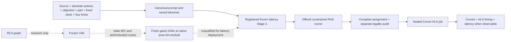

# Target-conditioned SALT-HLS architecture decision — 9 November 2026

**Decision: retain the registered latency Stage-1 endpoint. No new fusion, GNN,
modulation, DPO, or refinement arm qualifies for latency deployment in this run.**
This is a defensible baseline decision, not a claim that the architecture search
has found an optimum. The measured switch/stay gate failed before model training.
Preserving the exact reference adapter, prompt, domains, greedy decoder and
precision avoids an unmeasured reference-policy change. Reference physical
feasibility and latency are not guaranteed by checkpoint preservation.

The reference is `PARETO_LATENCY / xczu7ev-ffvc1156-2-e / 10 ns`, with available
BRAM_18K=624, DSP=1728, FF=460800, LUT=230400. The source and its action metadata
remain inputs: there is no universal reference pragma assignment.

## What executed and what the measurements establish

The [protocol](protocol.json) was written before new outcomes: 8 GPU-hours,
48 new unique HLS calls (24 bank / 16 outputs / 8 confirmation), at most six
post-route checks, 5% switch gap, 1% acceptable-set tolerance. Promotion requires
useful switches in at least two independent selection families, no observed
reference-feasibility regression and at most 5% family-macro reference latency
regression. Unknown receipts remain unknown. No test outcomes were read.

Coroni SSH, workspace permissions, 322 GiB free disk, vendor headers and Vitis
HLS 2021.1 were verified. Actual build: SW 3247384, IP 3246043. New synthesis ran
only on Coroni with the existing sealed-input runner; local and remote bundle
checksums were verified. The tool and vendor-header hashes are in the returned
`batch_provenance.json`. No already configured post-route runner was located;
`vivado` was not on PATH. No implementation/post-route claims follow.

The previously prepared paired V4 subset had only two completed result records:
both Viterbi timeout records after 21,600 seconds, and no successful QoR receipt.
The six-request archive therefore does not establish a physical V4 winner. Its
remaining jobs were never measured. These old calls are not charged as new work.

We sealed 12 shared-candidate jobs: two complete historical V4 single/multi
assignments for each of two validation sources, crossed at ZCU104/10 ns,
ZCU104/5 ns, U200/10 ns. Candidate selection used existing predictions before
new measurements, with no field splicing. The source, headers, full assignment,
part, clock, settings, runner and tool define physical identity. Budget is a view
of the same physical result. Only the two anchor cost probes were executed.

| New Coroni job | Source / context | Synthesis | Exact resources BRAM_18K/DSP/FF/LUT | HLS clock estimate | Worst latency |
|---|---|---|---|---|---|
| bank_01, historical single-reference assignment | Pathfinder baseline / ZCU104 / 10 ns | timeout at 300.004 s | unknown | unknown | unknown |
| bank_04, historical multi-reference assignment | same source / context | csynth completed in 11.911 s | 14 / 0 / 1515 / 3418 | 7.300 ns | `undef` |

The original runner calls the second result `failed` because its strict latency
parser rejects `undef`. We preserve that receipt and separately report
`synthesis_completed=true`, `rankable_latency=false`. This is not evidence of a
compiler failure or a slow design. The top-level report supplies exact resource
counts and an HLS timing estimate but no rankable worst-case latency. No cycle
count was inferred from the dataset or a submodule report.

The second design fits the full and 25% resource limits. Full-budget normalized
headroom is BRAM 0.977564, DSP 1.0, FF 0.996712, LUT 0.985165. A BRAM-only limit
of 13 excludes that design; without a measured feasible competitor it does not
create a switch example. These resource facts establish neither application
correctness nor post-route closure. Unknown first-candidate counts are not zero.

There are **zero usable switch pairs, zero established stay pairs, and zero
rankable latency cases**. Family-balanced regret, both-direction switch
correctness, stay agreement, transfer policy gain, and reference latency
regression are therefore unavailable, rather than zero. The shared-candidate
bank remains pending. Repeating all cross-context jobs would not repair the
missing anchor latency, so further synthesis and GPU comparisons were gated.
The evidence applies to one newly probed family, not a broad architecture win.

Actual spend: **2 new unique physical calls / 2 attempts, 311.915 synthesis
seconds; 0 optimizer updates, 0 model forwards, 0 post-route calls**. Ten sealed
jobs remain unexecuted; 46 new-call slots and the GPU budget remain unused.
Existing Viterbi receipts were reused as failure diagnostics, not QoR cache hits.
The allocation/stop decision is in `artifacts/architecture_finalization/allocation_log.json`.

Host GPU preflight initially found the assigned V100S idle (32,495 MiB free).
A later operational baseline-inference preflight found a Ray worker holding
29,782 MiB and refused model loading. No process was interrupted, no driver was
changed and no other GPU was used. The failure was before any model forward.
The sandbox's initial NVIDIA/DNS errors disappeared under authorized host
execution; those were not diagnosed as hardware or credential failures.

## Selected path and executable configuration

| Component | Choice | Status | Mechanism and qualification limit |
|---|---|---|---|
| Latency parent | registered `stage1_final_final_latency_s123/best_custom_stage1` | **retained baseline** | Exact adapter SHA `a15a0af1022370b08ee1e64cb9934a12e9f1c7ef1b96aaaf4ccfc406f4e0cc86`; no physical V4 promotion evidence |
| Text model | DeepSeek-Coder 6.7B base, revision `ce2207a8bfef3ee92bd7dd4cc31c52cfa0046912` | **retained baseline** | Existing NF4 / FP16 path, saved tokenizer and special input deltas |
| LoRA | rank 8, attention Q/K/V/O only | **qualified identity** | Actual adapter targets and 257-tensor allowed-trainable contract; no FFN LoRA |
| Target inputs | canonical objective/device/clock tokens plus physical capacity/available-resource integers and percentages | **qualified input contract** | Replay uses real capacities and canonical formatter; no hand-edited device token |
| Clock | fixed requested clock; 10/5/3.33 supported tokens | **retained baseline** | No AUTO selection; 6.67 ns and U50 transfer unqualified |
| Directive selection | official complete-action constrained greedy; mean RHS continuation token log-probability | **retained baseline** | Includes serialized continuation/newline, own preceding prefix for each candidate; score is not QoR |
| Local legality | saved registry + source action contract; separate tool-policy audit at synthesis boundary | **retained baseline** | No silent clipping or new candidate values; legality differs from resource/timing feasibility |
| Latency structural fusion | disabled in selected deployment | **retained baseline** | Registry has no production latency Stage-2; C pilot has no demonstrated held-out gain |
| RC3 research representation | canonical RC3, absolute Lk, masks/status/provenance | **qualified identity; utility unresolved** | Preserve explicit recurrence/access evidence; never infer independence from missing witnesses |
| Research GNN | frozen V4b compiler-only two-layer 64D → 128D | **retained research baseline** | ADP/QoR trained; not selected for latency. No depth/JK promotion |
| Memory / routing | static B is next minimal comparison; C remains experimental | **unresolved** | Same frozen encoder; compare routing and content separately. No claim B beats C |
| Fusion placement | native post-self-attention residual; historical [8,16,24,32] only as compatible anchor | **qualified boundary; layers unresolved** | Native MLP preserved. 12/24/32 require matched successful updates and measured winners |
| Target modulation / hardware messages | off | **retained baseline** | Target already enters LLM queries; no measured downstream evidence warrants memory-side target path |
| Stage-3 / text DPO | off for latency | **retained baseline** | Historical text DPO fell from 19/54 to 18/54 validation preference accuracy |
| Refinement | optional separately charged mode, off for one-pass qualification | **unresolved for latency** | Existing ADP controllers cannot be promoted from feedback availability alone |



On the actual GPU host, from this worktree:

```bash
PY=/home/elvouvali/miniforge3/envs/mailohls-llm-v2/bin/python
$PY -m experiments.architecture_finalization.audit
$PY -m experiments.architecture_finalization.run_selected \
  --input-jsonl artifacts/architecture_finalization/audit/operational_reference.jsonl \
  --output-jsonl artifacts/architecture_finalization/audit/operational_prediction.jsonl
# Add --execute after the assigned V100S preflight can pass.
```

The executable wrapper hashes the retained adapter and registry, pins the
V100S UUID, requires specified-clock latency requests, and invokes the real
inference module. It contains no decoder or prompt implementation. The frozen
reference JSONL contains Pathfinder source and exactly the reference part,
10 ns and all four full capacity counts. It contains no target assignment.
The dry command is executable; its actual model execution is currently blocked
by the active Ray allocation. The request-generation audit writes prompts,
token IDs, lengths, source/request hashes, and canonical physical fields.

For arbitrary input, provide the same JSONL fields with source action markers,
`objective=PARETO_LATENCY`, `frequency_mode=specified`, canonical `device`,
`clock_period`, `selected_clock_period`, and all `avail_*` values. Do not reuse a
10 ns output as a faster-clock quality result. Directives unchanged across two
requests may be correct when a common competitive design is measured in both
contexts; their invariance alone is not a model failure.

## Input, memory, and learning contracts

Request parsing normalizes device aliases and period units; canonical capacity
and availability fields reach `target_prompt_fields`, `build_prompt`, saved
token IDs, and the selected objective adapter. The response uses selected-clock
fixed context. Source markers precede the corresponding source fragments and
cannot themselves summarize later causal tokens. Directive-decision prefixes
see the complete source and prior assignments. The six CPU-replayed requests
were 1,086–1,346 tokens, below 7,168; each source was identical within its target
contrasts. Resource numerals are ordinary tokenizer pieces, not new learned
resource tokens. No new numeric encoding is justified by this replay alone.

Natural generation propagates earlier choices. Fixed-candidate comparisons must
keep preceding assignments and candidate domains fixed, and include a prompt-
freeze control. A final prefix state scores the first continuation token; later
RHS tokens/newline use later causal states. Never read full multi-token scores
from one hidden vector.

The supported fusion computes `u=h+SA(Norm(h))`, `v=u+r`, then
`v+MLP(Norm(v))`. The pre-hook is on native `post_attention_layernorm` input;
the MLP output hook carries the structural residual to preserve the native
outer addition. Attention uses branch precision; the residual addition retains
native stream precision. The prior four-request real-decoder parity receipt
recorded zero difference after that correction. This run reran its focused CPU
regression suite: **32 passed, 3 skipped**, plus **1 new archive-index test**.
The three skips require foundation packs absent from this isolated checkout.
No new full real-model cache/prefill/batch parity claim is made here.

Absolute Lk maps to row k−1. Memory B uses the same action vectors as A plus
compiler eligibility. C appends node/edge composite evidence, not a pooled graph
substitute. Masks govern known/valid/matched evidence and variable padding.
Evidence type and provenance metadata are not automatically learned vector
semantics. Edge composites are diagnostic, not trained complete witnesses.
Exact-slot one-key attention has softmax weight one; relational multi-key
routing enables query-dependent retrieval but does not establish its utility.

Static memory must exclude selected directives, labels, objective, requested
budget and measured QoR. The existing 20-pack builder checks exact vector/mask
invariance across ZCU104/3.33 and U200/10 overlays. It has evidence counts 42–877,
maximum combined key count 941, explicit capacity 1,024, no silent truncation.
A square 941×941 bool route mask is about 0.845 MiB/sample before text-attention
and model activations; mixed-length padding must be charged in cost comparisons.
Train/eval use the same bank manifest and absolute action rows. Stage-3 still
needs explicit RC3 variable-length/batched-single equivalence qualification
before it can be enabled; its historical loader is not assumed compatible.

## Graph and dataset denominator reconciliation

[Exact member reconciliation](graph_reconciliation.json) authenticates all 63
old-audit member hashes against the current archive. There are **63 canonical
variants, 61 unique normalized program names, 55 measured exact-source matches**.
The 63→61 reduction was three distinct Kalman graph identities sharing one
program name. The former index silently kept the last variant. It now retains
all variants and refuses ambiguous graph selection for an audited source until
an explicit identity is supplied. The duplicate test-family graph metadata were
read only for packaging integrity, not outcomes. No active action was removed.

The V4 cohort is narrower: 40 source matches; 38 complete action mappings; the
existing pilot selected 20 packs (17 training-family representatives and three
validation kernels). The two Hotspot exclusions remain explicit. The main
checkout's staged Hotspot repairs are preserved and are not silently treated as
part of the pinned archive. The full-data contract has 130,310 train, 13,011
validation and 6,705 test rows with 3 validation families. V4 has 2,524 train and
54 validation rows (17/2 families), no exported test rows. The RC3 pilot has
1,164 train and 54 validation rows. These are different populations, not
contradictory totals. Correlated requests do not increase independent families.
The archived GNN measured cohort has 18/3/1 train/validation/test families.

## Controlled alternatives and why none advances now

The existing V4 paired report says neither adapter matched an exact measured
configuration in the 54-case action-agreement cohort. Its physical subset is
now confirmed incomplete. A single/multi choice based on equality to one gold
assignment would not measure latency. The registered latency adapter therefore
remains parent; V4 adapters remain authenticated challengers.

The existing C pilot completed 20 updates over 17 training families. Its
held-out mean decision-site accuracy stayed 0.293505; candidate margin changed
−0.485576→−0.486175. The selected checkpoint remained step zero. The corrected
four-target inference changed margins slightly but no selected assignment.
Those are trainability observations; no authentic-memory causal or feasible-QoR
benefit qualifies C. They do not justify raising gate LR, adding modulation,
selecting layer 32, changing GNN depth, or training DPO.

The text DPO experiment used 136 training pairs / 17 families, 54 validation
pairs / 2 families and 34 updates. Training ranking rose 82.35%→84.56%, while
validation fell 35.19%→33.33%. Its sum over nonforced value tokens differs from
production candidate-mean continuation scoring. Conditional masks and token
lengths can change the scored terms; this is a hypothesis to quantify, not a
proven bug. Future standard DPO must use summed selected value-token logps,
float32 arithmetic, frozen exact Stage-2 reference, independent causal prefixes,
and matched chosen-only SFT versus anchored DPO. The historical production ADP
contract instead records semantic-action member mean, beta 0.5, anchor 0.02;
it must not be described as standard complete-sequence DPO.

Future screens are gated: (1) rankable shared train/validation pools, (2) matched
continued-SFT control versus train-only target-response enrichment, (3) static
B single-layer 12/24/32 screens or declared C bridge, (4) selected-layout B/C
with gate-off and eligibility-preserving permutation/witness ablations,
(5) static versus identity-initialized physical modulation with a parameter-
matched target-independent control and memory-only descriptor swaps. Modulation
must keep objective/budget in policy context. Hardware-message and depth/JK
arms require a diagnosed deficit and matched downstream evidence. No layer is
ranked from vector distance. No higher DPO weight is justified now.

## Draft-to-code alignment and objective support

No attached TCAD ZIP or active sections 03–08 were found in the checkout,
Downloads or available handoff archives. The GNN-training ZIP is not a TCAD
draft. Exact subsection, figure and table numbering/checkpoint attribution
remain **pending draft authentication**; no figure provenance is invented.
The table maps the claim categories supplied in the task to verified contracts.

| Claim category (draft section/figure: pending ZIP) | Verified implementation / artifact | Evidence status |
|---|---|---|
| Objective availability / three stages | `FINAL_ARTIFACTS.json`: Stage-1 all three; Stage-2 ADP; Stage-3 ADP registered | verified registration; not universal three-stage deployment |
| Split/data counts | full contract vs V4 and RC3 counts above, exact manifest hashes in identity audit | verified; draft original cohort unresolved |
| GNN four-layer JK and exported action memory | V1 registered multiscale memory vs V4b two-layer 64→128, physical-QoR + ADP preference | separate identities; RC3 not V1 replacement |
| Attention vs FFN LoRA | actual Q/K/V/O target modules, rank8; trained special input-token deltas | verified attention-only for all three inspected latency adapters |
| Single / multi references | V4 best versus uniform 1%-near-best whole assignments, four exposures | historical matched SFT; QoR promotion unresolved |
| RHS scoring | causal candidate continuation, mean token logp, saved newline serialization | verified production code |
| Masks / every-eight fusion / placement | ADP contract: RHS-only, relational, [8,16,24,32], post-SA residual, no fusion FF | verified checkpoint; latency C pilot separate |
| DPO reduction / anchor | ADP semantic-action mean beta .5 / .02 anchor vs text pilot summed values beta .1 / .2 SFT+DPO | verified distinct protocols; draft correspondence pending |
| Clock handling | specified response clock context in this study; AUTO exists but excluded | verified code/contract |
| Decoder constraints | checkpoint registry + source tuples; versioned tool guards on Stage-1 research ref | legacy and guarded outputs not pooled |
| Evaluation mode | one-pass greedy here; optional synthesis-query refinement charged separately | no post-route, no physical latency gain established |

GAN extent-50 factor-64 and large Kalman complete-partition XFORM failures stay
locked historical compiler-policy fixtures; they were not selected or synthesized
here. Source-tool V2 multidimensional semantics must be tested under the saved
policy on the Stage-1 ref, not silently retrofitted into historical scores.

| Objective | Registered Stage-1 | Registered Stage-2 / Stage-3 | This decision |
|---|---|---|---|
| PARETO_LATENCY | retained registered latency adapter | no production latency path | one-pass Stage-1; V4/RC3/DPO experimental |
| PARETO_AREA | registered area adapter | Stage-2 pending / no registered Stage-3 | retain independent defaults |
| PARETO_ADP | registered ADP adapter | registered V1 Stage-2 and ADP Stage-3 record | preserve; registry status is not a new quality validation |

The ADP Stage-3 contract calls its deployment role a focused DPO ablation and
names Stage-2 as production-model stage, although the registry also records its
Stage-3 path. This distinction must appear in any draft three-stage claim.
Historical Kalman fixed-checkpoint interventions do not change the registry.
U50 zero-shot, 6.67 ns, broad resource adaptation and test-family generalization
remain unqualified. The locked test was not used once because no candidate
passed the selection gate.

## Pinned historical evidence

See [the source ledger](evidence_sources.json) for immutable commit/file hashes.

- [paired_v4_20261105.md](https://github.com/ElenaVouvali/MailoHLS/blob/63afcfc7a54e573a544678e728cdb7d99d865981/experiments/stage1_quality_sft/results/paired_v4_20261105.md)
- [training_result.json](https://github.com/ElenaVouvali/MailoHLS/blob/3aeb704967714aa08d6ca68e4e6bf1136cb0b464/experiments/stage1_qor_preference/results/v1_20261106/training_result.json)
- [ARCHITECTURE_FINDINGS.md](https://github.com/ElenaVouvali/MailoHLS/blob/0098ea5c8e7c5d054e0fc311eab1541b2f52d820/experiments/architecture_representation_audit/ARCHITECTURE_FINDINGS.md)
- [XATTN_PLACEMENT_RECOMMENDATION.md](https://github.com/ElenaVouvali/MailoHLS/blob/97ed75ed3f41ad80247d739888d9ee488881872c/experiments/gemv_stage1_full_depth/XATTN_PLACEMENT_RECOMMENDATION.md)
- [synthesis.py](https://github.com/ElenaVouvali/MailoHLS/blob/c8e0b9c1912e4b59b5692f5f26918a23fbf82114/experiments/refinement/synthesis.py)

## Reproduction, raw evidence, rollback and the next experiment

All code is in the isolated `research/architecture-finalization` worktree based
on `ca1b9fc`; [identity.json](identity.json) pins all inspected refs and model,
tokenizer, registry, contract and code hashes. [results.json](results.json)
contains per-case assignments, counts, statuses and exact receipt hashes.
Large logs, XML/rpt/Tcl, sealed sources/headers, prompt/token replay and bank
inputs remain under `artifacts/architecture_finalization/` in this worktree.
The original checkout, checkpoints, production registry and historical receipts
were not modified.

```bash
# CPU authentication, replay, tests and report regeneration
$PY -m experiments.architecture_finalization.audit
$PY -m pytest -p no:cacheprovider experiments/architecture_finalization/test_archive_index.py \
  LLM_branch/tests/test_structural_xattn.py \
  experiments/rc3_stage2_multikernel/test_stage2_multikernel.py \
  experiments/rc3_fusion_foundation/test_rc3_memory.py -q
$PY -m experiments.architecture_finalization.analyze_bank
# The frozen bundle generator refuses overwrite; restore its authenticated
# Coroni input cache first, then choose a fresh output path in a future revision.
python -m experiments.architecture_finalization.prepare_bank
```

Coroni transfer/launch/retrieve templates (use a fresh run directory; do not
rerun timed-out identities without charging an additional attempt):

```bash
python -m experiments.architecture_finalization.seal_remaining --out artifacts/architecture_finalization/remaining_bank
scp -r artifacts/architecture_finalization/remaining_bank bonus24@coroni.microlab.ntua.gr:architecture_qualification_20261109_bank
ssh bonus24@coroni.microlab.ntua.gr 'cd architecture_qualification_20261109_bank && sha256sum -c SHA256SUMS && python3 run_batch.py --bundle . --output ../architecture_qualification_20261109_bank_results --timeout 300'
rsync -a --include='*/' --include='*.json' --include='*.xml' --include='*.rpt' --include='*.log' --include='*.tcl' --exclude='*' \
  bonus24@coroni.microlab.ntua.gr:architecture_qualification_20261109_bank_results/ \
  artifacts/architecture_finalization/bank_results/
```

These are restart instructions, not authorization to bypass the failed cohort
gate. The `remaining_bank` generator excludes both attempted identities and freezes
10 jobs in a **new hashed manifest** with explicit per-job Tcl and Tcl hashes.
The initial two probes sealed source/settings/runner and verified generated Tcl
from receipts; the new continuation also seals the Tcl bytes before transfer.
Before launching, log the revised budget/timeout and resolve the anchor latency. The runner preserves completed receipts; interrupted partial
jobs require review. No completed result is overwritten.

**Single next experiment:** establish an authenticated bounded-transaction
latency measurement for both sealed Pathfinder candidates at the anchor before
any cross-target training. Investigate why the top-level AXI design reports
`undef`; use an existing authorized cosimulation/measurement protocol if one
can supply valid finite latency without silently changing the source/settings.
A changed wrapper/interface/settings creates a new physical identity and
requires matched remeasurement, compiler graph/source registration and explicit
functional validation. In parallel, Viterbi requires a justified longer runtime
or a separately frozen smaller meaningful diagnostic; it cannot silently stand
in for the original workload. Only after two independent selection families
have rankable paired pools can the static-versus-modulated fusion question be
qualified. Retain the selected baseline until then.

Rollback is configuration-only: invoke the existing registry endpoint directly
and omit this research wrapper. The only shared implementation fix preserves
all graph variants and fails on ambiguous identity; it changes no model weights,
selected source, memory vector, candidate score, or production default.
