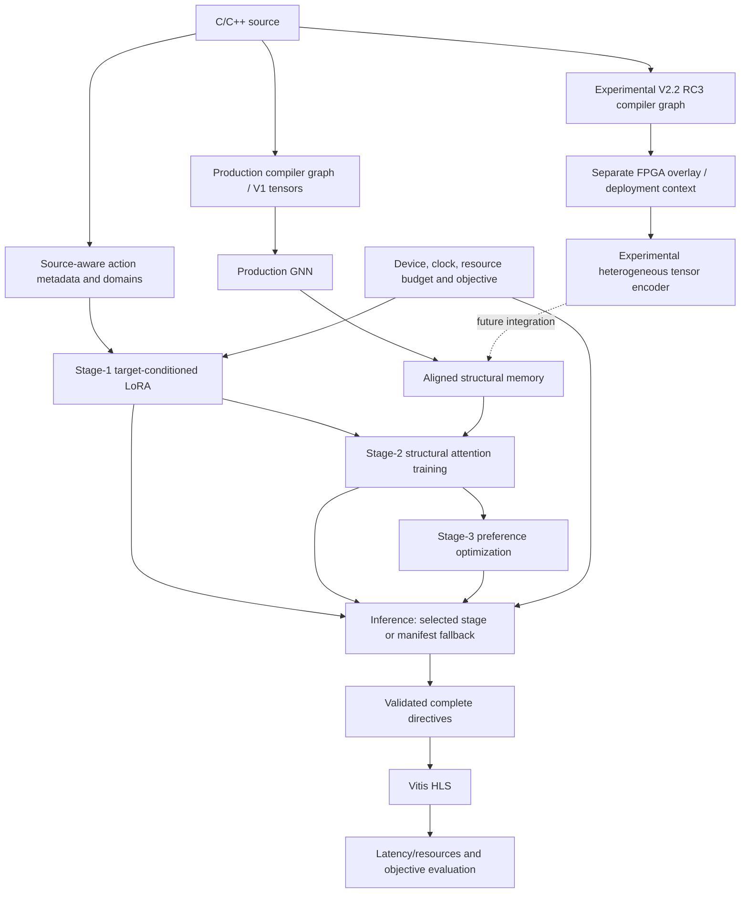

# Implementation architecture

The maintained production code is split by responsibility, not by research date.
`Preprocessing/` constructs measured examples and the family split.
`LLM_branch/common/directive_domains.py` validates source-specific actions.
`LLM_branch/common/mailohls_contract.py` owns the production target/prompt contract.
`GNN_branch/mlir_data.py`, `model.py`, and `train_GNN.py` own production tensors,
GNN prediction and training. Their learned dimensions and weights remain V1.

Source action IDs are absolute: `Lk` maps to memory slot `k-1`. Missing actions
must keep their slots. `build_structural_memory.py` and
`build_multiscale_memory.py` export memory; `LLM_branch/common/structural_memory.py`
loads it and `structural_xattn.py` supplies attention. Model availability is
objective-specific in `FINAL_ARTIFACTS.json`.

Stage arrows describe training dependencies and checkpoint selection, not three
LLMs executing serially during inference. Existing inference selects a compatible
stage/checkpoint. Stage 2 adds memory attention; Stage 3 retains its parent contract.

V2.2 compiler schema `salt-hls-mlir-structural-v2.2` is authenticated separately
from overlay schema `salt-hls-target-enriched-v22-v1`. The compiler graph retains
proof status, uncertain roots and unresolved actions; hardware compatibility
never establishes synthesis binding. The readiness encoder integrated here is
experimental. Later action-demand and semantic-v3 branches have their own tensor
schemas and do not retroactively alter pilot results or production weights.

Candidate directives belong to a candidate-conditioned prediction head. Reusable
structural memory must stay candidate-independent. Target-aware future memories
need graph/device/clock/budget cache identities. Stage-2 integration of those
memories is still future work. See the [status map](framework-development-status.md)
and [full graph contract](target-aware-mlir-v22/README.md).
