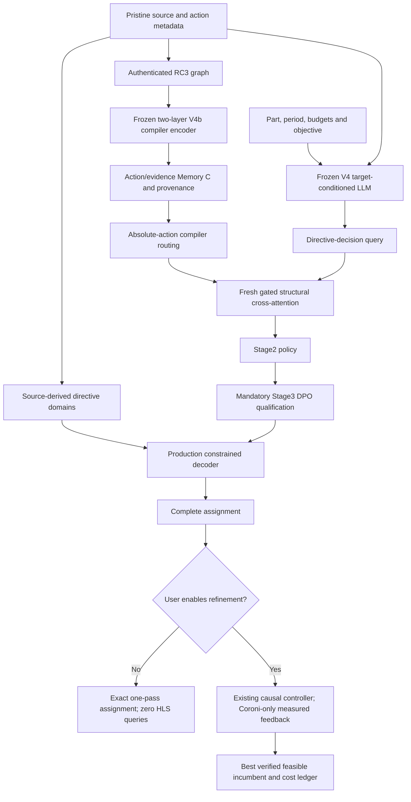

# SALT-HLS: architecture qualification and executable research path

**Revision3, 10 November2026. System freeze: NO while the mandatory DPO/default,
corrected fusion and physical target-adaptation gates remain open.** This document
supersedes older RUNNING/BLOCKED descriptions for the identified runs without
changing their historical receipts. It distinguishes an implemented computation
from a qualified deployment policy. The selected latency research parent is V4;
there is no demonstrated new hardware-conditioning architecture winner.

Current research branch: `research/final-architecture-v3-20261110`, based on
`8ad95155ec38d9a389e3b8c70dc4a1127dacc28e`. See
[reconciliation](../../experiments/final_architecture_v3/RECEIPT_RECONCILIATION.md),
[protocol](../../experiments/final_architecture_v3/protocol.json) and
[executable commands](../../experiments/final_architecture_v3/README.md).

**Current completed results:** [Revision-3 evidence and release decision](RESULTS_V3.md). The corrected150-update Stage2 selected50; mandatory34-update DPO/SFT and36 matched generations completed. Neither fusion nor DPO changes the nine Stage1 configurations. Twelve new exact-count syntheses establish one unusually tight resource boundary, no meaningful clock reversal. Refinement physical validation remains limited by per-job timeouts.

## 1. Optimization problem and information flow

Given pristine source P, deployment part D, requested period T, four absolute
resource limits B, objective o and compiler graph G(P), produce one complete
assignment d. The primary task is PARETO_LATENCY: minimize measured latency among
resource-feasible configurations at the same physical context. The reference is
ZCU104/`xczu7ev-ffvc1156-2-e`/10ns/full BRAM,DSP,FF,LUT limits. Full limits in the
current contract are624 BRAM_18K,1728 DSP,460800 FF and230400 LUT. These capacities
are request inputs; utilization-derived dataset proxies are not exact measurements.

The DPO-on path is the intended normal endpoint, not a proven better endpoint.
If its qualification fails, retain Stage2 as the transparent safety control and
block an unconditional DPO-default release. Runtime refinement is available only
when the user requests it; one-pass and synthesis-assisted outcomes are separate.

## 2. Source actions, complete assignments and legal decoding

The maintained directive domains and contracts live in
`LLM_branch/common/{directive_domains,mailohls_contract}.py`. Source metadata
register arrays and loops at absolute L1–L64 slots. Gaps are preserved. A local
L5 in another kernel is not the same semantic action. Array partition type,
factor and dimension, and loop pipeline/unroll are individual fields. Conditional
array tuples and semantically forced fields are resolved under the actual preceding
assignment. Complete measured configurations are never assembled from separately
preferred fields.

The historical/native checkpoint proposal domain and the source/tool-v2 guard
are distinct policies. The new matched training and generation retain the same
native domain; pinned source/tool-v2 checks are separate admissibility checks.
Source-valid does not imply synthesis success, resource feasibility or timing.
Historical GAN/Kalman failures must remain separate from guarded comparisons.

`eval_stage1_stage2_stage3.py` scores each admissible RHS continuation, including
its newline, by **mean causal token log probability**, then greedily selects a
value. A multi-token value is scored under its own whole prefix. A single hidden
state does not alone determine its full score. Forced singleton outputs are not
independent learned choices. Schema/field agreement is useful diagnostically but
cannot replace whole-design QoR.

## 3. Compiler graph and structural-memory contract

RC3 graph archive SHA256:
`feb2c2d469bf6672248ad0f3a88099ac9627b3b10b8e139a0fab050d532a1b73`.
Canonical graphs retain source/action registration, compiler matchedness, loop
hierarchy, affine accesses, operations, SSA values and dependence witnesses with
knownness/provenance. A verified scalar SSA recurrence is not automatically an
inter-action memory dependence. Missing evidence is not proof of independence.
Names, node IDs and source locations are provenance, not learned semantic features.

The archive/source/data denominators differ:63 canonical variants,61 names,
55 measured-source matches,40 V4 kernels,38 complete mappings and20 pilot packs.
These counts must not be collapsed into one coverage claim. The current cohort
has17 training families and three validation kernels in two families. Its Memory C
packs contain42–877 evidence records; the largest combined memory has941 keys.
The explicit capacity is1024 evidence records; overflow is rejected, not truncated.

The selected frozen **experimental** encoder is V4b compiler-only:
`compiler_selected.pt`, SHA256
`ef61521989d8cf3282b28f881f0cd7673de2a5253f1d42b57542e21531019162`.
It uses two typed64D graph layers and a64→128 output projection. This is distinct
from the paper's V1 four-layer JK encoder. V1 and RC3 cannot share trained fusion
weights merely because both export64×128 action arrays.

Interfaces A/B/C share frozen encoder vectors:

| Interface | Keys and routing | What remains compressed or unresolved |
|---|---|---|
| A | `[B,64,128]`, exact matched action key | Action vector compresses its structural neighborhood |
| B | Same64 action vectors, compiler-derived relational eligibility | No individual evidence records |
| C0 | `[B,64+E,128]`, action and individual evidence eligibility | Node/edge composites are not guaranteed lossless facts |

C0 includes array/memory roots, loop/control nodes, affine accesses,
arithmetic, SSA state and supported edge witnesses. Edge composites are deterministic
representations, not independently trained semantic edge encoders. Evidence types,
status and knownness are available in the ledger but are **not automatically
consumed as learned type embeddings** by current attention. A future C1 requires
its own matched experiment.

Memory for a fixed program is exactly invariant to device/clock/budget in the
compiler-only path. Candidate directives, measured QoR and chosen labels must not
enter static memory. Device/resource overlays may encode possible compatibility,
not proven HLS binding. Physical target information enters the present policy
through the LLM query.

## 4. LLM identity and Stage1 conditioning

Backbone: DeepSeek-Coder6.7B-base, revision
`ce2207a8bfef3ee92bd7dd4cc31c52cfa0046912`, NF4 with FP16 computation on the V100S.
V4 adapter SHA256:
`28dd67b87e10852c2e25975c0330259ac2dd09c4c9dff9cf84c3fff1bc3bf164`.
The adapter uses rank8 attention Q/K/V/O LoRA, alpha16, dropout0.05, with saved
learned special-token deltas. The saved tokenizer/mapping and objective are mandatory.
This is not the historical production checkpoint or experimental text-DPO adapter.

The prompt carries objective, learned device/clock tokens, numerical capacities,
component-wise available resources and source/action tokens. Numerical inputs are
ordinary token sequences unless explicitly included in the learned-token registry.
Changing a device token without its physical fields would invalidate the experiment.
`<SRC_Lk>` precedes its source fragment and cannot summarize future source tokens;
directive-decision positions after the full source are the primary analysis sites.

Stage1's action-normalized loss assigns each active action1/A mass, each of its
nonforced fields1/(A·J), and each value token1/(A·J·V). Prompt, fixed schema,
newlines, EOS and semantic singletons receive no decision loss. Near-optimal
multi-reference supervision retains complete measured assignments within the
existing1% tolerance, with a frozen exposure schedule and family-disjoint splits.

## 5. Stage2 fusion, routing and gradients

The current corrected baseline preserves all1,164 training exposures and54
validation rows. A scoped wrapper reuses the exact pinned Stage1 loss implementation
and bypasses objective reranking/deduplication. It also disables duplicate compaction.
Historical trainer defaults and the old150-step run remain unchanged. New contracts
record the effective policy even though the inherited parser still exposes top_k=1.

The historical150-update run used equal field weights and collapsed targets to291
rows. Its loss/accuracy trajectory cannot fairly reject action-normalized fusion.
The new loss scale also cannot be numerically compared to its old0.707 loss.

At selected transformer blocks:

`u = h + SelfAttention(Norm(h))`

`v = u + tanh(g) · XAttn(Norm(u), routed_memory)`

`h_next = v + native_MLP(native_Norm(v))`.

The established `post_self_attention_residual` hook preserves the decoder MLP.
Q width4096, memory width128, four heads×64 head dimension. The corrected baseline
uses historical layers[8,16,24,32] as a controlled starting point, **not an optimal
placement claim**. Only fusion projections/norms and gates train. Backbone, LoRA,
learned-token deltas and GNN are frozen. Attention LR1e-4, gate LR2e-4, seed123,
batch1/accumulation8, gradient checkpointing; maximum150 updates is a bounded pilot.

Native residual dtype must be preserved when adding the structural update.
Casting the residual itself at zero gate previously broke decoder equivalence.
The corrected path has real zero-gate candidate/assignment parity evidence.
At exact zero gate, first-step projection gradients may be zero; gate gradients
must turn the path on before subsequent Q/K/V gradients are judged.

Forward-filled target slots route RHS logit positions after the full source.
Source markers and sparse target-placeholder IDs are not interchangeable with
that causal action ID. Padding and unmatched evidence are masked. The Stage3
variable-length loader now uses the same right-padding utility as Stage2,
preserving the64 absolute action slots and false-masking added keys/routes.

## 6. Embeddings: availability, recoverability and use

[Fixed-prefix results](../../experiments/final_architecture_v3/results_v3/fixed_prefix_analysis.json)
cover six contexts, two kernels/families, layers8/16/24/32, identical previous
assignments and candidate domains. Across33 unforced field comparisons, zeroing
evidence changes3 winners, gate-off changes3, and matched permutation changes0.
Mean maximum absolute RHS-score shifts are0.14316,0.24401 and0.000748 respectively.
Maximum target-contrast mean-head attention total variation is0.01457. Authentic
relative structural updates range1.31–4.60% at these sites. These are measurements
of the historical mismatched-supervision checkpoint150, not new hardware gains.

[Trip-count probe](../../experiments/final_architecture_v3/results_v3/gnn_trip_probe.json)
uses74 training and13 validation actions, with compiler-proven positive trip counts
and family-disjoint splits. Ridge regularization is selected only inside training
family folds. Validation MAE in log2 units: mean1.6434, lexical1.1217, GNN1.1487,
shuffled-label GNN1.9824. Only two validation families exist. Trip count is an
explicit compiler input, so this does not establish compiler-like inference or
useful directive selection. The source baseline is essential. Actual frozen V4 states were subsequently captured for20 kernels on A2; the family-disjoint joint comparison is now complete. See [current probe results and limitations](RESULTS_V3.md#embeddingevidence-semantics).

Large vector motion is not quality. Attention weight is not causal importance.
A shuffle within identical eligibility routes is a permutation symmetry/placebo, not a semantic negative control. A subsequent cross-route matched-type/status intervention changes scores slightly but no selected directives in two corrected-Step50 cases. Invariance does not prove source facts are absent. Verified witness removal, score changes toward
measured feasible winners and physical validation are stronger evidence.

## 7. Mandatory Stage3 DPO

The intended Stage3 starts from the exact selected corrected Stage2 checkpoint,
including its V4 LoRA/token deltas and compatible structural memory. The frozen
reference is that complete starting policy, never the bare backbone. Its scores
are cached before updates with hashes of weights, tokenizer-derived encodings,
prompt, masks, memory and pair files. Policy/reference use each completion's own
preceding directive values. Selected log-softmax and accumulation use float32.

`L_DPO = -log sigmoid(beta · [(logπ+(x)-logπ−(x))-(logπref+(x)-logπref−(x))])`.

The initial bounded protocol uses beta0.1, fusion LR1e-5/gate LR2e-5,34 updates,
accumulation4, seed123. DPO sums nonforced value-token log probabilities. A separate
chosen-only action-normalized SFT arm starts from identical weights and sees the
same chosen schedule. Mean-token/action-normalized rankings are diagnostic alternatives,
not silently substituted DPO probabilities. Variable mask/length effects and
chosen/rejected likelihood drift must be reported.

The prepared bank has128 training pairs/16 families and54 validation pairs/two
families after excluding suspicious spcl units. Resource labels remain percentage
proxies and timing estimates are missing. Thus the bank supports a limited
preference experiment, **not timing-qualified exact-feasibility deployment proof**.
The earlier136-pair text-DPO result is historical: train82.35→84.56%, validation
35.19→33.33%. It neither qualifies nor rules out compatible Stage2+memory DPO.
DPO default remains `DPO_REQUIRED_BUT_NOT_QUALIFIED` until end-task checks pass.

## 8. User-controlled latency refinement

The normal public path is `python -m LLM_branch.inference.optimize`, which reuses
the real Stage3 constrained decoder. Without `--refinement-enabled`, it performs
zero oracle/SSH/HLS calls and returns the exact Stage3 assignment. With it, specify
`--refinement-budget`, request manifest, persistent run directory and backend.
Logical budgets include measuring/reusing the baseline; cache hits still cost a
logical query. The physical cache cannot reveal unqueried results to the policy.

The backend extends the existing search controller rather than replacing its
policies. Coordinate/feedback is the simplest candidate default. The public CLI derives verified action pairs directly from the authenticated RC3 graph. No invented inter-action links are accepted. Resume reconstructs the policy's own paid history, verifies
context/signatures and refuses changed code/request/model. Failure, unknown latency,
missing resource counts and unknown/missed timing never become scores.

All new synthesis runs only on `bonus24@coroni.microlab.ntua.gr`, pinned Vitis HLS2021.1.
Each job has sealed source/headers/assignment/part/period/settings/Tcl and checksums.
A durable reservation precedes the remote call; completed exact matches are reused.
The API returns the best verified feasible, HLS-estimated-timing-qualified incumbent,
or the unchanged baseline as unverified. This is **AVAILABLE_EXPERIMENTAL**. A real Stage3-start1/4/8-query comparison is executing with300s/job caps; initial queries time out, so no physical gain is established. No current latency benefit is
inferred from the older ADP R11 results.

## 9. Physical evidence and target identifiability

Historical checkpoint0/150 Pathfinder: step150 HLS3,165,722 cycles at10ns;
step0 HLS worst-case latency undefined. Both C/RTL simulations pass one initialized
case, all1,024 outputs,3,164,724 RTL cycles each:1.0× testcase tie. Not worst-case
or post-route proof. Both Viterbi runs time out; their QoR is unknown.

[5ns receipts](../../experiments/final_architecture_v3/results_v3/clock5_reconciliation.json):
step1503,167,770 HLS cycles, estimated3.65ns; step0 latency remains undefined.
Assignments are unchanged from10ns. Cycles×requested period gives nominal time,
not measured policy adaptation or routed executable latency. U200 reports are
separate physical contexts; its50% prompt view must not be mistaken for full budget.

The authenticated97,442-record audit has only three train clock reversal rows and
two correlated device reversal views; validation has zero meaningful common-pool
latency reversals. Budget boundaries use proxies. LavaMD confirmation timed out;
spcl's extreme ratio is quarantined. Hardware-conditioning superiority is therefore
not identifiable from the present validation pool. Invariant winners remain useful
anti-switch controls. New development measurements must not use locked test labels.

## 10. Decisions, compatibility and rollback

| Component | Current verdict | Consequence |
|---|---|---|
| V4 latency Stage1 | CONSERVATIVELY_RETAINED | Frozen research parent |
| RC3 graph/action provenance | QUALIFIED within tested packs | No universal compiler coverage claim |
| Two-layer V4b encoder | CONSERVATIVELY_RETAINED for experiments | Not selected as latency-optimal |
| Static Memory C0 and four-layer placement | NOT_IDENTIFIABLE for superiority | Corrected baseline completed; no generated-policy gain demonstrated |
| Hardware messages/FiLM/conditional gates | NOT_IDENTIFIABLE for latency generation | Historical ADP negatives are narrower |
| Stage3 DPO default | NOT_IDENTIFIABLE; required release gate | Never promote a proven regression |
| User-controlled refinement | AVAILABLE_EXPERIMENTAL | CPU contract tests are not physical gains |

Production latency/area fallbacks and independently registered ADP V1 paths remain
unchanged. No new production registry or FINAL_ARTIFACTS entry is written. These
latency experiments do not qualify area/ADP transfer. Restore historical behavior
by using its pinned checkout/checkpoints; never attach RC3 vectors to V1-trained
fusion. Preserve original graphs, adapters, manifests and paper measurements.

[TCAD crosswalk](TCAD_CLAIM_CROSSWALK.md) remains applicable as historical attribution.
The paper must distinguish V1 four-layer JK from RC3 two-layer memory, attention-only
LoRA from attention+FFN prose, correlated requests from independent families, and
one-pass proposals from charged feedback. No new architecture superiority table
may be filled from logits, training loss or prepared synthesis jobs.
