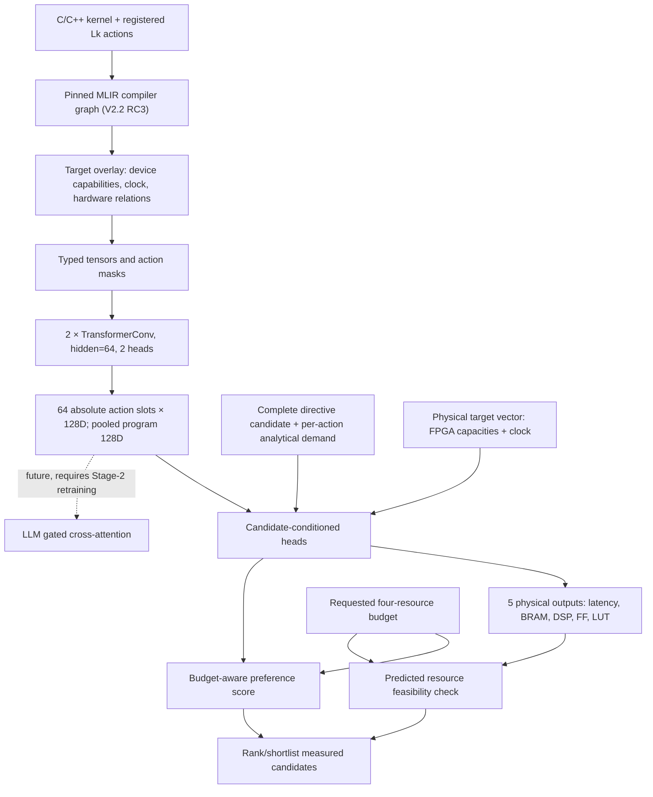

# SALT-HLS / MailoHLS: structural GNN research (V4b)

**Research branch:** `research/gnn-refinement`  
**Reviewed state:** commit `1f5a090` (4 November 2026)  
**Status:** V4b corrected-v3 experiments completed; **not integrated into production Stage-2**.

> **Start here.** This guide explains what the structural GNN encodes, where device/clock/budget information enters, what the controlled experiments show, and what must be demonstrated before it can improve the LLM. The root [README](../../README.md) documents the wider MailoHLS/SALT-HLS framework and retains historical experiments. The final V4b scientific record is in the [root README's V4b report](../../README.md#v4b-final-scientific-report--corrected-v3-2026-11-04).

## 1. Research question and distinction from production

SALT-HLS generates complete HLS pragma configurations for a C/C++ kernel under an objective (latency/area/ADP), device, clock period, and resource budget. Its production pipeline uses a **V1 structural GNN**, a target-conditioned Stage-1 LLM, and—in the selected ADP production path—Stage-2 cross-attention to V1 action-aligned memory. The supported stages/objectives are recorded in [`FINAL_ARTIFACTS.json`](../../FINAL_ARTIFACTS.json).

**V4b is a separate research model**, trained on measured design configurations. It tests whether compiler-derived, action-aligned embeddings help predict physical QoR and rank designs; it does **not** currently generate directives or replace the production V1 encoder. Its 64 × 128-dimensional memory has the required *shape* for a future interface, but not the same learned representation or checkpoint contract.

The central questions are:

1. Does learned compiler-graph memory outperform the same candidate/target descriptors **without** message passing?
2. Do target-dependent hardware messages or feature modulation improve the memory?
3. Does attending to **changed actions** improve pairwise design comparisons?
4. Does a better standalone selector translate to improved **LLM-generated** configurations? **Not tested yet.**

## 2. End-to-end architecture



The graph and memory are deliberately **candidate-independent**: changing an unroll or partition value changes the candidate-side features, not the underlying compiler structural representation. This isolates source structure from chosen pragma settings, a design direction also used by HARP.

### 2.1 Compiler graph: what is represented?

The authenticated V2.2 RC3 graph models compiler operations, SSA values, regions, loops, memory accesses, calls, control/data dependencies, and **verified action anchors** (`L1`, `L2`, …). Typed relations and numerical/semantic attributes include memory and dependence evidence. Unknown relations are not turned into fabricated facts; explicitly negative alias evidence is stored separately. The target overlay adds device/resource nodes, capabilities, and relations whose provenance is recorded.

**Action alignment matters:** `Lk` always refers to absolute slot `k−1`, and unresolved or source-only actions preserve their slots and masks. There is no silent renumbering, truncation beyond the 64-slot contract, or assertion that an unmatched compiler anchor is valid evidence.

See [`GNN_branch/mlir_graph_v2.py`](../../GNN_branch/mlir_graph_v2.py), [`GNN_branch/target_graph_v22.py`](../../GNN_branch/target_graph_v22.py), [`GNN_branch/target_graph_tensor_v22.py`](../../GNN_branch/target_graph_tensor_v22.py), and the [structural graph guide](../structural-graph-v22.md). The [GEMV graph example](../../paper_figures/gemv_mlir_paper.png) illustrates **production V1** action routing, not measured V4b embeddings.

### 2.2 GNN tensor encoder

`SmallGraphEncoder` in [`target_graph_tensor_v22.py`](../../GNN_branch/target_graph_tensor_v22.py) embeds node categories, operation/value types, resource/root types, numerical values, typed/semantic edges, static action-demand features, and action semantic summaries. Two residual, edge-aware `TransformerConv` layers (hidden size 64, two heads, with normalization) yield node representations projected to 128 dimensions. It returns:

- **Action memory** `M`: `[1, 64, 128]`, one learned vector per registered-and-matched absolute action; inactive/unmatched slots are masked.
- **Pooled program vector**: `[1, 128]`, aggregated from compiler-program nodes.

Different action points can receive distinct embeddings because they have different operations, memory/dependence neighborhoods, and action semantics. Merely having distinct vectors does **not** prove that they improve the LLM.

### 2.3 Candidate and target paths

A complete legal candidate configuration `d` becomes per-action directive features; analytical candidate-demand descriptors encode how the chosen settings affect a specific action. The ordinary scorer combines these with action memory, the pooled vector, and a numerical physical context. Its two heads predict:

- **Physical QoR:** five train-normalized `log1p` values—latency in ms, and BRAM/DSP/FF/LUT physical resource-count **proxies** derived from recorded utilization percentages × device capacity.
- **Preference:** a scalar used to rank candidates; it also receives the **requested four-resource budget**.

A separate feasibility check compares predicted resource counts against `capacity × requested_budget`. Under the same program, directive assignment, device, and clock, **changing only the requested budget must not change physical QoR predictions**. It may change feasible choices or preference scores.

Crucially, target information has different roles:

| Variant | Does 128D *action memory* change with device/clock? | Where the target influences decisions |
|---|---|---|
| `compiler` | **Not from hardware nodes:** incident hardware edges removed; memory is invariant when retained compiler tensors are identical | Numerical physical context in downstream heads |
| `hardware` | **Can:** retains hardware/resource edges into message passing | GNN messages **and** same downstream physical context |
| `target_film` | **Can:** authenticated device/clock capability vector modulates matched action slots, with zero-initialized gate | Modulated action memory **and** same downstream context |
| All three | **Independent of requested budget by design** | Budget enters preference head and feasibility filtering |

Do **not** call compiler-only action memory 'target-aware memory' merely because the complete candidate scorer is target-aware. The compiler-only target-mismatch ablation changed **0/90 selections**, consistent with its architectural separation; it is not evidence of effective target-specific memory. Neither hardware messages nor FiLM has yet demonstrated a reliable advantage.

The principal model definitions are in [`experiments/v22_gnn_training/v4b/models.py`](../../experiments/v22_gnn_training/v4b/models.py).

## 3. Training objective and why it was chosen

V4b uses **complete, authenticated, measured** directive assignments from the same kernel/device/clock context. A pair prefers a measured **feasible** design over an infeasible one; among feasible designs it prefers lower **ADP** only when the gap exceeds a predefined 5%. Both-infeasible comparisons and near ties are not preference labels.

The loss combines two signals:

```
L = SmoothL1(normalized log physical QoR, target) + 0.1 × logistic(pair preference)
```

This is **pointwise regression + pairwise supervised preference learning**, not DPO. It tests decisions rather than solely minimizing QoR prediction error. The 5% cutoff avoids demanding arbitrary orderings for near-tied measured designs. Contexts without trustworthy preference pairs still contribute **physical-only** updates.

Candidate pools were frozen **without using QoR to select candidates**, using coverage and Hamming diversity. Training samples a family, then context/budget and eligible pair; all matched arms see the same sampled identities. Normalization is fitted on training records only. The recorded pilot used **1,500 updates**, AdamW `3e-4`, weight decay `1e-4`, gradient clip `1`, seed `123`, checkpoints every 250 updates; different arms may select different steps by the stated validation criterion.

Relevant code: [`preferences.py`](../../experiments/v22_gnn_training/v4b/preferences.py), [`train_probe.py`](../../experiments/v22_gnn_training/v4b/train_probe.py), [`evaluation.py`](../../experiments/v22_gnn_training/v4b/evaluation.py).

## 4. Dataset, integrity, and measurement limitations

The authenticated inventory reconstructs **55 kernels / 150,026 design points**, including the separately reserved Kalman test kernel. V4b does **not** inspect Kalman labels. Among non-test kernels, **37 training kernels (17 families)** and **3 validation kernels (2 families)** have complete, authenticated directive assignments; **14 kernels** are excluded rather than guessing values for registered actions with no measured mapping. Of the strict complete-assignment set, 36 train + 3 validation kernels have at least one positive-ADP record; one training kernel has physical labels but no defensible ADP ranking.

The frozen 16-or-fewer-candidate pools contain **3,664 measured assignments across 240 physical contexts** (222 train + 18 validation). Five requested-budget views per validation context yield **90 correlated selection evaluations**, **not 90 independent families or kernels**.

### Reported-zero resource correction: do not fabricate counts

Some CSV rows report **0% for all four utilization fields** without original unrounded counts or precision metadata. A literal 0% is *not proof* that a synthesized design uses zero physical resources. Computing `ADP = latency × mean(resource fractions)` can create spurious zero denominators and enormous relative regrets. Corrected V3 marks such records **ADP-unobservable** across all kernels, does **not** replace zeros with 1%, and keeps the historical raw data untouched.

- Full strict set: **2,281 training** and **352 validation** records have all-zero resource percentages.
- Selected candidate pools: **305 training** and **5 validation** observations are ADP-unobservable.
- These records remain in reported physical-QoR regression, which is a separate limitation because their zero-resource labels may be low-precision proxies.
- Feasibility confusion statistics still use reported resource proxies; do not equate them with verified exact resource feasibility.
- ADP/regret refer only to the **ADP-observable measured subpool**; neither the global optimum nor previously unmeasured candidates are evaluated.

Prefer recovering HLS report counts and tool versions, or separately re-synthesizing a **small, selected** set under an explicitly versioned measurement protocol. Do not silently modify the GNOSIS CSVs.

## 5. Corrected V4b results (4 November 2026)

**These are exploratory, one-seed, two-validation-family results** after the global zero-area correction. The earlier V2 relative-regret numbers are invalid and retained only as history. Lower score/regret is better; higher feasible selection is better. The *score* is family-macro feasible-selection failure **plus conditional feasible top-1 regret**, and must be interpreted with feasibility coverage.

| Model/ablation | Parameters | Selected update | Feasible selection | Conditional top-1 ADP regret | Top-3 regret | Score |
|---|---:|---:|---:|---:|---:|---:|
| No learned graph memory (`no_graph`) | 126,930 | 1000 | **89.10%** | 0.8494 | 0.0538 | 0.9585 |
| Compiler graph (`compiler`) | 127,538 | 1500 | 78.93% | **0.5264** | 0.0556 | 0.7371 |
| Compiler + hardware messages (`hardware`) | 127,538 | 1250 | 83.16% | 0.6232 | 0.1611 | 0.7916 |
| Compiler + action-difference attention | 152,319 | 1500 | 84.01% | 0.9400 | 0.1483 | 1.0999 |
| Compiler + target FiLM | 191,667 | 250 | 87.40% | 0.5601 | 0.1896 | 0.6861 |
| Wider standard compiler head (`compiler_capacity`) | 191,604 | 500 | **89.10%** | **0.5234** | **0.0206** | **0.6325** |

### What the results actually mean

1. **Learned compiler memory is promising, but mixed.** Relative to no-graph, it lowers *conditional* ADP regret but loses ~10.17 percentage points of feasible selections, and does not improve pair accuracy or top-3 regret.
2. **Action alignment matters locally.** At the compiler checkpoint, correct memory scores 0.7371; action-slot shuffling scores 1.3967; replacing active slots with their mean scores 1.0320. This shows selection sensitivity to **correct correspondence**, not proof of general semantic causality.
3. **More hardware message passing has no demonstrated extra value** in these results.
4. **Action-difference attention has no demonstrated benefit**, despite its mathematically antisymmetric pair comparison. Comparison-head sophistication is not automatically useful.
5. **FiLM's improvement is not architecture-specific.** A nearly equal-parameter wider ordinary compiler head outperforms it (0.6325 vs 0.6861). This is why the capacity control is necessary.
6. **More training kernels do not always help.** The matched 14-to-37 sensitivity improves compiler's conditional regret while worsening feasible-selection coverage; effects vary by arm.
7. **Target adaptability is unproven.** The corrected validation families have **zero meaningful device/clock/budget winner changes** under the 5% criterion. The model may respond numerically to target inputs, but the held-out sample cannot establish whether it correctly switches winners when the optimum changes.
8. **Feasibility is a bottleneck.** The compiler model's false-feasible rate is approximately **61.16%** on reported proxy labels. High precision alone is misleading under class imbalance.

The full scientific explanation, failure modes, per-family breakdowns and ten research answers are in the [root final report](../../README.md#v4b-final-scientific-report--corrected-v3-2026-11-04). Machine-readable evidence and plots are in [`receipts_v3/`](../../experiments/v22_gnn_training/v4b/receipts_v3/). The final recorded suite was **218 passed, 15 skipped, zero failed**. This establishes implementation coverage, not model superiority.

## 6. Controls and design choices

| Choice | Reason | What it does **not** prove |
|---|---|---|
| **No-graph** control | Same candidate descriptors, target context and similarly sized MLP, **without learned graph messages** | Does not remove all compiler-derived analytical features |
| **Capacity-matched** standard head | Separates a target-modulation claim from simply giving FiLM more parameters | Equal parameter counts do not equal identical optimization difficulty |
| **Candidate-independent structural memory** | Prevents directive candidate values/QoR labels from contaminating the structural encoder | It may still be inadequate for modeling target-sensitive interactions |
| **Absolute action slots + masks** | Ensure `Lk` memory corresponds to the same source action at inference | Embedding alignment alone does not establish useful LLM cross-attention |
| **Target-conditioned heads, budget-invariant physical QoR** | Budget is a selection constraint, not a new synthesis result for fixed `(source, pragma, device, clock)` | Does not show learned target-dependent winner transitions |
| **QoR-blind candidate pool + family-disjoint validation** | Limits candidate-selection leakage and same-family memorization | Two families are inadequate for broad generalization claims |
| **Preserve unknown directives and reported-zero ambiguity** | Avoids invented hardware or pragma supervision | Does not recover the missing physical evidence |

## 7. Stage-2 boundary and prioritized next experiments

**Do not feed a V4b checkpoint into the existing production V1-trained Stage-2 cross-attention merely because both expose 128D action vectors.** Their learned distributions and contracts differ. Stage-2 needs a separately trained/adapted cross-attention with frozen data and comparable LLM initialization.

Before claiming a target-aware improvement, the shortest defensible path is:

1. **Documentation/measurement hygiene:** distinguish reported-proxy feasibility from count-verified feasibility; recover selected ambiguous HLS reports without altering historical CSVs.
2. **Representation audit:** extract actual per-action, per-source, and per-device/clock embedding distances; compare correct, shuffled, mean-pooled, and target-mismatched memory under equal candidate/target heads. Report score changes, not just embedding norms.
3. **Target-contrast coverage:** identify or synthesize **family-disjoint** contexts with the same complete assignments evaluated on multiple devices/clocks/budgets and meaningful winner reversals. Keep a true held-out evaluation split.
4. **Simpler matched GNN comparison:** no-graph, compiler, and capacity-matched compiler; add repeated seeds and compare feasibility coverage **together with** measured regret. Keep the original one-seed V4b reports unchanged.
5. **Small Stage-2 feasibility experiment:** identical Stage-1 LoRA and target prompts; separately trained cross-attention for (a) no memory, (b) production V1 memory, (c) experimental V4b compiler memory. Only then consider learned target-conditioned memory as a fourth arm. Evaluate generated assignments and actual synthesized QoR, not merely teacher-forced loss.

The central open hypothesis is whether correct compiler-action structure gives the LLM useful *additional information* beyond the source and prompt, and whether the model can use target-dependent structure when measured target preferences actually differ. V4b does **not** currently answer this question.

## 8. Repository map and reproduction

| File/area | Purpose |
|---|---|
| [`GNN_branch/mlir_graph_v2.py`](../../GNN_branch/mlir_graph_v2.py) | Native compiler graph construction and authenticated source bindings |
| [`GNN_branch/target_graph_v22.py`](../../GNN_branch/target_graph_v22.py) | FPGA/device/clock target overlay |
| [`GNN_branch/target_graph_tensor_v22.py`](../../GNN_branch/target_graph_tensor_v22.py) | Semantic tensorization, masks, `SmallGraphEncoder`, 64×128 memory |
| [`GNN_branch/action_demand_v22.py`](../../GNN_branch/action_demand_v22.py) | Candidate-independent static action demand information |
| [`experiments/v22_gnn_training/v4b/models.py`](../../experiments/v22_gnn_training/v4b/models.py) | Standard GNN, no-graph, FiLM, difference head, physical and preference losses |
| [`experiments/v22_gnn_training/v4b/train_probe.py`](../../experiments/v22_gnn_training/v4b/train_probe.py) | Frozen training and safe checkpoint/resume; V100S is explicitly authorized, not default |
| [`experiments/v22_gnn_training/v4b/evaluation.py`](../../experiments/v22_gnn_training/v4b/evaluation.py) | Fixed measured-pool selection, regret, feasibility and memory interventions |
| [`experiments/v22_gnn_training/v4b/quality.py`](../../experiments/v22_gnn_training/v4b/quality.py) | Versioned all-zero-resource ADP validity policy |
| [`experiments/v22_gnn_training/v4b/capacity_control.py`](../../experiments/v22_gnn_training/v4b/capacity_control.py) | Standard-head parameter-count control |
| [`experiments/v22_gnn_training/v4b/receipts_v3/`](../../experiments/v22_gnn_training/v4b/receipts_v3/) | Corrected results, auditable hashes and plots |

**Reproduce against the *recorded source commit and frozen manifests*, not whichever source happens to be HEAD.** The corrected primary runs used commit `f248497`, the capacity control `d21f462`, and explicitly authorized V100S. The canonical run options and identity checks are in the [final root report](../../README.md#reproduction-cost-and-artifacts). Large model weights, caches, raw histories, and private synth runs are stored outside Git; tracked JSON receipts are not the weights themselves.

### Related research (motivation, not validation of our claims)

- **HARP (ICCAD 2023):** [official project](https://github.com/UCLA-VAST/HARP) — hierarchical GNN representation and decoupled program/pragma modeling.
- **ProgSG (MLCAD 2024):** [paper](https://arxiv.org/abs/2406.09606) — fine-grained sequence/graph interaction and compiler-informed pretraining for HLS QoR prediction.
- **compareXplore (MLCAD 2024):** [paper](https://arxiv.org/abs/2409.13138) — pointwise/pairwise hybrid supervision and difference attention; positive results there do not override our negative V4b result.
- **FiLM (AAAI 2018):** [paper](https://ojs.aaai.org/index.php/AAAI/article/view/11671) — a general feature-modulation technique, not evidence of FPGA target-transfer benefit here.
- **Flamingo (NeurIPS 2022):** [paper](https://papers.neurips.cc/paper_files/paper/2022/hash/960a172bc7fbf0177ccccbb411a7d800-Abstract-Conference.html) — a precedent for gated cross-attention into a language model, not an HLS-specific result.
- **AMD Vitis HLS:** [HLS report interpretation](https://docs.amd.com/r/2024.1-English/ug1393-vitis-application-acceleration/Interpreting-the-HLS-Report) — estimates, latency and BRAM/DSP/FF/LUT reporting.

*This guide intentionally separates established implementation facts, exploratory measured-pool results, and future Stage-2 hypotheses. Do not describe V4b as a production model or its limited target-response results as demonstrated generalization.*