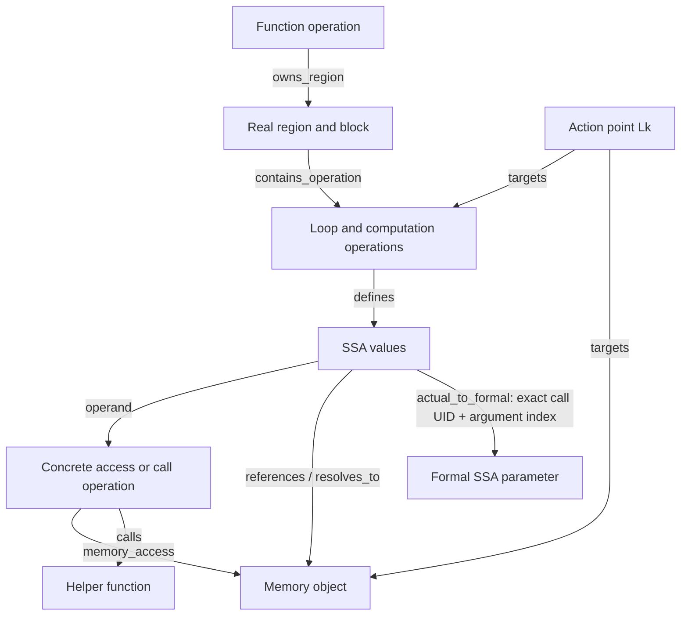

# MLIR structural graph V2

V2 is an explicitly selected research representation. Production SALT still uses
V1 graphs, its trained feature encoders, GNN checkpoints, 128-D memory and
Stage-2 routing. V2 does not run HLS, DeepSeek-Coder, training or a refinement
search. A smaller graph alone is not evidence of better QoR prediction.

V1's audit found context-insensitive helper reachability, missing originating
call IDs and a verifier that misinterpreted the direction of write edges. V2
addresses these in a companion builder, reusing `MLIRGraphBuilder`, native MLIR
objects, the pinned frontend and `_mailohls_analysis`. V1 source is unchanged.
The V2 wrapper keeps the MLIR module alive while querying its blocks/operations
and releases native handles before closing the context.

## One graph, four semantic levels



These levels share nodes and facts. Action-point relations are queries over this
graph, not a second stored graph. IDs use compiler operation UIDs and SSA IDs;
source locations validate optimization targets, rather than invent call IDs.

The graph schema is `salt-hls-mlir-structural-v2`, serialized as deterministic
JSON. Graph identity includes source, metadata, raw IR, analysis extension and
builder hashes. Local header hashes are captured; the entire transitive system
include closure is not. AP analysis stubs remain control/dataflow surrogates,
not bit-accurate models of genuine Vitis arithmetic.

| Node category | Purpose | Consumer |
|---|---|---|
| `operation` | Functions, loops, arithmetic, calls, concrete loads/stores; types, operands/results and loop context | Queries; future V2 encoder |
| `ssa_value` | Exact results and block arguments; retains use-def and memory-view identity | Call/root resolution; future encoder |
| `constant_or_feature` | Semantic constants and explicitly identified auxiliary analysis tokens | Canonical evidence; compact encoding |
| `control_region` | Module, real MLIR regions and blocks with explicit ownership | Hierarchy/control validation |
| `memory_object` | Function-local allocation or formal-parameter root, separate from SSA views and action points | Access/alias queries |
| `action_point` | One active `Lk`, supported directives and one exact compiler target | Derived action-point views; future refinement |

Function operations remain operations. Regions/blocks replace synthetic
pseudo-block membership with their actual compiler ownership. SSA values are
retained. A memory object is distinct from the array action point targeting it.
Loop points support PIPELINE and UNROLL together; array points support
ARRAY_PARTITION. This representation does not change directive domains.
Native `mailohls.action_id` attributes bind array points to their exact allocation
results where available. Otherwise the existing exact compiler/source binding
is retained explicitly. Disagreements with legacy root targets are recorded.
Original source dimensions/loop metadata remain separate from optimized compiler
shapes and proven trip counts; a pruned compiler array does not redefine the
source directive domain.

Every edge also carries `evidence_status`, `access_path` and `is_reverse`.
Canonical edges are forward semantic facts; no implicit reverse edges are added.

| Edge category | Direction and purpose | Consumer |
|---|---|---|
| `owns_region` | Owning operation → real region | Control validation |
| `contains_block` | Region → block | Control validation |
| `contains_operation` | Block → operation; module → function | Ownership/encoder |
| `declares_argument` | Block → block-argument SSA value | SSA/call validation |
| `next_operation` | Operation → next operation in its block | Execution order |
| `control_flow` | Existing verified compiler CFG relationship, with original role retained | Control validation |
| `defines` | Defining operation → result SSA value | Dataflow |
| `operand` | SSA value → using operation, with exact operand index | Dataflow/calls |
| `literal` | Semantic constant token → constant operation | Constant preservation |
| `feature` | Auxiliary token → associated compiler entity | Compact encoding |
| `loop_carried` | Exact existing init/yield/iter-argument forwarding; original role retained | SSA/root propagation |
| `loop_child` | Parent loop → immediate compiler child loop | Nearest labeled hierarchy query |
| `calls` | Call operation → verified callee function | Interprocedural queries |
| `actual_to_formal` | Actual SSA value → formal SSA argument, scoped by exact call UID and index | Interprocedural queries |
| `returns_to` | Callee returned SSA value → result of one identified call | Conservative returned-memory evidence |
| `references` | View SSA value → compiler-resolved base SSA value | Root resolution |
| `alias` | Canonically ordered pair, explicitly symmetric; preserves must/may/partial/no-alias kind | Alias queries |
| `resolves_to` | Memory SSA value → memory object | Root/access queries |
| `memory_access` | Concrete operation → memory object, with read/write/readwrite | Access queries |
| `depends_on` | Consumer/access B → preceding access A | Typed dependence queries |
| `targets` | Action point → loop operation or memory object | Absolute action alignment |
| `analysis_summary` | Explicit possible legacy/compiler summary, with original evidence | Audit; never concrete access proof |

Dependence edges retain the compiler's original source/target, RAW/WAR/WAW kind,
loop-carried flags, distances/bounds and full analysis record. A shared array
alone never creates a proven dependence. No-dependence, not-applicable and unknown
query outcomes remain in the canonical native-analysis payload. Unknown outcomes
are not converted into proven edges or negative semantic claims.

## Calls and memory roots

`helper(A)` and `helper(B)` may share a callee and formal parameter, but their
binding edges carry different `call_operation` and `call_uid` values. The builder
checks actual operand positions, formal argument positions, types and callee
identity against live indexed compiler objects. Argument position alone is not
proof. Calling a declaration, an unresolved callee or recursion cannot establish
a proven interprocedural memory access.

Memory roots are solved within each function from allocations, formal parameters,
compiler views, must-alias evidence and region/loop forwarding. May-alias and
partial-alias facts never enter the proven root solver. No global union propagates
every caller's buffers into a shared callee. Queries substitute formal roots only
through the selected call's binding. An unresolved binding is prevented from
falling back to another call's root. Returned-memory aliases remain conservative.
Global storage is identified by its compiler symbol. Unresolved storage has an
explicit placeholder object with `not_established` provenance; concrete accesses
are retained without claiming that placeholder is a proven allocation.
Available global declarations, including numerical initializers and visibility,
are recorded once as memory-object attributes. They are not discarded with
auxiliary feature tokens or duplicated for each `get_global` use.

Read and write edges both point **operation → memory object**. A call's effect
summary is separate possible evidence, not a concrete load/store. V1's original
edge orientation and graphs are preserved in the compatibility records.

## Queries and confidence

```python
from GNN_branch.mlir_graph_v2 import read_graph
from GNN_branch.action_point_relations import get_action_point_relations, action_point_views

graph = read_graph('/tmp/kernel.v2.json')
relations = get_action_point_relations(graph, 'L11', evidence='proven')
views = action_point_views(graph, max_slots=64)
```

Records separate `relation_type`, `evidence_status` (`proven`, `possible`,
`not_established`) and `access_path` (`local`, `through_call`, `not_applicable`).
They include exact operations, roots, call chains, binding receipts and source/
compiler hashes. Several facts may connect the same action points. Empty results
mean no qualifying evidence was established, not functional independence.

`historical_relation()` preserves the complete old classification/record. Old
proven labels are not automatically re-certified: their historical confidence is
recorded separately, with explicit ambiguity until checked against V2 evidence.

`action_point_views()` derives typed proven records, semantic connectivity and
legacy-compatible self/parent/child/access/dependence bits. Sparse IDs retain
their absolute `Lk-1` slots; inactive points are not renumbered. No-alias evidence
does not create a positive connectivity edge. Facts without a legacy bit (such
as alias information) remain in `unrepresented_in_legacy_bits`; the legacy mask
is exactly the nonzero projection of legacy bits. These views are not installed
in production Stage-2 or refinement.

## Compact view

The canonical graph remains authoritative. Its compact view folds only leaf
auxiliary memory-shape, affine-access and trip-count tokens into target attributes.
Real constants, SSA values, regions, calls, aliases and dependencies remain.
Uncertainty features and any token with ambiguous/non-leaf connectivity remain.

`compaction_mapping` records every removed node, its complete attributes and
incident edges. Targets retain token/type references. `expand_compact()` must
reconstruct canonical V2 exactly; the comparison also requires identical queries
at every evidence level and identical derived views. The V1 compatibility map
records consolidated pragma/array-scope anchors and the replacement of synthetic
block scopes. Any unresolved mapping is reported explicitly.

Graph-node/edge reductions do not guarantee smaller JSON files. Lossless
reconstruction and provenance have a storage cost, and V1 uses GEXF rather than
JSON. Count, storage and runtime results are reported separately.

## Generate, validate and compare

Use the pinned toolchain documented in [mlir-pipeline.md](mlir-pipeline.md).
Run from the repository root; no GPU is needed.

```bash
export POLYGEIST_BUILD=/path/to/Polygeist/build-mailohls-assertions
export MLIR_PYTHON=/path/to/python3.11
export PYTHONPATH="$POLYGEIST_BUILD/tools/mlir/python_packages/mlir_core"
export PYTHONHASHSEED=0

# Compile source through the unchanged frontend, then construct V2.
"$MLIR_PYTHON" -B -m GNN_branch.mlir_graph_v2 --mode generate \
  --source Data/ApplicationDataset/machsuite-gemm-ncubed/gemm.c \
  --cgeist "$POLYGEIST_BUILD/bin/cgeist" --output /tmp/gemm.v2.json

# Or reuse an authenticated raw module; paired context hashes must agree.
"$MLIR_PYTHON" -B -m GNN_branch.mlir_graph_v2 --mode generate \
  --source Data/ApplicationDataset/machsuite-gemm-ncubed/gemm.c \
  --mlir GNN_branch/MLIR_graphs/audit_mlir/machsuite-gemm-ncubed.mlir \
  --v1-graph GNN_branch/MLIR_graphs/machsuite-gemm-ncubed.gexf \
  --output /tmp/gemm.from-ir.v2.json

"$MLIR_PYTHON" -B -m GNN_branch.mlir_graph_v2 --mode compact \
  --input /tmp/gemm.v2.json --output /tmp/gemm.compact.json
"$MLIR_PYTHON" -B -m GNN_branch.mlir_graph_v2 --mode validate \
  --input /tmp/gemm.compact.json
```

Use `--metadata PATH` for metadata outside the source directory and
`--compiler-symbol` for an exact mangled C++ top symbol. Existing output is never
overwritten with a different graph. Timing is printed separately and does not
change deterministic graph bytes.

With the ordinary project Python environment (torch/networkx), compare the three
development kernels, five original GNΩSIS kernels and eight compiled fixtures:

```bash
python -B -m experiments.structural_audit.compare_v2 \
  --kernels GAN covariance Kalman \
  --polygeist-build "$POLYGEIST_BUILD" --mlir-python "$MLIR_PYTHON"

python -B -m pytest -q -p no:cacheprovider tests/test_mlir_graph_v2.py
```

The compiler subprocess receives its own MLIR `PYTHONPATH`. Missing external
archives or native prerequisites are reported as blocked; no compiler output is
invented. The existing audit's `--mode fixtures --compile-fixtures` prepares
missing fixtures; `--fixture-dir PATH` selects those receipts. Real references
remain the 28 source-written, machine-assisted drafts. Hand-authored unit graphs
are never reported as compiler outputs or reviewed ground truth.

Outputs are ignored under `experiments/structural_audit/results/graph_v2/`:
`manifest.json`, `comparison.json`, `report.md` and canonical/compact graph JSONs.
Use `--output-dir PATH` for a new protocol; sealed comparisons are not overwritten.
The manifest captures code, source, compiler and protected V1 hashes. Failed
checks produce a nonzero exit with their report preserved.

## Before a learning experiment

V1's saved GNN consumes its own categorical/numeric edge features. It exports
pragma-free action-aligned embeddings; Stage-2 uses a Boolean relation mask,
and deterministic refinement uses verified relations without learned embeddings.
V2 currently has typed attribute encoding, **no learned tensor encoder**. Its
topology/schema must not be fed to V1 weights and interpreted as valid QoR output.

Next: independently adjudicate the source references, extend adversarial calls/
views/returns/recursive tests, then implement a separate V2 tensor schema. Compare
V1, canonical V2 and compact V2 with fixed family splits, identical QoR data and
hardware contexts, equal model capacity/supervision and predeclared seeds. Measure
prediction, ranking, feasibility and held-out kernel performance. Only then
consider choosing a representation or changing production memory/routing.
Compiler UIDs, source positions and raw `Lk` numbers are identity/provenance keys,
not proposed categorical training shortcuts. A V2 encoder should encode typed
semantics and numerical attributes, with IDs used only for alignment.

Semantic references: [MLIR Func](https://mlir.llvm.org/docs/Dialects/Func/),
[MemRef](https://mlir.llvm.org/docs/Dialects/MemRef/),
[Affine](https://mlir.llvm.org/docs/Dialects/Affine/) and the
[language reference](https://mlir.llvm.org/docs/LangRef/).
