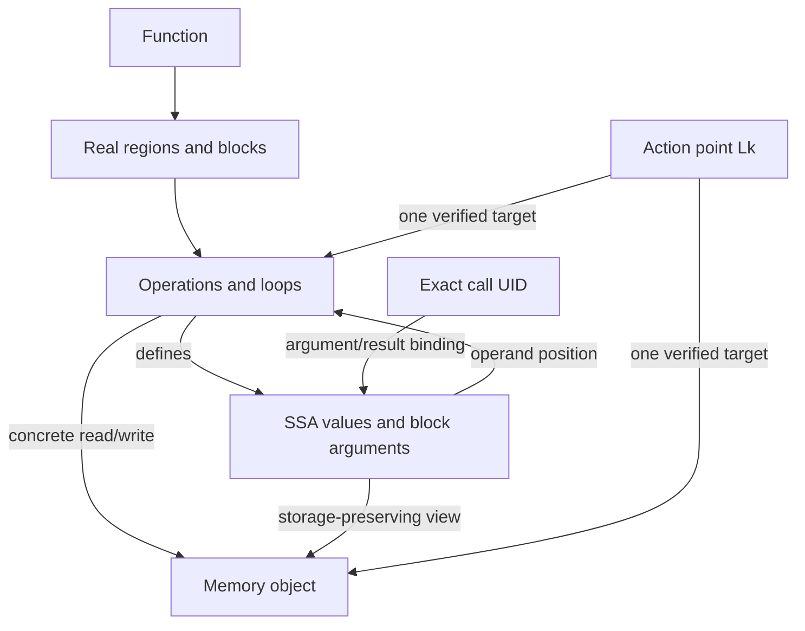

# SALT-HLS structural graph V2.2

**Release candidate — remaining evidence required.** V2.1 remains the frozen
published baseline. Explicit `--revision 2.2` selects schema
`salt-hls-mlir-structural-v2.2`. There is no compatible learned tensor encoder
or checkpoint. Production V1 models, memory, routing and refinement stay frozen.

Artifacts: [candidate manifest](graph-release-v22.json),
[candidate archive](../GNN_branch/MLIR_graphs/salt-hls-graphs-v22-20261027-rc2.tar.gz)
and [archive checksum](graph-release-v22.sha256). They are explicitly RC assets,
not a replacement for the frozen V2.1 release.

## One compiler graph

V2.2 extends the [existing representation](structural-graph-v2.md), retaining
its six categories: operations, SSA values, constants/auxiliary features,
control regions, memory objects and action points.



The directed edge vocabulary remains the existing control/region, SSA,
loop-state, memory-access/view/alias/dependence, call/return and action-target
vocabulary. Full globals are retained as symbol-keyed compiler definitions;
live global objects also retain their definition attributes. Canonical facts
contain no neural reverse edges. Compact graphs losslessly fold auxiliary
feature tokens, preserving actual constants, SSA values and compiler evidence.

No requested FPGA, clock, resource budget, objective, QoR or optimizer-selected
pragma assignment enters generation. Compiler module attributes such as the
host data layout describe frontend lowering, not a deployment FPGA.

## Semantic changes

**Action identity.** A matching native `mailohls.action_id` or exact compiler
declaration location is required. Shared source-use lines are context, not
allocation identity. Static/global binding still requires a unique symbol,
function/declaration match and concrete rooted access witnesses.

Both external Kalman metadata variants register L7 (`k_arr`, source line 63)
and L8 (`calc_temp_arr`, line 64). Their frozen IR has no independently bound
allocation for either. V2.1 assigned L8 to the L6-tagged `p_arr_1` allocation
at line 62, using overlapping use lines 74/80. V2.2 rejects that unsupported
assignment. The surviving `arith.divf` at line 76 and scalar uses at lines 78/80
do not prove separate L7/L8 memory. No transformation receipt proves elimination:
the registrations remain unresolved. Development metadata never registered
these two labels. Absolute `Lk`/slot `k-1` identities are never renumbered.

The same issue occurs in `rodinia-hotspot-2-pipeline` and
`rodinia-hotspot-3-unroll`: L1–L4 and L6 were mapped to the allocation tagged
L5 (`temp_center`, declaration line 27). Their own declarations are at different
locations; shared stencil-use lines do not prove identity. Those ten mappings
are also rejected. All 606 registrations remain accounted for, with 592 matched
and 14 unresolved. This is a correction, not an attempt to maximize coverage.

**Storage roots.** Native function-local LLVM GEP, pointer bitcast/address-space
cast and Polygeist memref/pointer conversions preserve underlying storage.
They do not prove equal addresses, overlap or dependence. Exact base/index
operands are retained. Integer-to-pointer conversions and loaded pointer
fields needing reaching-store/context analysis remain conservative. Types,
names, equal shapes, declaration order and global may-alias closure are not
storage-identity proofs. Select/conditional alternatives stay possible unless
all alternatives establish the same unique object.

Concrete accesses survive unresolved roots; call effects remain summaries.
Memref subview offsets are relative to their source view, while reinterpret
casts use underlying-storage offsets. Static/dynamic offsets, sizes, strides,
types and original attributes are retained. LLVM access records additionally
retain pointer-expression chains and their induction-loop dependencies. Empty
direct memref-index fields on LLVM accesses are not independence evidence.

Pointer path tags describe storage derivation, not a normalized byte address.
In the pinned descriptor ABI, `polygeist.memref2pointer` uses the aligned pointer
plus the source descriptor offset (or pointer/address-space casts in its pointer
ABI). The source view and indices remain available; a path tag never implies
zero offset. Composed addresses and element overlap remain unproven.

**Calls.** Bindings retain exact call UID, caller/callee, operand/result position
and actual/formal SSA identities. Returned-memory reasoning is invocation
scoped. Shared helpers do not merge caller arrays. Recursive, external and
incomplete calls remain conservative. Ambiguous actuals can retain possible
canonical roots without a complete caller-specific array-access projection;
this is a coverage limit, not proof of absence. LUD L2–L5 is checked in context
`lud_diagonal:op5` and rejected in the empty helper context.

**CFG and SSA.** The pinned Python Operation wrapper lacks `successors`.
The legacy compatibility helper silently returns an empty list. V2.2 uses
the existing `mlirOperationGetSuccessor` C API and independently checks actual
successor blocks/positions. Unused block arguments formerly removed by V1
cleanup retain their native ownership before cleanup and become canonical
`declares_argument` edges. No synthetic value or active action is invented.

For memory-valued SCF/Affine for-results, the initial buffer also reaches the
result when there are zero iterations. V2.2 records this conditional
`loop_zero_trip_result` SSA fact alongside the yielded/backedge buffer. If they
differ and execution count is not established, the result has possible roots,
not a false unique yielded root. SCF while-results retain the separate
condition-forwarding semantics. This additional adversarial correction is in
RC2; the earlier local candidate remains preserved and superseded.

**Dependence evidence.** RAW/WAR/WAW direction, scope, intervals and certainty
remain distinct. No-alias and explicit native no-dependence conclusions remain
negative analysis records, never positive connectivity. Unknown or an absent
edge is not independence. An interval is not an exact distance.

AES's 43,236 possible dependencies are distinct outcomes: 23,124 involve
different potentially aliased SSA storage, 20,032 fail affine analysis and 80
involve non-affine accesses. Root equality does not compose access maps or
prove independence. V2.2 retains every dependence record and does not sample,
deduplicate or promote these outcomes. The native analyzer stops at the first
successful depth; other carrying depths remain unverified.

All 20,032 AES affine failures lack a common block within their function affine
scope. This follows the pinned `getCommonBlockInAffineScope` rule, checked
against the native-validated block/region ownership: 9,984 pairs each occur in
`ByteSub_ShiftRow` and `InversShiftRow_ByteSub`; the remaining 64 involve
`encrypt`/`decrypt` loop/body paths. The pinned dependence routine returns
Failure at this CFG boundary. This explains an analysis limitation, not an
absence of dependence. `details/AES_failure_contexts.json` preserves the groups
and exact native source references.

Native view records previously inherited a C++ `Block*` map's address order.
V2.2 sorts this unordered list by SSA identity, retaining its entire multiset
and multiplicities. Semantic operand order and native alias/dependence outcomes
are unchanged. The original compiler binary and V2.1 archive are untouched.

**Numerical fidelity.** Source template spellings are lexical evidence, not
AST-verified substitution. Native SSA/element types are separately checked.
Unknown source/compiler correspondence, rounding, overflow and template
defaults stay unresolved. AP analysis stubs are not bit-accurate Vitis types;
an `ap_uint<256>` source spelling does not make an `i64` lowering hardware-exact.

## Validation and release boundaries

The original 63 source/metadata/header/raw-MLIR snapshots are authenticated:
55 development kernels and eight external snapshots, including all three
Kalman contexts. JPEG, Rosetta and two GEMV variants stay excluded. Current
working-tree sources cannot silently enter this cohort. The original raw MLIR
is reused exactly, isolating graph changes from frontend changes.

An independent live-MLIR walk checks every function operation, SSA value,
operand/result occurrence, type, block argument, region ownership, immediate
loop hierarchy, CFG successor, call/return binding and loop-state forwarding.
Global symbols/attributes are checked independently. Native memory-effect
occurrences are compared with concrete accesses independently of root guesses.
Portable checks validate witness fingerprints and evidence chains. Corrupted
operands, call UIDs, roots, certainty, directions and carrying scopes are rejected.
Both native generation runs and canonical/compact public queries must agree.

This is not exhaustive mathematical proof of native dependence analysis.
Complete mechanical classification plus two SHA-256-selected examples per
result/reason/RAW-WAR-WAW stratum produce draft review worksheets. Neither these
nor the previous real-source annotations are independently adjudicated ground
truth. Publication-level precision/recall is unavailable.

The initial 63-case run found nine unordered-view determinism failures; it is
preserved in `GNN_branch/MLIR_graphs/v22_corpus/`. The first corrected pass is
preserved in `validated/`; the current RC2 run is in `validated_rc2/`. Its `validation.json`, detailed
`comparison.csv`, `comparison.json`, `details/` evidence and
`V22_SEMANTIC_AUDIT.md` distinguish all pass/fail/pending cases and release gates.
Candidate packaging never declares the representation final.

## Completed corpus comparison

All **63/63** corrected snapshots passed input authentication, native occurrence
checks, repeated native generation, exact compact reconstruction and public
query equivalence. No snapshot was omitted. Aggregate changes:

| Property | Frozen V2.1 | V2.2 candidate |
|---|---:|---:|
| Canonical nodes | 30,874 | 30,634 |
| Canonical edges | 115,316 | 115,783 |
| Registered / matched actions | 606 / 604 | 606 / 592 |
| Unresolved registrations | 2 | 14 |
| Native operation / SSA entities | 9,730 / 7,657 | 9,730 / 7,670 |
| CFG successor edges | 0 | 43 |
| Proven concrete-access relationships | 2,813 | 2,973 |
| Possible / unresolved access relationships | 0 / 182 | 32 / 6 |
| Proven / possible dependencies | 1,911 / 51,659 | 1,911 / 51,659 |
| Native negative dependence/alias conclusions | 150,439 | 150,439 |
| Duplicate native dependence query records | 0 | 0 |

Of the original 182 unresolved access occurrences, 160 now have proven storage
chains, 16 have possible alternatives and six remain unresolved loaded-pointer
accesses in Kalman helper functions. The 16 alternatives produce 32 edges;
they do not create new physical accesses. There are 2,821 affine/memref
load/store operations plus 174 LLVM load/store operations, totaling 2,995
concrete occurrences in both versions. The earlier 2,821 count excluded LLVM.

All 241 removed memory-object nodes were unresolved placeholders replaced by
supported root evidence. No established allocation/global/formal identity was
removed. Twelve unsupported action nodes were removed and thirteen native SSA
arguments restored, explaining the net node change. New storage/view and CFG
facts explain edge growth; no dependence edge was removed or promoted.

The native walk also checks 13,712 operand occurrences, 6,205 result occurrences,
1,089 blocks, 318 loop-state occurrences and 21 global definitions. This is
implementation consistency plus native evidence, not a proof of every analysis
result. The final 63-case generation/validation run took approximately 513 seconds,
including two native generations per snapshot, excluding subsequent tests.

The final broad graph/audit/domain/refinement suite passed **224 tests**;
the focused RC2 suite passed **36** (included in that total). Native analysis
regressions passed with the original binary. The requested full worktree suite
also ran: **122 passed, two failed** in pre-existing uncommitted external
recovery tests outside this cohort: Rosetta expects 12 matches but the retained
V2.1 path finds 11; the JPEG marker harness references static/nonexistent symbols
as externs and does not link. These were reported, not deleted or weakened.

Gates A (reproducibility), B (mechanically supported structure/fixtures) and D
(complete registration accounting) pass. Gate C still needs independent
adjudication of the draft semantic/dependence worksheets; Gate E is partial
because of the reported recovery-test failures. The disposition is
**V2.2 RELEASE CANDIDATE — remaining evidence required**, not FINAL.

After packaging, the extracted archive was independently checked with its own
archived Python code: **63/63** canonical/compact graphs passed validation,
native-witness consistency, reconstruction and every public action/loop query,
without loading native MLIR bindings. The final RC2 portable read-only check took
100.44 seconds. Every bundled checksum passed.

## Reproduction

Use project Python/NetworkX for orchestration and the pinned native Python/
Polygeist environment for MLIR. No GPU, model loading, training or HLS runs.

```bash
python -B -m pytest -q tests/test_mlir_graph_v22.py
python -B -m pytest -q tests/test_mlir_graph_v2.py tests/test_structural_audit.py tests/test_v21_refinement.py tests/test_directive_domains.py
python -B -m experiments.structural_audit.finalize_v22 --mode diagnose
python -B -m experiments.structural_audit.finalize_v22 --mode generate --repeat-native
python -B -m experiments.structural_audit.finalize_v22 --mode summarize
python -B -m experiments.structural_audit.finalize_v22 --mode package
```

Override `--build`, `--native-python`, `--output-dir` or `--timeout` as needed.
Changed code/input/compiler identities require a fresh output directory.
Resume authenticates completed outputs. Failures do not omit later snapshots.
The candidate package contains sources, metadata, raw MLIR, both graph views,
generation/validation code, compiler identities and checksums. The original
V2.1 archive/checksum is never overwritten. Transitive system include closure
and exact Vitis arithmetic are not claimed.

For individual sources, the existing CLI accepts:

```bash
python -m GNN_branch.mlir_graph_v2 --revision 2.2 --source path/to/kernel.cpp --metadata path/to/kernel_info.txt --cgeist /path/to/pinned/cgeist --output /fresh/graph.json
python -m GNN_branch.mlir_graph_v2 --mode validate --input /fresh/graph.json
python -m GNN_branch.mlir_graph_v2 --mode compact --input /fresh/graph.json --output /fresh/compact.json
```

## Future integration contract

| Fields | Meaning | Later consumer |
|---|---|---|
| Operations/types/SSA/regions/shapes/indexing | Compiler facts | Separate tensor encoder |
| Typed accesses/views/aliases/dependencies and certainty | Evidence-bearing relationships | Refinement queries and evidence-aware encoding |
| Call UID, action Lk, SSA IDs, locations, hashes | Alignment/provenance | Matching/audit; exclude raw IDs as learned shortcuts |
| Possible roots, failures, unknown trip counts | Uncertainty rather than zero | Explicit missingness/certainty features |
| Source/lowered numerical fidelity | Limits on hardware interpretation | Prevent unsupported width/cost claims |
| FPGA, objective, clock, budget, candidate pragmas | Separate request/design inputs | Later conditioning/ranking; never overwrite compiler facts |

Neural reverse edges and feature IDs belong in reproducible derived tensor
views. A matched-capacity, fixed-split V1/V2.2 learning comparison is a later
experiment, after semantic evidence and regression issues are addressed.

Semantic references: official [LLVM](https://mlir.llvm.org/docs/Dialects/LLVM/),
[MemRef](https://mlir.llvm.org/docs/Dialects/MemRef/),
[Func](https://mlir.llvm.org/docs/Dialects/Func/),
[SCF](https://mlir.llvm.org/docs/Dialects/SCFDialect/) and
[Affine](https://mlir.llvm.org/docs/Dialects/Affine/) documentation. The pinned
source APIs, rather than newer documentation syntax alone, determine this build.
