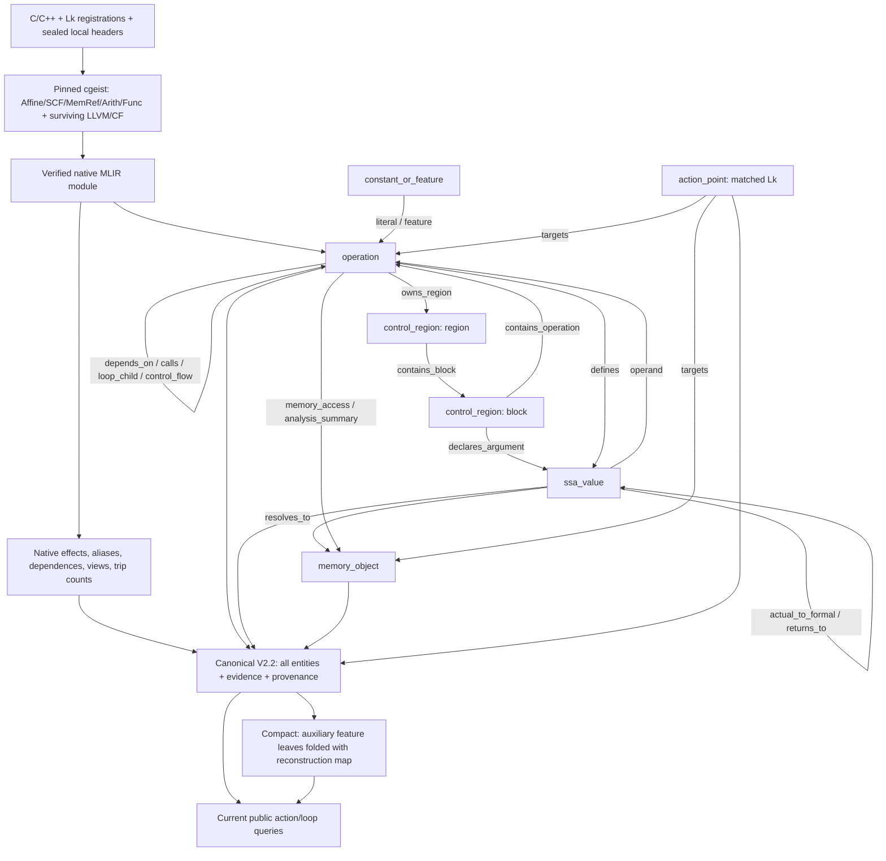
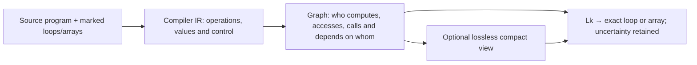
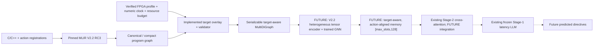
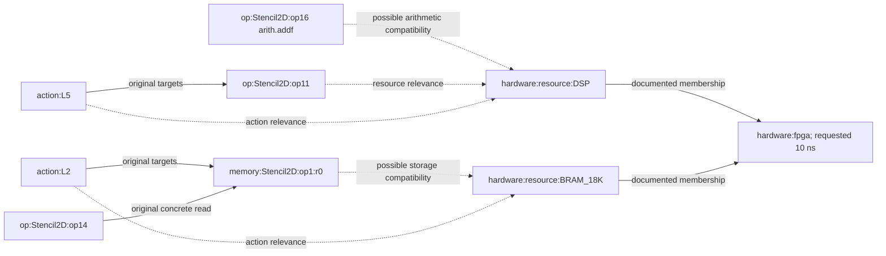

# SALT-HLS MLIR V2.2: compiler graph and target-aware extension

## Baseline documentation checkpoint (Phase A)

This section was written and saved **before implementing hardware enrichment**.
The documentation-only commit preserves this original description independently.
Inspected checkout: `d488681f68e58ab1b1e666f6911f5257d6462dc2` (`main`),
with pre-existing working-tree deletions preserved. Work branch:
`research/target-aware-mlir-v22`. The compiler schema is
`salt-hls-mlir-structural-v2.2`, semantic revision `rc3`, selected explicitly by
`--revision 2.2 --semantic-revision rc3`. V2.1 is historical.

**RC3 is technically frozen; independent human semantic adjudication is pending.**
Mechanical consistency does not close that review. The bounded review worksheet
has 60 pending cases. See [final review](../V22_FINAL_RELEASE_REVIEW.md) and
[V2.2 semantics](../structural-graph-v22.md). This work neither regenerates nor
amends that graph release.

### Authenticated baseline and implementation identities

Archive: `GNN_branch/MLIR_graphs/salt-hls-graphs-v22-20261027-rc3.tar.gz`.
SHA-256: `feb2c2d469bf6672248ad0f3a88099ac9627b3b10b8e139a0fab050d532a1b73`.
The [release manifest](../graph-release-v22-rc3.json) authenticates 538 bundled
files and 63 snapshots (55 GNΩSIS development kernels and eight external
snapshots). Three Kalman source/metadata contexts are distinct snapshots.
JPEG, Rosetta and two GEMV contexts are outside this frozen cohort.

The pinned frontend is Polygeist `77c04bb2a7a2406ca9480bcc9e729b07d2c8d077`,
with llvm-project gitlink `26eb4285b56edd8c897642078d91f16ff0fd3472` and the
nine ordered repository patches in [toolchain/README](../../toolchain/README.md).
Recorded binary SHA-256:

| Implementation | SHA-256 |
|---|---|
| `cgeist` | `29271acd6b365b0d828a637e908e5aa74eee2c21d402e64a8139f550e03fbc89` |
| `_mailohls_analysis` | `4d4932f962968118da6f8faee07402b62b2a99b29e996c53ede9939baba71e98` |
| Archived V2 builder | `ae12ae568905d3375f145e31ccab4cab73dcf16a6cb10aef1c50f49fe6d1ea5b` |
| Archived semantic annotation | `6167ab0bcf84f8aab0e7a60d7e896f546c8430f98165f166031bf95b1eb81d8d` |
| Archived V2.2 extension | `522135be66558874905bd133b2d6396514c0437482788bfe2989d895a389c855` |
| Toolchain lock | `9b46a4dd124a4e92cb99fdc87414e8e026bf2fe43ebdadeb56e6923a9a5451b3` |

The **current checkout** `GNN_branch/action_point_relations.py` is authoritative
for derived queries. Its corrected `_candidate_set_complete()` follows incoming
memory-valued loop state and checks incompleteness before closing cycles.
The archived helper has an off-corpus incomplete-root defect. The correction
does not change RC3 graph bytes. Per-file consumer hashes and newly executed
validation receipts are recorded with the verification report below.

### Source to native analysis to graph

1. `load_kernel_info_actions()` joins source `Lk` markers with `kernel_info.txt`.
   These identifiers are source registrations, not inferred optimization results.
2. Pinned `cgeist` emits textual MLIR with source locations. A representative
   authenticated command uses `-function=<top> -S -O0 -scal-rep=0
   -print-debug-info -memref-fullrank -raise-scf-to-affine`. Exact arguments,
   source/header/metadata/raw-MLIR hashes are in each graph's provenance.
3. Official MLIR Python bindings parse and verify the module. The compiled
   `_mailohls_analysis.analyze_module()` supplies effects, view reachability,
   aliases, affine dependence outcomes and trip counts. Production generation
   rejects missing native analysis; there is no approximate fallback.
4. `mlir_graph_v2.generate()` uses `_PreciseCoverageBuilder`, then
   `build_from_result()`, `mlir_semantics.annotate_semantics()` and
   `mlir_semantics_v22.annotate()`. Native operation/SSA ownership, successor
   occurrences and state forwarding are independently checked before releasing
   the owning MLIR context. The pinned wrapper needs the existing
   `mlirOperationGetSuccessor` C API for actual CFG successors.
5. The canonical `networkx.MultiDiGraph` is validated and serialized.
   `compact_view()` makes an optional, losslessly reconstructible view.
6. Public `get_action_point_relations()`, `get_loop_semantics()` and
   `action_point_views()` derive action relationships on demand from that graph.
   `generate_mlir_v2_corpus.py` is an inventory/reuse orchestrator whose default
   is still V2.1; it is not an alternative V2.2 analysis engine. The RC3 release
   uses authenticated frozen raw MLIR through the V2.2 finalization workflow.

The represented dialects include Affine, SCF, MemRef, Arith, Math, Func and
surviving CF/LLVM/Polygeist operations. Operations are not restricted to a
preselected arithmetic vocabulary: their exact names, attributes, operand/result
types, locations and ownership are retained. LLVM pointer operations matter
for class-lowered memory. Full text and lexical source evidence are audit data,
not a guarantee of hardware-exact C++ template semantics.

### Compiler entities: the six node categories

| Category | Identifier / attributes | Interpretation |
|---|---|---|
| `operation` | `op:<function>:op<ordinal>`; function operations also use `:function`; `op_uid`, `text`, `mlir_attrs`, types, source location, `parent_operation`, `loop_context` | Actual compiler operation, including functions, loops, accesses and calls |
| `ssa_value` | `value:<ssa_id>`; operand/result/block ownership, `value_type`, `lowered_numerical_type` | Exact result or block argument; a view is a value, not a second allocation |
| `constant_or_feature` | `feature:<legacy_id>`; `feature_role`, `feature_kind`, token | Semantic literal or auxiliary shape/access/trip token; only some auxiliary leaves compact |
| `control_region` | `module`, `region:<owner>:<index>`, `block:<function>:<block>`; `control_kind` | Actual region/block nesting, not synthetic loop membership |
| `memory_object` | `memory:<ssa_id>`, `memory:global:<symbol>`, `memory:unresolved:<ssa_id>`; `root_kind`, root SSA values, shape/type | Allocation, exact global, symbolic formal parameter or explicitly unresolved storage identity |
| `action_point` | `action:Lk`; `action_id`, `absolute_index`, `action_kind`, `supported_directives`, source binding | Matched registered source directive site with one exact compiler target |

Shapes, scalar constants, affine maps, source dimensions, lowered widths and
compiler-proven trip counts remain distinct attributes. Metadata loop values
may disagree with native counts; they are not silently substituted.

### Complete compiler edge vocabulary

Every canonical edge carries `relation_type`, `evidence_status`, `access_path`
and `is_reverse=false`. The table describes **all 22 implemented categories**
in `mlir_graph_v2.EDGE_KINDS`. Abbreviations: O operation, V SSA value,
F constant/feature, C control region, M memory object, A action point.
Examples are schematic relation illustrations, not additional benchmark facts.

| Relation | Endpoints | Evidence / meaning | Example; possible HLS relevance |
|---|---|---|---|
| `owns_region` | O → C(region) | Proven actual region owner | `affine.for → body region`; scope of pipelining |
| `contains_block` | C(region) → C(block) | Proven native block membership | `body → ^bb0`; structured/CFG boundaries |
| `contains_operation` | C(block/module) → O | Proven native membership; module owns function ops | `^bb0 → arith.addf`; operation placement |
| `declares_argument` | C(block) → V | Proven native block-argument owner, including restored unused arguments | `^bb0 → induction variable`; loop state |
| `next_operation` | O → O | Proven lexical block order, not a scheduling decision | `load → add`; execution context |
| `control_flow` | O → O | Native successor or retained compiler control role; RC3 successor targets first op of successor block | `cf.br → successor first op`; feasible control paths |
| `defines` | O → V | Exact native result occurrence/index | `arith.mulf → %p`; compute/dataflow |
| `operand` | V → O | Exact native operand occurrence/index | `%p → arith.addf`; producer/consumer chains |
| `literal` | F → O | Semantic immediate associated with compiler constant | `2 → arith.constant`; fixed bounds/constants |
| `feature` | F → O/V (associated compiler entity) | Retained auxiliary compiler feature occurrence | `shape token → memref value`; compactable information |
| `loop_carried` | V → V | Exact init/iter/yield/result/condition forwarding role and loop; zero-trip path retained separately | `%init → iter_arg`; recurrence constraints |
| `loop_child` | O(loop) → O(loop) | Proven immediate compiler loop nesting | `outer → inner`; unroll scope |
| `calls` | O(call) → O(function) | Proven matched body/arity or explicitly possible resolution | `call helper → helper`; interprocedural context |
| `actual_to_formal` | V(actual) → V(formal) | Exact call UID, operand/argument index, type/body checks | `A → helper.%p @ call1`; no union of unrelated callers |
| `returns_to` | V(return operand) → V(call result) | Initially possible, exact call/result index; separate invocation-scoped root reasoning may establish roots | `helper.%p → call1.%r`; returned storage |
| `references` | V(view) → V(base) | Direct compiler-supported storage/view forwarding; pointer path is not normalized address equality | `subview → A`; storage identity versus indexing |
| `alias` | V ↔ V (one canonically ordered edge) | Native must/may/partial/no-alias; `symmetric=true`; must/no are proven, may/partial possible | `%a no_alias %b`; negative evidence, never positive connectivity |
| `resolves_to` | V(memory) → M | Proven unique root, possible alternatives or not-established placeholder | `%view → allocation`; storage interpretation |
| `memory_access` | O(concrete access) → M | Exact native effect operand; root certainty preserved; read/write/readwrite | `affine.load → A`; memory demand, not port count |
| `depends_on` | O(consumer/access B) → O(producer/access A) | Native RAW/WAR/WAW record, carrying loop, bounds and certainty | `load B → preceding store A`; dependence constrains transformations |
| `targets` | A → O(loop)/M | Proven exact source/compiler binding; one target per active action | `L5 → loop`; action alignment |
| `analysis_summary` | F → V, V → V, or O → M (retained summary endpoints) | Explicit possible view reachability/call/legacy summary; not concrete access proof | `call → formal root`; conservative effects |

`proven` means the stated compiler relationship is supported within the analysis
contract. `possible` retains alternatives/analysis uncertainty.
`not_established` records missing proof; it does not mean false.
Native negative conclusions (`no_alias`, `no_dependence`) remain identifiable
negative evidence. Missing edges never prove independence. Dependence intervals
are not exact distances. Native analysis stops at its first successful depth;
other carrying depths remain unverified. Parallel relation kinds and distinct
native outcomes are preserved rather than sampled away.

### Memory, calls, loops and uncertainty

Allocations, globals and formal parameters seed function-local roots. Direct
views, native must-alias facts and supported SSA forwarding propagate roots;
may-alias does not prove identity. Subview offsets are relative to the source
view; reinterpret casts use underlying-storage offsets. Offsets, sizes, strides,
SSA indices, affine maps and their induction dependencies remain available.
For LLVM accesses the pointer-expression chain and induction dependencies are
retained; empty direct memref indices do not mean an invariant address.

`llvm.getelementptr`, pointer casts and Polygeist pointer/memref conversions
can preserve a storage root. `memref2pointer` uses the aligned pointer plus
descriptor offset or its pointer-ABI cast. These facts establish neither equal
addresses nor element overlap. Loaded pointer cells are resolved only with
supported reaching-store coverage; escapes, unsupported CFG and uncertain
aliases preserve incompleteness. A nonempty candidate set may still be incomplete.

Calls retain exact call UIDs, actual/formal positions and return positions.
Public queries lazily substitute roots in each verified invocation; they do not
merge all callers or enumerate argument Cartesian products. Recursive/external
calls stay conservative. Symbolic formal roots are not known on-chip buffers.
`root_candidates_complete` is relative to the represented invocation.

Loop hierarchy includes unlabeled loops. Public queries find nearest labeled
ancestors/descendants without erasing them. Native trip counts stay separate
from source metadata. Init, yield, backedge and result forwarding are explicit;
memory-valued for-results retain initial-buffer zero-trip alternatives, and
while-results use condition forwarding. Absence of a dependence proof does not
establish independence.

### Action registration and absolute alignment

`Lk` comes from source/metadata and always means absolute slot **`k-1`**.
Matched loop actions bind through exact compiler source evidence. Array actions
enumerate native `mailohls.action_id` or exact declaration-location candidates,
require a unique storage origin, and use shape only as a consistency filter.
Shared use lines, names or equal shapes cannot establish allocation identity.
Unresolved registrations get coverage records and diagnostics, not guessed
`targets` edges or fabricated active nodes.

The release contains **606 metadata registrations, 592 matched action points,
14 unresolved registrations and 13 source-only labels**. There are 380 matched
loop actions. Source-only means labeled but unregistered; unresolved means
registered without a supported surviving compiler target. Neither implies
compiler elimination. Source legality is independent of graph matching.

The 14 unresolved cases are external Kalman L7/L8 in two metadata variants (4)
and Hotspot pipeline/unroll L1–L4/L6 (10). The development Kalman metadata never
registered L7/L8. Consumers must carry registered/matched/unresolved masks and
must never compact away gaps or renumber active slots. The existing production
memory uses `[max_slots,128]`, absolute labels, active masks and relation masks;
multiscale export also seals checkpoint, graph, split and normalization hashes.
These are future interface constraints, not proof of V2.2 checkpoint compatibility.

### Canonical and compact views

`compact_view()` folds only single-neighbor auxiliary `memory_shape`,
`affine_access`, and `loop_trip_count` feature leaves whose incident relations
are all `feature`. Folded tokens are attached to the neighbor, while complete
original node attributes and keyed edges are saved in `compaction_mapping`.
`expand_compact()` removes the fold annotations and restores the exact canonical
payload. Operations, SSA values, semantic constants, regions/blocks, memory
objects, action points and their semantic relations survive intact.

The existing guarantees are exact canonical reconstruction and equal public
action views, all-evidence action queries and loop semantics. Smaller topology
does not by itself demonstrate improved learned QoR prediction. A consumer must
not attach irreplaceable semantics to compacted auxiliary node IDs.

### Serialization and validation

`graph_payload()` sorts node IDs and keyed edges and copies metadata;
`canonical_json()` sorts keys, uses compact separators and rejects NaN.
`add_relation()` keys facts with the first 24 hex digits of SHA-256 over
endpoints and complete attributes; identical facts deduplicate, distinct facts
remain parallel. `write_graph()` refuses to overwrite different bytes.
Graph identity hashes schema/provenance/builder identity, while release file
hashes authenticate the complete payload. Neither is a learned feature.

`validate()` checks node/edge vocabulary, exact action targets, memory-access
endpoints, call bindings, semantic annotations, RC3 evidence consistency and
connected semantic levels. Native correspondence checks actual compiler
occurrences; portable validation verifies their preserved witnesses without
loading native MLIR. Portable validation is not fresh compiler analysis.

### Existing architecture diagrams



Simpler compiler-design view:



### Authenticated examples (read-only neighborhoods)

* **Simple loops / stencil:** `spcl_example_03-fdea84258953.json` has 95 nodes,
  162 edges. `action:L5 --targets--> op:Stencil2D:op11`, an `affine.for` with
  compiler count 998 despite source metadata value 999. Its nested
  `op:Stencil2D:op14 --memory_access(read)--> memory:Stencil2D:op1:r0`
  joins L5 to array action L2. The exact access edge key is
  `e7e9a1c56d44f21b01b41ede`; the native affine index uses the inner induction
  variable. This establishes an access, not a memory-port bottleneck.
* **Memory/dependence-heavy AES:** `chstone-aes-883c223fddcf.json` has 4,204
  nodes and 53,788 edges. `action:L1 --targets--> op:encrypt:op95`.
  `op:encrypt:op100 --depends_on(RAW)--> op:encrypt:op102` has supporting key
  `620fee8fe6e022ee428831b0`, carrying loop `op:encrypt:op95` and distance
  bounds 1..15, not an exact distance. AES has 43,236 possible dependence
  records: 23,124 alias-related, 20,032 affine-analysis failures at missing
  common affine-scope blocks, and 80 non-affine outcomes. Uncertainty survives.
* **Interprocedural LUD:** `rodinia_lud_1_tiling_0-e35f0c4cd5d4.json` has
  1,479 nodes and 2,790 edges. L2 targets `op:diagonal_load:op2`; a public
  memory-access relationship to L5 is proven only in invocation context
  `op:lud_diagonal:op5`, with exact actual/formal witnesses. The same join is
  absent when explicitly querying the empty helper context. Sharing a helper
  does not join different callers' arrays.
* **Unresolved Kalman:** `serrano-kalman-filter-96b4d608969f.json` retains
  L7/L8 as unresolved coverage records. Surviving scalar arithmetic and shared
  source-use lines cannot prove separate arrays. No `action:L7` or `action:L8`
  target is invented. Six loaded-pointer access relationships across the
  Kalman cohort remain `not_established` even though the accesses themselves
  exist. Hotspot's ten unresolved registrations follow the same policy.

### Baseline limitations and acceptance boundary

RC3 has 30,634 canonical nodes, 115,783 edges and 2,995 concrete access
occurrences. Those accesses produce 2,973 proven, 32 possible and six
not-established relationships (alternative roots explain non-unit counts).
There are 1,911 proven and 51,659 possible dependencies; 150,439 native negative
conclusions are retained. No graph count is a QoR label.

Independent semantic adjudication remains open. Fourteen registrations and
some pointer roots remain unresolved. Static loop-result root unions can be
conservative. Alias roots do not prove element overlap; dependence analysis is
not complete. AP analysis stubs and lexical declarations do not establish
hardware-exact widths, rounding, overflow or cost. Transitive system headers
are not fully authenticated. FPGA characteristics are absent from canonical
compiler facts. No V2.2 tensor encoder is trained or implemented; production
GNN weights consume V1 feature schema `mailohls-mlir-features-v13-conditioned-targets`
(403 node features, 82 edge features in the maintained training launcher).

Phase-A acceptance requires authenticated archive/member hashes, existing
validators, exact reconstruction and equal current public queries on all 63
canonical/compact pairs. Newly executed receipts and any environment failures
are added here before enrichment begins. Historical final-review test counts
are inherited evidence, not tests newly executed by this task.

### Newly executed Phase-A acceptance

All 538 bundled content hashes and the archive SHA-256 passed. Archived-code
portable validation passed **63/63**, with no native MLIR loaded (117.00 s).
Current-code validation, exact canonical reconstruction, action views,
all-evidence action queries and loop-query equivalence passed **63/63**
(153.84 s). Queries left canonical payloads unchanged. Existing focused graph
tests passed **117/117**, zero failures/skips (104.25 s), including native fixture
subprocesses using the existing pinned compiler. This is not full native corpus
regeneration. All protected source/release/checkpoint hashes and the pre-existing
tracked change status remained unchanged. No target overlay code existed yet.

The compact corpus has 23,268 nodes and 108,417 edges; exact reconstruction
retains every folded node and edge. See [machine receipt](baseline-verification.json)
for per-snapshot counts, coverage, protected hashes and exact commands.

## Motivation and research boundary

GNΩSIS covers two devices (ZCU104 and U200) and three measured periods
(3.33/5/10 ns). This limits the evidence available to learn device/clock
generalization. Its [maintainer dataset card](https://huggingface.co/datasets/aferikoglou/GNWSIS)
and [upstream repository](https://github.com/aferikoglou/GNWSIS) describe the
larger dataset; that publication-level inventory is distinct from this
repository's processed records and 63-snapshot graph release.

The hypothesis is that numerical hardware properties, explicit constraints and
compiler-grounded resource relevance provide a useful inductive bias for a
future GNN, including U50 and 6.67 ns. **No generalization or QoR improvement
has been established by this task.** Device properties are inputs; directive
assignments, measured latency/utilization, Pareto ranks and adaptation labels
are never read by the overlay. Resource ratios are conditioning values, not
synthetic QoR labels.

## Target architecture: Approach C

`G_joint(x,d,c,B) = G_V2.2(x) ∪ H_d ∪ R_PH(x,d,c,B)`.
The separate overlay composes an existing graph with five hardware nodes and
justified relationships. Compile once; reuse the same authenticated program
graph for different targets, clocks and budgets. No hardware attribute is
injected into an original compiler node or edge.



Dashed paths are **not implemented in this task**. Preserve and reuse
`mailohls_runs/stage1_final_final_latency_s123/best_custom_stage1` during the
first future experiments. Existing Stage-2 integration is a reference contract,
not a compatible trained consumer of these new graphs.

## Hardware specifications and independent verification

The authoritative new registry is
[`GNN_branch/targets/fpga_profiles.json`](../../GNN_branch/targets/fpga_profiles.json),
schema `salt-hls-fpga-profiles-v1`, registry/profile version `1.0.0`.
`validate_registry()` checks positive integer capacities, units, meaning,
missingness, source references, vendor-excerpt hashes and exact excerpt/profile
agreement. The four resource keys match the existing LLM and V1 GNN conventions.
These are **physical full-part capacities**, not resources left after a Vitis
platform shell, user request, or synthesized design consumption.

| Property / unit | ZCU104 | Alveo U200 | Alveo U50 | Meaning and evidence |
|---|---|---|---|---|
| Part identifier | `xczu7ev-ffvc1156-2-e` | `xcu200-fsgd2104-2-e` | `xcu50-fsvh2104-2-e` | Exact experiment parts; independently read vendor `UserAssignments/Part`; board identities corroborated by UG1267/UG1289/UG1371 |
| Family | Zynq UltraScale+ MPSoC | UltraScale+ | UltraScale+ | Documented family; no inferred subtype embedding |
| BRAM / 18-Kibit RAM equivalents | 624 | 4,320 | 2,688 | Exact vendor `AvailableResources/BRAM_18K`; **not** 36-Kbit physical block count |
| DSP / slices | 1,728 | 6,840 | 5,952 | Exact vendor device enumeration; DS891/DS962/DS965 corroboration |
| LUT / LUTs | 230,400 | 1,182,240 | 871,680 | Exact vendor enumeration; public U200/U50 tables round counts |
| FF / flip-flops | 460,800 | 2,364,480 | 1,743,360 | Exact vendor enumeration; public U200/U50 tables round counts |
| Platform-available resources / same units | unknown | unknown | unknown | No platforminfo/XPFM shell allocation supplied; explicit `null` |
| User-requested budget / same units | input or unknown | input or unknown | input or unknown | Separate deployment data; zero is a known zero, not missing |
| Clock period / ns | arbitrary finite positive input | same | same | Deployment constraint, not an achieved clock or device capacity |
| Distributed-memory LUT allocation / LUTs | unknown | unknown | unknown | SLICEM subset availability unestablished; never equal to total LUT capacity |
| External-memory architecture | PS/PL DDR4 | DDR4 | HBM2 | Board-level fact only; kernel binding, available bandwidth and latency unknown |

**Independent capacity check actually performed:** only the `Part` and
`AreaEstimates/AvailableResources` sections of existing vendor report XML were
read on Coroni. No new tool run or synthesized `Resources`/performance labels
were used. Exact report paths, the four-field excerpts and normalized excerpt
SHA-256s are committed in the registry's `vendor_zcu104`, `vendor_u200` and
`vendor_u50` source records. This verifies exact capacities beyond copying the
GNΩSIS tuples. Vendor tool-version fields were not read and are not asserted.
The existing U50 adaptation config agrees; its training/measurement rows were
not used. The standalone `u50_device_specs.json` mentioned in that experiment's
README is absent in this checkout, so it was not claimed as inspected evidence.

Primary specification references (accessed for this task):

* [DS891 v1.11.1, 2025-03-18](https://docs.amd.com/api/khub/documents/sbPbXcMUiRSJ2O5STvuGNQ/content),
  EV resource table, p.8: ZU7EV has 312 block RAM blocks and the exact LUT/FF/DSP
  counts above. [UG1267 v1.1, 2018-10-09](https://docs.amd.com/v/u/en-US/ug1267-zcu104-eval-bd)
  establishes the ZCU104 board/device association.
* [DS962 v1.7, 2023-06-23](https://docs.amd.com/r/en-US/ds962-u200-u250/Alveo-Product-Details)
  lists U200 resources; [UG1289 v1.1, 2023-06-13](https://docs.amd.com/r/en-US/ug1289-u200-u250-reconfig-accel/Card-Features)
  identifies its XCU200-2FSGD2104E device.
* [DS965 v1.8, 2023-06-23](https://docs.amd.com/r/en-US/ds965-u50/Product-Details)
  lists 1,344 **36-Kbit** blocks, rounded LUT/FF counts and 5,952 DSPs.
  [UG1371 v1.1, 2023-06-15](https://docs.amd.com/r/en-US/ug1371-u50-reconfig-accel/Card-Features)
  establishes UltraScale+ XCU50 and HBM architecture.

Later document revisions above describe the same named physical devices. They
are used for architecture/capacity facts, not to change the pinned compiler or
Vitis 2021.1 operator semantics. Initial guessed AMD PDF endpoints were
inaccessible; the linked working official pages/API documents and vendor
excerpts are the evidence actually used.

### Primitive capabilities: supported, unknown and intentionally unmodeled

[UG573 v1.14, 2025-11-18, Block RAM Summary](https://docs.amd.com/r/en-US/ug573-ultrascale-memory-resources/Block-RAM-Summary)
applies to UltraScale architecture-based devices, including these UltraScale+
parts. One 36-Kbit block splits into two independent 18-Kbit halves. The overlay
records 18,432 bits per RAMB18 equivalent, 36,864 bits per physical block,
two halves, and maximum per-half port widths of 18 bits in true dual-port mode
and 36 bits in simple dual-port mode. These describe primitive configurations,
not the ports or capacity achieved by a benchmark array. Primitive bit capacity
includes parity storage; usable array payload depends on the chosen configuration.
Hence 624/4,320/2,688
BRAM18K equivalents correspond to 312/2,160/1,344 physical 36-Kbit blocks.

[UG579 v1.11, 2021-08-30, DSP48E2 functionality, p.16](https://docs.amd.com/api/khub/documents/pTysoma4TYgNH95BrY1Sbw/content)
documents integer multiply/accumulate/add capability, with 27×18-bit multiplier
inputs and a 48-bit ALU. These values are typed physical primitive properties;
they are **not** a model for mapping a lowered MLIR operation to one DSP.

[UG574 v1.6, 2025-01-22, Distributed RAM Applications](https://docs.amd.com/r/en-US/ug574-ultrascale-clb/Distributed-RAM-Applications)
supports LUT-based storage relevance. Only a subset of LUTs provides distributed
memory; its deployment availability is explicitly unknown. The overlay does
not assume a size threshold, exact packing, memory latency, bandwidth, or a
resource demand formula. UltraRAM support is documented for the devices but
an UltraRAM graph/model is intentionally outside version 1, as are external
interfaces, their kernel bindings, and physical interconnect topology.

### Deployment semantics

The API accepts `clock_period_ns`, `budgets` and optional `platform_available`
maps using `BRAM_18K/DSP/LUT/FF`. The CLI exposes `--clock-period-ns`,
`--available-bram18k`, `--available-dsp`, `--available-lut`, `--available-ff`
and optional `--platform-resources-json`.

For each resource, effective availability is the explicit user budget, otherwise
the explicit platform allocation, otherwise physical full capacity by documented
convention. Requests cannot exceed a supplied platform allocation or physical
capacity. Counts must be nonnegative integers; fractional/boolean/nonfinite
counts are rejected. Periods must be finite positive numbers. A zero available
DSP budget is valid; an absent budget is `null` with `known=false` in the
request field. The physical capacity never changes. Platform allocation can
be supplied without asserting a platform when none is known.

`deployment` stores raw clock, units, requested/platform/effective counts,
availability fractions and their basis. The FPGA node holds the raw requested
clock. The fraction is effective availability divided by the physical capacity;
it is not a measured utilization. Resource compatibility can remain present at
zero available budget because it describes physical capability/relevance,
not feasibility of a selected implementation.

[UG1399 **2021.1**, 2021-06-16, Specifying the Clock Frequency](https://docs.amd.com/r/2021.1-English/ug1399-vitis-hls/Specifying-the-Clock-Frequency)
describes the requested clock as a synthesis constraint. Final placement/routing
delays are unavailable at that point; emitting a design does not guarantee timing
closure. This overlay makes an even narrower statement: a user constraint is
attached, with **no timing calculation or assumed clock uncertainty**.
[UG1393 2021.1 platforminfo](https://docs.amd.com/r/2021.1-English/ug1393-vitis-application-acceleration/platforminfo-Utility)
can report platform clocks, allocations and memory; it is a future source of
deployment allocation metadata, not proof that the full part is free in a shell.

## New graph schema and preservation contract

Composition/export schema: **`salt-hls-target-enriched-v22-v1`**. The original
schema remains **`salt-hls-mlir-structural-v2.2`** inside `program_metadata`.
The unchanged V2.2 validator intentionally rejects the composed graph. The
dedicated `target_graph_v22.validate()` strips the overlay, validates the exact
restored program, reconstructs the overlay from current code/profile/context,
and compares the complete composed payload. This catches altered capacities,
contexts, mapping certainty, witnesses, implementation identities and original
compiler facts. It is independent validation of the overlay contract, not a
second independent compiler analysis or human adjudication.

Original node IDs/attributes and keyed edges/attributes are copied verbatim.
Original graph metadata is retained verbatim under `program_metadata`; the
outer metadata belongs to the new schema. `strip_overlay()` restores the exact
original `graph_payload()`, including canonical/compact metadata and evidence.
No copy of the complete program topology is hidden in another metadata field.

### Hardware nodes and identifiers

| Category | Exact identifiers | Attributes |
|---|---|---|
| `hardware_target` | `hardware:fpga` | Physical part/family/profile version; identity sources; raw clock and unit/constraint meaning; board memory architecture with unknown kernel binding; platform-known mask |
| `hardware_resource` | `hardware:resource:DSP`, `hardware:resource:BRAM_18K`, `hardware:resource:LUT`, `hardware:resource:FF` | Resource class; typed physical capacity; effective available capacity; available fraction; separate platform/request properties with `known` masks; documented capability properties |

Every numerical property has a unit and meaning. Known physical/profile numbers
have source references; deployment numbers identify their user/platform/default
basis. Null optional properties retain masks. No missing value becomes zero.
Compiler graphs containing reserved `hardware:` IDs or overlay markers are
rejected. There is one node per resource **class**, not per physical primitive.

### New edge relations

Every added edge has `_target_overlay=true` and a deterministic
`target:<24-hex-hash>` key. These relation names are separate from V2.2 facts:

| Relation | Endpoints | Derivation and interpretation |
|---|---|---|
| `hardware:belongs_to` | resource → FPGA | Documented class/capacity belongs to physical target; no program mapping |
| `target:arithmetic_compatible` | arithmetic operation → DSP/LUT | Conservative scalar operator whitelist and native operand/result types; possible implementation, not actual binding |
| `target:storage_compatible` | exact local memory object → BRAM/LUT/FF | Verified local scalar memref allocation; possible storage choices, not selected packing or partitioning |
| `target:loop_resource_relevance` | exact loop operation → resource | Compiler ownership/proven calls or public-query memory witnesses connect loop contents to an existing compatibility edge |
| `target:action_resource_relevance` | matched action point → resource | Exact `targets` edge plus supported loop/storage relevance; candidate directive values absent |
| `target:requested_clock` | matched loop action → FPGA | Exact loop target participates in requested global clock constraint; no achievable II or timing assertion |

Each edge has three **separate** axes:

```json
{
  "compiler_evidence": {
    "status": "proven",
    "nodes": ["<original compiler node ID>"],
    "edges": ["<original supporting edge key>"],
    "witnesses": ["<when derived: query/call/access receipts>"]
  },
  "hardware_evidence": {"status": "documented", "sources": ["<registry source ID>"]},
  "compatibility": {
    "status": "possible",
    "actual_binding": "unknown",
    "interpretation": "<precise relation-specific statement>"
  }
}
```

This is an illustrative field layout, not a literal benchmark edge. Compiler
status is `proven`, `possible`, `not_established`, or `not_applicable`; actual
new relationships use only the supported statuses of their witnesses. Hardware
membership uses `not_applicable` for program evidence. Compatibility is always
`possible`, except non-mapping membership/clock facts use `not_applicable`.
There is no collapsed overlay `evidence_status=proven` implying a hardware
binding. Uncertain memory relevance is not promoted when propagated to actions.

### Identities, serialization and provenance

Metadata retains original `program_graph_identity`, an exact
`program_payload_sha256`, profile ID/version/content hash, registry content hash,
numeric deployment context, implementation version and hashes of the overlay,
current query helper, V2 builder and semantic helpers. `target_context_identity`
hashes profile/registry/deployment independently of the source graph;
`overlay_identity` additionally includes program payload and implementation.
Canonical/compact inputs share semantic identity but have distinct payload hashes.

CLI input authentication checks the exact canonical/compact file hash against
the release manifest. A composed authenticated graph rechecks that source claim
against the restored bytes. API unit fixtures may omit authentication; they are
validated payloads and **must not be described as authenticated release graphs**.
The registry contains source IDs/URLs and exact capacity excerpts; referenced
registry bytes are sealed by its hash. Hashes, arbitrary IDs and source paths
are provenance, not proposed learned features.

`serialized()` uses the existing canonical sorted JSON conventions, rejecting
NaN; `write_graph()` validates and refuses different existing output bytes.
The underlying V2.2 writer/validator/schema are unchanged. No timestamps or
machine-dependent absolute output paths enter deterministic graph payloads.

## Deriving program–hardware relationships

### Arithmetic and compute relevance

Version 1 recognizes `arith.addi/subi/muli` with two equal scalar integer operand
types and one matching result type, and `arith.addf/subf/mulf/divf` with equal
scalar f16/f32/f64 operands/results. Add/sub/multiply connect to DSP and LUT;
floating division connects to LUT only. Index arithmetic, vectors, unsupported
operations and missing/inconsistent types are omitted and counted diagnostically.

[UG1399 **2021.1** BIND_OP](https://docs.amd.com/r/2021.1-English/ug1399-vitis-hls/pragma-HLS-bind_op)
documents fabric/DSP arithmetic alternatives and automatic synthesis selection.
Its floating implementations can require multiple primitives. We adopt only
possible compatibility, not that directive, its latency ranges, or a cost model.
The graph retains lowered types and graph-level numerical-fidelity evidence:
`hardware_exact=false/null`, source correspondence `not_established`. Even a
stub-lowered multiply gets no inferred DSP count, width-fit or throughput claim.

Loop compute relevance follows existing `loop_context` ownership and recursively
traverses **proven** `calls` edges with verified resolution. Exact call chains
and supporting call-edge keys are preserved; recursion/unresolved calls do not
become proven computation witnesses. This traversal reads existing compiler
facts and does not reimplement alias, dependence or call-root analysis.

### Memory and storage relevance

Storage compatibility requires `root_kind=allocation`, a unique defining
`memref.alloc`/`memref.alloca`, a proven direct root resolution, and a static,
positive-rank memref of ordinary scalar integer/f16/f32/f64 elements. Its three
possible realizations are BRAM, distributed LUT storage, and FF-based storage.
These are general alternatives, independent of candidate pragmas. No complete
partition directive, demand, fit, port count or banking decision is assumed.

Formal/external parameters, globals, views as separate objects, unresolved roots,
pointer/aggregate/zero-rank/dynamic/unsupported allocation types get no storage
compatibility in version 1. Their compiler facts remain intact and exclusions
are counted. This deliberate under-approximation avoids treating arbitrary
`memref` arguments as local BRAM. A view can still lead to an eligible exact
allocation via an established access; it is never a new physical memory node.

Memory relevance reads the corrected `get_loop_semantics()` and
`get_action_point_relations(..., 'all')` outputs. The latter preserves verified
invocation contexts such as LUD helper-to-caller arrays. Witnesses retain
concrete access keys, roots, memory operands, indices, views, call-site binding
receipts, certainty and `root_candidates_complete`. Possible accesses can
support possible relevance to known storage alternatives; incomplete sets never
become unique roots. Not-established accesses stay in query summaries without
creating unsupported resource links. Shared roots do not prove overlap.

### Directive actions, dependencies and constraints

The original supported action kinds remain PIPELINE/UNROLL for loops and
ARRAY_PARTITION for arrays. Action-resource edges refer to the exact original
`targets` key plus a compatibility/relevance witness; no directive RHS is used.
Array dimensions remain in the original source binding and memory node;
access maps, index dependencies and invocation contexts remain in original
edges/public query witnesses. No bank-conflict proof is synthesized.

`action_annotations` records absolute slot, exact target, supported directive
names, all-evidence query hash/counts and (for loops) native trip-count metadata,
SSA-state keys, dependence keys/certainty counts and access evidence counts.
`dependence_completeness=not_established` and `achievable_ii=null` are explicit.
All original dependence details remain on the program graph. `no_alias` is
counted as negative evidence and is never used to create resource connectivity.
The `action_slots` table preserves full absolute label spans and separate
registered/matched/unresolved/source-only masks, including unresolved trailing
registrations. No active or inactive slot is renumbered.

### Intended inductive bias and proposed normalization

A future heterogeneous GNN can propagate numerical capacity/budget context
through the specific operations, local memories and matched actions for which
that resource has supported relevance. This may help distinguish compute
opportunities, potential memory-access constraints, recurrence evidence and a
requested clock, without depending on a learned device-ID embedding. U50 is
representable through the same four classes and continuous numerical properties.

Raw properties are stored. A future encoder may use `log2(1+capacity)` with fixed
documented scales or train-only fitted statistics, raw available fractions and
`log2(clock_period_ns/10)` plus missingness masks. Scale fitting must use the
training split only; absent values require masks before numerical filling.
No normalization is fitted or encoder implemented here. Feature scaling cannot
guarantee extrapolation, physical feasibility, synthesis accuracy or improved QoR.

## Relationship to MLIR and prior research

* [MLIR DLTI](https://mlir.llvm.org/docs/Dialects/DLTIDialect/) defines
  `TargetDeviceSpecAttr` for optional device properties and `TargetSystemSpecAttr`
  for a collection of identified devices. This supports the separation of target
  metadata conceptually; using modern DLTI is **future work**, not a prerequisite
  or a claim about availability in this pinned older compiler.
* [Data Layout Modeling](https://mlir.llvm.org/docs/DataLayout/) addresses type
  storage sizes/alignment and scoped queries. Data layout does not establish
  FPGA scheduling, primitive binding or DSP cost. No layout-derived cost is added.
* Official [Affine](https://mlir.llvm.org/docs/Dialects/Affine/),
  [MemRef](https://mlir.llvm.org/docs/Dialects/MemRef/),
  [SCF](https://mlir.llvm.org/docs/Dialects/SCFDialect/) and
  [Func](https://mlir.llvm.org/docs/Dialects/Func/) explain loop/map, storage/view,
  structured-control and call abstractions. Current web docs are conceptual
  references; exact implemented operations and evidence are governed by the
  pinned native implementation and authenticated snapshots described above.
* Ye et al., **ScaleHLS**, HPCA 2022,
  [DOI 10.1109/HPCA53966.2022.00060](https://doi.org/10.1109/HPCA53966.2022.00060),
  [author paper, sections IV and V-E](https://arxiv.org/html/2107.11673v4):
  retain multiple IR abstraction levels. Adopted here: preserving loop, memory
  and operation levels. Its transformation/DSE/analytical estimation machinery
  is not adopted; this overlay has no candidate configuration or analytical QoR
  model. The paper does not establish this extension's hardware mappings.
* Ferretti et al., **Graph Neural Networks for High-Level Synthesis Design Space
  Exploration**, TODAES 28(2), article 25 (online 2022),
  [DOI 10.1145/3570925](https://doi.org/10.1145/3570925):
  hybrid control/dataflow graphs support learned latency/resource surrogates
  conditioned on directives, with adaptation experiments. Adopted here only as
  motivation for explicit typed program relationships. This pragma-free overlay
  neither predicts costs nor inherits their learning/generalization results.
* Ferikoglou et al., **GNΩSIS: Lessons Learned in Generating a High-Level
  Synthesis Dataset**, TACO 2026, [maintainer publication information](https://github.com/aferikoglou/GNWSIS#publication)
  and [dataset documentation](https://huggingface.co/datasets/aferikoglou/GNWSIS):
  motivates separating measured configurations/labels from static program and
  target inputs. The overlay imports none of the design-point CSV labels.
* Sohrabizadeh et al., **Robust GNN-Based Representation Learning for HLS**,
  ICCAD 2023, [DOI 10.1109/ICCAD57390.2023.10323853](https://doi.org/10.1109/ICCAD57390.2023.10323853),
  [author manuscript](https://par.nsf.gov/servlets/purl/10539416), already cited
  in `HARP-rep/README.md`: hierarchical representation and separation of program
  from transformations are relevant design principles. This work preserves
  existing compiler hierarchy and separates hardware in an overlay; it does not
  add HARP's learned pragma transformation or copy its feature dimensions.

Research references justify representation choices, not FPGA primitive-binding
proofs. Operator/storage compatibility is justified only by the compiler facts
and the explicitly cited vendor capabilities. No custom dialect, new compiler,
additional dependence solver or speculative analytical model is introduced.

## Reproduction (CPU only)

Use Python **3.10.20**, NetworkX **3.4.2** and pytest **9.1.1**, as tested here.
The overlay needs only Python and NetworkX; pytest is for tests. It does not
import PyTorch or native MLIR. Existing graph tests additionally exercise the
existing pinned native environment through their established subprocess fixtures.
No new compiler or toolchain dependency is installed.

All commands below run from the repository root. Choose fresh `/tmp` output
paths when rerunning; writers refuse to overwrite different artifacts.

```bash
PY=/home/elvouvali/miniforge3/envs/mailohls-llm-v2/bin/python

# Existing outer release checksum; does not modify the archive.
sha256sum -c docs/graph-release-v22-rc3.sha256

# Authenticate every bundled content hash and create an owned inspection copy.
"$PY" -B -m GNN_branch.target_graph_v22 authenticate \
  --archive GNN_branch/MLIR_graphs/salt-hls-graphs-v22-20261027-rc3.tar.gz \
  --output-dir /tmp/salt-v22-inspection

# Existing archived portable verification tool; independent historical consumer.
"$PY" -B /tmp/salt-v22-inspection/V22_PORTABLE_VALIDATION.py \
  /tmp/salt-v22-inspection /tmp/salt-v22-portable-receipt.json

# Materialize a target graph from the authenticated canonical stencil snapshot.
"$PY" -B -m GNN_branch.target_graph_v22 compose \
  --graph /tmp/salt-v22-inspection/canonical/spcl_example_03-fdea84258953.json \
  --target zcu104 --clock-period-ns 10 --output /tmp/stencil-zcu104-10.json

# New device, continuous unseen clock, restricted resource budget; same program.
"$PY" -B -m GNN_branch.target_graph_v22 compose \
  --graph /tmp/salt-v22-inspection/compact/spcl_example_03-fdea84258953.json \
  --target u50 --clock-period-ns 6.67 --available-bram18k 1344 \
  --available-dsp 1024 --available-lut 435840 --available-ff 871680 \
  --output /tmp/stencil-u50-6p67-budget.json

"$PY" -B -m GNN_branch.target_graph_v22 compose \
  --graph /tmp/salt-v22-inspection/canonical/spcl_example_03-fdea84258953.json \
  --target u200 --clock-period-ns 10 --output /tmp/stencil-u200-10.json

"$PY" -B -m GNN_branch.target_graph_v22 validate --graph /tmp/stencil-zcu104-10.json
"$PY" -B -m GNN_branch.target_graph_v22 inspect --graph /tmp/stencil-u50-6p67-budget.json

"$PY" -B -m pytest -q tests/test_target_graph_v22.py
"$PY" -B -m pytest -q tests/test_mlir_graph_v2.py tests/test_mlir_graph_v22.py

# Reauthenticate and test all 63 canonical/compact pairs; extra devices on 5 cases.
"$PY" -B -m GNN_branch.target_graph_v22 corpus \
  --archive GNN_branch/MLIR_graphs/salt-hls-graphs-v22-20261027-rc3.tar.gz \
  --output /tmp/salt-target-corpus-validation.json
```

For a known platform allocation, `--platform-resources-json` accepts a JSON
object such as `{"BRAM_18K":300,"DSP":800,"LUT":100000,"FF":200000}`.
It must be genuine deployment metadata; the overlay does not discover or invent
a platform allocation. These values remain separate from a stricter user budget.
The API exposes `enrich`, `validate`, `strip_overlay`, `overlay_signature`,
`read_graph`, and `write_graph` for future CPU dataset preparation.
Run existing public compiler queries on `strip_overlay(joint)`, not directly on
the independently typed composed graph. No existing consumer is silently adapted.

## Verification report and before/after comparison

Phase A's original documentation is independently preserved in commit `afe131c`.
The focused overlay tests pass **58/58** (14.27 s), zero failures/skips. Tests
cover real authenticated graphs plus explicitly hand-authored consumer units;
the latter are not represented as native compiler evidence. The first test runs
exposed new archive-reader assumptions about the names and self-checksum of
the bundled manifest files. The reader was corrected to match the frozen
archive; no historical test, checksum, archive or validator was relaxed.

Full-corpus validation passed **63/63 canonical/compact pairs**, zero failures,
zero blocked cases, in **1,026.85 s**. It authenticated the entire release,
validated both program views, checked exact canonical reconstruction, generated
and validated both overlays, compared their derived semantics, repeated
canonical enrichment byte-for-byte, and restored both original payloads exactly.
The additional U200/U50 contexts passed **10/10**: both devices on stencil,
AES, LUD, Hotspot pipeline and external Kalman. Together with ZCU104's full pass,
all three profiles were exercised on those five snapshots.

Machine receipts: [baseline](baseline-verification.json),
[full corpus](corpus-validation.json),
[tested CLI commands and exact example edges](reproduction-verification.json),
and [final preservation checks](final-verification.json).
All reported executions are CPU representation checks; no training, GPU model
inference, native full-corpus regeneration, HLS synthesis or QoR evaluation ran.

### Measured before/after statistics: ZCU104, 10 ns, full-capacity convention

| Authenticated snapshot | Original nodes / edges | Added nodes / edges | Enriched nodes / edges | Matched / registered actions |
|---|---:|---:|---:|---:|
| SPCL stencil `fdea84258953` | 95 / 162 | 5 / 54 | 100 / 216 | 6 / 6 |
| AES `883c223fddcf` | 4,204 / 53,788 | 5 / 83 | 4,209 / 53,871 | 6 / 6 |
| LUD `e35f0c4cd5d4` | 1,479 / 2,790 | 5 / 424 | 1,484 / 3,214 | 46 / 46 |
| Hotspot pipeline `c448680ca9be` | 695 / 1,505 | 5 / 164 | 700 / 1,669 | 14 / 19 |
| External Kalman `96b4d608969f` | 541 / 1,006 | 5 / 123 | 546 / 1,129 | 11 / 13 |
| **All 63 canonical snapshots** | **30,634 / 115,783** | **315 / 6,655** | **30,949 / 122,438** | **592 / 606** |

Hotspot's five unresolved labels and Kalman's L7/L8 remain unresolved. Across
the whole release, all 14 unresolved registrations and 13 source-only labels
retain their original identities. The original 51,659 possible dependencies
and six not-established concrete-access relationships remain unchanged.

Added relations across the full canonical corpus:

| Relation | Count |
|---|---:|
| `hardware:belongs_to` | 252 |
| `target:arithmetic_compatible` | 2,044 |
| `target:storage_compatible` | 891 |
| `target:loop_resource_relevance` | 1,226 |
| `target:action_resource_relevance` | 1,862 |
| `target:requested_clock` | 380 |

All 6,655 added edges have documented hardware evidence. The program-side
evidence axis has 6,403 proven structural facts and 252 not-applicable hardware
memberships; no possible/unknown program-side *new* relation is required by this
conservative release cohort. Synthetic incomplete-root tests do exercise
possible program relevance and confirm no promotion. On the separate mapping
axis there are **6,023 possible compatibilities**, 632 non-mapping facts and
**zero proven actual bindings**. Every actual binding is unknown. Existing
compiler uncertainty is preserved, not erased by these aggregate counts.

Serialized enriched canonical payloads total **199,637,711 bytes**. The stencil
is 221,861 bytes; AES is 67,826,368 bytes because its compiler evidence is
retained. The base ZCU104 canonical/compact/repeat checks take about 0.69 s for
the stencil and 286.86 s for AES; total corpus time also includes extra-profile
validation, authentication and serialization. These exhaustive timings are not
encoder throughput or synthesis runtimes. No graph was omitted to improve them.

The exact overlay implementation SHA-256 is
`d528c62be0cad9b8eec46898de7d3f6873d28bdf46d8d6d59a49401009dddfdf`;
the current consumer query hash is
`39aab15de84fecb46d108df194a6ebcad9e0db9963fba7bd155dbdcd036aba7c`.
The canonical registry-content hash is
`d005abae28531fed2f43b0cae68a5c3d9f86a0d641a48423c01f05516a418269`.
Receipts record file hashes separately from canonical-content hashes, environment
versions, base/documentation commits and exact commands. Runtime/host receipts
are outside deterministic graph content.

The implementation is independently preserved in commit `1b97487` after the
baseline documentation commit. Final checks confirm all **65 protected file
hashes** unchanged, including release files and the Stage-1 checkpoint; the
current pinned `cgeist`, analysis extension and lock hashes also match the
release. All **386 pre-existing tracked changes** are preserved. `main` still
points to `d488681f68e58ab1b1e666f6911f5257d6462dc2`; all task commits are on
`research/target-aware-mlir-v22`. Nothing was pushed or merged. No validation is
blocked in this environment; independent semantic adjudication remains pending.

### Exact before/after neighborhood

These links were materialized from authenticated SPCL stencil bytes, not drawn
from an imagined mapping. Original facts remain:

```text
action:L5 --targets--> op:Stencil2D:op11
action:L2 --targets--> memory:Stencil2D:op1:r0
op:Stencil2D:op14 --memory_access(read)--> memory:Stencil2D:op1:r0
```

New links (all mapping/relevance edges are possible implementations):

```text
op:Stencil2D:op16 --target:arithmetic_compatible--> hardware:resource:DSP
  key target:42df60bbb9447c9001c46590; native arith.addf, f32 operands/result
memory:Stencil2D:op1:r0 --target:storage_compatible--> hardware:resource:BRAM_18K
  key target:f6e3f177a2d783f7c9057615; exact local allocation, unknown actual binding
op:Stencil2D:op11 --target:loop_resource_relevance--> hardware:resource:DSP
  key target:a6788899bc63eda549fc532a; contained arithmetic witnesses
action:L5 --target:action_resource_relevance--> hardware:resource:DSP
  key target:f81a66a491bb8058c3b573ac; original loop target and relevance edge
action:L2 --target:action_resource_relevance--> hardware:resource:BRAM_18K
  key target:0d684b1349a1fb53072b2602; original array target and storage edge
```



This neighborhood intentionally omits other verified nodes/edges for readability.
It expresses relevance and possibility, not DSP count, achieved latency,
memory-port pressure or a recommended directive assignment.

## Limitations and interface for the next independent task

This is a graph representation with possible resource relevance. It does not
implement a V2.2 tensor encoder, GNN training, learned target-aware action
embeddings, Stage-2 integration, hardware-exact resource binding, full HLS
scheduling, timing closure, synthesis-verified bank conflicts, or new QoR
measurements. Physical capacity is not deployment feasibility. Unsupported
operators, formal/global/dynamic/aggregate storage and uncertain roots deliberately
receive fewer links. All RC3 numerical and semantic limitations remain, including
pending independent adjudication and 14 unresolved registrations.

The next task is to build and train a **new V2.2 target-aware heterogeneous GNN**:

1. Define versioned tensor schemas for the six compiler categories, two overlay
   categories, 22 compiler relation kinds and six overlay relation kinds. Keep
   certainty, negative polarity, root completeness and missingness distinct.
   If reverse message-passing edges are needed, construct them only in tensor
   space with separate types; never relabel them compiler facts.
2. Encode static typed operations/types, loops, index/view/state relationships,
   resource capacities, availability and numeric clock. Fit normalization only
   on training data. Exclude source IDs, provenance hashes, query fingerprints,
   candidate pragmas and QoR labels from input features. A new device must not
   require a learned device embedding.
3. Produce target-aware action vectors at exact slot `k-1`, with separate
   registered/matched/unresolved masks and explicit handling of missing targets.
   Preserve sparse and trailing slots. The conceptual memory shape is
   `[max_slots,128]` (normally 64 slots); shape alone is insufficient for
   compatibility: relation masks, labels, identities and provenance must agree.
4. Train and evaluate that new encoder under a declared family/target split;
   only afterward export new memory and integrate with existing Stage-2
   cross-attention, initially freezing the preserved Stage-1 latency adapter.

The current V1 GNN, its 403/82 dimensions, old checkpoint weights and structural
memory are not reinterpreted as compatible. Before learning claims, independent
semantic reviewers must adjudicate the RC3 worksheet or explicitly approve its
remaining uncertainty boundaries. This task does not close that review.
