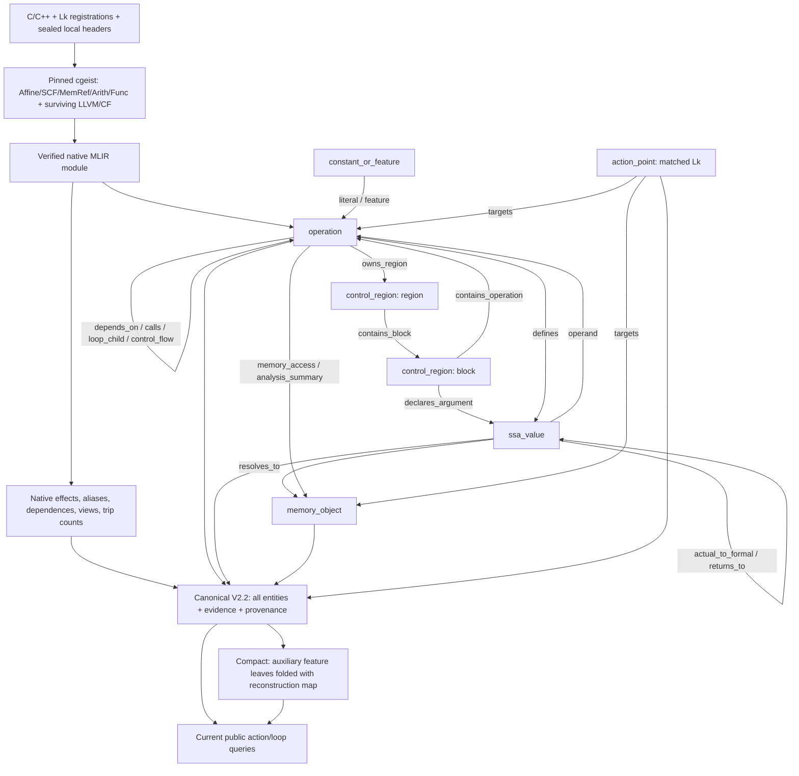
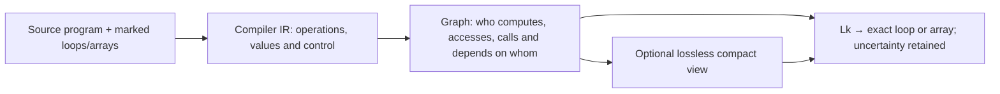

# SALT-HLS MLIR V2.2: compiler graph and target-aware extension

## Baseline documentation checkpoint (Phase A)

This section was written and saved **before implementing hardware enrichment**.
The documentation-only commit preserves this original description independently.
Inspected checkout: `d488681f68e58ab1b1e666f6911f5257d6462dc2` (`main`),
with pre-existing working-tree deletions preserved. Work branch:
`research/target-aware-mlir-v22`. The compiler schema is
`salt-hls-mlir-structural-v2.2`, semantic revision `rc3`, selected explicitly by
`--revision 2.2 --semantic-revision rc3`. V2.1 is historical.

**RC3 is technically frozen; independent human semantic adjudication is pending.**
Mechanical consistency does not close that review. The bounded review worksheet
has 60 pending cases. See [final review](../V22_FINAL_RELEASE_REVIEW.md) and
[V2.2 semantics](../structural-graph-v22.md). This work neither regenerates nor
amends that graph release.

### Authenticated baseline and implementation identities

Archive: `GNN_branch/MLIR_graphs/salt-hls-graphs-v22-20261027-rc3.tar.gz`.
SHA-256: `feb2c2d469bf6672248ad0f3a88099ac9627b3b10b8e139a0fab050d532a1b73`.
The [release manifest](../graph-release-v22-rc3.json) authenticates 538 bundled
files and 63 snapshots (55 GNΩSIS development kernels and eight external
snapshots). Three Kalman source/metadata contexts are distinct snapshots.
JPEG, Rosetta and two GEMV contexts are outside this frozen cohort.

The pinned frontend is Polygeist `77c04bb2a7a2406ca9480bcc9e729b07d2c8d077`,
with llvm-project gitlink `26eb4285b56edd8c897642078d91f16ff0fd3472` and the
nine ordered repository patches in [toolchain/README](../../toolchain/README.md).
Recorded binary SHA-256:

| Implementation | SHA-256 |
|---|---|
| `cgeist` | `29271acd6b365b0d828a637e908e5aa74eee2c21d402e64a8139f550e03fbc89` |
| `_mailohls_analysis` | `4d4932f962968118da6f8faee07402b62b2a99b29e996c53ede9939baba71e98` |
| Archived V2 builder | `ae12ae568905d3375f145e31ccab4cab73dcf16a6cb10aef1c50f49fe6d1ea5b` |
| Archived semantic annotation | `6167ab0bcf84f8aab0e7a60d7e896f546c8430f98165f166031bf95b1eb81d8d` |
| Archived V2.2 extension | `522135be66558874905bd133b2d6396514c0437482788bfe2989d895a389c855` |
| Toolchain lock | `9b46a4dd124a4e92cb99fdc87414e8e026bf2fe43ebdadeb56e6923a9a5451b3` |

The **current checkout** `GNN_branch/action_point_relations.py` is authoritative
for derived queries. Its corrected `_candidate_set_complete()` follows incoming
memory-valued loop state and checks incompleteness before closing cycles.
The archived helper has an off-corpus incomplete-root defect. The correction
does not change RC3 graph bytes. Per-file consumer hashes and newly executed
validation receipts are recorded with the verification report below.

### Source to native analysis to graph

1. `load_kernel_info_actions()` joins source `Lk` markers with `kernel_info.txt`.
   These identifiers are source registrations, not inferred optimization results.
2. Pinned `cgeist` emits textual MLIR with source locations. A representative
   authenticated command uses `-function=<top> -S -O0 -scal-rep=0
   -print-debug-info -memref-fullrank -raise-scf-to-affine`. Exact arguments,
   source/header/metadata/raw-MLIR hashes are in each graph's provenance.
3. Official MLIR Python bindings parse and verify the module. The compiled
   `_mailohls_analysis.analyze_module()` supplies effects, view reachability,
   aliases, affine dependence outcomes and trip counts. Production generation
   rejects missing native analysis; there is no approximate fallback.
4. `mlir_graph_v2.generate()` uses `_PreciseCoverageBuilder`, then
   `build_from_result()`, `mlir_semantics.annotate_semantics()` and
   `mlir_semantics_v22.annotate()`. Native operation/SSA ownership, successor
   occurrences and state forwarding are independently checked before releasing
   the owning MLIR context. The pinned wrapper needs the existing
   `mlirOperationGetSuccessor` C API for actual CFG successors.
5. The canonical `networkx.MultiDiGraph` is validated and serialized.
   `compact_view()` makes an optional, losslessly reconstructible view.
6. Public `get_action_point_relations()`, `get_loop_semantics()` and
   `action_point_views()` derive action relationships on demand from that graph.
   `generate_mlir_v2_corpus.py` is an inventory/reuse orchestrator whose default
   is still V2.1; it is not an alternative V2.2 analysis engine. The RC3 release
   uses authenticated frozen raw MLIR through the V2.2 finalization workflow.

The represented dialects include Affine, SCF, MemRef, Arith, Math, Func and
surviving CF/LLVM/Polygeist operations. Operations are not restricted to a
preselected arithmetic vocabulary: their exact names, attributes, operand/result
types, locations and ownership are retained. LLVM pointer operations matter
for class-lowered memory. Full text and lexical source evidence are audit data,
not a guarantee of hardware-exact C++ template semantics.

### Compiler entities: the six node categories

| Category | Identifier / attributes | Interpretation |
|---|---|---|
| `operation` | `op:<function>:op<ordinal>`; function operations also use `:function`; `op_uid`, `text`, `mlir_attrs`, types, source location, `parent_operation`, `loop_context` | Actual compiler operation, including functions, loops, accesses and calls |
| `ssa_value` | `value:<ssa_id>`; operand/result/block ownership, `value_type`, `lowered_numerical_type` | Exact result or block argument; a view is a value, not a second allocation |
| `constant_or_feature` | `feature:<legacy_id>`; `feature_role`, `feature_kind`, token | Semantic literal or auxiliary shape/access/trip token; only some auxiliary leaves compact |
| `control_region` | `module`, `region:<owner>:<index>`, `block:<function>:<block>`; `control_kind` | Actual region/block nesting, not synthetic loop membership |
| `memory_object` | `memory:<ssa_id>`, `memory:global:<symbol>`, `memory:unresolved:<ssa_id>`; `root_kind`, root SSA values, shape/type | Allocation, exact global, symbolic formal parameter or explicitly unresolved storage identity |
| `action_point` | `action:Lk`; `action_id`, `absolute_index`, `action_kind`, `supported_directives`, source binding | Matched registered source directive site with one exact compiler target |

Shapes, scalar constants, affine maps, source dimensions, lowered widths and
compiler-proven trip counts remain distinct attributes. Metadata loop values
may disagree with native counts; they are not silently substituted.

### Complete compiler edge vocabulary

Every canonical edge carries `relation_type`, `evidence_status`, `access_path`
and `is_reverse=false`. The table describes **all 22 implemented categories**
in `mlir_graph_v2.EDGE_KINDS`. Abbreviations: O operation, V SSA value,
F constant/feature, C control region, M memory object, A action point.
Examples are schematic relation illustrations, not additional benchmark facts.

| Relation | Endpoints | Evidence / meaning | Example; possible HLS relevance |
|---|---|---|---|
| `owns_region` | O → C(region) | Proven actual region owner | `affine.for → body region`; scope of pipelining |
| `contains_block` | C(region) → C(block) | Proven native block membership | `body → ^bb0`; structured/CFG boundaries |
| `contains_operation` | C(block/module) → O | Proven native membership; module owns function ops | `^bb0 → arith.addf`; operation placement |
| `declares_argument` | C(block) → V | Proven native block-argument owner, including restored unused arguments | `^bb0 → induction variable`; loop state |
| `next_operation` | O → O | Proven lexical block order, not a scheduling decision | `load → add`; execution context |
| `control_flow` | O → O | Native successor or retained compiler control role; RC3 successor targets first op of successor block | `cf.br → successor first op`; feasible control paths |
| `defines` | O → V | Exact native result occurrence/index | `arith.mulf → %p`; compute/dataflow |
| `operand` | V → O | Exact native operand occurrence/index | `%p → arith.addf`; producer/consumer chains |
| `literal` | F → O | Semantic immediate associated with compiler constant | `2 → arith.constant`; fixed bounds/constants |
| `feature` | F → O/V (associated compiler entity) | Retained auxiliary compiler feature occurrence | `shape token → memref value`; compactable information |
| `loop_carried` | V → V | Exact init/iter/yield/result/condition forwarding role and loop; zero-trip path retained separately | `%init → iter_arg`; recurrence constraints |
| `loop_child` | O(loop) → O(loop) | Proven immediate compiler loop nesting | `outer → inner`; unroll scope |
| `calls` | O(call) → O(function) | Proven matched body/arity or explicitly possible resolution | `call helper → helper`; interprocedural context |
| `actual_to_formal` | V(actual) → V(formal) | Exact call UID, operand/argument index, type/body checks | `A → helper.%p @ call1`; no union of unrelated callers |
| `returns_to` | V(return operand) → V(call result) | Initially possible, exact call/result index; separate invocation-scoped root reasoning may establish roots | `helper.%p → call1.%r`; returned storage |
| `references` | V(view) → V(base) | Direct compiler-supported storage/view forwarding; pointer path is not normalized address equality | `subview → A`; storage identity versus indexing |
| `alias` | V ↔ V (one canonically ordered edge) | Native must/may/partial/no-alias; `symmetric=true`; must/no are proven, may/partial possible | `%a no_alias %b`; negative evidence, never positive connectivity |
| `resolves_to` | V(memory) → M | Proven unique root, possible alternatives or not-established placeholder | `%view → allocation`; storage interpretation |
| `memory_access` | O(concrete access) → M | Exact native effect operand; root certainty preserved; read/write/readwrite | `affine.load → A`; memory demand, not port count |
| `depends_on` | O(consumer/access B) → O(producer/access A) | Native RAW/WAR/WAW record, carrying loop, bounds and certainty | `load B → preceding store A`; dependence constrains transformations |
| `targets` | A → O(loop)/M | Proven exact source/compiler binding; one target per active action | `L5 → loop`; action alignment |
| `analysis_summary` | F → V, V → V, or O → M (retained summary endpoints) | Explicit possible view reachability/call/legacy summary; not concrete access proof | `call → formal root`; conservative effects |

`proven` means the stated compiler relationship is supported within the analysis
contract. `possible` retains alternatives/analysis uncertainty.
`not_established` records missing proof; it does not mean false.
Native negative conclusions (`no_alias`, `no_dependence`) remain identifiable
negative evidence. Missing edges never prove independence. Dependence intervals
are not exact distances. Native analysis stops at its first successful depth;
other carrying depths remain unverified. Parallel relation kinds and distinct
native outcomes are preserved rather than sampled away.

### Memory, calls, loops and uncertainty

Allocations, globals and formal parameters seed function-local roots. Direct
views, native must-alias facts and supported SSA forwarding propagate roots;
may-alias does not prove identity. Subview offsets are relative to the source
view; reinterpret casts use underlying-storage offsets. Offsets, sizes, strides,
SSA indices, affine maps and their induction dependencies remain available.
For LLVM accesses the pointer-expression chain and induction dependencies are
retained; empty direct memref indices do not mean an invariant address.

`llvm.getelementptr`, pointer casts and Polygeist pointer/memref conversions
can preserve a storage root. `memref2pointer` uses the aligned pointer plus
descriptor offset or its pointer-ABI cast. These facts establish neither equal
addresses nor element overlap. Loaded pointer cells are resolved only with
supported reaching-store coverage; escapes, unsupported CFG and uncertain
aliases preserve incompleteness. A nonempty candidate set may still be incomplete.

Calls retain exact call UIDs, actual/formal positions and return positions.
Public queries lazily substitute roots in each verified invocation; they do not
merge all callers or enumerate argument Cartesian products. Recursive/external
calls stay conservative. Symbolic formal roots are not known on-chip buffers.
`root_candidates_complete` is relative to the represented invocation.

Loop hierarchy includes unlabeled loops. Public queries find nearest labeled
ancestors/descendants without erasing them. Native trip counts stay separate
from source metadata. Init, yield, backedge and result forwarding are explicit;
memory-valued for-results retain initial-buffer zero-trip alternatives, and
while-results use condition forwarding. Absence of a dependence proof does not
establish independence.

### Action registration and absolute alignment

`Lk` comes from source/metadata and always means absolute slot **`k-1`**.
Matched loop actions bind through exact compiler source evidence. Array actions
enumerate native `mailohls.action_id` or exact declaration-location candidates,
require a unique storage origin, and use shape only as a consistency filter.
Shared use lines, names or equal shapes cannot establish allocation identity.
Unresolved registrations get coverage records and diagnostics, not guessed
`targets` edges or fabricated active nodes.

The release contains **606 metadata registrations, 592 matched action points,
14 unresolved registrations and 13 source-only labels**. There are 380 matched
loop actions. Source-only means labeled but unregistered; unresolved means
registered without a supported surviving compiler target. Neither implies
compiler elimination. Source legality is independent of graph matching.

The 14 unresolved cases are external Kalman L7/L8 in two metadata variants (4)
and Hotspot pipeline/unroll L1–L4/L6 (10). The development Kalman metadata never
registered L7/L8. Consumers must carry registered/matched/unresolved masks and
must never compact away gaps or renumber active slots. The existing production
memory uses `[max_slots,128]`, absolute labels, active masks and relation masks;
multiscale export also seals checkpoint, graph, split and normalization hashes.
These are future interface constraints, not proof of V2.2 checkpoint compatibility.

### Canonical and compact views

`compact_view()` folds only single-neighbor auxiliary `memory_shape`,
`affine_access`, and `loop_trip_count` feature leaves whose incident relations
are all `feature`. Folded tokens are attached to the neighbor, while complete
original node attributes and keyed edges are saved in `compaction_mapping`.
`expand_compact()` removes the fold annotations and restores the exact canonical
payload. Operations, SSA values, semantic constants, regions/blocks, memory
objects, action points and their semantic relations survive intact.

The existing guarantees are exact canonical reconstruction and equal public
action views, all-evidence action queries and loop semantics. Smaller topology
does not by itself demonstrate improved learned QoR prediction. A consumer must
not attach irreplaceable semantics to compacted auxiliary node IDs.

### Serialization and validation

`graph_payload()` sorts node IDs and keyed edges and copies metadata;
`canonical_json()` sorts keys, uses compact separators and rejects NaN.
`add_relation()` keys facts with the first 24 hex digits of SHA-256 over
endpoints and complete attributes; identical facts deduplicate, distinct facts
remain parallel. `write_graph()` refuses to overwrite different bytes.
Graph identity hashes schema/provenance/builder identity, while release file
hashes authenticate the complete payload. Neither is a learned feature.

`validate()` checks node/edge vocabulary, exact action targets, memory-access
endpoints, call bindings, semantic annotations, RC3 evidence consistency and
connected semantic levels. Native correspondence checks actual compiler
occurrences; portable validation verifies their preserved witnesses without
loading native MLIR. Portable validation is not fresh compiler analysis.

### Existing architecture diagrams

Simpler compiler-design view:

### Authenticated examples (read-only neighborhoods)

* **Simple loops / stencil:** `spcl_example_03-fdea84258953.json` has 95 nodes,
  162 edges. `action:L5 --targets--> op:Stencil2D:op11`, an `affine.for` with
  compiler count 998 despite source metadata value 999. Its nested
  `op:Stencil2D:op14 --memory_access(read)--> memory:Stencil2D:op1:r0`
  joins L5 to array action L2. The exact access edge key is
  `e7e9a1c56d44f21b01b41ede`; the native affine index uses the inner induction
  variable. This establishes an access, not a memory-port bottleneck.
* **Memory/dependence-heavy AES:** `chstone-aes-883c223fddcf.json` has 4,204
  nodes and 53,788 edges. `action:L1 --targets--> op:encrypt:op95`.
  `op:encrypt:op100 --depends_on(RAW)--> op:encrypt:op102` has supporting key
  `620fee8fe6e022ee428831b0`, carrying loop `op:encrypt:op95` and distance
  bounds 1..15, not an exact distance. AES has 43,236 possible dependence
  records: 23,124 alias-related, 20,032 affine-analysis failures at missing
  common affine-scope blocks, and 80 non-affine outcomes. Uncertainty survives.
* **Interprocedural LUD:** `rodinia_lud_1_tiling_0-e35f0c4cd5d4.json` has
  1,479 nodes and 2,790 edges. L2 targets `op:diagonal_load:op2`; a public
  memory-access relationship to L5 is proven only in invocation context
  `op:lud_diagonal:op5`, with exact actual/formal witnesses. The same join is
  absent when explicitly querying the empty helper context. Sharing a helper
  does not join different callers' arrays.
* **Unresolved Kalman:** `serrano-kalman-filter-96b4d608969f.json` retains
  L7/L8 as unresolved coverage records. Surviving scalar arithmetic and shared
  source-use lines cannot prove separate arrays. No `action:L7` or `action:L8`
  target is invented. Six loaded-pointer access relationships across the
  Kalman cohort remain `not_established` even though the accesses themselves
  exist. Hotspot's ten unresolved registrations follow the same policy.

### Baseline limitations and acceptance boundary

RC3 has 30,634 canonical nodes, 115,783 edges and 2,995 concrete access
occurrences. Those accesses produce 2,973 proven, 32 possible and six
not-established relationships (alternative roots explain non-unit counts).
There are 1,911 proven and 51,659 possible dependencies; 150,439 native negative
conclusions are retained. No graph count is a QoR label.

Independent semantic adjudication remains open. Fourteen registrations and
some pointer roots remain unresolved. Static loop-result root unions can be
conservative. Alias roots do not prove element overlap; dependence analysis is
not complete. AP analysis stubs and lexical declarations do not establish
hardware-exact widths, rounding, overflow or cost. Transitive system headers
are not fully authenticated. FPGA characteristics are absent from canonical
compiler facts. No V2.2 tensor encoder is trained or implemented; production
GNN weights consume V1 feature schema `mailohls-mlir-features-v13-conditioned-targets`
(403 node features, 82 edge features in the maintained training launcher).

Phase-A acceptance requires authenticated archive/member hashes, existing
validators, exact reconstruction and equal current public queries on all 63
canonical/compact pairs. Newly executed receipts and any environment failures
are added here before enrichment begins. Historical final-review test counts
are inherited evidence, not tests newly executed by this task.

### Newly executed Phase-A acceptance

All 538 bundled content hashes and the archive SHA-256 passed. Archived-code
portable validation passed **63/63**, with no native MLIR loaded (117.00 s).
Current-code validation, exact canonical reconstruction, action views,
all-evidence action queries and loop-query equivalence passed **63/63**
(153.84 s). Queries left canonical payloads unchanged. Existing focused graph
tests passed **117/117**, zero failures/skips (104.25 s), including native fixture
subprocesses using the existing pinned compiler. This is not full native corpus
regeneration. All protected source/release/checkpoint hashes and the pre-existing
tracked change status remained unchanged. No target overlay code existed yet.

The compact corpus has 23,268 nodes and 108,417 edges; exact reconstruction
retains every folded node and edge. See [machine receipt](baseline-verification.json)
for per-snapshot counts, coverage, protected hashes and exact commands.
