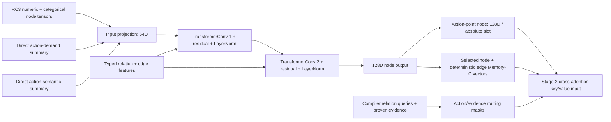

# GNN topology, reachability, and architecture audit

## Measured encoder path

The checkpoint contract was verified against SHA and strict `state_dict` load. `R1` already includes direct action summaries; `R2/R3` are after each normalized message-passing update; `R4` is 128D node output and `R5` the action-point output. The encoder uses `hardware_messages=False`; action and pooled memory are therefore compiler-only and target-independent. No target-conditioned inference was claimed.

## Effective reachability

The typed tensor graph includes directed and reverse edges. Two layers permit paths of at most two message-passing steps, but exact reachability depends on the graph's actual edges and on whether the relevant information is already in a direct feature. In the measured evidence subset, target-to-selected-node distance was 1–8 hops (median 4 over 4,415 action/witness distances). This exceeds the learned message-passing radius for much of the selected evidence. This is not an over-squashing diagnosis: direct action summaries and local semantic edges bypass the path; some distant nodes may be irrelevant; a two-hop output may still encode useful aggregate signals.

The direct path is substantial. The feature-group masking tests changed all 534 action-node output vectors when demand summaries, action-semantic summaries, or all edge features were zeroed; loop-depth/trip-count pairs changed all 534. Array shape/rank/volume pairs changed 481/534. These are single-group diagnostic ablations of a fixed forward pass, not compiler-valid program transformations and not evidence of the information's downstream utility. Demand had the largest aggregate response (mean per-graph mean action L2 7.795), followed by action-semantic input (1.360), loop/trip node pairs (0.733), all edge attributes (0.514), and shape/volume pairs (0.247). The feature groups differ in scale and dimensionality, so magnitude is not a ranking of importance.

## Graph scale and evidence distribution

The 63 authenticated release graphs span 47–4,204 nodes and 76–53,788 edges (medians 355 and 700). Loop counts range 1–40; memory-object counts 3–61 in the measured cohort. Complexity is not inferred from graph size. The compiler evidence and route failures are described in `COMPILER_INFORMATION_AUDIT.md` and the extraction manifest. Memory C as currently implemented fits only 18/55 graphs under cap 128; 37 fail closed, including graphs whose selected evidence exceeds cap by more than 700 records. This is a capacity/selection contract failure for corpus scale, not proof that a learned encoder loses information.

The existing RC3 action relation builder fails with `KeyError` for a missing action-point node on 12 matched graphs. The graph's coverage record can outlive a materialized action-point node; the current builder indexes `points[label]` unconditionally. This audit records errors without patching the production/library code or substituting an inferred mapping. The single frozen test graph is among the failures.

## Over-squashing and evidence strength

No over-squashing claim is warranted. The audit measures graph distances and activation sensitivity, but does not quantify path multiplicity, effective Jacobian attenuation by valid relation path, or discriminability conditional on matched compiler facts. Global feature-group ablations are too broad to attribute a result to distant witnesses. High priority next diagnostic: sample action/witness pairs with authenticated relation paths at 1/2/>2 hops, mask only the witness feature on a diagnostic tensor copy, compare target-action deltas against matched irrelevant-node interventions, and report both pre-summary and post-summary action vectors by family. This would distinguish path reachability from direct-summary reliance without retraining.

## Bottleneck ranking by evidence

1. **Evidence selection/capacity and route coverage (strong direct implementation evidence):** 37/55 C overflows and 12/55 action-map errors block broad C use.
2. **Action-level compression (architecture fact, no per-property probe yet):** each absolute slot receives one 128D action node; full relation maps/status and compiler payload do not all appear in the consumed vector.
3. **Training supervision (known contract limitation):** frozen V4b is ADP/physical-QoR oriented, not latency-qualified; its learned action vectors were not trained with per-property structural reconstruction objectives.
4. **Depth/topology (plausible, not established as main loss):** two message layers cannot directly propagate arbitrary 4–8 hop facts, but action summaries bypass this and controlled per-witness attenuation has not been measured.
5. **Missing compiler facts:** this corpus explicitly contains useful compiler analyses; some are missing/unknown by analysis design. Evidence omissions should not be filled by inferred negatives.

The next architecture experiment should first repair/measure memory-route coverage in a separate code change and benchmark action-level structural probes under the frozen split. Do not deepen the GNN until per-property R0–R5 recovery identifies a specific propagation failure.
