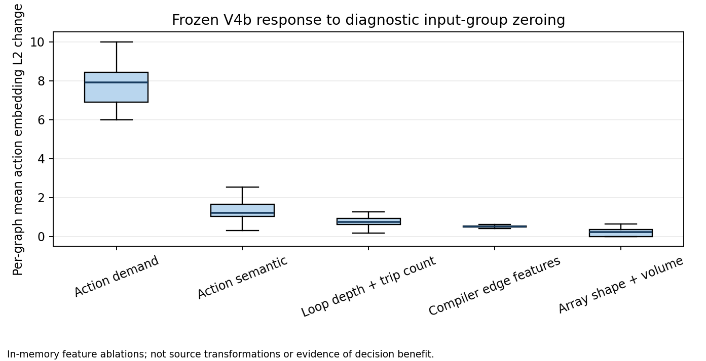
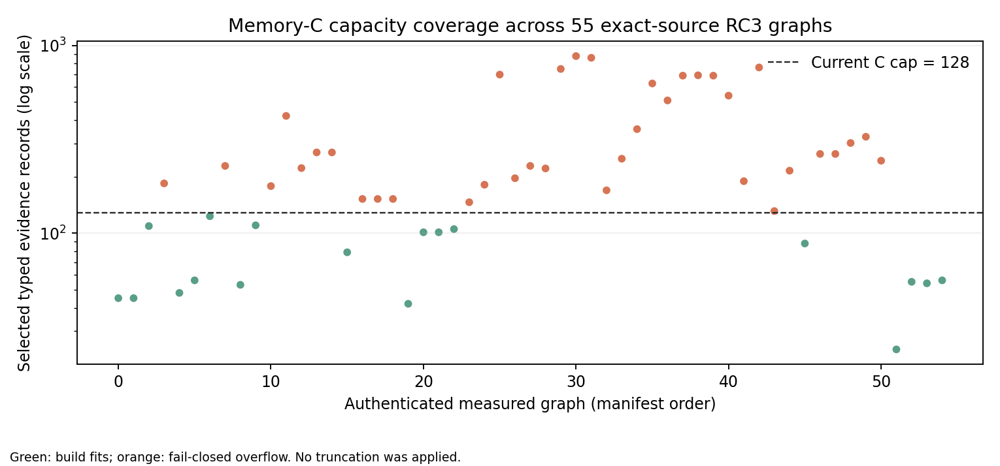

# Frozen GNN and Memory-C information audit

## Experiment and authentication

**Completed: CPU inference on all 55 exact-source measured RC3 graphs.** The V4b compiler-only selected checkpoint is `compiler_selected.pt`, SHA-256 `ef61521989d8cf3282b28f881f0cd7673de2a5253f1d42b57542e21531019162`, arm `compiler`, step 1500, quality policy `reported-zero-adp-ambiguous-v1`, protocol fingerprint `09b0f68a3bd80e4bc777daf3fb0f0c99f6b6b9b9112039eb7f852e588fda1ba5`. Its receipt identifies source commit `f248497d4d8b51313fa9683aa64e0b701c6c2f39`. The model contract is two typed `TransformerConv` layers, 64D internal state, residual + LayerNorm, and 128D node output, with direct 40D action-demand and semantic-action projections. This is a frozen diagnostic checkpoint, ADP/physical-QoR oriented, not a latency-qualified model.

Environment: CPU, PyTorch 2.6.0+cu124, isolated PyG 2.6.1 install under `/tmp/mailohls-pyg-audit-site`; no shared Python environment or GPU was used. Activation matrices are outside Git at `/tmp/mailohls-gnn-audit-activations/`, keyed by the manifest row. `R0` stores numerical node input only; categorical node IDs remain represented in the forward model but are not duplicated in these activation dumps. `R1` is after numeric/categorical projection and direct action summary injection; `R2/R3` are after the first/second message-passing layer and normalization; `R4` is final node output; `R5` is action-node output; `R6` is the existing deterministic Memory-C node/edge evidence vector when construction fits its cap.

## Coverage and observed representation sensitivity

| Measurement | Result |
|---|---:|
| Graphs passed through frozen encoder | 55/55 |
| Action-node output vectors extracted | 534 |
| Action/evidence scopes reconciled | 423 rows across 43 graphs; the other 12 graphs have explicit missing-action-node mapping errors |
| Memory-C record counts for graphs that fit | 18 graphs: 24–123 records; median 55 |
| Memory-C evidence overflow | 37/55; overflow sizes 131–877 records, median 264; fail-closed, no truncation |
| RC3 relation builder mapping error | 12/55, missing action labels such as L1/L5/L9 |
| Action-target to selected evidence-node distances | n=4,415; min 1, median 4, max 8 (undirected compiler graph; selected-node witnesses only) |

Diagnostic in-memory feature-group zeroing changed action embeddings as follows. These are forward sensitivity tests, not valid program transformations, and the aggregate deltas do not establish semantic use or decision benefit.

| Input group zeroed | Mean across graphs of per-graph mean action L2 delta | Graphs with a nonzero action change | Actions changed |
|---|---:|---:|---:|
| Direct action-demand summary | 7.795 | 55/55 | 534/534 |
| Direct action-semantic summary | 1.360 | 55/55 | 534/534 |
| Loop depth + trip-count node value/known pairs | 0.733 | 55/55 | 534/534 |
| All compiler edge features (relation IDs retained) | 0.514 | 55/55 | 534/534 |
| Shape/rank/source-volume node pairs | 0.247 | 40/55 | 481/534 |

Large response to action-demand is expected because V4b explicitly adds that projection at each action point; it is not proof of compiler semantics. The perturbations combine feature and knownness channels for node pairs. Edge-feature masking removes all numeric and semantic edge attributes together, so it cannot identify which edge field matters. They do establish that these channels affect this frozen forward computation.

## Where evidence is accessible and where it can be lost

The network has direct action input paths: action-demand and action-semantic descriptors are injected before both graph layers, and node-level trip-count/depth/shape fields are present wherever populated. One- and two-hop compiler information can then propagate over tensorized directed/reverse relations. A two-layer receptive field does not by itself cover all selected action witnesses: the diagnostic action-to-evidence node-distance median is four and maximum eight. Some of those facts may still be included by direct action summaries or local relation attributes.

Action output is one 128D vector from the action-point node. It is an aggregation bottleneck: it cannot be assumed to preserve all array access expressions, operands, nested hierarchy, or relation status without property-specific evidence. Memory C exposes selected node embeddings and deterministic edge composites. Its edge vector is endpoint mean plus fixed relation/edge projections; it is not a separately trained relation embedding. The exact edge payload, known/status flags, IDs, and provenance are metadata and are not part of the vector supplied to attention. Evidence type and validity side channels exist, but the current attention adapter consumes vectors and masks; type IDs are not currently embedded into learned K/V.

The 37/55 overflow makes the current fixed C interface incomplete for the multi-family corpus. The 12 relation-builder mapping errors further prevent a reliable per-action C mask on those graphs. Of the 423 rows with a successfully reconciled action/evidence scope, 19 frozen families are represented (16 train, 3 validation); the one held-out test graph has a mapping error, so no held-out test action-scope row is available. All 55 graphs did produce frozen action-node embeddings. Both failures are stronger immediate implementation constraints than evidence that the GNN needs more layers.

## Probe status and interpretation

No trained linear property probe is reported here: the strict held-out test contains one family, and recurrence positives have unknown rather than proven-negative counterparts. Embedding extraction plus controlled input zeroing is an executed representation experiment, but not a family-generalized semantic-decoding result. The available vectors do not establish that an action embedding encodes a particular trip count, dependence, or affine access role robustly. A future probe must use family-level validation, mask unknown labels, report constant/source-feature controls, and use family bootstrap; the present cohort cannot yield stable test uncertainty with one test family.

## Central information comparison

| Compiler property | Raw RC3 | V4b node/action | Memory C | Stage-1 |
|---|---|---|---|---|
| Loop depth / hierarchy | Explicit depth and loop-child/region relations | Numeric depth and direct action descriptors; two-hop propagation | Loop nodes/hierarchy witnesses for 18 fitting graphs | GEMV source contrasts only; no cross-family probe |
| Static trip count | Proven numeric value + knownness | Numeric node value and action summaries; input masking changes vectors | `known.trip_count` is a knownness flag, with trip value in node vector; not a standalone typed numeric side channel | Availability in prompts does not prove robust decoding; no 32-layer cross-kernel property probes |
| Scalar SSA recurrence | Proven loop-carried edges/SSA witnesses where recorded | Edge path + action semantic summary; masked-edge sensitivity is not recurrence-specific | Explicit witness category when selected; often absent/unknown; overflows/mapping failures constrain access | GEMV source contrast changes states/preferences but is confounded and not a reusable recurrence probe |
| Affine array access / role | Access map, role, memory root, dimensions where recorded | Tensor edge fields and semantic action summary; mean action vector can compress distinctions | Edge payload metadata has full provenance; deterministic vector may not preserve map/status independently | GEMV source contrast is not invariant under rename; no robust access-role probe |
| Proven/possible dependence | Explicit status/type on graph edges | Status/type edge features and propagation | Evidence type + exact provenance metadata; not all metadata is in vector | Not established by current Stage-1 evidence |

These are availability and path claims, not relative-accuracy rankings. The first next measurement should fix C coverage/mapping and then run family-disjoint probes only if the data split is expanded or cross-validation is predeclared without touching the frozen test family.
