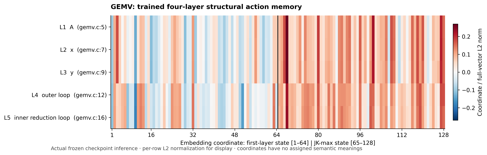
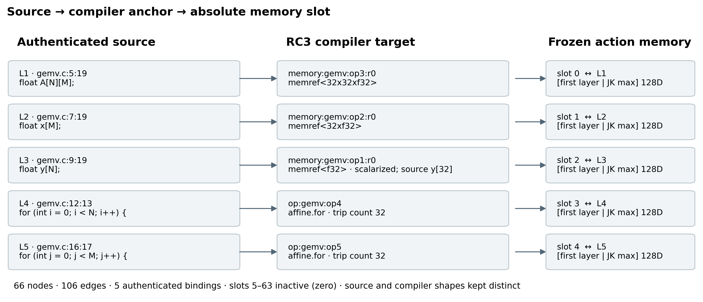

# GEMV structural memory: authenticated four-layer visualization

The independently completed first deliverable is **CPU inference from a trained,
strictly loaded four-layer `PaperRC3Net`**, with actual L1–L5 vectors and source /
compiler / memory correspondence. No GMT alignment training or decoder retrieval
result is claimed in this visualization release. The encoder remains provisional
for downstream use; this experiment does not promote it to production.





The figures are available as SVG, 300-dpi PNG and PDF. Share
[embedding_heatmap.pdf](figures/embedding_heatmap.pdf) and
[source_compiler_memory.pdf](figures/source_compiler_memory.pdf) with supervisors.
Other completed figures show [cosines](figures/embedding_cosine.pdf),
[first-layer/JK components](figures/embedding_components.pdf), and
[compiler evidence accessibility](figures/action_evidence_coverage.pdf).
The last figure shows available records, not neural retrieval.

## Pinned identities and compatibility

| Input | Exact identity |
|---|---|
| Repository base | `25c5ae389644963b39127c1769bffcf0b074e2e0` (`origin/final-architecture` at audit) |
| Trained encoder | `PaperRC3Net`, preliminary latency checkpoint, epoch 15 (zero based), **4,736 optimizer updates** |
| Checkpoint SHA-256 | `79540c9f27e4807e0c3badbd876322bbde5badd9d4a04f601b316ee75e944ee8` |
| Checkpoint recovery path on Liono | `/home/elvouvali/MailoHLS/artifacts/paper_gnn_20261110/latency/selected.pt` |
| Encoder representation schema | `salt-paper-rc3-transformer4-jkmax-conv1-jk-v1` |
| Tensor schema | `salt-paper-rc3-compiler-tensors-v1` (full vocabulary in manifest and tensor sidecar) |
| RC3 graph identity | `42fe84cb8b8c2f5665dc016fcfb6a969f93b848a3407c7343100b6b4bcabae21` |
| Canonical graph file SHA-256 | `7d295d791f8438eeda62a6b230ab80c8d3a051ecda43b822c7a3827ec0cb43a6` |
| Labelled source SHA-256 | `c6e8b0aab3919a433803bacf29c7af6b56a6a5cb4d7a511a6875a21593a7e8f6` |

The graph is the retained standalone RC3 artifact (66 nodes, 106 edges), outside
the frozen training release. Source, MLIR and registration metadata hashes are
checked against its manifest. No compiler graph was regenerated. Each action has
a proven `targets` edge. The loader checks checkpoint hash, tensor vocabulary,
categories, numerical fields, relation/status order, and defining model/tensorizer
code hashes, then loads the **entire model state with `strict=True`**. Four static
edge-aware TransformerConv layers have width 64; JK uses max. The fifth,
candidate-conditioned prediction stage is never used for exported memory.

The completed four-layer study retained this preliminary checkpoint with
`FREEZE_NOT_YET_JUSTIFIED`; see
[the qualification report](../../docs/evidence/latency_gnn_completed_local.md).
The original latency objective combined regression, physical-resource supervision
and within-context ranking, with family-separated development selection. Its
selection limitations remain applicable. The corrected newer four-layer tensor
schema and the two-layer V4b checkpoint are **different experiments**. Neither was
substituted. GEMV desired directives were never used to fit these embeddings.

For each action, the exported representation is exactly
`concat(first_layer[action_node], JK_max[action_node])`, before candidate injection,
target/budget conditioning, or QoR inputs. `model.eval()` disables dropout.
Inference ran on Liono CPU using PyTorch 2.6.0+cu124 / PyG 2.6.1, float32, four CPU
threads. Existing GPU workers were left running. No decoder was allocated.

## Source and compiler correspondence

All source locations below refer to the authenticated labelled
[`gemv.c`](../../evaluation_set/gemv/code_to_memory_outputs/meta/gemv.c).

| Action | Source construct/location | Compiler target | Absolute slot |
|---|---|---|---:|
| L1 | Matrix `A[N][M]`, 5:19 | `memory:gemv:op3:r0`, `memref<32x32xf32>` | 0 |
| L2 | Vector `x[M]`, 7:19 | `memory:gemv:op2:r0`, `memref<32xf32>` | 1 |
| L3 | Output `y[N]`, 9:19 | `memory:gemv:op1:r0`, `memref<f32>` | 2 |
| L4 | Outer loop, 12:13 | `op:gemv:op4`, affine loop, trip count 32 | 3 |
| L5 | Inner reduction loop, 16:17 | `op:gemv:op5`, affine loop, trip count 32 | 4 |

Source `y[32]` and compiler scalar storage remain separate facts. L3 is not the
inner scalar accumulator. Slots 5–63 are inactive, exactly zero. Action IDs are
source-local and never compacted. The compiler anchor identifies the construct;
the GNN reads its registered **action-point node** and its propagated context,
rather than silently replacing the action representation with the target node.

The first layer carries local message-passing features; JK combines the four
depths. This is an architectural statement, not a guarantee that a named fact is
recoverable from a vector. The v1 tensor adapter includes categorical operation /
relation features and numerical compiler metadata with knownness. Detailed
affine maps, source lines and witness identities also remain in the authenticated
sidecars; their presence there does not mean the encoder consumes them losslessly.

## Exported values and observations

| Action | Full norm | First-layer norm | JK norm |
|---|---:|---:|---:|
| L1 | 2.886323 | 1.497298 | 2.467582 |
| L2 | 2.887032 | 1.497167 | 2.468490 |
| L3 | 2.844787 | 1.497109 | 2.418983 |
| L4 | 2.951743 | 1.718585 | 2.399844 |
| L5 | 2.913428 | 1.719246 | 2.352074 |

The five vectors are finite and distinct, but highly similar: L1/L2 cosine
**0.999968**, L4/L5 **0.998235**; array/loop pairs range approximately
**0.8505–0.8577**. These similarities limit claims about discrimination. They do
not validate semantic clustering, useful retrieval, or directive sensitivity.
First-layer/JK within-action cosines range **0.1410–0.2027**. No vector dimension
is labelled as a human concept.

- [`action_memory.pt`](results/action_memory.pt): actual `[64,128]` float32 tensor,
  validity, absolute slots, encoder hash, graph identity and complete tensor schema.
- [`action_embeddings.npz`](results/action_embeddings.npz): `action [64,128]`,
  `active [64]`, `active_vectors [5,128]`, absolute IDs, plus first/JK states for
  all 66 nodes. No pickle loading is needed for NPZ.
- [`active_action_embeddings.csv`](results/active_action_embeddings.csv): five raw
  vectors, source names/locations, slot and all 128 values.
- [`embedding_metrics.json`](results/embedding_metrics.json): full norms, three
  cosine matrices, component agreement, variance and nonfinite checks.
- [`action_provenance.json`](results/action_provenance.json),
  [`evidence_catalog.json`](results/evidence_catalog.json), and
  [`manifest.json`](results/manifest.json): exact compiler records and checkpoint
  training/schema identity. Evidence records are inputs for later trainable
  projections; no learned evidence-vector semantics are asserted here.
- [`figure_manifest.json`](figures/figure_manifest.json): input and figure hashes.

The heatmap divides each **full 128D vector by its own L2 norm**, uses one symmetric
color scale for all rows, and marks the component boundary. Raw values above are
unaltered. A small `.pt`/NPZ export is retained in Git; the trained checkpoint and
raw extended-memory packs remain in ignored `artifacts/` with hashes.

## Reproduce and validate

Use the existing Liono environment, without installing dependencies:

```bash
cd /home/elvouvali/MailoHLS/worktrees/gemv-structural-explainability
export MPLCONFIGDIR=/tmp/gemv-mpl
export PYTHONPATH=/home/elvouvali/MailoHLS/worktrees/paper-gnn-latency-final-20261110/experiments/paper_gnn_latency_final/runs/liono_v3_20261110/deps
PY=/home/elvouvali/miniforge3/envs/mailohls-llm-v2/bin/python
$PY -m experiments.gemv_structural_explainability.run export \
  --raw-dir /tmp/gemv-four-layer-reproduction \
  --out /tmp/gemv-four-layer-results
$PY -m experiments.gemv_structural_explainability.run figures
$PY -m pytest -q -p no:cacheprovider experiments/gemv_structural_explainability/tests/test_export.py
```

Export refuses to overwrite an existing raw pack. Tests re-run actual inference,
require bit-identical saved vectors, check absolute slots/source scalarization,
compare CSV/NPZ/metrics, and authenticate figure inputs and outputs. Figures are
generated from numerical outputs and compiler sidecars, not hand-drawn mappings.

## Subsequent GMT experiment and scientific boundary

These **same raw frozen four-layer states** are the selected inputs for the
subsequent GMT-inspired experiment. Its checkpoint/schema contract must retain
the identities above and verify equality to this export. Changing or retraining
the encoder requires regenerating these figures and updating provenance.

The planned extension learns typed node/edge projections, two action-conditioned
summary queries per action, and deep gated cross-attention in the maintained
DeepSeek-Coder decoder. Original anchors and individual evidence stay addressable;
compiler routes remain fixed. Action-only, evidence and GMT arms require fresh,
matched Stage-2 training from the exact Stage-1 parent. The transferable GMT ideas
are learned memory-query aggregation and deep memory alignment, from the
[official paper](https://arxiv.org/abs/2510.08966v2) and
[implementation](https://github.com/tongruiliu/GMT/blob/main/gmt_model.py).
The knowledge-graph pretraining objective, relation-text pipeline and LLaMA
wrapper are not adopted.

Availability does not establish retrieval; attention does not prove causality;
decision changes do not establish better hardware. Learned attention, controlled
candidate interventions and matched superiority remain **NOT EVALUATED** in this
independent visualization release. **Physical QoR improvement: NOT EVALUATED.**
The descriptive GEMV source also has uninitialized local inputs; this artifact
does not establish a functional/synthesis benchmark. Physical claims require
authenticated source/assignment/target/clock-matched HLS measurements and
functional qualification.

## Alignment implementation and execution

The subsequent implementation is separate from the independently published
visualization. Read the [implementation decision](IMPLEMENTATION_DECISION.md).
`memory_alignment.py` provides trainable typed node/ordered-edge encoders and two
action-conditioned summary queries; `integration.py` connects one shared module
to the maintained Stage-2 trainer and its checkpoint/freeze/optimizer paths.
`evaluation.py` uses the real constrained decoder and full causal continuation
scorer. `interventions.py` defines reproducible family/record deletions, matched
random and cross-route content controls, and summary interventions. Numerical
test fixtures are never emitted as learned results.

CPU export also completed for the established 20-source alignment cohort plus
GEMV, using this same checkpoint. See
[`alignment_input_audit.json`](results/alignment_input_audit.json) for actual
counts, tensor shapes, parameter counts, raw-bank hash and recovery path. All
source-action slots remain absolute. The larger catalog explicitly admits 4,096
records (observed maximum 2,675), retaining globally unrouted records with no
permission to retrieve them. GEMV has 63 catalog records; L1–L5 can respectively
access 10, 10, 14, 37 and 31. These counts differ from the earlier V4b memory's
selection policy and do not measure retrieval quality.

The frozen vectors use an explicit, hashed **identity normalization**, preserving
exact equality to the independently published raw tensor. This is documented
through the trainer's existing normalization contract, not described as a fitted
RMS statistic. The raw bank is target-independent; target context stays in the
decoder request. Alignment and all fusion layers use fresh weights.

```bash
# Export the existing authenticated cohort; use a fresh raw output directory.
$PY -m experiments.gemv_structural_explainability.run export \
  --raw-dir artifacts/gemv_structural_explainability/multikernel_4096 \
  --out /tmp/gemv-multikernel-results \
  --graphs-dir /home/elvouvali/MailoHLS-rc3-stage2-multikernel-c/artifacts/rc3_stage2_multikernel/v1/memory_c/graphs \
  --cohort-audit /home/elvouvali/MailoHLS-rc3-stage2-multikernel-c/artifacts/rc3_stage2_multikernel/v1/audit/coverage.json

# Run separately for action, evidence and gmt with the identical budget/seed.
HF_HUB_OFFLINE=1 TOKENIZERS_PARALLELISM=false OMP_NUM_THREADS=4 MKL_NUM_THREADS=4 \
$PY -m experiments.gemv_structural_explainability.run train --mode gmt --steps 20 \
  --raw-dir artifacts/gemv_structural_explainability/multikernel_4096 \
  --out artifacts/gemv_structural_explainability/runs/gmt

# Evaluation requires a positive-update completion receipt and exact bank identity.
$PY -m experiments.gemv_structural_explainability.run evaluate --mode gmt \
  --checkpoint artifacts/gemv_structural_explainability/runs/gmt \
  --raw-dir artifacts/gemv_structural_explainability/multikernel_4096 \
  --out artifacts/gemv_structural_explainability/evaluation/gmt

# Use the action arm's natural_prefixes.json across all matched fixed-prefix runs.
# 'intervene' additionally runs the registered interventions and native free decode.
$PY -m experiments.gemv_structural_explainability.run intervene --mode gmt \
  --checkpoint artifacts/gemv_structural_explainability/runs/gmt \
  --reference-prefixes artifacts/gemv_structural_explainability/evaluation/action/natural_prefixes.json \
  --raw-dir artifacts/gemv_structural_explainability/multikernel_4096 \
  --out artifacts/gemv_structural_explainability/evaluation/gmt_interventions
```

The launcher checks exclusive GPU ownership before allocation; it never stops
another job. Stage-1 LoRA/token deltas, backbone and GNN remain frozen. The
20-update pilot uses batch 1/accumulation 8, seed 123, LR 1e-4 for attention and
alignment / 2e-4 for gates, no structural FF, no FiLM, no DPO. Frozen multireference
exposures and action-normalized nonforced-value supervision come from the
maintained V3 correction. Native development evaluation remains enabled. Resume
with `--resume <checkpoint-N>` and the identical raw bank/arm.

Inference may use the separately preflighted A2 by explicit `--gpu-uuid`; NF4
compute stays FP16. Device and runtime receipts distinguish training from
inference. Runtime/throughput comparisons must use matched hardware. The NumPy
compatibility namespace is imported explicitly for the existing Liono stack;
no dependency installation or environment replacement is required.

The evaluation keeps exact whole-prefix continuation semantics and scores even
source-forced singleton fields. For intervention generation it may memoize an
**identical** score with the same complete prefix, continuation, visible routed
memory values/masks and gates. Earlier prefix positions receive no structural
update under the maintained causal RHS mask. New prefixes or visible content
force real model forwards. Attention capture always forces real forwards and
verifies replay parity. Cache counts and maximum replay differences are recorded.
This is computational reuse, not an additional independence experiment.

The focused export/alignment tests and maintained structural-XAttn / inference
schema tests passed together: **42 tests**. Coverage includes actual trained GNN
reload, source/provenance, exact exports, summary routing/padding, nonzero
tokenizer/edge gradients, zero-gate full-decoder behavior, checkpoint context,
and full multi-token RHS/newline scoring. A completed GPU run and its validation
receipt are required before learned attention figures are generated.
