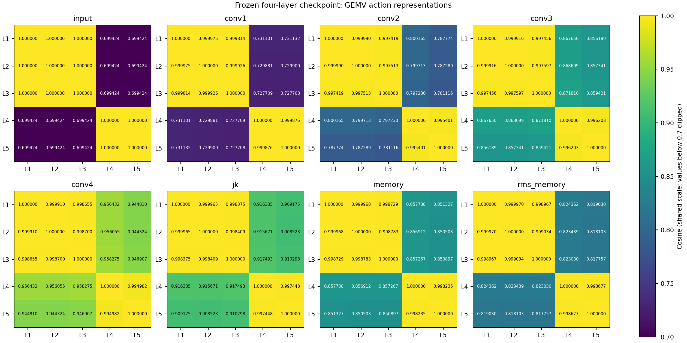

# Frozen four-layer action representation diagnostic

**Recommendation A: keep the authenticated GNN and proceed to a controlled
typed-evidence GMT alignment experiment.** First make the evidence payload values
explicit in a versioned memory adapter. Merely projecting compressed endpoints,
relation types and knownness bits would repeat an identified information gap.
Keep all 64 source-action slots and this checkpoint fixed. This recommendation
authorizes no scientific claim of useful decoder retrieval or better hardware.
Expensive alignment training has **not started** in this diagnostic.

The CPU evidence supports a small, recoverable action-specific signal alongside
large shared components. It also demonstrates missing inputs and a weakly used
candidate-conditioned graph pathway. It does **not** establish total collapse,
nor does it establish that additional GNN layers or larger embedding distances
would help directive decisions.

## Inputs, scope and reproducibility

The full model was loaded with `strict=True`, frozen and evaluated on CPU with
four threads. Its SHA-256 is
`79540c9f27e4807e0c3badbd876322bbde5badd9d4a04f601b316ee75e944ee8`
(selected epoch 15, zero based; 4,736 optimizer updates). Defining model,
tensorizer and `nn_att.py` hashes match the checkpoint protocol. The checkpoint
remains the preliminary four-layer encoder, not a production-qualified model.
No retraining, encoder replacement, source edit, graph regeneration or GPU job
operation was performed.

GEMV's graph file is authenticated as
`7d295d791f8438eeda62a6b230ab80c8d3a051ecda43b822c7a3827ec0cb43a6`:
66 nodes, 106 compiler edges, 212 tensor edges after reverse-edge expansion.
Source, MLIR, registration metadata and graph identity are checked by
[`audit.py`](audit.py). The original exported `[64,128]` action memory is
**bit-identical** to this extraction. Inactive slots remain zero in that original
pack. Encoder parameters are checked unchanged after the diagnostic.

The extension uses **50 training kernels and four development kernels**, 523
actions, across 18 training and three disjoint development families. Only selected
train/development canonical graph members are read from the authenticated RC3
archive. No locked-test measurements, QoR labels or GEMV fitting are used.
Summaries cover all 54 kernels; complete pairwise matrices are retained for seven
representatives, including GEMM, MD, stencil, hotspot, radix, Viterbi and pathfinder.

Reproduce into a **new output directory** (existing directories are refused):

```bash
cd /home/elvouvali/MailoHLS-final-architecture
export CUDA_VISIBLE_DEVICES=''
export MPLCONFIGDIR=/tmp/gemv-diagnostic-mpl
export PYTHONDONTWRITEBYTECODE=1
export PYTHONPATH=/home/elvouvali/MailoHLS/worktrees/paper-gnn-latency-final-20261110/experiments/paper_gnn_latency_final/runs/liono_v3_20261110/deps
PY=/home/elvouvali/miniforge3/envs/mailohls-llm-v2/bin/python
$PY -m experiments.gemv_structural_explainability.diagnose_representations \
  --out /tmp/gemv-representation-reproduction
$PY -m pytest -q -p no:cacheprovider \
  experiments/gemv_structural_explainability/tests/test_export.py \
  experiments/gemv_structural_explainability/tests/test_representations.py
```

The historical backend import writes its normal log directory; it creates no
trained checkpoint. Large checkpoints and memory banks remain external artifacts.
All new small results live in [`representation_diagnostics_v1/`](representation_diagnostics_v1/).
The JSON manifest records input and output hashes, environment, bank equality
checks and the script hash. Historical embeddings and figures are untouched.

## What reaches the GNN

The v1 tensor schema has 90 node channels: six category indicators, 58 operation
token indicators, and 13 pairs of numeric value/knownness channels. Non-operation
nodes receive the shared empty token. Each tensor edge has 48 channels: 22 forward
relation indicators, 22 reverse indicators, and four evidence-status indicators.
Direction and status are represented; arbitrary edge payloads are not.

Every numeric value uses `sign(v) * log2(1 + abs(v)) / 24`. Its knownness is a
separate unit-scale bit. Known zero and missing are different. Rank values 2/1/0
therefore become **0.0660401 / 0.0416667 / 0**, all with knownness 1. The L1/L2
target difference is only 0.0243734 in one channel. Loop depth, operand count and
result count differences of one each become 0.0416667. Trip count 32 becomes
0.2101831.

| Actions | Initial action vector | Distinguishing target information | Arrival |
|---|---|---|---|
| L1/L2/L3 | Identical; norm 1.414214 | Memory rank 2/1/0; memory-object category | First layer, reverse `targets` |
| L4/L5 | Identical; norm 2.021968; both action trip-count fields equal 32 | Depth 0/1, operand count 0/1, result count 0/1; same `affine.for` token and trip count 32 | First layer, reverse `targets` |

Memory-target norms are 1.733309 / 1.732552 / 1.732051. Their numeric-value
norms are 0.066040 / 0.041667 / 0, against knownness norm 1 and shared category /
token indicators. Loop-target knownness norm is 2, while numeric-value norms are
0.210183 and 0.222228. Thus input scale already favors shared type and availability
over small rank/depth differences.

Each action has **one incoming neighbor** in the first layer. Measured attention
is exactly 1 for that reverse `targets` edge. Before ELU, the array action skip
term has norm 0.851597, the shared edge term 0.927853, and each neighbor term about
0.929. The loop skip term has norm 1.124682 and neighbor terms about 1.25. There
is no first-layer attention competition suppressing rank: shared affine terms
and small distinguishing input values explain the near-parallel vectors.
[`first_layer_decomposition.json`](representation_diagnostics_v1/first_layer_decomposition.json)
recomposes the actual convolution output to verify this.

| Compiler fact | Representation coverage |
|---|---|
| Rank, depth, trip count, operand/result/use counts | Allowlisted numeric node channels, where present under the exact field name |
| Compiler storage extents / shape, source array dimensions, source declared type | Absent as values; rank is only a partial proxy |
| Affine index maps, SSA index operands, dimension/stride association | Access payload absent; related operation/SSA topology remains |
| Read/write memory-access role, operand position on an edge | Payload absent; `memory_access` relation and load/store operation token remain |
| Arithmetic | Operation token plus numeric counts; `operand`/`defines` topology; type/width details omitted |
| Recurrence | `loop_carried` relation/status present; carrying-loop ID, forwarding role and state kind omitted |
| Dependence | `depends_on` relation/status present; RAW/WAR/WAW, distances and carrying-loop details omitted |
| Action identity/kind/directive support | Absolute output slots retained; names/IDs/kind/support not separate learned node channels |
| Loop bounds/step | Adapter expects `lower_bound/upper_bound/step`; GEMV records `loop_lower/loop_upper/loop_step`, so these channels are unknown |

Graph relationships are bidirectional in the tensors. `memory_access` reaches
its corresponding array action starting at layer two. SSA edges enter according
to endpoint distance. For L5, recurrence edges first reach layers three/four,
and the proven dependence edge can first reach layer four. For L1, the recurrence
and dependence edges are beyond four layers. Some loop-associated access edges
also lie beyond four layers. Exact edge identities, statuses, payloads and minimum
arrival layers are in
[`compiler_feature_coverage.json`](representation_diagnostics_v1/compiler_feature_coverage.json).
These are possible propagation paths, not guarantees of successful decoding.

Source `y[32]` and optimized scalar `memref<f32>` remain separate facts. L3 keeps
the source-derived one-dimensional directive domain. Neither scalar storage nor
missing dependence evidence is used to invent a new legal domain or independence.

## Layer-wise measurements



| Stage | L1/L2 cosine | L1/L2 distance | L4/L5 cosine | L4/L5 distance | Mean array/loop distance | Centered variance | Effective rank |
|---|---:|---:|---:|---:|---:|---:|---:|
| Input | 1.000000 | 0 | 1.000000 | 0 | 1.445114 | 0.626506 | 1.000 |
| Layer 1 | 0.999975 | 0.010656 | 0.999876 | 0.027131 | 1.200446 | 0.432425 | 1.004 |
| Layer 2 | 0.999990 | 0.007185 | 0.995401 | 0.166291 | 1.077536 | 0.351069 | 1.093 |
| Layer 3 | 0.999916 | 0.023182 | 0.996203 | 0.158299 | 0.931447 | 0.263302 | 1.127 |
| Layer 4 | 0.999910 | 0.025405 | 0.994982 | 0.171138 | 0.599239 | 0.110998 | 1.232 |
| JK max | 0.999965 | 0.020524 | 0.997448 | 0.176335 | 1.010265 | 0.310050 | 1.137 |
| First + JK | 0.999968 | 0.023125 | 0.998235 | 0.178410 | 1.569068 | 0.742475 | 1.067 |
| RMS memory | 0.999970 | 0.060121 | 0.998677 | 0.421791 | 4.724171 | 6.716998 | 1.044 |

Within-array mean distance grows from 0 to 0.019250 in layer one and 0.083329
in layer four; raw complete memory gives 0.107004. Within-loop distance similarly
grows from zero. Overall centered energy fraction decreases from 13.69% in layer
one to 2.80% in layer four; raw complete memory has 7.08%. This is evidence of
compression of the dominant array/loop distinction in deeper states, alongside
preservation/introduction of within-category differences. It is not uniform,
monotonic loss of action distinctions. **Oversmoothing is inconclusive as the
primary cause of the reported within-group similarities.**

JK draws coordinates from all four layers. L1/L2 have counts `[11,15,18,20]`;
L4 `[15,13,19,17]`, L5 `[17,13,18,16]`. It does not reduce to layer four.
Concatenation mechanically adds squared distances; larger complete-memory
distance is not proof of better semantics. All per-action norms, full cosine /
Euclidean matrices and group statistics are retained in the JSON/CSV/NPZ files.

Centered variance is `sum((x-mean(x))**2)/(n-1)`. Effective rank is exponential
entropy of **squared** centered singular values, with relative cutoff 1e-12.
Only five actions give maximum centered rank four. Two broad groups dominate the
variance; an effective rank near one does not demonstrate absence of small useful
signals, and these five points cannot establish corpus-wide collapse.

The actual exporter divides the first and JK halves by training-kernel-balanced
RMS **0.2073609194 / 0.3029933850**, then by `sqrt(2)`. Constants and their
training-only fit list are authenticated against the existing memory manifest.
Reconstructed normalized outputs match all 54 saved bank packs within maximum
absolute error **5.96e-7** (CPU/GPU arithmetic). GEMV RMS memory is the exact
interface transformation applied to authenticated GEMV raw states, rather than
an independently historical GEMV bank pack. The loader consumes already
normalized `node_embs`; it does not apply a second normalization. This blockwise
scaling alters angular balance; it is not per-action L2 normalization.

## Feature sensitivity and recoverability

All interventions are reversible in-memory observation controls. The authenticated
graph and source remain intact. Withheld numeric observations zero both value
and knownness. Separate value-channel gates retain the original knownness and
test numerical scale; a gated zero is never asserted to be a changed compiler
fact. Relation controls withhold both directions and leave all retained type /
status fields unchanged. Absent records never imply program independence.

| Intervention | Raw 128D memory change, selected actions | Interpretation |
|---|---|---|
| Mask rank value + knownness | L1/L2/L3: 0.568 / 0.570 / 0.573 | Large availability/type-related response |
| Gate rank value only | L1/L2/L3: 0.03454 / 0.02177 / 0.00034 | Small numeric signal, not absent |
| Gate depth value only | L4/L5: 0.00136 / 0.02139 | Distinctive inner-loop depth has a measurable effect |
| Gate all trip-count value channels | L4/L5: 0.15637 / 0.15814 | Shared trip information strongly affects both loops |
| Mask shape/source shape/maps/access role/recurrence detail/dependence detail payload | All actions: exactly zero | Tensor-identical negative controls; these values are omitted |
| Withhold memory-access edges | L1/L2/L3: 0.241 / 0.241 / 0.362 | Access topology contributes beyond layer one |
| Mask arithmetic tokens | L1–L5 maximum: 0.00496 | Arithmetic token information reaches actions weakly here |
| Withhold operand + defines | L5: 0.12390 | SSA structure contributes |
| Withhold recurrence edges | L5: 0.01633 | Recurrence topology reaches inner-loop action |
| Withhold dependence edge | L3: 0.01819; L5: 0.00093 | Dependence topology reaches selected actions |

[`action_feature_ablations.json`](representation_diagnostics_v1/action_feature_ablations.json)
contains every intervention's per-action norm change, relative change, cosine to
baseline, pairwise cosine changes and Euclidean matrices at **all eight stages**.
Target-specific masks also show locality at layer one and later propagation.
Large masks test missing observations, not realistic alternate programs or
causal changes in physical QoR.

Lightweight ridge probes use fixed alpha 1, training-only channel standardization,
equal total training-family weight, and official family-separated development.
Each property uses its appropriate array or loop subset. GEMV is never fitted.
All stages, per-family errors, individual development predictions, constants and
counts are saved in [`linear_probes.json`](representation_diagnostics_v1/linear_probes.json).

| Property | Train/dev actions | Dev families | Constant MAE | First layer MAE | Layer four MAE | Complete memory MAE |
|---|---:|---:|---:|---:|---:|---:|
| Memory rank | 190/7 | 2 | 0.5000 | 0.0077 | 0.4204 | 0.0086 |
| Loop depth | 302/24 | 3 | 0.5915 | 0.1336 | 0.2672 | 0.1453 |
| log2 trip count | 300/24 | 3 | 1.9066 | 0.0735 | 0.6718 | 0.0821 |
| Recorded recurrence presence | 302/24 | 3 | 0.3474 | 0.1293 | 0.1144 | 0.0969 |
| log2 compiler elements | 190/7 | 2 | 3.2351 | 3.5340 | 3.2603 | 2.3302 |

Errors are family-macro MAE. These small held-out samples support retention of
rank, depth, trip count and recorded-recurrence correlates. Standardization can
amplify tiny signals; probe success does not prove that decoder attention uses
them. Recurrence may correlate with operand/result counts even in layer one;
this is not proof that layer one has already received recurrence edges.
Source-rank predictability is also recorded, but mostly tracks compiler rank;
it cannot establish preservation of omitted source shape or optimized/source
disagreements. Shape-size performance is mixed. Two or three development families
are insufficient to promote general semantic sufficiency.

Other kernels exhibit the same high-cosine pattern without identical memory:
within-category raw-memory mean cosine is 0.999337 for blocked GEMM, 0.995085 for
MD, 0.998098 for stencil2d, 0.998603 for hotspot, and 0.998729 for baseline
pathfinder. Pathfinder's within-category input distance is zero but becomes
0.1455 in complete memory. These observations support testing downstream use
instead of choosing an encoder by visual separation.

## Objective and candidate-summary bypass

`PaperRC3Net` uses **mean pooling over all compiler nodes after candidate injection
and one post-directive convolution**. Although historical `Net` initializes
`MyGlobalAttention`, `PaperRC3Net.from_static()` does not use it. Inspecting
`nn_att.py` therefore does not explain this checkpoint's pooling behavior.
On GEMV, only five of 66 nodes receive candidate injection directly.

The pooled vector is added to a separate `512→64` ReLU summary of all 64 complete
candidate slots. This preserves assignments at unbound actions, but provides
an alternate learning path. The recorded objective is
`0.5*(latency/area smooth-L1 + selected-objective smooth-L1)` plus
`0.1*resource smooth-L1 + 0.05*within-context feasible ranking`. These supervise
whole designs. They impose no action-level reconstruction, rank/depth decoding,
access-role or directive-conditional explanation target on exported memory.

A frozen CPU control enumerated **71 legal per-action tuples** against one
source-derived complete reference, with a fixed authenticated U200/10ns context.
All 13 source fields and coupled domains are preserved. Holding each pathway
at its reference output gives:

| Varying pathway | Latency-head RMS change | Area-head RMS change |
|---|---:|---:|
| Both | 0.066135 | 0.099573 |
| Graph/injection only | 0.000554 | 0.000304 |
| Complete-candidate summary only | 0.065818 | 0.099595 |

These are standardized head predictions, not decoder candidate scores or
measured QoR. Summary input RMS change is 0.015989 versus pooled graph change
0.0000968. Thus the bypass demonstrably dominates candidate sensitivity in this
GEMV context. Static graph information can still condition common outputs; this
control does not measure training loss attribution or prove the bypass dominates
every training family. Weak action-specific supervision is a supported concern;
its causal contribution to the embedding geometry remains **inconclusive**.

## Compatible memory and next experiment

The measured facts favor **A** for the initial alignment: keep the useful first
layer and JK together, freeze the trained four-layer encoder, and supply missing
facts through individually routed typed evidence. No encoder change is needed
to make the missing observations available to this intended architecture.

[`evidence_distinctions.json`](representation_diagnostics_v1/evidence_distinctions.json)
lists exact action targets and individual eligible provenance-labelled records.
It exposes matrix versus vector versus scalar compiler shapes; separate source
shapes; outer/inner depths; A's two-index affine access versus x's one-index
access; y's read/write records; and L5's scalar recurrence roles. These values
are available independently of small embedding differences. A dependence record
must retain its status, kind and recorded limitations; it cannot be promoted to
an inner-loop memory hazard that the compiler did not establish.

Before Stage-2, version the **evidence adapter**, not the GNN tensor schema:

1. Retain original raw action exports and the authenticated normalized interface.
   Use the same train-fitted RMS action representation in all three matched arms;
   never silently compare a raw action-only arm against normalized GMT inputs.
2. Encode individual payload values as well as types, statuses and knownness:
   source/compiler shape dimensions and extents with their roles, numeric compiler
   rank/depth/trips, parsed affine index/dimension relations, access read/write
   roles, ordered SSA relations, recurrence role/carrying-loop binding and recorded
   dependence kind/distance/status. Keep graph IDs in provenance/routing, not as
   semantic numeric features. Unknown and not-established remain distinct.
3. A raw graph sidecar, a `shape-known` bit, or a GNN endpoint projection is not
   an encoding of shape extent or an affine map. The current `audit.export_pack`
   exposes endpoint states, relation/status and availability; its retained payload
   must actually enter a typed-value projection for these distinctions to be used.
   Verify reversible value ablations affect evidence vectors while all original
   64 action vectors stay fixed. Do this on independent families, never fit GEMV.

**B is not justified as a prerequisite:** the GNN does omit important facts, but
the intended typed-evidence route can expose them while preserving the baseline.
If later evidence routing cannot represent a required fact, the smallest B trial
would add a separate authenticated target-feature adapter (rank, dimensions,
depth and correctly named bounds) and compare against the exact v1 adapter under
matched multi-family training. It requires a new schema/checkpoint and must not
silently replace this experiment.

**C remains a controlled follow-up:** if matched downstream tests fail to use
retained properties, compare the same QoR objective against that objective plus
small action-level compiler-property reconstruction losses. Supervise only known
rank/depth/trip/recorded-recurrence facts, on independent training families, with
the same split, architecture and selection budget. Retain the zero-auxiliary
baseline and measure downstream decisions as well as probes. The present bypass
measurement motivates that trial but does not require changing the fixed encoder
before testing the explicitly intended evidence path.

No compatible trained GMT alignment completion was found in the local GEMV
artifacts. Decoder scores, ranks, gates, retrieval and evidence-ablation decision
effects are therefore **NOT EVALUATED**. The existing independent visualization
release and untrained alignment scaffolding are not such a checkpoint.

The subsequent matched comparison must use action-only, action+individual
evidence, and action+evidence+learned summaries, each freshly aligned from the
same Stage-1 parent, GNN, domains, family split, seed/budget and evaluation protocol.
Freeze the 64 original action slots; append evidence and summaries with provenance
and masks. No GEMV tokenizer or decoder fitting is permitted.

For GEMV, score the actual **nine array fields** (`ARRAY_T/F/D` at L1–L3) and
**four loop fields** (`PIPE/UNROLL` at L4–L5). First use identical saved legal
prefixes across arms and interventions and save every legal candidate's score,
rank and selected value, with head/layer retrieval weights, gates, eligibility,
and evidence IDs. Separately save each arm's complete autoregressive generation
and its resulting prefixes; do not treat different generated prefixes as fixed
controls. Include payload-family and individual-record ablations, preserving
typed knownness/status. Meaningful changes must follow the specific evidence,
including dimension-aware array choices and measured recurrence sensitivity.
Attention alone is not causal evidence. Physical QoR improvement remains
**NOT EVALUATED** until exact source/assignment/target/clock-matched synthesis.

Focused validation is recorded in `representation_validation.json` next to this
report. Original export tests and new extraction/mask/provenance checks run with
CUDA disabled. The reproduction command regenerates all measured artifacts;
Markdown interpretation is intentionally kept separate from numerical outputs.
