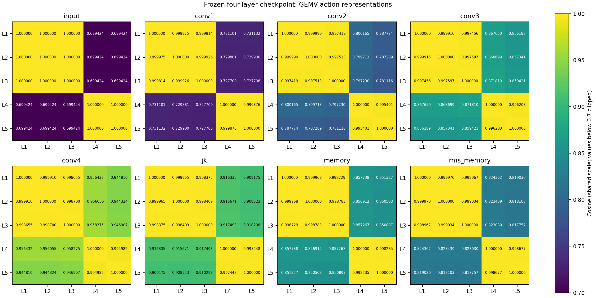

# Frozen action-memory diagnosis and GMT decision

**Recommendation A: keep the authenticated four-layer GNN and test typed-evidence
GMT alignment.** Preserve all 64 original action slots. First make individual
compiler **payload values** explicit in a versioned evidence adapter; endpoint
embeddings and knownness bits alone omit important distinctions. No expensive
alignment training was started. B/C remain controlled follow-ups.

The encoder retains useful small signals despite near-parallel vectors. Missing
input values and a complete-candidate-summary bypass are demonstrated. Total
collapse and oversmoothing as the primary cause are not established.

## Verified implementation

The pinned checkpoint (`79540c9f…44ee8`, epoch 15, 4,736 updates) loads strictly;
model/tensorizer/`nn_att.py` hashes match its protocol. Graph, source, MLIR and
metadata authenticate. GEMV raw memory is bit-identical to the historical
export; encoder state remains unchanged. All work used CPU with four threads.
Existing GPU jobs, original embeddings, checkpoints and figures were untouched.

The v1 schema has 90 node and 48 edge channels. L1/L2/L3 inputs are identical;
L4/L5 inputs are identical. Reverse `targets` edges bring rank 2/1/0, depth 0/1,
and operand/result counts into the first layer. Each action has one incoming
neighbor and attention exactly 1. Shared skip/edge terms dominate small numeric
differences. Scaling is `sign(v)*log2(1+abs(v))/24` plus a unit knownness bit:
rank 2/1/0 becomes 0.066040/0.041667/0; depth/count differences of one are 0.041667.

Shape extents, source shape, affine maps, access roles, recurrence roles and
dependence kind/distances are absent as payload values. Related topology and
some operation tokens remain. GEMV bound field names also miss the allowlist.
Access topology reaches arrays from layer two; L5 recurrence arrives in layers
three/four. Some evidence lies beyond four layers. Source `y[32]` and optimized
scalar storage remain separate; source-derived directive domains are preserved.
Exact fields, scales and paths are in the
[coverage artifact](representation_diagnostics_v1/compiler_feature_coverage.json).

## Measurements

| Stage | L1/L2 cosine | L1/L2 distance | L4/L5 cosine | L4/L5 distance |
|---|---:|---:|---:|---:|
| Input | 1.000000 | 0 | 1.000000 | 0 |
| Layer 1 | 0.999975 | 0.010656 | 0.999876 | 0.027131 |
| Layer 2 | 0.999990 | 0.007185 | 0.995401 | 0.166291 |
| Layer 3 | 0.999916 | 0.023182 | 0.996203 | 0.158299 |
| Layer 4 | 0.999910 | 0.025405 | 0.994982 | 0.171138 |
| JK max | 0.999965 | 0.020524 | 0.997448 | 0.176335 |
| First + JK | 0.999968 | 0.023125 | 0.998235 | 0.178410 |
| RMS memory | 0.999970 | 0.060121 | 0.998677 | 0.421791 |

Within-category distinctions are introduced and generally grow. Array/loop mean
distance shrinks from 1.200446 at layer one to 0.599239 at layer four; complete
memory retains 1.569068. Centered energy fraction falls from 13.69% to 2.80%,
while complete memory retains 7.08%. JK uses all four layers. This is partial
compression of broad group distinctions, not uniform loss of action information.
Complete-memory centered effective rank is 1.067, using squared singular values.
Five actions allow maximum centered rank four; broad groups dominate. These
statistics cannot establish corpus-wide collapse.

Authenticated training RMS constants are **0.2073609194 / 0.3029933850**, followed
by division by `sqrt(2)`. Reconstruction matches all 54 saved train/development
bank packs within **5.96e-7**. GEMV normalized memory applies the same interface
transformation; no historical normalized GEMV bank pack is claimed. Concatenation
and block scaling mechanically change distances and angular weighting.

Reversible observation masks show that rank+knownness masking changes array
memories by about **0.57**, whereas numeric-value gating alone changes them by
at most **0.03454**. Availability response must not be mistaken for rank-value
sensitivity. L5 changes by **0.02139** for depth-value gating, **0.12390** for SSA
edge withholding and **0.01633** for recurrence withholding. Masking omitted
shape/map/role/detail payloads produces **exactly identical tensors and vectors**.
These masks do not change the source program or establish independence.

The corpus diagnostic covers **54 kernels / 523 actions**, 18 training and three
disjoint development families. No locked-test labels or GEMV fitting are used.
Fixed-alpha ridge probes use training-only scaling and equal training-family
weight, within the appropriate array/loop subset:

| Property | Train/dev actions | Constant MAE | First layer MAE | Layer four MAE | Complete memory MAE |
|---|---:|---:|---:|---:|---:|
| Memory rank | 190/7 | 0.5000 | 0.0077 | 0.4204 | 0.0086 |
| Loop depth | 302/24 | 0.5915 | 0.1336 | 0.2672 | 0.1453 |
| log2 trip count | 300/24 | 1.9066 | 0.0735 | 0.6718 | 0.0821 |
| Recorded recurrence | 302/24 | 0.3474 | 0.1293 | 0.1144 | 0.0969 |

Errors are development family-macro MAE; rank has only two development families.
Probes can amplify tiny signals and exploit correlations. Recurrence prediction
does not prove reception of recurrence edges at layer one. Source-rank prediction
does not prove retention of omitted source shape. Compiler-element-size results
are mixed. Recoverability supports retention, not decoder use or directive
sufficiency. Other representative kernels also have similar but distinct memory.

## Objective and next experiment

`PaperRC3Net` uses whole-design **mean pooling**, not `MyGlobalAttention`.
A separate `512→64` complete-candidate summary is added to that pool. The
checkpoint's QoR/resource/ranking losses have no action-property objective.
Across **71 legal GEMV tuples**, in one fixed U200/10ns context:

| Varying pathway | Latency-head RMS change | Area-head RMS change |
|---|---:|---:|
| Both | 0.066135 | 0.099573 |
| Graph/injection only | 0.000554 | 0.000304 |
| Complete-candidate summary only | 0.065818 | 0.099595 |

The bypass dominates these candidate responses. This supports concern about
weak action-specific supervision; it does not measure training-loss attribution
or prove corpus-wide behavior. Its causal contribution to geometry is inconclusive.

**A is justified:** useful properties survive, and individual typed evidence can
expose omitted facts while preserving the encoder. Encode values, statuses and
knownness for source/compiler dimensions, depth/trips, affine index relations,
access roles, SSA/recurrence and dependence. Keep IDs in provenance/routing.
The [evidence artifact](representation_diagnostics_v1/evidence_distinctions.json)
lists actual action-specific records and distinctions. Sidecar presence alone
does not make these values inputs to a learned projection.

Use identical RMS action anchors in all three future arms: action only;
action+individual evidence; action+evidence+learned summaries. Keep the same GNN,
Stage-1 parent, legal domains, family split and budget, with no GEMV fitting.
Before Stage-2, test evidence-value sensitivity while original action anchors
stay fixed. Do not mix raw/normalized conventions between arms.

B would require a new authenticated schema/checkpoint and matched v1 baseline;
start with target dimensions/depth and correctly named bounds only if the
evidence route cannot supply needed facts. C would compare the same objective
with/without small known-property action reconstruction losses on independent
families if downstream use remains weak. Neither intervention was performed.

No compatible trained GMT alignment was found in the local GEMV artifacts.
Decoder scores/ranks, retrieval, gates and decision effects are **NOT EVALUATED**.
The next comparison must score all **13 fields**: nine `ARRAY_T/F/D` fields at
L1–L3 and four `PIPE/UNROLL` fields at L4–L5. Save candidate scores/ranks/values,
head/layer attention, gates, evidence IDs and ablations under identical fixed
prefixes; evaluate complete autoregressive generation separately. Structural
decision changes are decisive. Physical QoR requires exact synthesis and is
**NOT EVALUATED**.

Full definitions, reproduction commands and baseline requirements are in
[`representation_diagnostic_details.md`](representation_diagnostic_details.md).
All numeric artifacts, vectors, figure and hashes are in
[`representation_diagnostics_v1/`](representation_diagnostics_v1/). Focused CPU
test results are recorded in
[`representation_validation.json`](representation_validation.json).
