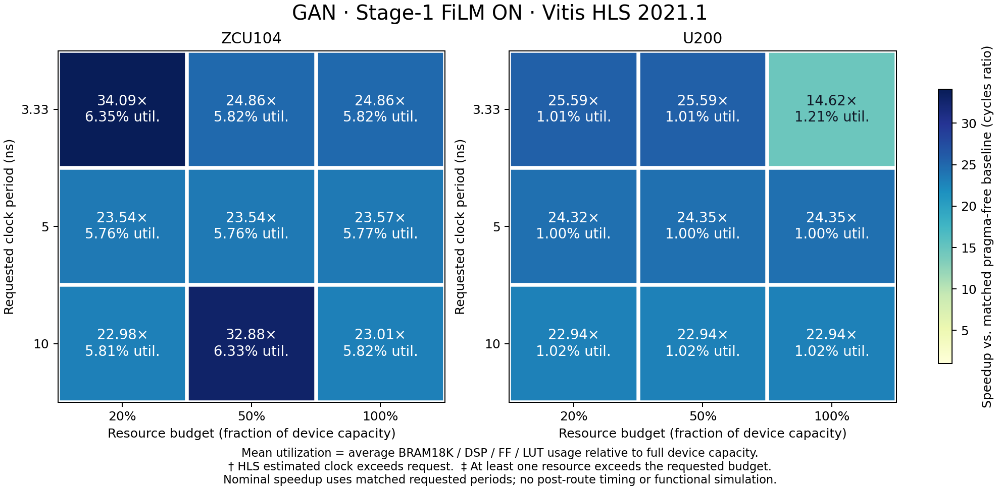

# GAN: 18 TCAD requests with the selected Stage-1 FiLM checkpoint

All 18 inference requests and their matched Vitis HLS 2021.1 syntheses completed.
The grid is ZCU104/U200 × 3.33/5/10 ns × 20/50/100% component-wise resource budgets,
from `sections/05__Detailed_Design.tex`, `fig:target-conditioning`, in the TCAD archive.
The archive, source, headers, requests and checkpoint identities were checked before inference.

## Checkpoint and supervision

The selected model is **arm B, update 600**, from `stage1_ab_pilot_20261112_retry2`.
Both A/B training runs completed 720 optimizer updates; validation selected B at 600.
This is a latency-supervised **Stage-1 continuation**, objective `PARETO_LATENCY`,
using a frozen V4 Stage-1 parent plus a trained residual LoRA and intermediate-layer FiLM.
The 600 updates are additional continuation updates, not the total training history of the parent.
No Stage-2 structural memory or Stage-3 DPO checkpoint is used here.

Inference loads the frozen parent, `device_adapt/adapter_model.safetensors`, and `film.pt`.
FiLM remains **ON** for all 18 requests. It consumes device, clock, budget and directive-kind features.
Training includes measured near-optimal feasible SFT references and context-pair ranking supervision.
The model predicts directive values, not numeric latency.

On Liono, the selected checkpoint is:

```text
/home/elvouvali/MailoHLS/worktrees/gnosis-stage1-film-ab/artifacts/gnosis_stage1_ab/stage1_ab_pilot_20261112_retry2/B/checkpoint-0600/
```

| Component | SHA-256 |
|---|---|
| Frozen V4 parent | `28dd67b87e10852c2e25975c0330259ac2dd09c4c9dff9cf84c3fff1bc3bf164` |
| Selected residual LoRA | `6628fe1f268f93ce760428ca0c50b46dbcbfe55e00d45fba97a20142e89b2f80` |
| Selected FiLM | `d2697977c97c467c7f433b134dff3031c4e842f3b8f2cf9f0c57613c1ecf46ae` |

Weights remain in the existing runtime directories; this report does not embed them.

## Predictions and synthesis

There are **25 directive fields per request**, 450 predicted fields in total,
and **five distinct complete assignments**. The production decoder scores complete RHS/newline
continuations with mean token log-probability, preserving the full source and causal directive prefix.
All 18 inference masks matched the actual training encoder; no source was truncated.
GAN is an external descriptive evaluation and supplied no training or checkpoint-selection labels.

Synthesis ran on `bonus24@coroni.microlab.ntua.gr`, using
`/opt/Xilinx/Vitis_HLS/2021.1/bin/vitis_hls`. The 18 requests require 12 distinct predicted
design/device/clock syntheses and six matching pragma-free baselines. Budget-only duplicates
reuse the same physical measurement, because the budget is a feasibility constraint, not a Tcl directive.

All runs use identical application headers, genuine Vitis AP headers, and the same settings:

```tcl
config_array_partition -complete_threshold 0 -throughput_driven off
config_compile -pipeline_loops 0
```

The baseline removes all pragma lines from the top source and keeps the same application headers.
Materialization removes disabled pipeline/unroll sentinels and the factor-0 sentinel for complete
partitioning, preserving their checkpoint meaning. Program tokens outside pragmas are unchanged.
The analysis-only `ap_fixed.h` stub is excluded from synthesis.

For each request:

- **Mean normalized utilization (%)** = `100/4 × sum(used_resource / full_device_capacity)`
  across BRAM18K, DSP, FF and LUT. The denominator is full capacity, not the requested budget.
- **Speedup** = baseline worst-case latency cycles / predicted worst-case latency cycles,
  for the same FPGA part and requested period. This also equals the nominal delay ratio when
  both cycle counts are multiplied by that shared requested period.
- Budget compliance checks every resource individually against its component-wise requested allowance.
  Clock compliance uses the HLS estimated clock, not implemented timing.

All 18 request cells have paired measurements; all fit their requested budgets and meet their
requested periods according to the HLS estimates. Speedup spans **14.620×–34.094×**.
Mean utilization spans **1.0017%–6.3547%**. Increasing the allowance does not guarantee that
the predicted design is faster: U200/3.33 ns/full uses C5 and achieves 14.620×, while its
20% and 50% requests use C2 and achieve 25.592×.



## Evidence

- [Complete directive text for every request](inference/DIRECTIVES.md)
- [All 450 predicted fields as CSV](inference/directives.csv)
- [Prediction configuration comparison](inference/SUMMARY.md)
- [Synthesis table for all 18 requests](synthesis/RESULTS.md)
- [Measured resource counts, cycles and timing as CSV](synthesis/request_results.csv)
- [Detailed paired measurements](synthesis/request_results.json)
- [Downloadable PDF map](synthesis/request_map.pdf)
- [Tool version and genuine vendor-header identities](synthesis/tool.json)
- [Synthesis inputs and request-to-job mapping](synthesis/manifest.json)
- [Per-job input sources, Tcl, result receipts and original XML reports](synthesis/jobs/)
- [Published artifact SHA-256 index](EVIDENCE_INDEX.json)

Full synthesis logs and projects remain on Coroni under
`/home/bonus24/mailohls_gan_film_tcad_20261112/`, and collected runtime evidence remains on Liono
under `artifacts/gnosis_stage1_ab/gan_tcad_film_synthesis_20261112/` in this worktree.
Unmodified shared application headers are already tracked under `evaluation_set/GAN/`.

## Interpretation

These measurements establish HLS estimated latency and resources for this GAN request grid
against matched pragma-free baselines. They do not establish that FiLM caused the gains:
GAN synthesis controls for the parent, A and B-off were not run. This is one program, and
duplicate budget views are not independent hardware designs. The original held-out A/B
qualification remains inconclusive. No functional simulation or post-route timing was run.
Historical manuscript heatmap measurements are not attributed to these new predictions.

## Verify and reproduce

From this experiment worktree, no GPU or Vitis is required to verify published measurements:

```bash
python -m experiments.gnosis_stage1_ab.verify_gan_tcad_results
```

Inference reuses a hash-verified TCAD prepared bundle, the existing V4 parent and the selected
B checkpoint. Use a fresh output directory and an idle Liono V100S. `--preflight-only` verifies
all 18 source/token/mask fixtures without loading the decoder:

```bash
python -m experiments.gnosis_stage1_ab.gan_tcad_contexts \
  --prepared /path/to/gan_stage1_tcad/run_20261110 \
  --draft /path/to/TCAD.zip \
  --parent /path/to/stage1_quality_sft_latency_v4/multi_reference/run \
  --training-run /path/to/stage1_ab_pilot_20261112_retry2 \
  --out /path/to/new/inference --preflight-only
```

Remove `--preflight-only` and set `CUDA_VISIBLE_DEVICES=GPU-cea3d9e4-d189-a5b9-cf2e-9bd77b8218fb`
to execute on the verified idle V100S. Preserve the selected checkpoint directory basename
when relocating its `best.json` lineage pointer; the runner resolves it within `--training-run`.
The TCAD prepared bundle was created by `experiments/gan_stage1_tcad/run.py` in the existing
`research/gan-stage1-tcad-20261110` experiment; its sealed identities are in the inference manifest.

Prepare fresh physical jobs locally, then transfer that new directory to Coroni:

```bash
python -m experiments.gnosis_stage1_ab.gan_tcad_synthesis prepare \
  --root /path/to/new/synthesis \
  --predictions /path/to/completed/inference \
  --prepared /path/to/gan_stage1_tcad/run_20261110

# Run inside the transferred directory on Coroni, with the pinned Vitis installation:
python3 gan_tcad_synthesis.py run --root /path/to/new/synthesis --workers 3
```

The synthesis runner supports Python 3.6+, verifies inputs/tool identities, seals each result,
and resumes already successful jobs without repeating them. Failed or unsealed attempts are
preserved and require an explicitly separate attempt. It writes the request table and CSV after
the queue finishes. `plot_gan_tcad_synthesis.py --root /path/to/completed/synthesis` creates the map.
