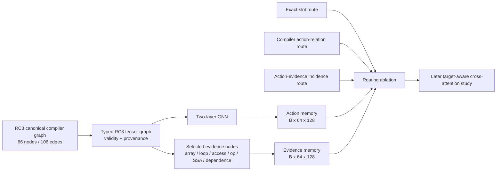

# Proposed structural-memory interface

## Options

| Option | Coverage | Interface / complexity | Assessment |
|---|---|---|---|
| A. One vector per action | Five 128-d vectors summarize each anchor; array dimensions and proven trip count can be direct, but access maps, recurrence, arithmetic and dependence witnesses are compressed through the GNN. | Existing `[B,64,128]` memory, absolute slots, registered/matched masks. Lowest complexity; current contract. | Keep as baseline. Risky as the only long-term representation for action-level decisions whose evidence lies several edges away. |
| B. Action vectors + compiler-relational routing | Same representation; action-relation mask exposes eligible neighboring action slots and relation bits. | Existing `[B,64,64]` bool mask plus `[B,64,64]` relation bits (exact runtime widths follow slot cap); low added complexity. | Compare before changing architecture. Helps action-to-action context but cannot expose operation or SSA witnesses. |
| C. Hierarchical action + selected evidence memory | Retains five action vectors plus typed compiler evidence vectors: array/scope roots, loop/region nodes, memory accesses, arithmetic ops, SSA recurrence/dependence witnesses. | Small variable set of evidence keys plus typed/valid masks, provenance IDs, relation labels, and per-action incidence. Moderate tensorizer and routing work; no cross-attention redesign implied. | Recommended representation for an eventual target-aware attention study, after A/B diagnostics. It keeps facts addressable instead of relying on latent compression alone. |

## Evidence-based choice

The CPU ablation in `CURRENT_GNN_INFORMATION_AUDIT.md` shows the trained compiler encoder is sensitive to shape, access/affine, loop/trip, arithmetic/SSA, and dependence masks, especially L1/L2 access features and L4/L5 arithmetic/SSA features. This establishes input sensitivity only. Direct action semantic mean-pooling already exposes some supported facts, yet can blend individual witnesses. RC3-derived relational action routing adds loop/array eligibility but not witness-level access. Therefore C is the best representation to test first for Stage-2 evidence access; compare it against A/B under identical inputs and downstream evaluation. For an initial deployment-compatible baseline, retain A with exact-slot routing until an RC3 mask schema and C have been evaluated. More tokens or layers are not assumed to help.

## Concrete C contract (proposal, not implemented)

- `action_memory`: `[B,64,128]` (unchanged output width/absolute slots).
- `evidence_memory`: `[B,64,128]`, with 64 fixed evidence slots per graph, stable deterministic ordering by evidence kind then canonical node ID; GEMV uses far fewer than 64. Never truncate: overflow is an explicit validation error or a schema-versioned cap increase.
- `evidence_type`: `[B,64]` categorical IDs for `array_root`, `loop_region`, `memory_access`, `arithmetic_op`, `ssa_value`, `dependence`, `other_compiler`; `evidence_valid`: `[B,64]` boolean. A separate `evidence_known`/field-level validity mask is needed for each scalar attribute; unknown is not numeric zero.
- `evidence_features`: `[B,64,F]` typed compiler features and validity bits: source/compiler shape separately, affine map/access role, operation family/type, loop depth/trip evidence, SSA kind/use role, dependence kind/direction/certainty and completeness. Only emit facts present in authenticated compiler artifact; preserve explicit `possible`, `not_established`, and `not_applicable` distinctions. Keep exact witness payload in provenance, not as free-form model text.
- `action_evidence_mask`: `[B,64,64]` boolean incidence; `action_evidence_relation`: `[B,64,64,R]` or compact relation ID plus mask, with types such as `targets`, `owns/contains`, `accesses`, `operand/defines`, `loop_carried`, `depends_on`. Include direction and shortest-hop distance as graph-derived routing metadata; do not promote uncertain links to proven relations.
- Provenance: per evidence slot canonical node/edge keys, graph identity, source artifact digest, builder/tensorizer digest, semantic revision, and witness status. Padding slots have `valid=false`, no IDs, and are masked from attention.
- Initial routing comparisons: action self only; current compiler-relational action keys; action self plus directly incident evidence; action plus evidence within 2 hops; and all selected evidence (diagnostic ceiling). Use the same encoded vectors and evaluation protocol. Report eligible key counts and type coverage per action.

The fixed cap of 64 evidence slots is a starting tensor shape, not a validated optimal memory size. Prefer a smaller evidence set determined by selected typed witness families, pad with validity masks, and report actual per-graph counts; raise the cap only with schema versioning and overflow tests. Keep source/compiler shape separately for y promotion.

## Diagram

This is a memory contract proposal only. No GNN, cross-attention module, production inference, or checkpoint was changed.
