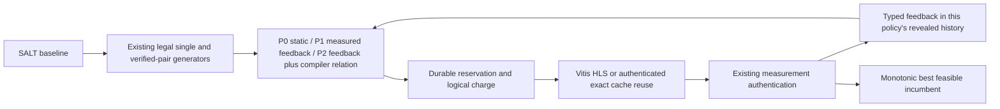

# Feedback-Guided Refinement v1 (FGR-v1)

FGR-v1 is an experimental ranking adapter for the frozen refinement search engine. It consumes only a policy's authenticated, already-paid observations and existing legal candidate generators. It does not train models or predict unobserved QoR.



## Evidence separation

- **Compiler facts:** existing authenticated relation records, active/inactive action contract, and TCAD source-domain checks. Only `direct_verified` and `indirect_verified` relations enable joint proposals. An unknown relation is not independence.
- **Measured observations:** latency cycles, four resource counts, status, feasibility, estimated HLS clock, and comparison context copied from the authenticated result only after that policy's query is paid.
- **Derived quantities:** utilization, area proxy, ADP, deltas, and budget headroom. Area and ADP retain `synthesis.evaluate_metrics` definitions. Physical-capacity utilization is separate from requested-budget headroom; zero budget is explicitly handled.
- **Unknowns:** missing metrics and optional report diagnostics remain unavailable. HLS estimated clock is never called post-route timing. This version does not infer scheduling, dependency, or memory-port causes from aggregate resources.
- **Ranking assumptions:** P1 assumes observations by directive family can support conservative local priority; P2 also gives verified relationship evidence priority for a joint candidate. Neither is a causal model or proof of benefit. Seeded hashes resolve ties.

## Policies

- `fgr_static` (P0) follows deterministic ordering over the common legal single plus verified-pair candidate pool and does not rank using measured effects.
- `fgr_feedback` (P1) prioritizes families with observed improvements and diversifies away from over-observed or unproductive families. It does not use relation evidence to rank.
- `fgr_structural` (P2) uses the same observations and pool; verified relation evidence participates in lexicographic joint-versus-single ranking. Singles and joint candidates remain eligible after baseline-only feedback.

Candidates are deduplicated by canonical complete-assignment signature. The inherited generator enforces legal tuples, domains, active sites, and safe pair composition. Proposal code is separately hashed in experiment inputs; physical identity keeps the unmodified engine hash contract. Scoped adapter hooks restore in `finally`.

## Commands

From the repository root with Python 3.8–3.11:

```sh
PYTHONPATH=. python3 -m experiments.refinement_feedback.experiment --mode prepare \
  --output-dir experiments/refinement/results/fgr_v1/prospective --execution replay \
  --kernels GAN covariance Kalman --policies fgr_static fgr_feedback fgr_structural --max-evaluations 8
PYTHONPATH=. python3 -m experiments.refinement_feedback.experiment --mode replay \
  --output-dir experiments/refinement/results/fgr_v1/prospective
PYTHONPATH=. python3 -m experiments.refinement_feedback.experiment --mode summarize \
  --output-dir experiments/refinement/results/fgr_v1/prospective
PYTHONPATH=. python3 -m pytest -q tests/test_refinement_feedback.py tests/test_refinement.py \
  tests/test_refinement_search.py tests/test_refinement_benchmark.py tests/test_v21_refinement.py
```

Replay does not launch synthesis. The historical archive may lack newly selected candidates; those remain unavailable and cannot support complete comparisons. For prospective synthesis, prepare in a fresh isolated directory on a compatible Vitis HLS 2021.1 host:

```sh
PYTHONPATH=. python3 -m experiments.refinement_feedback.experiment --mode prepare \
  --output-dir experiments/refinement/results/fgr_v1/prospective_fresh --execution synthesis \
  --fresh-synthesis --kernels GAN --policies fgr_static fgr_feedback fgr_structural --max-evaluations 8
PYTHONPATH=. python3 -m experiments.refinement_feedback.experiment --mode run \
  --output-dir experiments/refinement/results/fgr_v1/prospective_fresh --kernels GAN \
  --policies fgr_static fgr_feedback fgr_structural --allow-batch --limit 1 --vitis-hls vitis_hls
```

The upper bound is 8 logical queries per policy. Three arms across three kernels cost **72 logical evaluations**, including each initial SALT configuration. A three-arm GAN smoke run costs at most 24. Physical synthesis count depends on authenticated cache reuse and failures, while every logical query remains charged. Prepare, replay, summarize, and tests never launch synthesis.

`fgr_report.json` records per-query changes, rationale, outcome, reuse accounting, runtime, timing availability, and single/joint counts. Existing controller reports provide best feasible ADP at available prefixes 1/2/4/8 and do not extrapolate incomplete replay curves. Synthetic test fixtures are not hardware results.

## Research status

`IMPLEMENTED_AND_TESTED` means implementation and CPU-only synthetic checks pass. It does not mean `MEASURED_HARDWARE_IMPROVEMENT_DEMONSTRATED`. The latter requires new authenticated complete matched-budget prospective results. A learned refinement model needs multiple frozen contexts and predeclared seeds, repeated context-matched action effects, calibrated incremental benefit over P1/P2, and a held-out evaluation.
