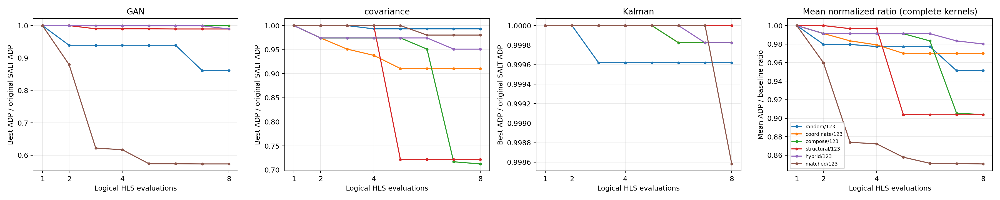

# Authenticated R11 refinement results

**Scientific decision: `REFINEMENT_BENEFICIAL_BUT_STRUCTURAL_GAIN_UNPROVEN`.**

Assessment date: 2026-11-01. Evidence state: `COMPLETE_AUTHENTICATED`.
All 18 contexts reached eight paid logical evaluations. All three selected
finalists have authenticated, executed C-simulation passes. The current task
reauthenticated the existing experiment; it launched **zero new syntheses and
zero additional C simulations**. No policy was retuned and no model was loaded.

## Identity and evidence recovery

- Research branch: `research/refinement-mechanism`; initial head
  `49a32d07fa2630e570447aae08d0a22de5daa044`.
- R11 preparation Git commit: `98698167a146a7be9ec711cc817a746734d384f2`.
- Validated assessment implementation/evidence commit: `b9687e59dce518c9735e18e4ee59b7d09425946b`.
- Protocol seal: `b4ed8b95ee8d64dcc91406216659229db8b20efb7c14b614a6ae6ccc3fd98868`.
- Original host: `bonus24@coroni.microlab.ntua.gr`.
- Original execution root: `/home/bonus24/mailohls_search_20261026_NqbK0V/`.
- Evidence under that root: `experiments/refinement/results/search/benchmark_r11/`,
  plus sibling `pilot/`, `smoke/`, and the benchmark `historical_cache/`.
- Original local recovery copy: `/home/elvouvali/MailoHLS/experiments/refinement/results/search/`.
- Dedicated worktree recovery copy: `/tmp/MailoHLS-refinement-mechanism/experiments/refinement/results/search/`.
- Execution: Vitis HLS **2021.1**, Python **3.8.0**, glibc **2.27**;
  `xczu7ev-ffvc1156-2-e`, requested clock **10 ns**, seed **123**,
  full BRAM/DSP/FF/LUT capacities **624 / 1728 / 460800 / 230400**.
- Live Vitis executable SHA256:
  `18046ed76282160f2290b0fa36ffcf8e9e6068e883e14e6325a10bdfe9315896`.
- Vendor `ap_fixed.h` SHA256:
  `bb9b88dae1a2d39a81f5f068632e9a217ed3e6e1b6c3baed92041c5dbcdf9e11`.
- Vendor `ap_int.h` SHA256:
  `a8695b7a66192b2b4300c64883a01e3911c619f9686b0018876d5af4176d0445`.

The [sealed assessment](evidence/r11/assessment.json) records all 144 paid
assignments, source/report identities, full finalist configurations, functional
receipts, and an input-file hash inventory. It was generated with exact policy
replay on Coroni and then verified by hashes locally. The original sealed curve
export agrees with the reconstructed journals. The original engine and benchmark
files match their frozen hashes. These hash seals establish recorded integrity;
they are not signatures from an independent certification authority.

| Kernel | Original source SHA256 | Graph SHA256 |
| --- | --- | --- |
| GAN | `40c0d7706c7d4ed88978366cd022ffa1868a2dcb19a8e82fa02d39346a6ae03f` | `eefc52bf7652eb0cda3609358ac2b8d98472a90ceec1337615c488c0ef1d08b3` |
| covariance | `2df25e667247b05dfd0dfe3c25f6580864a8fbbca4d2ff50996b5a52b7cb0b98` | `fdf5e4de970a391a37394d5ea5191fd09b57054648d4a13de41dab573d805b23` |
| Kalman | `3c36824db4be6be09b110a20cd5c5b655d14a4973bf4a0ec1820d544b98b81b1` | `bcb06f71f45ef22649d7e7729abc66af0b67a688c1787a1125c3502ee2fc0238` |

Metadata, template, header, baseline-signature, engine and Tcl identities are
also recorded in the sealed protocol and assessment. Every successful result
was reparsed from its actual HLS XML and matched to its exact assignment, source,
headers, Tcl settings, completion log, tool receipt and deployment context.

## Equal logical-budget results

Area is the arithmetic mean of four resource-utilization percentages against
full physical capacity; ADP is latency cycles times that area proxy. Feasibility
checks every resource separately. The initial measured SALT assignment costs
one logical evaluation; reused and infeasible queries also cost one.

`N@b = best feasible ADP in paid prefix b / original measured SALT ADP`.
Ratios below one improve the baseline. Rounded display values below have full
precision in [contexts.csv](evidence/r11/contexts.csv). All listed prefixes are
complete; none is extrapolated from a pause or missing replay observation.

| Kernel | Policy | N@1 | N@2 | N@4 | N@8 | Improvement@8 % |
| --- | --- | ---: | ---: | ---: | ---: | ---: |
| GAN | random | 1.000000000 | 0.939337666 | 0.939337666 | 0.861173566 | 13.882643 |
| GAN | coordinate | 1.000000000 | 1.000000000 | 0.999428463 | 0.999428463 | 0.057154 |
| GAN | compose | 1.000000000 | 1.000000000 | 0.999428463 | 0.999428463 | 0.057154 |
| GAN | structural | 1.000000000 | 1.000000000 | 0.990085660 | 0.989507986 | 1.049201 |
| GAN | hybrid | 1.000000000 | 1.000000000 | 0.999428463 | 0.989507986 | 1.049201 |
| GAN | matched | 1.000000000 | 0.879717486 | 0.616895102 | 0.573057187 | 42.694281 |
| covariance | random | 1.000000000 | 1.000000000 | 0.993212415 | 0.993212415 | 0.678758 |
| covariance | coordinate | 1.000000000 | 0.974341579 | 0.938128508 | 0.910745862 | 8.925414 |
| covariance | compose | 1.000000000 | 0.974341579 | 0.974341579 | 0.712455439 | 28.754456 |
| covariance | structural | 1.000000000 | 1.000000000 | 1.000000000 | 0.721635284 | 27.836472 |
| covariance | hybrid | 1.000000000 | 0.974341579 | 0.974341579 | 0.951125309 | 4.887469 |
| covariance | matched | 1.000000000 | 1.000000000 | 1.000000000 | 0.980264048 | 1.973595 |
| Kalman | random | 1.000000000 | 1.000000000 | 0.999618869 | 0.999618869 | 0.038113 |
| Kalman | coordinate | 1.000000000 | 1.000000000 | 1.000000000 | 0.999823778 | 0.017622 |
| Kalman | compose | 1.000000000 | 1.000000000 | 1.000000000 | 0.999823778 | 0.017622 |
| Kalman | structural | 1.000000000 | 1.000000000 | 1.000000000 | 1.000000000 | 0.000000 |
| Kalman | hybrid | 1.000000000 | 1.000000000 | 1.000000000 | 0.999823778 | 0.017622 |
| Kalman | matched | 1.000000000 | 1.000000000 | 1.000000000 | 0.998582029 | 0.141797 |

Raw ADP, using the same authenticated observations:

| Kernel | Policy | ADP@1 | ADP@2 | ADP@4 | ADP@8 |
| --- | --- | ---: | ---: | ---: | ---: |
| GAN | random | 19447.464906350 | 18267.736301694 | 18267.736301694 | 16747.642708890 |
| GAN | coordinate | 19447.464906350 | 19447.464906350 | 19436.349958545 | 19436.349958545 |
| GAN | compose | 19447.464906350 | 19447.464906350 | 19436.349958545 | 19436.349958545 |
| GAN | structural | 19447.464906350 | 19447.464906350 | 19254.656124800 | 19243.421827702 |
| GAN | hybrid | 19447.464906350 | 19447.464906350 | 19436.349958545 | 19243.421827702 |
| GAN | matched | 19447.464906350 | 17108.274927384 | 11997.045851140 | 11144.509527744 |
| covariance | random | 1903145.910300926 | 1903145.910300926 | 1890228.146122685 | 1890228.146122685 |
| covariance | coordinate | 1903145.910300926 | 1854314.191767940 | 1785395.432870371 | 1733282.262442130 |
| covariance | compose | 1903145.910300926 | 1854314.191767940 | 1854314.191767940 | 1355906.655164931 |
| covariance | structural | 1903145.910300926 | 1903145.910300926 | 1903145.910300926 | 1373377.239293981 |
| covariance | hybrid | 1903145.910300926 | 1854314.191767940 | 1854314.191767940 | 1810130.241825810 |
| covariance | matched | 1903145.910300926 | 1903145.910300926 | 1903145.910300926 | 1865585.513310185 |
| Kalman | random | 8678366.581469242 | 8678366.581469242 | 8675058.986417158 | 8675058.986417158 |
| Kalman | coordinate | 8678366.581469242 | 8678366.581469242 | 8678366.581469242 | 8676837.263326880 |
| Kalman | compose | 8678366.581469242 | 8678366.581469242 | 8678366.581469242 | 8676837.263326880 |
| Kalman | structural | 8678366.581469242 | 8678366.581469242 | 8678366.581469242 | 8678366.581469242 |
| Kalman | hybrid | 8678366.581469242 | 8678366.581469242 | 8678366.581469242 | 8676837.263326880 |
| Kalman | matched | 8678366.581469242 | 8678366.581469242 | 8678366.581469242 | 8666060.905253964 |

Complete three-kernel aggregates use normalized ratios, never raw ADP:

| Policy | Mean N@1 | Mean N@2 | Mean N@4 | Mean N@8 | Geomean@8 | Median@8 | Improved / unchanged | Wins@8 |
| --- | ---: | ---: | ---: | ---: | ---: | ---: | --- | ---: |
| random | 1.000000000 | 0.979779222 | 0.977389650 | 0.951334950 | 0.949122842 | 0.993212415 | 3 / 0 | 0 |
| coordinate | 1.000000000 | 0.991447193 | 0.979185657 | 0.969999368 | 0.969075157 | 0.999428463 | 3 / 0 | 0 |
| compose | 1.000000000 | 0.991447193 | 0.991256681 | 0.903902560 | 0.892916730 | 0.999428463 | 3 / 0 | 1 |
| structural | 1.000000000 | 1.000000000 | 0.996695220 | 0.903714423 | 0.893810985 | 0.989507986 | 2 / 1 | 0 |
| hybrid | 1.000000000 | 0.991447193 | 0.991256681 | 0.980152358 | 0.979926497 | 0.989507986 | 3 / 0 | 0 |
| matched | 1.000000000 | 0.959905829 | 0.872298367 | 0.850634421 | 0.824723294 | 0.980264048 | 3 / 0 | 2 |

Wins above include the matched control: matched wins GAN and Kalman; compose
wins covariance. Among the five main policies, random wins GAN and Kalman,
and compose wins covariance. A mean near-tie between structural and compose
changes ordering under the geometric mean; neither aggregate establishes
superiority. Three kernels and budget prefixes are not independent replications.
Finalists are selected retrospectively across six eight-query trajectories
(48 logical policy observations per kernel). Their best-observed gains are not
a guarantee for a policy chosen in advance with only eight total observations.

[Standalone PDF](evidence/r11/optimization_curves.pdf). This is the existing
plot exporter driven by sealed original curve data. Panels use different
y-axis ranges; Kalman is zoomed and every Kalman gain is below 0.5%.

## Logical versus physical cost

| Kernel | Policy | Logical / unique | New syntheses | Reuses | HLS seconds | Controller seconds | Feasible / infeasible | Failed / unavailable |
| --- | --- | ---: | ---: | ---: | ---: | ---: | --- | --- |
| GAN | random | 8 / 8 | 6 | 2 | 376.470 | 9.804 | 8 / 0 | 0 / 0 |
| GAN | coordinate | 8 / 8 | 5 | 3 | 310.224 | 8.074 | 8 / 0 | 0 / 0 |
| GAN | compose | 8 / 8 | 2 | 6 | 120.933 | 8.120 | 8 / 0 | 0 / 0 |
| GAN | structural | 8 / 8 | 7 | 1 | 445.115 | 11.360 | 8 / 0 | 0 / 0 |
| GAN | hybrid | 8 / 8 | 2 | 6 | 128.593 | 8.044 | 8 / 0 | 0 / 0 |
| GAN | matched | 8 / 8 | 7 | 1 | 439.751 | 12.682 | 8 / 0 | 0 / 0 |
| covariance | random | 8 / 8 | 7 | 1 | 240.174 | 10.926 | 8 / 0 | 0 / 0 |
| covariance | coordinate | 8 / 8 | 7 | 1 | 92.566 | 10.840 | 8 / 0 | 0 / 0 |
| covariance | compose | 8 / 8 | 2 | 6 | 55.611 | 7.763 | 8 / 0 | 0 / 0 |
| covariance | structural | 8 / 8 | 7 | 1 | 170.052 | 10.940 | 8 / 0 | 0 / 0 |
| covariance | hybrid | 8 / 8 | 2 | 6 | 25.618 | 7.849 | 8 / 0 | 0 / 0 |
| covariance | matched | 8 / 8 | 7 | 1 | 107.723 | 11.043 | 8 / 0 | 0 / 0 |
| Kalman | random | 8 / 8 | 6 | 2 | 172.104 | 9.676 | 6 / 2 | 0 / 0 |
| Kalman | coordinate | 8 / 8 | 5 | 3 | 142.943 | 8.056 | 7 / 1 | 0 / 0 |
| Kalman | compose | 8 / 8 | 1 | 7 | 28.408 | 6.362 | 7 / 1 | 0 / 0 |
| Kalman | structural | 8 / 8 | 6 | 2 | 174.859 | 11.160 | 7 / 1 | 0 / 0 |
| Kalman | hybrid | 8 / 8 | 1 | 7 | 28.109 | 7.922 | 7 / 1 | 0 / 0 |
| Kalman | matched | 8 / 8 | 6 | 2 | 182.833 | 10.069 | 7 / 1 | 0 / 0 |

**Totals:** 120 main-policy + 24 control queries; 99 distinct assignments;
86 new Vitis executions + 58 authenticated reuses; 137 feasible observations
and seven BRAM-infeasible observations; zero synthesis failures, timeouts or
unavailable observations. Recorded new HLS runtime is **3242.085 s**, and
combined controller/authentication/persistence overhead is **170.690 s**.

Physical ledgers also include three earlier smoke executions, giving 89
reserved/completed executions across the recovered search roots. These are
not 89 new jobs charged to the 144-query R11 comparison. All reservations have
final results; no pending query or unresolved physical reservation remains.

Individual selection versus authentication/persistence times were not recorded;
neither is invented. Full end-to-end elapsed execution time is unavailable.
The historical sealed post-execution audit records a **3707.454 s physical-phase
span**, including the smoke/batch gap and controller work; it is not full experiment
wall time or the sum of isolated policy runtimes.

Cache lookup follows durable logical reservation. The original policy API sees
only source/graph facts and its own revealed history; exact replay reproduced
all 144 decisions. Physical cost depends on execution order. In particular,
compose/hybrid appear cheap partly because earlier policies supplied their
reports. The exported `recorded_unique_candidate_runtime_proxy_seconds` sums
authenticated original runtimes of each queried assignment as a retrospective
cold-cache workload proxy; it is not a new isolated speed benchmark.

## Mechanism comparisons

Positive differences below favor the second policy and are percentage points
of the original baseline ADP:

| Kernel | Comparison | At budget 2 | At budget 4 | At budget 8 |
| --- | --- | ---: | ---: | ---: |
| GAN | coordinate → compose | 0.000000 | 0.000000 | 0.000000 |
| GAN | matched → structural | -12.028251 | -37.319056 | -41.645080 |
| GAN | compose → hybrid | 0.000000 | 0.000000 | 0.992048 |
| covariance | coordinate → compose | 0.000000 | -3.621307 | 19.829042 |
| covariance | matched → structural | 0.000000 | 0.000000 | 25.862876 |
| covariance | compose → hybrid | 0.000000 | 0.000000 | -23.866987 |
| Kalman | coordinate → compose | 0.000000 | 0.000000 | 0.000000 |
| Kalman | matched → structural | 0.000000 | 0.000000 | -0.141797 |
| Kalman | compose → hybrid | 0.000000 | 0.000000 | 0.000000 |

### Coordinate versus compose

GAN and Kalman tie at all requested comparison budgets and evaluate no explicit
composition. Covariance compose is worse at budget 4 but better at budget 8.
Coordinate repeatedly decreases `UNROLL_L2` (10→8→5→4→2), obtaining 8.925414%.
Common-reference sibling sweeps instead reach `PIPE_L6=1` and a beneficial
`UNROLL_L2=5` edit. The only explicit composition occurs at query 8:

| Cell | Authenticated ADP |
| --- | ---: |
| Common reference (UNROLL_L2=8) | 1854314.1917679398 |
| A: UNROLL_L2=5 | 1810130.2418258102 |
| B: PIPE_L6=1 | 1364539.8332609953 |
| AB | 1355906.6551649305 |

All four cells are feasible, authenticated and share one comparison context.
`Δint = +35550.77184606483`: favorable negative interaction is **not** observed.
Nevertheless, the joint design beats the best single by **0.465573% of its
common-reference ADP**, or **0.453627 percentage points of the original SALT
ADP**. This is one useful composition, not evidence that all of the 19.829042-point
compose/coordinate gap is caused by composition. The remaining policy difference
includes sibling-probe order and reanchoring.

### Structural versus matched

Structural improves over matched only on covariance, by 25.862876 baseline
percentage points. Matched wins GAN by 41.645080 points and Kalman by 0.141797
points. There is no cross-kernel structural-search advantage in this sample.

All **21/21** paid matched proposals have recorded log2-magnitude distance zero.
Action kinds, changed field families/counts and domain novelty match their
source-only structural templates. This does not equalize endpoint domains:
legal TCAD action-tuple counts differ in **6/7 GAN**, **4/7 covariance**, and
**7/7 Kalman** pairs. For example, GAN query 2 matches endpoint domain sizes
34/22 against 20/22; Kalman query 2 compares 70/38 against 14/38.
Full action IDs, directive changes, matching scores and cardinalities appear
in [queries.csv](evidence/r11/queries.csv). Incumbents also diverge; the comparison
is exploratory, not a randomized isolation of compiler information.

Covariance structural query 5 changes the nested loops `L6/L7`: `PIPE_L6 0→1`
and `UNROLL_L7 0→2`. Its result is 1373377.2392939813 ADP. The relation is
same-function loop nesting with proven-dependence evidence, rather than an
array-banking pair. Independent authentication of the original `local_refinement`
archive verifies a `PIPE_L6`-only design with identical latency, resources,
estimated clock, ADP and comparison context; all 33 archived measurements
authenticate without a rejection. Its [control receipt](evidence/r11/covariance_single_control.json)
records the exact assignment and evidence hashes. This is historical measured
evidence, not a new synthesis or a newly sampled factorial.
No necessary joint interaction is demonstrated. Across structural plus hybrid
queries, improvements occur in 3/9 GAN, 1/9 covariance and 0/9 Kalman queries.

GAN matched query 3 has only one net baseline edit, `UNROLL_L10 0→4`, and
achieves **37.792986%** ADP improvement. This factor is native-admissible.
The final matched winner follows multiple accepted pair steps; its full gain
cannot be assigned to one synergistic pair. This identifies action/factor
prioritization as a plausible bottleneck, without proving its counterfactual
performance at a fixed budget.

### Compiler-evidence sensitivity

The [separate diagnostic](evidence/r11/compiler_diagnostic.json) reexecutes the
unchanged historical relation verifier against authenticated graph snapshots.
All facts and full dependence-edge multisets reproduce; unordered dependence
list iteration can vary with Python hashing. Historical sealed records are not
rewritten, and strict policy replay is still performed on Coroni.

The existing `strict_callsite_and_access_v1` auditor then checks the same graphs
as a separately labeled sensitivity analysis. **Nine GAN array–loop relations**
change from historical `direct_verified` to `conservative_unknown`: call-effect
summaries are insufficient concrete memory-access proof. This includes every
GAN pair used by structural/hybrid, including improving `L1/L6` and `L3/L11`.
Conversely, seven Kalman array–loop relations gain direct evidence under the
existing native write-orientation correction. Three paid matched-control queries
(steps 2, 3 and 6) then have direct evidence, although none improves the incumbent.
The original control therefore means **no relation verified by the frozen R11
verifier**, not semantic independence or absence under every stronger verifier.
These limitations further preclude a causal structural-guidance claim. A future
verifier change requires a new sealed protocol, not retrospective relabeling.

### Compose versus hybrid

Hybrid reserves evaluations **4 and 8**, displacing two single-action probes
per kernel. Selection-only replay of the compose alternative at all six
reservations finds single-action proposals, not immediately ready compositions.
Only GAN query 8 improves its incumbent. Hybrid gains 0.992048 points over
compose on GAN, loses **23.866987** points on covariance, and ties on Kalman.
On covariance the reserved probes delay the `PIPE_L6` sibling probe beyond the
budget, preventing the observed compose trajectory from completing. This is
consistent with exploitation opportunity cost; it does not assign synthetic
QoR to the unqueried hybrid alternative. No hybrid superiority is supported.

### Directions, domains and failures

The actual trajectories include 82 numerical increases, 60 decreases and 11
disables, counted per changed UNROLL/ARRAY_F field relative to its reference.
Improving queries involve 19 increases, 20 decreases and one disable; a joint
query can contribute multiple field counts. This is not a success-rate estimate
from independent proposals. Lower-first reanchoring still biases short coordinate
runs, particularly covariance. Ordering was not retuned after observing QoR.

Sixteen queried configurations contain values outside the native domain, but
only eleven queries introduce such a value relative to their reference; later
GAN control queries inherit `UNROLL_L7=15`. GAN’s native `UNROLL_L10=4` result
shows substantial headroom without that expansion. Covariance’s final compose
design uses newly admitted divisor 5. Domain expansion and search ordering
cannot be attributed entirely to compiler guidance.

All seven infeasible observations are on Kalman and exceed BRAM capacity.
Kalman starts at 604/624 BRAMs; several larger/less-partitioned variants are
unproductive or infeasible. Its structural policy never improves the baseline.
There are no failed, timed-out, or missing measurements in this comparison.

## Finalists and physical interpretation

| Kernel / policy | Baseline → final cycles | Baseline → final area proxy (%) | Baseline → final ADP | Gain % | HLS estimated clock ns |
| --- | --- | --- | --- | ---: | --- |
| GAN / matched | 3231 → 2745 | 6.019023493 → 4.059930611 | 19447.464906350 → 11144.509527744 | 42.694281 | 7.068 → 7.095 |
| covariance / compose | 2188412 → 414492 | 0.869646991 → 3.271249277 | 1903145.910300926 → 1355906.655164931 | 28.754456 | 7.163 → 7.672 |
| Kalman / matched | 327772 → 327772 | 26.476839332 → 26.439295929 | 8678366.581469242 → 8666060.905253964 | 0.141797 | 7.3 → 7.3 |

Resource order below is BRAM / DSP / FF / LUT:

| Kernel | Original counts | Final counts | Feasible |
| --- | --- | --- | --- |
| GAN | 83 / 80 / 4619 / 11849 | 31 / 80 / 5181 / 12713 | yes |
| covariance | 0 / 17 / 2412 / 4542 | 0 / 28 / 28005 / 12412 | yes |
| Kalman | 604 / 2 / 5515 / 17971 | 604 / 2 / 5251 / 17757 | yes |

GAN reduces cycles by **15.041783%** and area proxy by **32.548351%**;
BRAM falls while FF/LUT rise. Covariance reduces cycles by **81.059691%**
while area proxy rises **276.158293%**: the ADP gain is a latency/area trade-off.
Kalman keeps the same cycles and reduces FF/LUT, yielding only **0.141797%**
ADP improvement. The requested clock is 10 ns; all selected HLS estimates are
below it, but this is **not post-route timing**. No implementation area, power
or physical-board improvement was measured. The 0.5% small-gain flag is a
reporting convention, not a statistical significance threshold.

Complete assignments and hashes are in `assessment.json`; net baseline edits:

- GAN: `ARRAY_F_L1 2→4`, `ARRAY_F_L3 5→2`, `UNROLL_L10 0→4`,
  `UNROLL_L4 0→2`, `UNROLL_L6 10→8`, `UNROLL_L7 10→15`.
- Covariance: `PIPE_L6 0→1`, `UNROLL_L2 10→5`.
- Kalman: `ARRAY_F_L2 4→8`, `UNROLL_L4 2→4`.

## Functional validation

| Kernel / selected policy | Candidate signature | Status | Max absolute error | Mismatches |
| --- | --- | --- | ---: | ---: |
| GAN / matched | `f404e536b2959a2c8cf13c42394dcf1b2775ecd60b99cd56a39bda197c4c87e4` | csim_pass | 0.0 | 0 |
| covariance / compose | `35351c6d4724e16fb13bfbb7220705f18380969925e6fef5ab2e1ca6660285db` | csim_pass | 0.0 | 0 |
| Kalman / matched | `04da81ddb8bf46eb4566f2a5adc0462197f9854c72d5626b24c1aabcb5696e75` | csim_pass | 0.0 | 0 |

These are original-source versus materialized-candidate comparisons, not a
SALT-versus-refinement executable comparison. Original source, candidate,
complete assignment, generated testbench, vendor headers, output binary hashes
and logs were checked. Output lengths and finite values were revalidated, and
both C-simulation projects have completion markers and return code zero.

The three original patterns are zero, alternating ±0.25, and seed-123 bounded
deterministic values. GAN checks 1176 floats; covariance checks 43440 doubles
including mutated input arrays, covariance matrix and means; Kalman checks
786432 unpacked floats. Tolerances remain `1e-6 + 1e-6*abs(ref)` for floats
and `1e-9 + 1e-9*abs(ref)` for doubles. No thresholds were altered.

An earlier GAN coordinate finalist also passed, giving four executed design
checks / eight C-simulation projects and **86.144 s** total recorded runtime,
separate from search selection costs. The native single-change GAN intermediate
was not separately simulated. C simulation covers these finite inputs only;
neither exhaustive equivalence nor RTL correctness is established.

## Scientific decision and next experiments

1. **Measured feedback helps:** the best observed policies improve GAN by
   42.694281% and covariance by 28.754456%; Kalman’s 0.141797% gain is small.
2. **Structural advantage is unproven:** structural wins one of three matched
   contrasts; matching and historical verifier quality limit attribution.
3. **Composition can help:** one valid covariance composition improves the best
   single, without favorable negative interaction; other kernels supply no
   explicit composition evidence.
4. **Hybrid is not better overall:** its small GAN advantage is outweighed by
   the covariance opportunity cost in this study.
5. **Selected programs agree on executed inputs:** all three winners pass the
   original finite C-simulation checks.

Additional seed-456/789 syntheses were not launched: the present conclusion is
bounded and negative about universal structural superiority, all required R11
prefixes and functional checks are complete, and Coroni has only about 41 GiB
free on its home filesystem plus another user’s active Vivado job. Two new
seeds would allocate up to 288 logical calls before reuse. A rigorous future
study should predeclare seeds, quantify incremental unique physical cost, and
first separate stronger compiler-evidence eligibility from site/factor ordering.
Changing the verifier is a new experiment, not unchanged-policy seed robustness.
No learned ranker, LLM agent or RL controller is justified by this small dataset;
priority is evidence quality, simple ordering controls and broader frozen contexts.

## Reproduction and validation

Use the [methodology guide](README.md#authenticated-r11-assessment) for commands.
Restore the ignored search roots at their recorded repository-relative paths;
run strict authentication on Coroni, then portable verification and plotting.
No model checkpoint or GPU is required. The original numerical differences
in three auxiliary distance annotations remain untouched; measured QoR
authentication is exact. A self-contained raw-evidence bundle is not included
in Git; recovery locations and hashes are recorded above.

- Before changes: **108 passed, 0 failed, 0 skipped**.
- After changes: **143 passed, 0 failed, 1 skipped**.
- The skip is the existing saved-research-memory/encoder-artifact test; those
  optional local tensors are absent in this dedicated worktree.
- New analysis regressions: **14 passed**; mandatory original four files
  remain covered, plus the existing structural-audit tests.
- `git diff --check` is required before each research commit.
- Frozen `policies.py`, `controller.py`, `benchmark.py`, shared refinement code,
  model training, selected weights and historical protocols were not modified.
