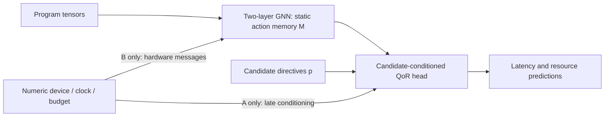

# Target-graph learning readiness

**Decision: CONDITIONAL GO.** The tensor and gradient interfaces work, and a
small candidate-conditioned model learns real measured variations. This pilot
does **not** establish an advantage for hardware-graph conditioning. Correct
measurement/action coverage and the prediction head's calibration before a
complete-corpus training run. The compiler/target graph needs no redesign here.

Full numerical results, input/code hashes and all loss-curve points are in
[verification.json](verification.json). These are CPU diagnostics, not new HLS
results, pretrained SALT improvements or target-generalization evidence.

## Assessment recorded before experiments

Base: `84e78a4`, from `research/target-aware-mlir-v22`. This isolated experiment
does not change the compiler graph, target overlay, profile registry, measurements,
family split or trained checkpoints. V2.2 RC3 is technically frozen; its independent
human semantic review remains open.

The five implementation hashes and RC3 archive SHA-256 match the committed
`docs/target-aware-mlir-v22/final-verification.json`. Its recorded full-corpus
validation covers 63 canonical/compact pairs, 592 matched of 606 registered
actions, 14 unresolved registrations and deterministic reconstruction. Hardware
enrichment adds five nodes per graph (one FPGA and four resource classes), six
relation categories, validated numerical capacities/budgets and requested clock.
These are compatible-resource links, not proven HLS bindings. The original
51,659 possible dependencies and six unknown concrete-access relationships remain.
Historical receipts are inherited evidence, not new full-corpus validation.

| Milestone | Status before this experiment |
|---|---|
| Validated compiler and hardware representation | Recorded receipts match current source; independent semantic review pending |
| Deterministic GNN tensors and action masks | Not implemented/tested yet |
| Hardware-to-action message and gradient path | Not demonstrated yet |
| Supervised learning with candidate directives | Not demonstrated for V2.2 |
| Better prediction or generalization to new targets | Not established |

The maintained V1 workflow uses `mlir_data.py`'s versioned 403-node/82-edge
feature schema, local five-field pragma vectors and padded configuration vectors.
Its model can inject pragma-dependent transformations, pool graph representations
for QoR heads and use numerical multi-device/clock conditioning. Training and
exports seal feature/split/checkpoint identities. The memory exporters preserve
absolute action slots, 128-D vectors and optional multiscale training-only RMS
normalization. Stage-2's `compiler_relational` route consumes Boolean visibility;
exported relation bits are not a typed attention model. This experiment reuses
those alignment principles, not V1 tensors, weights or pragma-injection behavior.

The model/data protocol will be frozen before training. Only development-family
SPCL stencil, MachSuite GEMM and SpMV are considered for the tiny measured pilot;
external evaluation kernels are excluded. Sampling uses configuration hashes,
not their QoR ranking. Train clocks are 3.33/10 ns; 5 ns is a final diagnostic,
never a checkpoint-selection signal. One seed (123), one architecture and a
fixed small optimizer budget are used. Unresolved actions remain registered,
with missing structural-evidence masks. No V1 weights or LLM weights are loaded.

Results, tensor schema, exact commands and the evidence-based recommendation
will be appended after execution. Large generated outputs stay in ignored
`results/`; no tensor caches or model weights will be committed.

Pre-training correspondence correction: SPCL `spcl_example_03` registers L1–L6
but its CSV/APL maps only L1/L2/L5/L6. The strict complete-assignment pilot rejects
that incomplete correspondence rather than inventing L3/L4 settings. Before
sampling/training, the simple-kernel choice was changed to `machsuite-stencil2d`,
whose four loop actions all have CSV mappings. No QoR ranking or model outcome
was used for this change. SPCL remains the tensorization/message-path test case.

## Tensor schema and model interface

Implementation: [tensor encoder](../../GNN_branch/target_graph_tensor_v22.py),
schema `salt-hls-target-tensors-v1-experimental`. The representation is a typed
homogeneous PyG `Data`: one tensor graph, with explicit node/edge type IDs. Its
fixed vocabulary is written in code, never fitted on an evaluation graph.

Eight node categories are retained: `operation`, `ssa_value`,
`constant_or_feature`, `control_region`, `memory_object`, `action_point`,
`hardware_target`, `hardware_resource`. Additional categorical embeddings describe
19 coarse operation kinds, eight lowered-type kinds, six storage-root kinds and
five resource kinds (including `none`). A future dialect maps to `other`, rather
than changing model dimensions.

All 28 forward relation types have distinct IDs:

```text
owns_region, contains_block, contains_operation, declares_argument,
next_operation, control_flow, defines, operand, literal, feature,
loop_carried, loop_child, calls, actual_to_formal, returns_to,
references, alias, resolves_to, memory_access, depends_on, targets,
analysis_summary,
hardware:belongs_to, target:arithmetic_compatible, target:storage_compatible,
target:loop_resource_relevance, target:action_resource_relevance,
target:requested_clock
```

Each positive edge also gets a **separate tensor-only** `reverse:<type>` ID,
giving 56 message types. Original direction and reverse direction remain
distinguishable; both retain the original edge key for finding compiler witnesses.
No compiler JSON is changed. Explicit `no_alias` records go into separate
negative-edge tensors and never create a positive or reverse message. Negative
tensors are preserved for inspection; this small GNN does not yet learn from them.

The node numerical vector has **36 columns: 18 value/knownness pairs**:

| Features | Meaning |
|---|---|
| Lowered width; memory volume/rank; source-array volume | Compiler type/shape information; lowered width is not a hardware-exact AP width |
| Loop depth/trip count; operand/result/use counts; constant | Structural/computational context; metadata upper bounds never replace unknown compiler trip counts |
| Physical/available capacity and available fraction | Numerical FPGA resource context; four resource classes have semantic type embeddings, not device-name embeddings |
| Clock; platform capacity; requested budget | Requested deployment inputs, with unknown platform/budget masks |
| Loop-action/array-action flags | Action category, separate from its source ID |

Except fractions, clock and action flags, numerical values use signed
`log2(1+abs(value))/24`. Clock uses `log2(period_ns/10)`. These scales are fixed,
not fitted on held-out data. A known zero has `[0,1]`; unknown has `[0,0]`.

The **24 edge columns** retain four compiler-evidence states, read/write/readwrite,
RAW/WAR/WAW, four alias kinds, root completeness with knownness, loop-carried
status with knownness, argument/operand position with knownness, concrete-access
status, through-call status, possible implementation and documented hardware.
Missing or nullable evidence is not coerced into a known negative. Root
completeness is encoded where directly present or exposed by overlay witnesses;
otherwise its knownness flag is false. Full call-scoped alternatives remain in
the source graph/public queries, not flattened into a guessed unique root.
For an overlay edge with several memory witnesses, the bit means all of those
represented witness sets are complete, not that every program invocation was
enumerated. Native `no_dependence` conclusions remain in compiler-analysis JSON;
they are not converted into message edges or dense negative-label features.

**Deliberate limits:** exact affine/index expressions, per-dimension view
offsets/strides, dependence intervals/carrying-loop identities, fine-grained SSA
forwarding roles, source-template arithmetic behavior and full call chains are
not all neural features in this first encoder. Original typed edges and witness
keys still locate that evidence in JSON. Auxiliary feature-token text is not
vectorized; actual constant operations and selected numeric attributes are.
Call IDs remain provenance keys: this GNN does not maintain a separate hidden
state for each invocation, and shared helper nodes can aggregate from several
calls. Learned messages must never be treated as call-specific alias proofs.
This is a documented coarse projection, not a lossless neural encoding of every
compiler fact. Compact inputs are expanded first so both views give identical
tensors; this deliberately postpones compact-tensor optimization.

Source paths, native IDs, hashes, evidence text and query fingerprints remain
audit/alignment data only. No chosen directives, latency, utilization, Pareto
weights or ADP values enter the static tensor encoder.

Matched actions have tensor-node indices and **absolute** `Lk → k−1` slots.
Registration, matching, unresolved and source-only masks are separate. Kalman
has 13 registered slots but only 11 structural vectors; slots 6/7 for L7/L8 stay
zero with unresolved masks. Missing targets do not invalidate source directives.
More than the requested slot count causes an error, never silent truncation.
Batching offsets node indices while leaving absolute action slots unchanged.
The output shape is `[batch, max_slots, 128]`; it is not a V1-compatible memory pack.

## Experiment 1: tensor integrity

Twelve authenticated graph/context combinations passed: stencil, LUD and external
Kalman under ZCU104/U200/U50 at 10 ns and ZCU104 at 6.67 ns. Checks include finite
features, valid endpoints, repeated construction, all action masks, reverse-edge
provenance, unchanged compiler features across contexts, and exact
canonical/compact tensor equality. No native corpus regeneration was needed.

| Program, ZCU104 / 10 ns | Tensor nodes | Message edges, including reverse | Separate negative edges | Tensor bytes | Audit time, s |
|---|---:|---:|---:|---:|---:|
| SPCL stencil | 100 | 422 | 5 | 70,556 | 0.456 |
| LUD | 1,484 | 6,410 | 9 | 1,044,892 | 9.314 |
| External Kalman | 546 | 2,244 | 7 | 371,580 | 2.678 |

Times include overlay creation, repeated tensorization, compact reconstruction
and integrity checks; they are not bare encoder throughput. All 12 checks took
49.78 s in total. Bytes count tensors, including masks and negative edges; Python
JSON evidence and temporary attention activations are additional memory. Tensor
features do not contain full evidence JSON records. In-memory input tensors are
reused during training; **trainable embeddings are recomputed at every step**.

All eight node categories and 27 of 28 forward categories occur in these real
examples (54 with reverses). `control_flow` and its reverse are covered by a
hand-authored tensor forward/backward test, not a new native CFG validation.
All 56 IDs execute with finite gradients. AES was not loaded for tensor or
learning experiments; no full-corpus encoding/scalability claim is made.

## Experiment 2: hardware-to-action path

The experimental GNN has two edge-aware `TransformerConv` layers, hidden size
64, two averaged attention heads, residual additions, layer normalization,
zero dropout, and a 128-D projection. Neither a learned device-ID embedding nor
a global target vector enters this encoder.

For the same stencil, normalized L2 distances between **aligned action memories**
and ZCU104/10 ns were:

| Changed context | Hardware messages enabled | Hardware messages removed |
|---|---:|---:|
| U200, 10 ns | 0.00504810 | 0 |
| U50, 10 ns | 0.00403418 | 0 |
| ZCU104, 6.67 ns | 0.00414720 | 0 |

For the DSP-relevant action L5, halving only the DSP-capacity tensor feature
gave L2 distance 0.00041599. This is a synthetic one-feature derivative/path test,
not a valid new vendor profile. A valid half-DSP budget on ZCU104, leaving its
physical capacity unchanged, gave 0.01260654. Clock was tested separately above.

Backpropagating a diagnostic L5 loss produced hardware-input gradient L1 norm
5.69523 and absolute DSP-capacity gradient 0.0529545. Removing all hardware
message edges made both exactly zero. Embeddings and parameter gradients were
finite. Batch extraction, sparse alignment and missing-slot zeros passed.
These results prove **a numerical information path**, not useful hardware reasoning
by random embeddings. U50/6.67 ns have no supervised or QoR evaluation here.

## Experiment 3: measured candidate-conditioned learning

### Data and frozen selection

The original `mailohls_final_family_split_s123.json` is unchanged. All three
selected families belong to its training partition. The 5 ns test is a context
diagnostic within these training families, **not a held-out-family benchmark**.
Source and metadata hashes match authenticated RC3 members, local headers match
their recorded hashes, and every measured action maps through CSV/APL/metadata
to a source label. Complete assignments pass the existing TCAD validator using
compiler-proven loop trip counts. Source/CSV/mapping hashes are recorded in
[verification.json](verification.json); per-design vendor synthesis/source hash
receipts are not available in these CSVs, so that stronger authentication is
not claimed.

| Kernel / released snapshot | Raw CSV rows | Valid rows before replicate aggregation | Unique effective measured points | Selected |
|---|---:|---:|---:|---:|
| `machsuite-stencil2d` / `624ee88fef89` | 1,437 | 1,364 | 551 | 96 |
| `machsuite-gemm-ncubed` / `8692fbcbe7b2` | 1,710 | 1,363 | 860 | 96 |
| `machsuite-spmv-ellpack` / `01a6b91f7611` | 240 | 240 | 168 | 96 |

The existing preprocessor filters nonfinite/failed labels, requires positive
latency and each resource percentage in `[0,100)`, canonicalizes directives and
takes medians of repeated effective configurations. Its Pareto/weight columns
are **unused**. There were zero additional TCAD exclusions for the final cohort.
The pilot samples the 16 lowest seeded configuration hashes per kernel/device/
clock, without ranking their QoR. No missing measurements are invented.

There are **192 training observations** (3.33 and 10 ns) and **96 diagnostic
observations** (5 ns), covering both ZCU104 and U200. Exact design-point keys
include kernel, assignment, device and clock and are disjoint across partitions.
However, 93/96 test assignments occur at another training context (stencil 32/32,
GEMM 29/32, SpMV 32/32). This mainly tests clock interpolation for familiar
configurations, not unseen directives. Only loop PIPE/UNROLL actions occur in
these complete-mapping learning samples; array-partition learning remains untested.

### Models and budget

Both models have **100,145 allocated trainable parameters**, identical initialized
weights, candidates, labels, normalization and Adam settings (lr 0.003, full
batch). One fixed seed, 123, is used. No hyperparameters were changed after
viewing the diagnostic results.

- **A, numerical:** hardware messages are disabled; the same capacities,
  available counts/fractions and clock enter the candidate head as 13 numbers.
- **B, enriched:** those numbers reach the static embeddings through graph
  messages; the head's separate 13-number input is zeroed.



The identical architecture keeps unused paths allocated: A's disconnected
hardware rows and B's zeroed late-context columns do not receive the same
effective training as their counterparts. Equal allocated parameter count does
not make these information paths architecturally identical; this is a small,
explicit conditioning-location comparison, not a perfectly matched active-parameter ablation.

The candidate head combines each static 128-D action vector with that action's
eight directive features, action category and matching mask, then pools over
registered actions. Candidate features never change reusable static memory.
Labels are `log1p(latency_ms × 1000)` and the four reported resource percentages
divided by 100. Label mean/std are fitted on training rows only; std has a
`1e-4` numerical floor. Fractions retain each device's physical denominator;
they are not raw resource counts. Zero percentages are not replaced by 1%.

### Subsequent action-demand interface (not part of this pilot)

The later compiler-grounded feature work introduces tensor schema
`salt-hls-target-tensors-v2-action-demand-experimental`, with a fixed static
per-action workload vector and knownness masks projected into the action node.
It also exposes `candidate_demand_tensor(target_overlay, complete_assignments, actions)`
and an optional separate candidate-demand input to the experimental head.
Candidate features are not added to pragma-free structural memory. This changed
experimental head has schema
`salt-hls-target-candidate-head-v2-demand-input-experimental`; old head weights
are not dimension-compatible. The measurements, model results, and
`salt-hls-target-tensors-v1-experimental` provenance reported above remain
unchanged and describe only the earlier pilot. The action-demand work did not
retrain or rescore either pilot model and has not demonstrated improved QoR
prediction or target generalization.

### Tiny same-context fit: eight stencil configurations

Both models pass the predeclared gate: final/initial MSE below 0.25, within-context
Spearman above 0.7 and nonconstant predictions. These are readiness thresholds,
not statistical significance tests. Each gets 250 optimizer updates, with a new
graph computation on every update.

| Step | A normalized MSE | B normalized MSE |
|---:|---:|---:|
| 0 | 0.713755 | 0.706792 |
| 50 | 0.699907 | 0.697848 |
| 100 | 0.692320 | 0.488942 |
| 150 | 0.561979 | 0.322065 |
| 200 | 0.321243 | 0.207945 |
| 250 | 0.161752 | 0.036224 |

Training latency MAPE is **9.24% A / 16.66% B**; Spearman is **0.9762 / 0.9524**.
Both select the best measured candidate in this eight-point set. B's lower
combined loss does not mean better latency prediction: it fits some resource
labels more closely. Neither fit is perfect. Graph and candidate-head gradients
are finite and nonzero; candidate changes affect predictions while static graph
features stay fixed. Runtime is 2.69 s A / 2.71 s B.

### Fixed-budget context diagnostic

Fresh A/B models train for exactly 180 updates on the 192 training rows; only
the final models are evaluated at 5 ns. No test-clock checkpoint selection occurs.

| Step | A training MSE | B training MSE |
|---:|---:|---:|
| 0 | 0.806580 | 0.802108 |
| 60 | 0.555448 | 0.569929 |
| 120 | 0.523853 | 0.528491 |
| 180 | 0.504981 | 0.421703 |

| Held-out 5 ns metric | A, numerical | B, enriched |
|---|---:|---:|
| Latency MAPE | 118.10% | 121.67% |
| Context-macro Spearman | 0.5863 | 0.5392 |
| Mean measured top-choice latency regret | 120.11% | 120.11% |
| BRAM MAE, percentage points | 0.000319 | 0.000150 |
| DSP MAE, percentage points | 4.065 | 3.670 |
| FF MAE, percentage points | 3.613 | 3.203 |
| LUT MAE, percentage points | 4.427 | 4.684 |
| Measured feasible rows / all diagnostic rows | 96 / 96 | 96 / 96 |
| Predicted resource vectors within physical `[0,1]` bounds | 32 / 96 | 32 / 96 |

All 288 selected BRAM labels are reported **0%**; tiny BRAM MAE is not evidence
of useful memory-cost prediction. Raw resource outputs are unconstrained and can
be negative or exceed capacity. Such outputs are prediction/calibration problems,
not evidence that these measured feasible candidates fail synthesis. The latency
head is also substantially underfit under this deliberately short budget.

Per-context 5 ns latency diagnostics (A/B):

| Kernel / target | MAPE, % | Spearman | Measured selected regret, % |
|---|---:|---:|---:|
| Stencil / U200 | 69.37 / 81.58 | 0.763 / 0.735 | 0 / 0 |
| Stencil / ZCU104 | 85.37 / 81.27 | 0.678 / 0.640 | 0 / 0 |
| GEMM / U200 | 194.29 / 178.44 | 0.636 / 0.618 | 712.96 / 712.96 |
| GEMM / ZCU104 | 87.67 / 95.09 | 0.444 / 0.265 | 7.73 / 7.73 |
| SpMV / U200 | 124.83 / 151.27 | 0.493 / 0.481 | 0 / 0 |
| SpMV / ZCU104 | 147.06 / 142.41 | 0.504 / 0.496 | 0 / 0 |

Regret compares only the 16 measured candidates in that context; it is not
regret against the complete design space. Both models select identical-QoR top
choices here; GEMM dominates the poor aggregate regret. Context correlations
handle ties and omit undefined constant-target correlations. A/B runtime is
7.43 / 7.71 s. Total optimization time for the two phases is 20.53 CPU seconds.

**Interpretation:** there is a functioning learning path, but this pilot shows
no consistent enriched-graph advantage over numerical conditioning. One seed,
three training-family kernels, familiar assignments and an unseen intermediate
clock cannot establish statistical or cross-device generalization. No new HLS,
U50/6.67 ns supervised test, GNN production training, LLM inference, Stage-1/2
training or DPO was performed.

## Recommendation and next boundary

**CONDITIONAL GO for a larger controlled experiment, not an immediate full run.**

1. Audit complete CSV-to-action correspondence across the intended training
   subset; handle unmeasured actions explicitly rather than silently inventing
   no-directive labels. Include a small authenticated partition-action sample
   before claiming array-partition learnability.
2. On training/development data only, establish a candidate head with stable
   latency fitting and physically interpretable nonnegative resource outputs.
   Freeze the next small budget/acceptance rules before examining test results.
   This is head/data readiness work, not a reason to rewrite compiler semantics.
3. Then compare numerical A against enriched B with the original family split,
   comparable capacity and the same data/optimizer budget. Address omitted
   symbolic/index/state features deliberately before freezing a full tensor
   schema; do not call this pilot a completed encoder ablation.

No current evidence justifies replacing V1, retraining SALT, or exporting these
128-D vectors into existing Stage-2 packs. The frozen Stage-1 latency directory
is preserved: all eight files were checked against its original recorded hashes.
Independent human review of RC3 is still open. Target correctness and predictive
usefulness remain different questions.

## Reproduction and tests

All work is on `research/target-graph-readiness`, based on the requested research
branch. A separate worktree preserves the Stage-1 repair checkout's dirty files.
The project environment lacked PyG; the older installed PyG environment used
Python 3.7 and could not import the current directive API (`math.isqrt`). The
final runs use an isolated Python **3.10.20** environment inheriting the existing
PyTorch **2.6.0+cu124**, with PyG **2.6.1**, SciPy **1.15.3**, NumPy **2.2.6**,
NetworkX **3.4.2**, and one Torch CPU thread. CUDA is unavailable; no GPU
correctness, speed or memory claim is made. No production packages were replaced.

From the repository root, use fresh output paths:

```bash
BASE=/home/elvouvali/miniforge3/envs/mailohls-llm-v2/bin/python
"$BASE" -m venv --system-site-packages /tmp/mailohls-graph-readiness-env
PY=/tmp/mailohls-graph-readiness-env/bin/python
"$PY" -m pip install torch-geometric==2.6.1 scipy==1.15.3

"$PY" -B -m GNN_branch.target_graph_v22 authenticate \
  --archive GNN_branch/MLIR_graphs/salt-hls-graphs-v22-20261027-rc3.tar.gz \
  --output-dir /tmp/salt-readiness-release

"$PY" -B -m pytest -q -p no:cacheprovider \
  tests/test_target_graph_readiness.py tests/test_target_graph_v22.py --tb=short

"$PY" -B -m experiments.target_graph_readiness.experiment --mode all \
  --release-dir /tmp/salt-readiness-release --output-dir /tmp/salt-readiness-s123
```

For individual stages replace `--mode all` with `prepare`, `audit`, `smoke`, or
`pilot`. Default mode is `audit`, with no learning. `--per-context` is bounded
to 4–32, and both step limits are bounded to 300. Defaults reproduce this pilot:
16/context, 250 overfit steps, 180 diagnostic-training steps, seed 123.

The run writes sealed `protocol.json` and `data_protocol.json`, exact
`observations.json`, `tensor_audit.json`, `message_smoke.json`, per-model losses
and metrics, and combined results. It refuses changed source/input contracts
in a reused output directory. It stores input tensors only in process memory;
no detached trainable embedding cache or production checkpoint is used. Repeating
a pilot reruns the bounded fit; it does not resume an optimizer checkpoint.
The full learning curves are the `curve` arrays in per-model JSON and the
committed verification receipt. Timings are environment-dependent.

**Tests actually executed:** 20 new readiness tests and 58 existing overlay
tests, **78 passed, zero failed/skipped**, in 36.71 s. They cover real authenticated
inputs, nullable evidence, known zeros, negative aliases, compact equality,
batch/slot alignment, every typed message, gradients, and separate candidate
conditioning. Initial development failures (nullable `loop_carried`, an integrity
test that correctly rejected modified source payloads, and incomplete SPCL
measurement correspondence) were corrected in the experimental layer or test
setup; no historical validator or graph was weakened. Historical 63-graph/native
regression receipts are authenticated inherited evidence, not newly run tests.

## Methodological references and their limits

- Official MLIR [Affine](https://mlir.llvm.org/docs/Dialects/Affine/),
  [MemRef](https://mlir.llvm.org/docs/Dialects/MemRef/),
  [SCF](https://mlir.llvm.org/docs/Dialects/SCFDialect/) and
  [Func](https://mlir.llvm.org/docs/Dialects/Func/) describe the compiler entities
  whose evidence this projection reads. No new analysis is inferred from tensors.
  [DLTI](https://mlir.llvm.org/docs/Dialects/DLTIDialect/) and
  [Data Layout](https://mlir.llvm.org/docs/DataLayout/) concern target/layout
  metadata; they do not prove HLS resource binding or scheduling.
- PyG 2.6.1 [TransformerConv](https://pytorch-geometric.readthedocs.io/en/2.6.1/generated/torch_geometric.nn.conv.TransformerConv.html)
  supports edge attributes; [typed graphs/reverses](https://pytorch-geometric.readthedocs.io/en/2.6.1/notes/heterogeneous.html)
  and [batching](https://pytorch-geometric.readthedocs.io/en/2.6.1/advanced/batching.html)
  guide distinct reverse types and the separate handling of node indices/slots.
- [ScaleHLS](https://arxiv.org/abs/2107.11673) motivates multiple compiler levels;
  its optimizer and analytical model are not implemented here.
- [Ferretti et al., TODAES](https://doi.org/10.1145/3570925) motivates predicting
  measured outcomes conditioned on configurations; its published accuracy is
  not evidence for this overlay.
- [HARP](https://par.nsf.gov/servlets/purl/10539416) motivates separating program
  structure from transformations; no HARP weights or learned pragma transformer
  are used.
- [Chariot, author-affiliated abstract](https://scholars.cityu.edu.hk/en/publications/compiler-aware-heterogeneous-graph-learning-for-hls-qor-predictio/)
  motivates exact directive-target correspondence and typed relations. The
  accessible abstract was consulted; a full-text implementation comparison was
  not performed, and no Chariot performance claim is transferred to this work.
- [Alon and Yahav](https://arxiv.org/abs/2006.05205) explain long-range message
  bottlenecks. Passing a short hardware-path test does not establish that two
  layers capture every relevant program dependency.

## Follow-on semantic tensor schema

The committed pilot and its results use the recorded
`salt-hls-target-tensors-v2-action-demand-experimental` schema. They remain
unchanged and are not results for the later semantic encoder. The current
`GNN_branch/target_graph_tensor_v22.py` emits
`salt-hls-target-tensors-v3-semantic-experimental`: it preserves the same
two-layer `TransformerConv`, hidden/output widths, typed relations, target
context, static action-demand vectors and absolute action slots, while adding
compiler-derived semantic channels to edge messages and a static
action-neighborhood summary. V3 edge-input dimensions and learned feature
projections differ, so V2 pilot model states are not compatible and must not be
loaded as if they had received these features.

Candidate-dependent workload/banking features remain a separate optional input
to `CandidatePredictor`; neither V3 static semantic vectors nor the 128D action
memory include proposed directive assignments. The V3 implementation has been
checked for deterministic tensorization, authenticated representative RC3
graphs, canonical/compact equality, action masks and gradient flow. This
validates information preservation and model connectivity only. No new
training run or QoR experiment was performed, and the pilot's CONDITIONAL GO
result is unchanged.

The later semantic-coverage repair introduces tensor schema
`salt-hls-target-tensors-v4-semantic-wide-affine-experimental`, which removes
the former fixed affine-input cap without changing feature dimensions. This
does not change the tensors, checkpoints, measurements, or conclusions recorded
in this pilot; the pilot remains tied to its original V2/V3 schema provenance.
See [`docs/target-aware-mlir-v22/semantic-coverage-repair.md`](../../docs/target-aware-mlir-v22/semantic-coverage-repair.md)
for the authenticated corpus audit and remaining quasi-affine/dependence
limitations.
