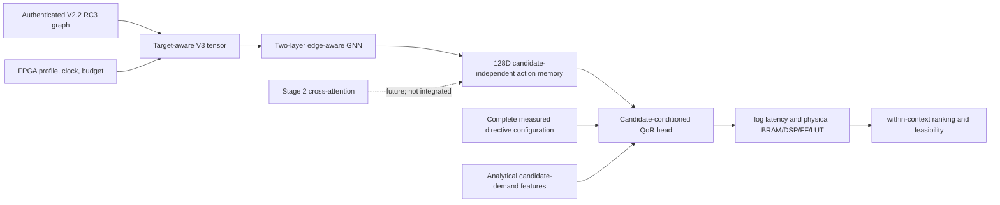

# V2.2 target-aware GNN training

**Status: A2 execution pending.** The experiment implementation and data
correspondence audit are prepared, but neither model arm has been trained and
no QoR or ranking result is claimed. The Codex execution environment does not
have a working NVIDIA driver. An SSH attempt from this environment could not
verify liono's host key, so no command has been run there. The user reports
liono's physical GPU 0 is an idle 15 GB NVIDIA A2 and GPU 1 is a V100S running
another job; only physical GPU 0 is to be used. The liono driver/runtime and
PyTorch/PyG stack still need verification from the user's existing liono
terminal.

## What the experiment is meant to test

The experiment compares two matched candidate-conditioned regressors:

1. **Numerical conditioning:** V2.2 compiler graph, static action workload and
   semantic edge features; messages touching FPGA/resource nodes removed;
   numeric device, clock and budget context enters the prediction head.
2. **Hardware message passing:** the same encoder and head, with graph messages
   through the FPGA/resource nodes enabled. It receives the same late numeric
   target context as arm 1.

Both arms use the same complete directive assignments, candidate-demand input,
loss, measured records, optimizer and seed. The existing V3 encoder remains a
two-layer `TransformerConv` and returns 128D absolute-slot action memories.
Candidate directives and candidate-demand descriptors enter only the QoR
head; they are never attached to the static graph memory.

Both arms use the same target/context vector. Only the numerical arm's graph
edge set differs. An earlier draft zeroed the late context for the numerical
arm, which changed two conditioning pathways at once; the current trainer
retains identical numeric context in both arms.



The implementation predicts `log(1 + latency_ms)` and `log(1 + physical
resource count)`, standardized using **training rows only**. The resource
fractions in GNΩSIS are converted to physical counts using the authenticated
profile. A budget never changes these labels. Inference applies `expm1` and a
zero lower bound, so predicted physical latency and resources are nonnegative.
There is no cap at device capacity.

The objective is:

\[
\mathcal L = \operatorname{SmoothL1}(\hat y,y)
              + 0.1\,\mathcal L_{pairwise}.
\]

The pairwise logistic term is formed only among candidates from one
kernel/device/clock group and only when measured scores differ by more than 5%
relative. It is minimized for the repository objectives `PARETO_LATENCY`,
`PARETO_AREA`, and `PARETO_ADP`. Area is the existing arithmetic mean of the
four physical utilization fractions; ADP ordering within a fixed clock is
equivalent to latency times that area proxy. Feasibility comes only from
measured resource counts against an explicit budget. The implemented budget
contexts are 100% and 50% of physical capacities; QoR labels are repeated
unchanged across them.

## Authenticated data audit

The preflight reconstructs the compact GNΩSIS JSONL from the committed
preprocessed tables and verifies its hash against the selected manifest and
seed-123 family split. It authenticates every one of the 55 GNΩSIS source,
metadata, local-header, APL, CSV and graph chains against the frozen 63-snapshot
MLIR V2.2 RC3 release. It validates measured assignments with the shared
source-aware directive-domain implementation.

| Audit item | Verified count/result |
|---|---:|
| Raw CSV records | 219,864 |
| Existing preprocessing-valid measurements | 175,874 |
| Aggregated unique design points | 150,026 |
| Authenticated graph snapshots / matched GNΩSIS kernels | 63 / 55 |
| Seed-123 split | 50 train / 4 validation / 1 test kernels |
| Split records | 130,310 train / 13,011 validation / 6,705 test |
| Complete source-domain-valid assignments | 149,227 |
| Records excluded: APL action has no measured CSV column | 45,080 |
| Records excluded: source-aware joint tuple violation | 799 |
| Records eligible after explicit exclusions | 104,147 |
| Compiler-unresolved action rows retained with source values and masks | 8,258 |
| External-device/clock records in the selected training JSONL | 0 |

Rows from a kernel with an action lacking an APL measurement column are
excluded: preprocessing writes the source action's disabled default into the
serialized target, but that is not a measured directive label. We do not infer
it. The 799 invalid joint tuples (300 at L3, 339 at L4 and 160 at L6) are
excluded rather than repaired. In contrast, source-measured values for
compiler-unresolved but registered actions are retained as candidate inputs;
their compiler-derived action embeddings remain masked. The eligible split is
88,466 train / 8,976 validation / 6,705 test records, across 37 / 3 / 1
kernels respectively. The test remains Kalman alone, so this is a narrow
held-out-family evaluation even after it becomes runnable.

The full machine-readable report is [data-audit.json](data-audit.json). Its
graph archive SHA256 is
`feb2c2d469bf6672248ad0f3a88099ac9627b3b10b8e139a0fab050d532a1b73`; the
reconstructed selected dataset SHA256 is
`afdf4af8e6defc559871a6ec92185e6321313979ff3f1495806e5b037d5ab820`.
The audit was executed on base commit
`21ed70492e74e167354c1cb21d5a499e2f434014`; its code hashes are embedded in
the report. A real training protocol additionally records the then-current
commit, dirty-tree state and source hashes for the encoder, demand analysis,
overlay and training entry point.

## Candidate and target inputs

The complete assignment includes PIPELINE, UNROLL and ARRAY_PARTITION type,
factor and dimension values in absolute `Lk -> k-1` slots. The full assignment
is checked against the existing source-specific TCAD tuples. The separate
candidate-demand tensor is obtained from `candidate_demand_tensor()` and
contains the existing nominal unroll, arithmetic/access and supported banking
features with their knownness encoding. These are analytical descriptors, not
synthesized operator counts, memory ports or schedules.

Static compiler memory remains identical when candidates differ. The
candidate-demand tensor is supplied directly to the candidate head in every
training and evaluation call. No gold directive winners, Pareto ranks or
measured QoR values are features.

## Training and evaluation protocol

The default optimizer is AdamW (`3e-4`, weight decay `1e-4`), gradient norm
clipping at 1, seed 123, 8 candidate configurations per update, and up to 8,000
updates per model arm. Training samples one kernel/device/clock group per
update, then samples candidates within that context. It samples one of the
three repository objectives and one of two explicit budget contexts.

Validation evaluates up to 256 configurations per context in deterministic
configuration-hash order every 500 updates. The validation selection score is
`0.4 * feasibility_error + 0.2 * ranking_error + 0.2 * bounded_regret + 0.2 *
bounded_QoR_error`, macro-averaged across validation contexts. Feasibility
error uses both budget levels; ranking error is normalized Spearman error over
PARETO_LATENCY/AREA/ADP; QoR error combines latency MAPE and normalized
physical-resource MAE. Test metrics are computed once after validation
checkpoint selection. The selected validation step and metrics are saved with
the checkpoint. The evaluator reports objective-specific Spearman/Kendall
correlation, measured-pool regret/top-1, and feasibility accuracy/false-feasible
rate at both budget levels. These paths have not run on an A2.

The readiness pilot's historic three-kernel results are not modified or
reinterpreted. That pilot did not include family-held-out evaluation and did
not pass candidate-demand tensors during its original training loop. Its
metrics are not results for this training implementation.

## Reproduction

Requirements are the repository-compatible Python/PyTorch/PyG environment,
CUDA driver/runtime, and authenticated V2.2 RC3 release. On liono, expose the
idle physical A2 as the only visible GPU. Verify the device and environment
first; do not select physical GPU 1, which is the active V100S.

```bash
CUDA_VISIBLE_DEVICES=0 nvidia-smi
CUDA_VISIBLE_DEVICES=0 python - <<'PY'
import torch
import torch_geometric
assert torch.cuda.is_available()
assert torch.cuda.device_count() == 1
assert 'A2' in torch.cuda.get_device_name(0)
x = torch.ones(1024, device='cuda:0')
torch.cuda.synchronize()
print({'torch': torch.__version__, 'pyg': torch_geometric.__version__,
       'cuda_runtime': torch.version.cuda,
       'device': torch.cuda.get_device_name(0), 'gpu_sum': x.sum().item()})
PY
```

If PyTorch/PyG is missing or incompatible, create a separate experiment
environment and match project-supported versions; do not alter the environment
used by the active Stage-1 job. The trainer records actual versions and refuses
to train without CUDA or into a nonempty output directory. Candidate count can
be reduced with the existing `--candidates` option if measured A2 memory
requires it.

```bash
# Extract to a fresh temporary directory. The audit checks the release manifest
# and each graph member hash before admitting measured rows.
test ! -e /tmp/salt-v22-training-release
mkdir /tmp/salt-v22-training-release
tar -xzf GNN_branch/MLIR_graphs/salt-hls-graphs-v22-20261027-rc3.tar.gz \
  -C /tmp/salt-v22-training-release

# Recheck the dataset, split, action correspondence, and graph release.
test ! -e /tmp/v22-gnn-data-audit-a2.json
PYTHONPATH=. python -m experiments.v22_gnn_training.audit \
  --release-dir /tmp/salt-v22-training-release \
  --output /tmp/v22-gnn-data-audit-a2.json

# Profile small, medium, and AES graphs, then take one disposable optimizer
# update per model arm on real measured training candidates. No checkpoint is
# written by this preflight.
test ! -e /tmp/v22-a2-memory-profile.json
CUDA_VISIBLE_DEVICES=0 PYTHONPATH=. python -m experiments.v22_gnn_training.profile_memory \
  --release-dir /tmp/salt-v22-training-release \
  --output /tmp/v22-a2-memory-profile.json

# Train the numerical and hardware-message arms. The output must be fresh.
CUDA_VISIBLE_DEVICES=0 PYTHONPATH=. python -m experiments.v22_gnn_training.train \
  --release-dir /tmp/salt-v22-training-release \
  --output mailohls_runs/v22_target_aware_gnn_s123_a2 \
  --steps 8000 --candidates 8
```

The Codex CPU-only run audited the data and exercised one Stencil2D
candidate-conditioned forward/backward. Its tensor had 81 nodes, 304 positive
messages and 234,988 bytes; CPU tensorization plus candidate-demand
construction took 0.24 s. CHStone AES tensorization took 50.7 s and produced
60,297,588 CPU tensor bytes (4,209 nodes, 107,732 positive messages). These
are not GPU memory or update-time measurements. The new `profile_memory` entry
point measures A2 allocation for small/medium/AES graphs and performs one
disposable labeled optimizer update per arm using real measured candidates.
It refuses a non-A2 device, records OOM instead of dropping a graph, and
creates no model checkpoint. No A2 measurements exist yet.

## Checkpoint and Stage-2 memory contract

Selected checkpoints are written only under the fresh ignored output directory
and carry graph, overlay, tensor, demand and candidate-head schema identifiers,
normalization statistics and validation/test metric records. The encoder's
candidate-independent action memory remains `[1, 64, 128]` with registered,
matched, unresolved and source-only masks. Candidate-demand features and
measured QoR are not exported. Target/context-specific memory cache keys must
include graph identity, profile, clock and budget. No Stage-2 loader or training
integration is included here.

## Current outcome and limitations

No baseline or hardware-aware V2.2 GNN checkpoint, selected validation model,
held-out test metric, or prediction-quality comparison exists yet. The current
result is therefore **TRAINING BLOCKED**, not a competitive or positive
scientific result. The A2 GPU and NVIDIA driver are not accessible in this
runtime, so CUDA forward/backward, GPU memory measurement, and model training
could not be performed. The exact next step is to run the commands above from
the liono terminal with the compatible isolated PyTorch/PyG environment,
inspect peak memory on AES, and then complete both arms' validation-selected
training and final Kalman-family test evaluation.

Even after that run, Kalman is one test family; U50 and 6.67 ns remain outside
the training contexts and are needed for claims about target generalization.
The graph does not provide a synthesis-exact resource-binding or schedule
model, and Stage-2 remains future work. Nothing here establishes improved QoR
or target generalization.
