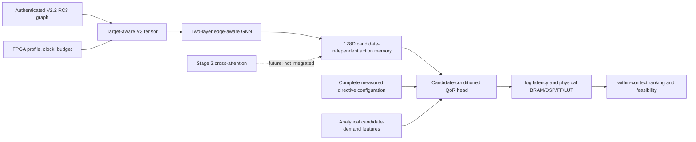

# V2.2 target-aware GNN training

**Experiment state:** the previous V100S attempt remains an incomplete
historical run with no trained checkpoints or QoR conclusion. Its output is
preserved at `/tmp/v22-target-aware-gnn-s123-v100-20261029`. This task repairs
resume safety, verifies the complete data contract, and runs the A2 preflight
before starting a fresh detached comparison. Current outcomes are recorded in
[`RESULTS.md`](RESULTS.md); the audit and exact configuration are in
[`AUDIT.md`](AUDIT.md) and [`RUN_PROTOCOL.md`](RUN_PROTOCOL.md).

The active Stage-1 diagnostics and prior run are not overwritten. The A2 is
selected by its GPU UUID because CUDA ordinal mappings can differ from
`nvidia-smi` indices. The detached launcher checks model identity, free memory,
utilization and existing compute processes and refuses to share a busy device.

## What the experiment is meant to test

The experiment compares two matched candidate-conditioned regressors:

1. **Numerical conditioning:** V2.2 compiler graph, static action workload and
   semantic edge features; messages touching FPGA/resource nodes removed;
   numeric device, clock and budget context enters the prediction head.
2. **Hardware message passing:** the same encoder and head, with graph messages
   through the FPGA/resource nodes enabled. It receives the same late numeric
   target context as arm 1.

Both arms use the same complete directive assignments, candidate-demand input,
loss, measured records, optimizer and seed. The existing V3 encoder remains a
two-layer `TransformerConv` and returns 128D absolute-slot action memories.
Candidate directives and candidate-demand descriptors enter only the QoR
head; they are never attached to the static graph memory.

Both arms use the same target/context vector. Only the numerical arm's graph
edge set differs. An earlier draft zeroed the late context for the numerical
arm, which changed two conditioning pathways at once; the current trainer
retains identical numeric context in both arms.

The implementation predicts `log(1 + latency_ms)` and `log(1 + physical
resource count)`, standardized using **training rows only**. The resource
fractions in GNΩSIS are converted to physical counts using the authenticated
profile. A budget never changes these labels. Inference applies `expm1` and a
zero lower bound, so predicted physical latency and resources are nonnegative.
There is no cap at device capacity.

The objective is:

\[
\mathcal L = \operatorname{SmoothL1}(\hat y,y)
              + 0.1\,\mathcal L_{pairwise}.
\]

The pairwise logistic term is formed only among candidates from one
kernel/device/clock group and only when measured scores differ by more than 5%
relative. Its predicted monotonic `log1p` score is divided by a robust
within-training-context score spread, fitted on training records only. This
fixes the mismatch between physical units and a shared pairwise-loss
coefficient without changing ranking direction or using validation/test data.
The coefficient remains 0.1. Area is the existing arithmetic mean of the four
physical utilization fractions; ADP ordering within a fixed clock uses latency
times that area proxy. Feasibility comes only from measured resource counts
against an explicit budget. Budget contexts are 100% and 50% of physical
capacities; QoR labels remain unchanged across them.

## Authenticated data audit

The preflight reconstructs the compact GNΩSIS JSONL from the committed
preprocessed tables and verifies its hash against the selected manifest and
seed-123 family split. It authenticates every one of the 55 GNΩSIS source,
metadata, local-header, APL, CSV and graph chains against the frozen 63-snapshot
MLIR V2.2 RC3 release. It validates measured assignments with the shared
source-aware directive-domain implementation.

| Audit item | Verified count/result |
|---|---:|
| Raw CSV records | 219,864 |
| Existing preprocessing-valid measurements | 175,874 |
| Aggregated unique design points | 150,026 |
| Authenticated graph snapshots / matched GNΩSIS kernels | 63 / 55 |
| Seed-123 split | 50 train / 4 validation / 1 test kernels |
| Split records | 130,310 train / 13,011 validation / 6,705 test |
| Complete source-domain-valid assignments | 149,227 |
| Records excluded: APL action has no measured CSV column | 45,080 |
| Records excluded: source-aware joint tuple violation | 799 |
| Records eligible after explicit exclusions | 104,147 |
| Compiler-unresolved action rows retained with source values and masks | 8,258 |
| External-device/clock records in the selected training JSONL | 0 |

Rows from a kernel with an action lacking an APL measurement column are
excluded: preprocessing writes the source action's disabled default into the
serialized target, but that is not a measured directive label. We do not infer
it. The 799 invalid joint tuples (300 at L3, 339 at L4 and 160 at L6) are
excluded rather than repaired. In contrast, source-measured values for
compiler-unresolved but registered actions are retained as candidate inputs;
their compiler-derived action embeddings remain masked. The eligible split is
88,466 train / 8,976 validation / 6,705 test records, across 37 / 3 / 1
kernels respectively. The test remains Kalman alone, so this is a narrow
held-out-family evaluation even after it becomes runnable.

The machine-readable fresh audit is in the preflight output directory linked
from [`AUDIT.md`](AUDIT.md). Its
graph archive SHA256 is
`feb2c2d469bf6672248ad0f3a88099ac9627b3b10b8e139a0fab050d532a1b73`; the
reconstructed selected dataset SHA256 is
`afdf4af8e6defc559871a6ec92185e6321313979ff3f1495806e5b037d5ab820`.
The audit verifies source/metadata/APL/CSV/graph correspondence. The training
protocol rechecks it and binds the resulting identities to the experiment.

## Candidate and target inputs

The complete assignment includes PIPELINE, UNROLL and ARRAY_PARTITION type,
factor and dimension values in absolute `Lk -> k-1` slots. The full assignment
is checked against the existing source-specific TCAD tuples. The separate
candidate-demand tensor is obtained from `candidate_demand_tensor()` and
contains the existing nominal unroll, arithmetic/access and supported banking
features with their knownness encoding. These are analytical descriptors, not
synthesized operator counts, memory ports or schedules.

Static compiler memory remains identical when candidates differ. The
candidate-demand tensor is supplied directly to the candidate head in every
training and evaluation call. No gold directive winners, Pareto ranks or
measured QoR values are features.

## Training and evaluation protocol

The default optimizer is AdamW (`3e-4`, weight decay `1e-4`), gradient norm
clipping at 1, seed 123, 8 candidate configurations per update, and up to 8,000
updates per model arm. Training samples one kernel/device/clock group per
update, then samples candidates within that context. It samples one of the
three repository objectives and one of two explicit budget contexts.

Validation evaluates up to 256 configurations per context in deterministic
configuration-hash order every 500 updates. The validation selection score is
`0.4 * feasibility_error + 0.2 * ranking_error + 0.2 * bounded_regret + 0.2 *
bounded_QoR_error`, macro-averaged across validation contexts. Feasibility
error uses both budget levels; ranking error is normalized Spearman error over
PARETO_LATENCY/AREA/ADP; QoR error combines latency MAPE and normalized
physical-resource MAE. Test metrics are computed once after validation
checkpoint selection. The selected validation step and metrics are saved with
the checkpoint. The evaluator reports objective-specific Spearman/Kendall
correlation, measured-pool regret/top-1, and feasibility accuracy/false-feasible
rate at both budget levels. These paths have not run on an A2.

The readiness pilot's historic three-kernel results are not modified or
reinterpreted. That pilot did not include family-held-out evaluation and did
not pass candidate-demand tensors during its original training loop. Its
metrics are not results for this training implementation.

## Reproduction

The complete versioned protocol, isolated runtime, authenticated graph release,
safe detached launch, monitoring and exact resume commands are in
[`RUN_PROTOCOL.md`](RUN_PROTOCOL.md). The verified runtime is an isolated
Python 3.10.20 environment using existing CUDA PyTorch 2.6.0+cu124, PyG 2.6.1
and SciPy 1.15.3. The launcher selects and pins a GPU by UUID, not by assumed
CUDA ordinal, and refuses a busy GPU. It requires a clean source branch and a
new output directory.

The A2 profile completed forward/backward/update checks for Stencil2D, GEMM,
and AES without OOM. AES tensorization is 60,297,588 CPU bytes; full measured
candidate update peaked at 656,113,664 allocated CUDA bytes (about 626 MiB).
The real-candidate preflight exercised all three objectives on both arms and
recorded finite loss, candidate/demand gradients, hardware-relation gradients,
and ranking-gradient ratios. See [`AUDIT.md`](AUDIT.md) and the raw JSON paths
there for actual figures.

## Checkpoint and Stage-2 memory contract

Selected checkpoints are written only under the fresh ignored output directory
and carry graph, overlay, tensor, demand and candidate-head schema identifiers,
normalization statistics and validation/test metric records. The encoder's
candidate-independent action memory remains `[1, 64, 128]` with registered,
matched, unresolved and source-only masks. Candidate-demand features and
measured QoR are not exported. Target/context-specific memory cache keys must
include graph identity, profile, clock and budget. No Stage-2 loader or training
integration is included here.

## Current outcome and limitations

The previous V100S attempt produced no model checkpoints; it remains preserved
and is not resumed because it used the pre-resumability protocol. The current
branch has passed data authentication, focused regression tests and A2 memory
and measured-update preflight. Whether the fresh paired training has launched
or completed is tracked in [`RESULTS.md`](RESULTS.md), which is updated only
from run status and measured output.

Even after that run, Kalman is one test family; U50 and 6.67 ns remain outside
the training contexts and are needed for claims about target generalization.
The graph does not provide a synthesis-exact resource-binding or schedule
model, and Stage-2 remains future work. Nothing here establishes improved QoR
or target generalization.
