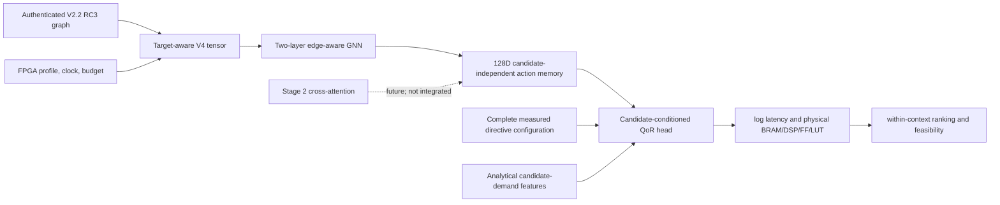

# V4 target-aware GNN training

**Current state (2026-11-01):** the bounded directive-preference study has
completed on the A2. Three matched 300-update arms compared compiler-only
memory, zero-gated device/clock FiLM modulation, and the existing hardware
message graph on 1,344 training and 288 validation measurements. The
hardware-message model did not improve held-out ADP preference accuracy or
measured-pool regret over compiler-only memory. FiLM had a small preference
accuracy gain but worse feasible top-1 and top-1 regret. The validation set has
no meaningful device or clock winner changes, and all three models failed to
identify the 21 meaningful budget-driven winner changes. This is evidence
against a current hardware-aware memory benefit, with only two validation
families and one seed. See the latest study in [`RESULTS.md`](RESULTS.md),
auditing in [`AUDIT.md`](AUDIT.md), and the current decision in
[`NEXT_STEPS_BRIEF.md`](NEXT_STEPS_BRIEF.md). Exact outputs are linked below.

The earlier 20-update QoR pilot, 100/300/600-update QoR studies and
budget-independent QoR ablation remain historical, unchanged. No experimental
V4 memory was integrated into Stage 2; the production V1 memory and checkpoints
are untouched. The V100S was not used.

## What the experiment is meant to test

The experiment compares two matched candidate-conditioned regressors:

1. **Numerical conditioning:** V2.2 compiler graph, static action workload and
   semantic edge features; messages touching FPGA/resource nodes removed;
   numeric device, clock and budget context enters the prediction head.
2. **Hardware message passing:** the same encoder and head, with graph messages
   through the FPGA/resource nodes enabled. It receives the same late numeric
   target context as arm 1.

Both arms use the same complete directive assignments, candidate-demand input,
loss, measured records, optimizer and seed. The V4 encoder remains a
two-layer `TransformerConv` and returns 128D absolute-slot action memories.
V4 widens affine-map semantic support without changing tensor dimensions or
frozen graph contents.
Candidate directives and candidate-demand descriptors enter only the QoR
head; they are never attached to the static graph memory.

Both arms use the same target/context vector. Only the numerical arm's graph
edge set differs. An earlier draft zeroed the late context for the numerical
arm, which changed two conditioning pathways at once; the current trainer
retains identical numeric context in both arms.



The implementation predicts `log(1 + latency_ms)` and `log(1 + physical
resource count)`, standardized using **training rows only**. The resource
fractions in GNΩSIS are converted to physical counts using the authenticated
profile. A budget never changes these labels. Inference applies `expm1` and a
zero lower bound, so predicted physical latency and resources are nonnegative.
There is no cap at device capacity.

The objective is:

\[
\mathcal L = \operatorname{SmoothL1}(\hat y,y)
              + 0.1\,\mathcal L_{pairwise}.
\]

The pairwise logistic term is formed only among candidates from one
kernel/device/clock group and only when measured scores differ by more than 5%
relative. Its predicted monotonic `log1p` score is divided by a robust
within-training-context score spread, fitted on training records only. This
fixes the mismatch between physical units and a shared pairwise-loss
coefficient without changing ranking direction or using validation/test data.
The coefficient remains 0.1. Area is the existing arithmetic mean of the four
physical utilization fractions; ADP ordering within a fixed clock uses latency
times that area proxy. Feasibility comes only from measured resource counts
against an explicit budget. Budget contexts are 100% and 50% of physical
capacities; QoR labels remain unchanged across them.

## Authenticated data audit

The preflight reconstructs the compact GNΩSIS JSONL from the committed
preprocessed tables and verifies its hash against the selected manifest and
seed-123 family split. It authenticates every one of the 55 GNΩSIS source,
metadata, local-header, APL, CSV and graph chains against the frozen 63-snapshot
MLIR V2.2 RC3 release. It validates measured assignments with the shared
source-aware directive-domain implementation.

| Audit item | Verified count/result |
|---|---:|
| Raw CSV records | 219,864 |
| Existing preprocessing-valid measurements | 175,874 |
| Aggregated unique design points | 150,026 |
| Authenticated graph snapshots / matched GNΩSIS kernels | 63 / 55 |
| Seed-123 split | 50 train / 4 validation / 1 test kernels |
| Split records | 130,310 train / 13,011 validation / 6,705 test |
| Complete source-domain-valid assignments | 149,227 |
| Records excluded: APL action has no measured CSV column | 45,080 |
| Records excluded: source-aware joint tuple violation | 799 |
| Records eligible after explicit exclusions | 104,147 |
| Compiler-unresolved action rows retained with source values and masks | 8,258 |
| External-device/clock records in the selected training JSONL | 0 |

Rows from a kernel with an action lacking an APL measurement column are
excluded: preprocessing writes the source action's disabled default into the
serialized target, but that is not a measured directive label. We do not infer
it. The 799 invalid joint tuples (300 at L3, 339 at L4 and 160 at L6) are
excluded rather than repaired. In contrast, source-measured values for
compiler-unresolved but registered actions are retained as candidate inputs;
their compiler-derived action embeddings remain masked. The eligible split is
88,466 train / 8,976 validation / 6,705 test records, across 37 / 3 / 1
kernels respectively. The test remains Kalman alone, so this is a narrow
held-out-family evaluation even after it becomes runnable.

The machine-readable fresh audit is in the preflight output directory linked
from [`AUDIT.md`](AUDIT.md). Its
graph archive SHA256 is
`feb2c2d469bf6672248ad0f3a88099ac9627b3b10b8e139a0fab050d532a1b73`; the
reconstructed selected dataset SHA256 is
`afdf4af8e6defc559871a6ec92185e6321313979ff3f1495806e5b037d5ab820`.
The audit verifies source/metadata/APL/CSV/graph correspondence. The training
protocol rechecks it and binds the resulting identities to the experiment.

## Candidate and target inputs

The complete assignment includes PIPELINE, UNROLL and ARRAY_PARTITION type,
factor and dimension values in absolute `Lk -> k-1` slots. The full assignment
is checked against the existing source-specific TCAD tuples. The separate
candidate-demand tensor is obtained from `candidate_demand_tensor()` and
contains the existing nominal unroll, arithmetic/access and supported banking
features with their knownness encoding. These are analytical descriptors, not
synthesized operator counts, memory ports or schedules.

Static compiler memory remains identical when candidates differ. The
candidate-demand tensor is supplied directly to the candidate head in every
training and evaluation call. No gold directive winners, Pareto ranks or
measured QoR values are features.

## Training and evaluation protocol

The default optimizer is AdamW (`3e-4`, weight decay `1e-4`), gradient norm
clipping at 1, seed 123, 8 candidate configurations per update, and up to 8,000
updates per model arm. Training samples one kernel/device/clock group per
update, then samples candidates within that context. It samples one of the
three repository objectives and one of two explicit budget contexts.

Validation evaluates up to 256 configurations per context in deterministic
configuration-hash order every 500 updates. The validation selection score is
`0.4 * feasibility_error + 0.2 * ranking_error + 0.2 * bounded_regret + 0.2 *
bounded_QoR_error`, macro-averaged across validation contexts. Feasibility
error uses both budget levels; ranking error is normalized Spearman error over
PARETO_LATENCY/AREA/ADP; QoR error combines latency MAPE and normalized
physical-resource MAE. Test metrics are computed once after validation
checkpoint selection. The selected validation step and metrics are saved with
the checkpoint. The V4 evaluator reports objective-specific Spearman/Kendall
correlations and undefined reasons, top-1/3/5/10 measured-pool feasible
selection and regret, false-feasible selections, empty-pool outcomes and
budget-induced QoR shifts. Periodic validation remains a deterministic subset
and labels subset regret explicitly. The frozen checkpoint-selection score is
unchanged. If every ranking correlation is undefined, its predeclared score
uses an explicit neutral zero correlation fallback; the report marks that
fallback and gives defined/undefined counts and reasons. The bounded evaluation described in `RESULTS.md` ran on the A2; the full
8,000-update protocol and full 104,147-record candidate-pool evaluation remain
unrun.

The readiness pilot's historic three-kernel results are not modified or
reinterpreted. That pilot did not include family-held-out evaluation and did
not pass candidate-demand tensors during its original training loop. Its
metrics are not results for this training implementation.

## Learnability and target-conditioning follow-up (2026-11-01)

The fixed-context diagnostic used the existing V4 model, RC3 graph and one
training-family context (Stencil2D, ZCU104, 10 ns). It trained on 24 distinct
measured assignments selected by complete-assignment Hamming diversity without
using QoR for selection. Regression-only loss fell from standardized SmoothL1
0.3363 for the constant predictor to 0.0940 after 1,000 updates. Latency MAE
fell from 0.4023 ms to 0.2479 ms; within-set Spearman was 0.701. The model's
predicted best was 1.05% above the best measured latency, but it did not select
the exact best assignment. This establishes candidate-dependent memorization
on this set, not held-out learning.
The separate 200- and 1,000-update manifests/results, including selected
assignment hashes and checkpoint identities, are in
[`results/fixed_context_learnability_200_s123_manifest.json`](results/fixed_context_learnability_200_s123_manifest.json),
[`results/fixed_context_learnability_s123_manifest.json`](results/fixed_context_learnability_s123_manifest.json),
[`results/fixed_context_learnability_200_s123_results.json`](results/fixed_context_learnability_200_s123_results.json),
and [`results/fixed_context_learnability_s123_results.json`](results/fixed_context_learnability_s123_results.json).

A separate 100-update comparison used 5 training families and 2 held-out
validation families, each across ZCU104/U200 and 3.33/5/10 ns. It compared the
same V4 graph encoder with hardware-resource messages enabled or removed, plus
a small candidate/demand/numerical-context MLP. The graph arms shared the exact
initial weights and 100-update sampling trace. The fixed-step results were not
selected on validation. The MLP is a simple control, not a parameter-matched
ablation (338,053 parameters versus 116,081 for either graph model).

The 480 training records use 16 directive assignments per kernel shared across
all six target contexts. Validation contains 180 records: 16 hash-selected
Viterbi assignments per context and the 14 PathFinder assignments shared
across all six. Validation assignment selection did not inspect QoR. The test
family (Kalman) was excluded from training, selection and evaluation. Exact
identities and overlap counts are in
[`results/target_coverage_audit_s123.json`](results/target_coverage_audit_s123.json)
and [`results/target_condition_probe_s123_manifest.json`](results/target_condition_probe_s123_manifest.json).

| Validation measure (12 kernel/device/clock groups) | Candidate + target | Numerical GNN | Hardware GNN |
|---|---:|---:|---:|
| Latency MAPE, macro | 0.6888 | 0.6126 | 0.6066 |
| Latency MAE, ms, macro | 6.4723 | 6.5538 | 6.3968 |
| Resource MAE / capacity `[BRAM,DSP,FF,LUT]` | `[.02395,.00071,.04305,.21402]` | `[.02395,.00104,.04314,.21046]` | `[.02395,.00104,.04314,.21095]` |
| Latency Spearman, macro | 0.2360 | 0.0791 | 0.1473 |
| Latency Kendall, macro | 0.2231 | 0.0494 | 0.1098 |
| Latency top-1 measured-pool regret, macro | 7.3810 | 0.2865 | 2.3451 |
| Latency top-3 measured-pool regret, macro | 0.2755 | 0.0605 | 0.0029 |
| 100% budget accuracy / always-feasible baseline | 1.000 / 1.000 | 1.000 / 1.000 | 1.000 / 1.000 |
| 50% budget accuracy / always-feasible baseline | .816 / .816 | .816 / .816 | .816 / .816 |
| 50% false-feasible assignments / selected actually feasible | 31 / 9 of 12 | 31 / 10 of 12 | 31 / 9 of 12 |

Latency top-1 regret is highly context-sensitive: the hardware arm is best on
top-3 but has much worse macro top-1 regret than the numerical arm. Under the
50% budget all arms have the same accuracy as predicting every candidate
feasible, so that score is not evidence of a learned feasibility rule. At 100%
all selected candidates are feasible by construction of the measured pool.
Area/ADP regret is undefined in one Viterbi/U200/5 ns context because its
measured optimum is exactly zero; the corrected summary excludes that one
context (11/12 defined), rather than reporting a huge epsilon-denominator
percentage. The raw output is preserved and the corrected, denominator-aware
summary is in [`results/target_condition_probe_s123_summary.json`](results/target_condition_probe_s123_summary.json).

Exact target pairing supports 91 assignment-pair observations across 10 clock
comparison groups and 45 across 5 device comparison groups, from only two
validation kernels. These pairs overlap and are not independent samples. On
PathFinder, the hardware arm gets the clock-change sign right in many paired
cases but has large absolute paired-delta errors; it gets the device-change
latency sign wrong in all three device groups. Viterbi intersections are sparse
(one to three selected assignments per nonempty pair). These are weak target
response diagnostics, not evidence of cross-device generalization.

The hardware relation rows receive finite nonzero mean gradient norm
`1.04e-4`; the numerical arm receives zero for those rows. Disabling hardware
edges in the trained hardware model changes action memories (mean relative
L2 shift 0.509), selected latency candidates in 10/12 validation contexts, and
macro latency Spearman from 0.147 enabled to -0.220 disabled. Yet enabled
messages worsen mean top-1 latency regret from 0.697 to 2.345. Thus the path is
used, but its contribution is mixed and does not show a reliable selection
benefit. This ablation is distinct from the separately trained numerical arm.

Predicted physical QoR changes when only the requested budget changes for the
same candidate/device/clock. Mean absolute predicted latency shifts are 0.0124
ms (candidate MLP), 0.1105 ms (numerical GNN), and 0.1417 ms (hardware GNN).
This violates the desired physical-QoR budget invariance, even though measured
labels are reused unchanged. It is evidence for a future, separately versioned
model contract with physical QoR conditioned on program/candidate/device/clock
and feasibility derived against the requested budget. No V4 schema or graph was
changed in this diagnostic.

**Interpretation:** V4 can memorize some candidate-dependent QoR on one fixed
context. The 100-update cross-family experiment does not establish accurate
QoR, target-aware device response, or a consistent incremental benefit from
hardware messages. The hardware arm is not ready for Stage-2 use. The next
smallest useful step is a predeclared 300–600 update continuation of the exact
same deterministic three-arm cohort when the A2 is available, followed by the same
validation protocol. Do not change graph features, loss or target semantics
simultaneously.

The run completed on the A2 UUID
`GPU-1a87c5a7-652d-d582-29e8-a5fccb11ce35` in 7.56 seconds GPU time after
94.96 seconds of authenticated data loading and 136.59 seconds of feature
preparation. Selected graph, assignment and demand tensors were precomputed
once in memory and shared across arms and validation; this follow-up did not
write a reusable on-disk tensor cache. Peak CUDA allocation was not recorded.
Model weights and raw run artifacts remain in `/tmp`; tracked receipts include
raw output, corrected summary and exact cohort identities. Reproduction commands and
checksums are in [`RESULTS.md`](RESULTS.md) and [`AUDIT.md`](AUDIT.md).

## Reproduction

The complete versioned protocol, isolated runtime, authenticated graph release,
safe detached launch, monitoring and exact resume commands are in
[`RUN_PROTOCOL.md`](RUN_PROTOCOL.md). The verified runtime is an isolated
Python 3.10.20 environment using existing CUDA PyTorch 2.6.0+cu124, PyG 2.6.1
and SciPy 1.15.3. The launcher selects and pins a GPU by UUID, not by assumed
CUDA ordinal, and refuses a busy GPU. It requires a clean source branch and a
new output directory.

Previous V3 A2 profiling completed forward/backward/update checks for
Stencil2D, GEMM and AES without OOM. AES tensorization was 60,297,588 CPU
bytes; its measured-candidate update peaked at 656,113,664 allocated CUDA
bytes. These are historical V3-compatible results, not V4 GPU validation.
See [`AUDIT.md`](AUDIT.md) for provenance.

## Checkpoint and Stage-2 memory contract

Selected checkpoints are written only under the fresh ignored output directory
and carry graph, overlay, tensor, demand and candidate-head schema identifiers,
normalization statistics and validation/test metric records. The encoder's
candidate-independent action memory remains `[1, 64, 128]` with registered,
matched, unresolved and source-only masks. Candidate-demand features and
measured QoR are not exported. Target/context-specific memory cache keys must
include graph identity, profile, clock and budget. No Stage-2 loader or training
integration is included here.

The V4 memory is not compatible with V1 memory checkpoints. It is trained for
candidate-conditioned QoR, while Stage-2 needs candidate-independent memory
that improves directive generation. Any future Stage-2 study must compare
Stage-1 prompt-only, Stage-2 with production V1 memory, V4 numerical memory,
and V4 hardware memory on identical directive-generation cases. The current
probe gives no evidence to replace the production V1 memory.

## Current outcome and limitations

The earlier V100S smoke is preserved and failed at its first validation because
`Counter` was missing from the evaluator imports; it completed five numerical
updates and produced no selected checkpoint. That import defect is fixed. A
separate early cohort attempt exposed missing measured action columns for
Sort-Radix L6, so that validation kernel was excluded rather than assigned a
fabricated label. The replacement Viterbi cohort is fully mapped. The A2 was
verified idle before completed probes. A later corrected-report retry was
refused when an unrelated VLLM process occupied it; no GPU process was
signalled.

Even after that run, Kalman is one test family; U50 and 6.67 ns remain outside
the training contexts and are needed for claims about target generalization.
The graph does not provide a synthesis-exact resource-binding or schedule
model, and Stage-2 remains future work. Nothing here establishes improved HLS synthesis QoR
or target generalization.

## Branch provenance

The consolidated branch `research/gnn-refinement` includes the resumable trainer from
`bf93db9`; semantic coverage corrections/audits from `26c2247` are incorporated
without changing the frozen RC3 program graph or hardware-overlay schemas.
The current tensor schema is `salt-hls-target-tensors-v4-semantic-wide-affine-experimental`.
It keeps dimensions, action slots, candidate/static separation and the two-layer
encoder. Existing corpus values are unchanged where the earlier cap was never
exceeded; new verified wider affine maps are no longer masked unnecessarily.

Original V3 GPU preflight receipts above remain historical; they are not V4 GPU
measurements. A V3 checkpoint or old worktree is not a V4 checkpoint. The
schema/source/protocol checks reject incompatible resume. The current V4 run
status and any QoR conclusion are reported only in `RESULTS.md`.

The complete catalog is recovered with `scripts/artifacts.py restore-git` from
original commit `42f52df`; its history is retained here. The Hotspot export is
retained at commit `4a308a0`, including its authenticated archive and guide.
Original research heads are preserved as provenance parents after deliberately
selecting their current modules, not by importing their old runtime/data trees.

## Design decisions and rationale

| Decision | Alternatives considered | Why selected | What remains unchanged | Validation |
|---|---|---|---|---|
| Keep numerical device, clock and budget context in both arms | Make the numerical arm target-free | Isolates hardware-resource relational messages as the experimental variable | Candidate head, labels and all other inputs | CPU tensor-equivalence and model-path tests |
| Keep hardware nodes but remove every edge touching them in the numerical arm | Remove nodes or zero their features | Preserves IDs while blocking hardware-node information; pooling includes compiler nodes only | Program-node features and absolute action slots | CPU test mutates a hardware feature and verifies numerical action memories stay fixed |
| Record initial parameter hashes and per-update sampled identities | Assume equal seed means identical training | Makes initialization and sampling parity auditable and fails fast on divergence | Seed, sampler and optimizer settings | Deterministic unit test plus run-time pair checks |
| Preserve the existing validation-selection score | Select a new metric after observing results | Avoids outcome-driven checkpoint selection | Existing 0.4/0.2/0.2/0.2 score | Selection-score regression; expanded metrics are report-only |
| Count false-feasible and empty-pool outcomes; retain undefined correlations | Average only successful picks or silently substitute a rank score | Keeps failures and undefined populations visible | Physical feasibility and measured-pool objective definitions | Focused empty-pool, tie and false-feasible tests |
| Add regression-only fixed-context memorization before target generalization | Treat validation failure as proof the GNN cannot learn | Separates candidate-head learnability from family generalization | V4 encoder, graph and output schema | 24-design training-only probe; constant baseline and train-set rank |
| Freeze all-six-context assignment intersections for training; use hash-only validation selection | Select favorable validation QoR or use loose directive similarity | Makes true clock/device pairs observable without validation-label selection | RC3 graphs, dataset and family split | Exact SHA assignment intersections in target-coverage audit |
| Add a non-graph candidate/demand/target MLP only as a diagnostic | Compare graph models only | Checks whether candidate plus numeric target can explain these labels | Candidate and target feature contract | Same selected measured validation pools; parameter-count difference disclosed |
| Mark relative regret undefined at near-zero measured optima | Divide by an arbitrary epsilon | Avoids enormous meaningless area/ADP percentages | Raw predictions and measured labels | Authenticated zero area/ADP optimum in Viterbi/U200/5 ns; focused unit test |

V4 checkpoints and optimizer states are incompatible with V3 and must use a
fresh protocol identity. This experiment does not change the frozen compiler
graphs, target overlay, candidate-demand contract, training split or production
V1 GNN. Prior V3 GPU measurements remain historical and are not V4 results.


## Bounded V4 fast probe (2026-11-01)

The previous full-corpus validation path repeatedly enriched candidates and
recomputed demand descriptors for thousands of rows. The fast probe uses the
existing V4 tensorizer, encoder, candidate head, loss and evaluator, but
authenticates a fixed small cohort and computes each selected graph/context,
complete directive vector and candidate-demand tensor once. A hashed cache is
shared by both arms and all validation calls. Cache keys bind the RC3 graph,
V4 schema, source/action mapping, feature implementation, target context,
assignment and demand schema. Equality checks compare cached values with the
public V4 construction paths. This changes when features are computed, not
what information the models receive.

| Decision | Alternative | Reason and scientific effect | Validation |
|---|---|---|---|
| Precompute 112 selected candidates and 28 graph tensors | Recompute each validation | Avoid repeated compiler feature work while preserving exact inputs | 28 graph, 112 candidate-vector and 112 demand equality checks |
| Keep V4 graph/tensor schemas unchanged | Add/derive new semantic features | Isolate existing hardware-message representation | RC3 archive and tensor schema hashes recorded in cohort manifest |
| Use five training kernels and two validation kernels from distinct held-out families | Random row split or test-family tuning | Test transfer to two represented unseen families without splitting related kernel rows | Seed-123 family membership checked before selection |
| Select training candidates by directive Hamming diversity; validation candidates by hash order | Select validation winners using QoR | Training diversity is useful; validation labels must not choose the pool | Selection rules and candidate hashes frozen in manifest |
| Use 20 matched updates per arm, seed 123 | Continue the old 8,000-step plan | Bound the diagnostic; assess feasibility before a larger study | Identical initial-state and sample-trace hashes |
| Run one hardware-edge ablation after matched training | Add model variants | Check whether the learned hardware path changes representations and decisions | Embedding/prediction/ranking deltas recorded |

Exact inputs and results: [`fast_probe_s123_cohort_manifest.json`](results/fast_probe_s123_cohort_manifest.json) and
[`fast_probe_s123_summary.json`](results/fast_probe_s123_summary.json). Model
weights and the detailed update journal stay outside Git at
`/tmp/v22-gnn-v4-fast-probe-s123-r4/training/`. Reproduction commands:

```bash
PYTHONPATH=. /tmp/mailohls-v22-gnn-env-20261030/bin/python \
  -m experiments.v22_gnn_training.fast_probe prepare \
  --release-dir /tmp/salt-v22-training-release \
  --output /tmp/v22-gnn-v4-fast-probe-s123-r5 \
  --preparation-limit-seconds 600

CUDA_VISIBLE_DEVICES=GPU-1a87c5a7-652d-d582-29e8-a5fccb11ce35 PYTHONPATH=. \
  /tmp/mailohls-v22-gnn-env-20261030/bin/python \
  -m experiments.v22_gnn_training.fast_probe run \
  --output /tmp/v22-gnn-v4-fast-probe-s123-r5 \
  --run-output /tmp/v22-gnn-v4-fast-probe-s123-r5/training \
  --gpu-name A2 --gpu-uuid GPU-1a87c5a7-652d-d582-29e8-a5fccb11ce35 \
  --updates 20 --candidates-per-update 8 --gpu-limit-seconds 1200
```

The first attempt selected Sort-Radix, whose L6 registration has no
authenticated measured column; it failed explicitly and was preserved. The
final manifest instead uses Viterbi and PathFinder baseline validation graphs.
No test-split measurements were loaded into the cohort cache.

## Corrected 300-update evidence and design decisions

The follow-up corrected target-difference scoring: a latency delta is
meaningful only when it exceeds `max(1e-5 ms, 1% of the larger paired
latency)`. The absolute tolerance corresponds to one 10 ns cycle expressed in
milliseconds. Exact complete-assignment hashes are required. Near-zero pairs
are excluded from sign accuracy but retained in error summaries. The
zero-area/ADP audit traced nine Viterbi/U200/5 ns measurements to source CSV
rows whose four utilization fields are present and literally zero. Conversion
is consistent with those recorded percentages; unavailable sub-percent raw
counts prevent deciding whether the values are exact or rounded. The labels
were preserved and relative regret at zero optimum remains undefined.

The matched 300-update models improved some ranking measures, but not
consistently. Hardware latency Spearman improved from 0.147 at 100 updates to
0.392 at 300; its top-1 regret remained 2.345, and latency MAPE rose from
0.607 to 1.001. All arms predict every 50%-budget candidate feasible, matching
the always-feasible baseline (149/180 correct). Meaningful device evidence is
only 3 of 45 exact pairs; the remaining 42 are near-zero. The numerical GNN
gets the direction of clock changes right in 0.958 of the meaningful pairs,
but its paired-delta MAE is still 7.29 ms. The hardware arm's clock direction
accuracy is 0.042. These results do not establish reliable target response.

The original V4 model also lets the requested budget change predicted
physical QoR. The separately versioned physical-QoR/budget-separation run
reduced this drift below `5e-7 ms`, but did not consistently improve
validation: hardware latency Spearman fell to 0.243 and top-1 regret rose to
6.457. Budget separation fixes a semantic inconsistency; it does not prove
better learning.

| Problem | Evidence | Decision | Alternatives | Test/result |
|---|---|---|---|---|
| Target-difference threshold compared a delta with itself | Any nonzero delta almost always passed | Threshold against original paired latency and one-cycle absolute tolerance | Keep defective test | Synthetic boundary tests; 91/91 clock pairs meaningful, only 3/45 device pairs |
| Zero area/ADP optimum | Nine raw rows have present, literal zero utilization values | Preserve labels; use null relative regret and report absolute regret | Add an arbitrary epsilon or infer hidden counts | Provenance audit found no conversion defect |
| Physical QoR changed with budget | Original V4 shifts latency by 0.412 ms (numerical) and 0.629 ms (hardware) between 100% and 50% budget | Test a separately versioned budget-independent QoR pathway | Rewrite historical V4 | Drift < `5e-7 ms`; selection did not improve consistently |
| Hardware messages may be undertrained | 300-step hardware ranking improves, while other metrics and edge ablation are mixed | Keep current graph and encoder | Add layers, relations, or gates | Edge ablation results differ between formulations; utility is unproven |

Exact receipts are in `RESULTS.md`. The original 300-update run used seed 123,
the frozen cohort, and 20.66 GPU seconds on A2; data loading and feature
preparation took 94.28 s and 144.47 s. The budget-independent run took 18.70
GPU seconds and preserved the same sample trace and initial graph-model
parameters under a separate schema. Checkpoints and raw reports remain
outside Git. The model remains experimental; candidate-conditioned QoR
prediction does not validate V4's candidate-independent action memory for
Stage-2.

A fresh 600-update run subsequently showed that the graph models can fit the
fixed training context (latency MAE fell from about 1.15 to 0.34 ms), but
held-out metrics were mixed or worse than at 300 updates. Hardware-arm latency
Spearman was 0.243 and top-1 regret 2.618 at 600, compared with 0.392 and
2.345 at 300. At 600, the numerical arm predicted clock-change signs correctly
on 95.8% of meaningful pairs but had 7.32 ms paired-delta MAE. Hardware had
59.5% sign accuracy and 7.37 ms MAE. Candidate memorization therefore works;
target-difference magnitude and family-held-out QoR remain unreliable. The
authenticated training cohort offers 480 exact assignment clock pairs and 240
device pairs before filtering, so one predeclared clock-difference supervision
ablation is justified. Device transfer remains weakly evaluated. See the 600
step receipts and limitations in `RESULTS.md`.

## Directive-preference memory probe (2026-11-01)

This newest experiment changes the primary outcome from absolute QoR regression
to pairwise ranking of complete measured directive assignments. It compares
three candidate-independent memory paths with one shared, shallow preference
scorer:

1. **Compiler-only:** the V4 encoder with edges touching hardware nodes
   removed. The scorer still receives numerical device, clock, budget and
   objective context.
2. **Target-FiLM:** compiler-only memory with a zero-initialized gated
   modulation from authenticated device capabilities and requested clock. The
   requested budget and objective remain in the scorer.
3. **Hardware messages:** the existing V4 hardware-resource nodes and typed
   edges, plus the same numerical scorer context as arm 1.

The GNN memory is generated before a candidate is known. Candidate assignments
and analytical demand enter only the common scorer. No QoR, preference label or
selected-winner feature enters the memory. The scored objective is ADP by
default; latency and the existing area proxy are supplementary tasks. A
feasible candidate outranks an infeasible one; two infeasible candidates do
not form an objective pair; feasible objective pairs within 5% are ties and
are omitted. The lower model score means preferred. This pairwise ranking
probe is not DPO and does not modify the Stage-3 workflow.

The cohort is 14 training kernels across 12 families (1,344 measurement rows)
and three validation kernels across two disjoint families (288 rows). Each
selected kernel/target has up to 16 complete measured assignments; contexts
with less support are not padded with fabricated measurements. The fixed
validation pool includes ZCU104/U200 at 3.33, 5 and 10 ns and budget views at
100/75/50/25/10%. Budget views share physical measurements and are correlated.
No Kalman/test rows were loaded. The frozen cohort, pair audit and target
coverage receipt are under
[`results/directive_preference_v1/`](results/directive_preference_v1/).

One-time CPU preparation authenticates and tensorizes each of the 102
kernel/device/clock graph contexts, then prepares candidate vectors and demand
descriptors once. A run-scoped cache is shared by all arms and validation
calls, so compiler enrichment is not repeated during validation. The current
run checked cached versus existing construction on one candidate per graph
context and exercised multi-candidate cache reuse in the focused tests; this is
not a claim that every one of the 1,632 assignments was independently
re-materialized for equality. Cache artifacts remain outside Git. The cache is
bound to the cohort manifest; it is not a general-purpose reusable cache.

All arms use seed 123, AdamW (`3e-4`, `1e-4` decay), the same 300 sampled
updates and preference-pair trace, and validation at 100/200/300. Checkpoint
selection uses validation-only ADP preference accuracy, macro-averaged over
validation families. All three selected step 100. Compiler and
hardware-message models each have 107,565 parameters; target-FiLM has 171,694.
No parameter-matched FiLM control was run, so its small preference-accuracy
gain cannot be attributed solely to conditioning instead of added capacity.

### Latest result and design decisions

| Decision | Alternatives | Reason | Scientific impact | Test/result |
|---|---|---|---|---|
| Train complete-action preference pairs as primary | Regress every physical QoR label as primary | The intended output is directive selection; physical QoR regression was already studied | Measures preference and measured-pool selection directly | Fixed pool and validation pair reports; full details in `RESULTS.md` |
| Use a small zero-gated FiLM arm | Add device IDs, a larger FPGA graph, or more GNN layers | Tests a simple transferable-profile modulation without changing RC3 | Isolates a low-complexity target-memory path | Gate gradients and matched/mismatched-memory selection ablation |
| Keep budget/objective in the scorer, not structural memory | Generate a distinct memory for every request | Budget is a feasibility limit and objective is a decision request | Memory remains physical-context-specific and candidate-independent | Budget preference reversals are evaluated on exact candidate intersections |
| Freeze 14 train / 3 validation kernels before training | Select kernels from favorable validation results | Structural support and target coverage were used; validation QoR was not | Limits leakage but leaves only two validation families | Authenticated cohort and source/graph identities |
| Stop at 300 updates per arm | Run thousands of updates or tune one arm | Predeclared bounded comparison showed weak validation changes and the A2 budget was ample | One-seed pilot only; no convergence claim | Same initialization and pair trace hashes across arms |
| Defer richer hardware topology and Stage-2 integration | Promote V4 memory based on gradients or score changes | Neither hardware messages nor target-FiLM improved feasible selection consistently | Avoids equating pathway activity with directive utility | Correct/zero/shuffled/global/mismatched memory selection results |

On validation, pair accuracy was 0.6714 for compiler-only, 0.6824 for
target-FiLM, and 0.6663 for hardware messages. Primary ADP pair accuracy was
0.7222/0.7246/0.7126. ADP top-1 measured-pool regret was
0.3412/0.5319/0.4439, respectively; feasible top-1 selection succeeded in
85/88 contexts for compiler and hardware messages and 83/88 for FiLM. The
target-conditioned arms did not correctly identify any of 21 meaningful
budget-driven winner changes in the held-out coverage report. Validation has
zero meaningful device or clock winner changes, so those axes cannot establish
general target response. Correct memory changed many decisions relative to
zero memory, but shuffled/global memory was often comparable; this supports
some use of nonzero structural features, not a reliable advantage from action
alignment or target conditioning. Full values, per-family results and the
paired memory ablation are in [`RESULTS.md`](RESULTS.md).

The exact completed launch used `/tmp/MailoHLS-gnn-directive-preference-ba6f39a`
at source commit `fdd66e63db1ec40cb6ed11e23590ee93541c07b2`, the pinned Python
3.10.20/PyTorch 2.6.0+cu124/PyG 2.6.1 environment, and A2 UUID
`GPU-1a87c5a7-652d-d582-29e8-a5fccb11ce35`. The durable output and hashes are
recorded in `RESULTS.md`; model weights, full cache and the 39 MB raw result
remain outside Git. V4 remains unsuitable for Stage-2 integration: action
memory has not shown stable held-out target-conditioned selection gains, and
the new feature space is not compatible with V1-trained cross-attention.
