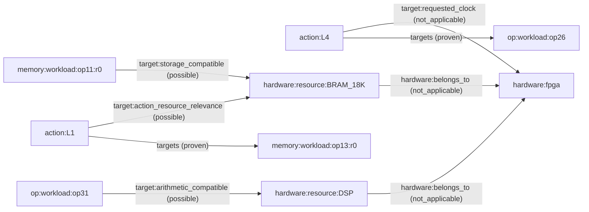

# rodinia-backprop-0-baseline-forward-b0198e97c7a5

[Back to all graphs](../../README.md)

RC3 snapshot.

| Representation | Nodes | Edges | File |
| --- | ---: | ---: | --- |
| MLIR canonical | 219 | 426 | [canonical JSON.gz](canonical.json.gz) |
| MLIR + hardware canonical | 224 | 486 | Select a target below |
| MLIR compact | 184 | 391 | [compact JSON.gz](compact.json.gz) |
| MLIR + hardware compact | 189 | 451 | Select a target below |

Actions: **6/6 compiler-matched/registered**. Unresolved: none.

Review [sealed source, headers and metadata](../../sources/b0198e97c7a564838d82e829d95a9c050a0827093b5628d7f9bc7af94c98aae6/), [raw MLIR](module.mlir), [exact action registrations](action-points.json), [hardware nodes and every added edge, including evidence](hardware-review.json). The hardware excerpt uses ZCU104, 10 ns, full capacity. Actual mappings remain unknown.

A small, exact neighborhood (all node IDs and edges are copied from the stored graphs):

[Exact nodes, edges and evidence behind this diagram](graph-neighborhood.json). `proven` describes a compiler relationship; `possible` describes hardware compatibility. The clock edge is a requested constraint, not a mapping or feasibility result.

| Device | Clock (ns) | Full canonical graph | Full compact graph |
| --- | ---: | --- | --- |
| u200 | 3.33 | [JSON.gz](hardware/u200/3p33ns_full/canonical.json.gz) | [JSON.gz](hardware/u200/3p33ns_full/compact.json.gz) |
| u200 | 5 | [JSON.gz](hardware/u200/5ns_full/canonical.json.gz) | [JSON.gz](hardware/u200/5ns_full/compact.json.gz) |
| u200 | 6.67 | [JSON.gz](hardware/u200/6p67ns_full/canonical.json.gz) | [JSON.gz](hardware/u200/6p67ns_full/compact.json.gz) |
| u200 | 10 | [JSON.gz](hardware/u200/10ns_full/canonical.json.gz) | [JSON.gz](hardware/u200/10ns_full/compact.json.gz) |
| u50 | 3.33 | [JSON.gz](hardware/u50/3p33ns_full/canonical.json.gz) | [JSON.gz](hardware/u50/3p33ns_full/compact.json.gz) |
| u50 | 5 | [JSON.gz](hardware/u50/5ns_full/canonical.json.gz) | [JSON.gz](hardware/u50/5ns_full/compact.json.gz) |
| u50 | 6.67 | [JSON.gz](hardware/u50/6p67ns_full/canonical.json.gz) | [JSON.gz](hardware/u50/6p67ns_full/compact.json.gz) |
| u50 | 10 | [JSON.gz](hardware/u50/10ns_full/canonical.json.gz) | [JSON.gz](hardware/u50/10ns_full/compact.json.gz) |
| zcu104 | 3.33 | [JSON.gz](hardware/zcu104/3p33ns_full/canonical.json.gz) | [JSON.gz](hardware/zcu104/3p33ns_full/compact.json.gz) |
| zcu104 | 5 | [JSON.gz](hardware/zcu104/5ns_full/canonical.json.gz) | [JSON.gz](hardware/zcu104/5ns_full/compact.json.gz) |
| zcu104 | 6.67 | [JSON.gz](hardware/zcu104/6p67ns_full/canonical.json.gz) | [JSON.gz](hardware/zcu104/6p67ns_full/compact.json.gz) |
| zcu104 | 10 | [JSON.gz](hardware/zcu104/10ns_full/canonical.json.gz) | [JSON.gz](hardware/zcu104/10ns_full/compact.json.gz) |

All contexts use full physical resources; platform reservations are unknown. Resource compatibility is possible, never a proven synthesis binding. Compiler facts, action IDs and uncertainty are preserved. Independent human semantic adjudication remains pending.

Decompress with `gzip -dk canonical.json.gz`, or use the catalog unpack command. See the [catalog guide](../../GUIDE.md) for schemas and the evidence contract.
